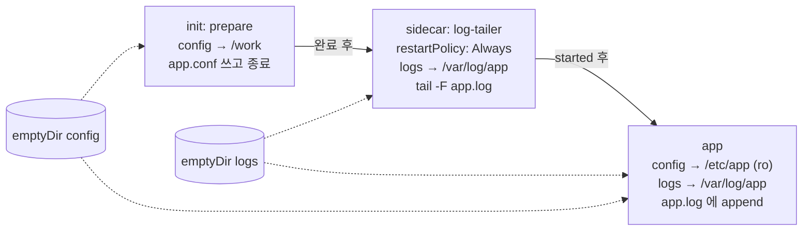

# q03 — Init container and native sidecar sharing volumes · 풀이

← 문제: **[question.md](question.md)**

## 문제 (해석)

**원문**

> A draft manifest for Pod `log-pipeline` in namespace `beta` is stored at
> `/opt/course/a03/log-pipeline.yaml`. A Pod created from the draft never leaves the
> initialization phase. Fix the file in place and create the Pod from it. Do not change any
> `command`, image or volume name.
>
> 1. Init container `prepare` must run first and run to completion. Its output file
>    `/work/app.conf` must be written into the emptyDir volume `config`.
> 2. Container `log-tailer` must be a **native sidecar**: it starts after `prepare` has completed,
>    it is already running when container `app` starts, and it keeps running for the whole
>    lifetime of the Pod.
> 3. `log-tailer` must follow the same file that container `app` appends to
>    (`/var/log/app/app.log` in volume `logs`).
> 4. The Pod must be `Running` with `log-tailer` and `app` both running, and
>    `kubectl -n beta logs log-pipeline -c log-tailer` must show lines that contain
>    `mode=production`.

**해석**

`beta` 네임스페이스의 Pod `log-pipeline` 초안 매니페스트가 `/opt/course/a03/log-pipeline.yaml` 에 있다. 초안으로
만든 Pod 는 초기화 단계를 벗어나지 못한다. 파일을 그 자리에서 고친 뒤 그 파일로 Pod 를 만든다. `command`, 이미지,
볼륨 이름은 바꾸지 않는다.

1. init 컨테이너 `prepare` 가 가장 먼저 실행되어 끝까지 완료되어야 한다. 그 결과 파일 `/work/app.conf` 는
   emptyDir 볼륨 `config` 안에 쓰여야 한다.
2. 컨테이너 `log-tailer` 는 **네이티브 사이드카**여야 한다. `prepare` 가 완료된 뒤 시작하고, 컨테이너 `app` 이
   시작할 때 이미 실행 중이며, Pod 가 살아 있는 동안 계속 실행된다.
3. `log-tailer` 는 컨테이너 `app` 이 덧붙여 쓰는 바로 그 파일(볼륨 `logs` 의 `/var/log/app/app.log`)을 따라 읽어야 한다.
4. Pod 가 `Running` 이고 `log-tailer` 와 `app` 이 모두 실행 중이어야 하며,
   `kubectl -n beta logs log-pipeline -c log-tailer` 에 `mode=production` 이 들어간 줄이 보여야 한다.

## 모범 풀이

**0) 초안에서 고장 찾기**

```bash
cat /opt/course/a03/log-pipeline.yaml
```

| 위치 | 초안 | 문제 |
|---|---|---|
| `initContainers` 순서 | `log-tailer` → `prepare` | init 컨테이너는 **나열 순서대로** 하나씩 실행된다. `prepare` 가 먼저여야 한다 |
| `log-tailer` | `restartPolicy` 없음 | 평범한 init 컨테이너라 `tail -F` 가 끝나기를 영원히 기다린다 → `Init:0/2` 에서 멈춤 |
| `log-tailer` 마운트 | `logs` → `/logs` | 명령은 `/var/log/app/app.log` 를 읽는데 볼륨은 `/logs` 에 있다 → 자기 파일시스템의 빈 파일만 본다 |
| `prepare` 마운트 | `config` → `/config` | 명령은 `/work/app.conf` 에 쓴다 → 볼륨이 아닌 곳(그나마 `/work` 가 없어 실패)에 쓴다 |

**1) · 2) · 3) 고친 매니페스트**

```yaml
apiVersion: v1
kind: Pod
metadata:
  name: log-pipeline
  namespace: beta
spec:
  volumes:
  - name: config
    emptyDir: {}
  - name: logs
    emptyDir: {}
  initContainers:
  - name: prepare                       # 1) 첫 번째로 이동
    image: busybox:1.36
    command: ["sh", "-c", "echo mode=production > /work/app.conf; echo prepared"]
    volumeMounts:
    - name: config
      mountPath: /work                  # 명령이 쓰는 디렉터리에 볼륨을 붙인다
  - name: log-tailer                    # 2) 두 번째 + restartPolicy: Always
    image: busybox:1.36
    restartPolicy: Always               # ← 네이티브 사이드카
    command: ["sh", "-c", "touch /var/log/app/app.log; tail -n +1 -F /var/log/app/app.log"]
    volumeMounts:
    - name: logs
      mountPath: /var/log/app           # 3) app 과 같은 경로
  containers:
  - name: app
    image: busybox:1.36
    command: ["sh", "-c", "while true; do echo \"$(date +%T) $(cat /etc/app/app.conf)\" >> /var/log/app/app.log; sleep 5; done"]
    volumeMounts:
    - name: config
      mountPath: /etc/app
      readOnly: true
    - name: logs
      mountPath: /var/log/app
```

```bash
vi /opt/course/a03/log-pipeline.yaml
kubectl apply -f /opt/course/a03/log-pipeline.yaml
```

초안으로 이미 Pod 를 만들었다면 `initContainers` 는 변경할 수 없는 필드이므로 `kubectl replace --force -f ...`
(삭제 후 생성)로 다시 만듭니다.

볼륨은 **이름**으로 공유되고, 각 컨테이너는 같은 볼륨을 **원하는 경로**에 붙일 수 있습니다. `prepare` 는
`config` 를 `/work` 에, `app` 은 같은 `config` 를 `/etc/app` 에 붙이므로 `/work/app.conf` 가 `app` 에게는
`/etc/app/app.conf` 로 보입니다. 반대로 `logs` 는 두 컨테이너가 같은 경로를 쓰므로, 경로를 맞추는 것은 각
**명령이 실제로 여는 경로**에 맞춘다는 뜻입니다.

### 그림 — 컨테이너 시작 순서와 볼륨 공유



1. kubelet 은 `initContainers` 를 위에서부터 하나씩 처리합니다. 평범한 init 컨테이너(`prepare`)는 **종료(성공)** 해야 다음으로 넘어갑니다.
2. `restartPolicy: Always` 인 init 컨테이너(`log-tailer`)는 **시작(started)** 만 되면 다음으로 넘어가고, 계속 실행됩니다. startupProbe 가 있으면 그것이 성공할 때까지 기다립니다.
3. 모든 init 단계가 끝나면 일반 컨테이너 `app` 이 시작됩니다. 이때 사이드카는 이미 떠 있어 첫 로그 줄부터 따라 읽습니다.
4. 두 emptyDir 은 Pod 수명과 같습니다. 파일은 볼륨에 있으므로 어느 컨테이너가 어느 경로에 붙였든 같은 내용이 보입니다.

## 검증

```bash
kubectl -n beta get pod log-pipeline
# NAME           READY   STATUS    RESTARTS   AGE
# log-pipeline   2/2     Running   0          30s     ← kubectl 은 사이드카도 READY 에 센다
kubectl -n beta get pod log-pipeline \
  -o jsonpath='{range .status.initContainerStatuses[*]}{.name}{" "}{.state}{"\n"}{end}'
# prepare {"terminated":{"exitCode":0,"reason":"Completed",...}}
# log-tailer {"running":{"startedAt":"..."}}
kubectl -n beta logs log-pipeline -c prepare          # prepared
kubectl -n beta logs log-pipeline -c log-tailer --tail=3
# 09:41:05 mode=production
# 09:41:10 mode=production
```

## 오답 원인 / 배운 점

- **왜 틀렸나**:
- **기억할 것**: 네이티브 사이드카 = `initContainers` 안 + `restartPolicy: Always`. init 목록의 순서가 곧 시작 순서다.
- **헷갈리는 지점**: 사이드카를 `containers` 에 넣어도 Pod 는 뜨지만 `prepare` 이후·`app` 이전이라는 순서 보장이 없고, Job 에서는 사이드카가 끝나지 않아 Job 이 완료되지 않습니다. 네이티브 사이드카는 v1.33 에 GA 되었고, 일반 컨테이너가 모두 끝나면 kubelet 이 사이드카를 정리합니다. 볼륨 공유는 이름 기준이고 `mountPath` 는 컨테이너마다 다를 수 있습니다.

## 참고 문서

- 검색어: `sidecar containers`, `init containers`
- https://kubernetes.io/docs/concepts/workloads/pods/sidecar-containers/
- https://kubernetes.io/docs/concepts/workloads/pods/init-containers/

---

[↑ 문항 목록](../README.md) · [← 문제로](question.md) · [다음 문제 q04 →](../q04_blue_green_service_switch/question.md)
