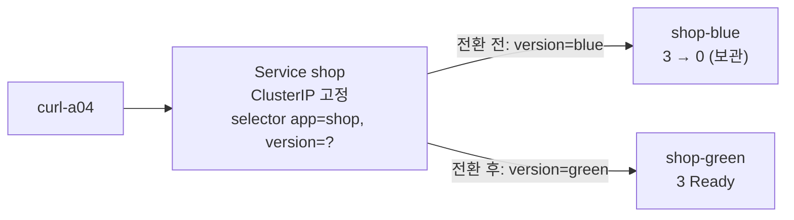

# q04 — Blue/green switch behind a Service · 풀이

← 문제: **[question.md](question.md)**

## 문제 (해석)

**원문**

> Namespace `gamma` serves version blue of the `shop` application through Service `shop`.
> Release version green with a blue/green switch so that clients never see an outage.
>
> 1. Create Deployment `shop-green` in namespace `gamma` with `3` replicas, image
>    `hashicorp/http-echo:1.0`, container args `-text=green`, container port `5678`, a TCP
>    readiness probe on port `5678`, and Pod labels `app=shop` and `version=green`. Its selector
>    must not match any Pod of `shop-blue`.
> 2. Only after all 3 green Pods are Ready, switch Service `shop` so that it sends traffic to the
>    green Pods only. Do not delete or recreate the Service; its ClusterIP must stay the same.
> 3. Confirm with the EndpointSlice of Service `shop` that it contains exactly the 3 green Pod
>    IPs. Then write the response of `curl -s http://shop` executed in Pod `curl-a04` to
>    `/opt/course/a04/after.txt`.
> 4. Scale `shop-blue` to `0` replicas. Keep the Deployment so it can be used for a rollback.
> 5. Write to `/opt/course/a04/rollback.txt` the commands that would move traffic back to blue
>    without an outage. Do not run them.

**해석**

`gamma` 네임스페이스는 Service `shop` 을 통해 `shop` 애플리케이션의 blue 버전을 서비스하고 있다. 클라이언트가
중단을 전혀 겪지 않도록 blue/green 전환으로 green 버전을 내보낸다.

1. `gamma` 에 Deployment `shop-green` 을 만든다. 레플리카 `3`, 이미지 `hashicorp/http-echo:1.0`, 컨테이너 args
   `-text=green`, 컨테이너 포트 `5678`, 포트 `5678` 에 대한 TCP readiness probe, Pod 라벨 `app=shop` 과
   `version=green`. 이 Deployment 의 selector 는 `shop-blue` 의 어떤 Pod 와도 맞으면 안 된다.
2. green Pod 3개가 모두 Ready 가 된 **뒤에야** Service `shop` 이 green Pod 로만 트래픽을 보내도록 바꾼다. Service 를
   지우거나 다시 만들지 않는다. ClusterIP 가 그대로여야 한다.
3. Service `shop` 의 EndpointSlice 에 green Pod IP 3개만 정확히 들어 있는지 확인한다. 그다음 Pod `curl-a04` 안에서
   실행한 `curl -s http://shop` 의 응답을 `/opt/course/a04/after.txt` 에 쓴다.
4. `shop-blue` 를 레플리카 `0` 으로 줄인다. 롤백에 쓸 수 있게 Deployment 는 남겨 둔다.
5. 중단 없이 트래픽을 blue 로 되돌리는 명령들을 `/opt/course/a04/rollback.txt` 에 쓴다. 실행하지는 않는다.

## 모범 풀이

**0) 현재 상태 파악**

```bash
alias k=kubectl; export do="--dry-run=client -o yaml"
k -n gamma get deploy,svc -o wide
k -n gamma get svc shop -o jsonpath='{.spec.selector}{"\n"}'      # {"app":"shop","version":"blue"}
k -n gamma get deploy shop-blue -o jsonpath='{.spec.selector}{"\n"}'
```

**1) green Deployment**

```bash
k -n gamma create deploy shop-green --image=hashicorp/http-echo:1.0 --replicas=3 --port=5678 $do > /tmp/green.yaml
```

뼈대는 라벨이 `app: shop-green` 하나뿐이므로 selector·template 라벨을 고치고 args·probe 를 넣습니다.

```yaml
apiVersion: apps/v1
kind: Deployment
metadata:
  name: shop-green
  namespace: gamma
spec:
  replicas: 3
  selector:
    matchLabels:
      app: shop
      version: green          # version 까지 넣어야 blue Pod 와 겹치지 않는다
  template:
    metadata:
      labels:
        app: shop
        version: green
    spec:
      containers:
      - name: http-echo
        image: hashicorp/http-echo:1.0
        args: ["-text=green"]
        ports:
        - containerPort: 5678
        readinessProbe:
          tcpSocket:
            port: 5678
          periodSeconds: 2
```

```bash
k apply -f /tmp/green.yaml
k -n gamma rollout status deploy shop-green      # successfully rolled out 이 뜰 때까지
```

selector 를 `app: shop` 하나로만 두면 blue Pod 도 green Deployment 의 selector 에 걸립니다. 두 Deployment 의
selector 가 겹치면 컨트롤러가 서로의 Pod 를 자기 것으로 셀 수 있어 쿠버네티스 문서도 금지합니다. 색깔 라벨은
selector 에 반드시 넣습니다.

**2) Service 전환 — 셀렉터의 `version` 키만 바꿉니다**

```bash
k -n gamma get svc shop -o jsonpath='{.spec.clusterIP}{"\n"}' > /tmp/ip-before
k -n gamma patch svc shop -p '{"spec":{"selector":{"version":"green"}}}'
k -n gamma get svc shop -o jsonpath='{.spec.selector}{"\n"}'      # {"app":"shop","version":"green"}
```

strategic merge patch 는 맵을 **키 단위로 합치므로** `app: shop` 은 그대로 두고 `version` 만 바뀝니다.
`kubectl edit` 도 됩니다. `kubectl expose` 로 다시 만들거나 delete/create 하면 ClusterIP 가 바뀌고 그 사이에 요청이
실패합니다. `version` 키를 지워 `app: shop` 만 남기면 blue·green 이 섞여 응답하는 canary 가 되어 버립니다.

**3) EndpointSlice 와 curl 로 확인**

```bash
k -n gamma get endpointslice -l kubernetes.io/service-name=shop
# NAME         ADDRESSTYPE   PORTS   ENDPOINTS                           AGE
# shop-x7k2p   IPv4          5678    10.0.1.21,10.0.2.14,10.0.1.22       5m
k -n gamma get pod -l app=shop,version=green -o wide          # IP 3개가 위와 같은지
k -n gamma exec curl-a04 -- curl -s http://shop > /opt/course/a04/after.txt
cat /opt/course/a04/after.txt                                 # green
```

Endpoints API 는 v1.33 에서 deprecated 되었으므로 `get ep` 대신 EndpointSlice 를 봅니다. 라벨
`kubernetes.io/service-name=<svc>` 로 그 Service 의 슬라이스만 고를 수 있습니다.

**4) blue 를 0 으로 (삭제하지 않음)**

```bash
k -n gamma scale deploy shop-blue --replicas=0
```

**5) 롤백 절차**

```bash
cat > /opt/course/a04/rollback.txt <<'EOF'
kubectl -n gamma scale deploy shop-blue --replicas=3
kubectl -n gamma rollout status deploy shop-blue
kubectl -n gamma patch svc shop -p '{"spec":{"selector":{"version":"blue"}}}'
EOF
```

순서가 중요합니다. blue 를 먼저 늘려 Ready 를 확인한 **다음** 셀렉터를 돌려야 엔드포인트가 비는 순간이 없습니다.

### 그림 — 셀렉터 하나로 트래픽을 넘기는 blue/green



1. 두 Deployment 는 `app=shop` 을 공유하고 `version` 라벨로만 구분됩니다. 각자의 selector 에도 `version` 이 들어 있어 서로의 Pod 를 건드리지 않습니다.
2. green 이 모두 Ready 가 된 뒤 Service 의 `version` 값만 바꾸면, EndpointSlice 컨트롤러가 슬라이스를 green IP 로 갈아 끼웁니다. ClusterIP 와 DNS 이름은 그대로라 클라이언트는 아무것도 바꾸지 않습니다.
3. blue 는 0 으로 줄여 자원을 반납하되 Deployment 와 ReplicaSet 은 남아 있어, 롤백은 "scale up → Ready 확인 → 셀렉터 되돌리기" 세 줄로 끝납니다.

## 검증

```bash
k -n gamma get svc shop -o jsonpath='{.spec.clusterIP}{"\n"}'; cat /tmp/ip-before     # 같은 값
k -n gamma get deploy
# NAME         READY   UP-TO-DATE   AVAILABLE   AGE
# shop-blue    0/0     0            0           10m
# shop-green   3/3     3            3           3m
k -n gamma get endpointslice -l kubernetes.io/service-name=shop \
  -o jsonpath='{range .items[*].endpoints[*]}{.addresses[0]} {.targetRef.name} {.conditions.ready}{"\n"}{end}'
# 10.0.1.21 shop-green-...-abcde true   (3줄, 모두 shop-green)
for i in 1 2 3 4 5; do k -n gamma exec curl-a04 -- curl -s http://shop; done   # 모두 green
cat /opt/course/a04/after.txt /opt/course/a04/rollback.txt
```

## 오답 원인 / 배운 점

- **왜 틀렸나**:
- **기억할 것**: blue/green = 새 버전을 완전히 Ready 로 띄운 뒤 Service selector 의 버전 라벨만 바꾼다. Service 는 지우지 않는다.
- **헷갈리는 지점**: `kubectl set selector` 는 selector 전체를 **덮어쓰므로** 기존 키를 함께 적어야 합니다(`patch` 는 키 단위로 합침). Deployment selector 는 생성 후 바꿀 수 없으니 처음부터 `version` 을 넣습니다. 검증은 `get ep` 대신 `get endpointslice -l kubernetes.io/service-name=shop` (Endpoints API v1.33 deprecated).

## 참고 문서

- 검색어: `service selector`, `endpointslices`, `deployment selector`
- https://kubernetes.io/docs/concepts/services-networking/service/
- https://kubernetes.io/docs/concepts/services-networking/endpoint-slices/
- https://kubernetes.io/docs/concepts/workloads/controllers/deployment/#selector

---

[↑ 문항 목록](../README.md) · [← 문제로](question.md) · [다음 문제 q05 →](../q05_helm_local_chart_upgrade_rollback/question.md)
