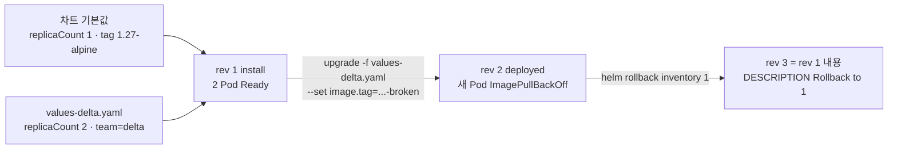

# q05 — Render, upgrade and roll back a local Helm chart · 풀이

← 문제: **[question.md](question.md)**

## 문제 (해석)

**원문**

> A local Helm chart is stored at `/opt/course/a05/chart`. Deploy it to namespace `delta`, go
> through a failed upgrade and recover.
>
> 1. Create the values file `/opt/course/a05/values-delta.yaml` that sets `replicaCount` to `2`
>    and adds the Pod label `team: delta` through the chart value `podLabels`.
> 2. Without installing anything, render the chart with release name `inventory`, namespace
>    `delta` and this values file into `/opt/course/a05/rendered.yaml`.
> 3. Install release `inventory` from the local chart into namespace `delta` (create the
>    namespace) with this values file. Its Deployment must have 2 ready Pods.
> 4. Upgrade the release so that `image.tag` is `1.27-alpine-broken`, keeping every value from
>    step 1. Write the waiting reason of the new Pod's container (as shown in its status) to
>    `/opt/course/a05/upgrade-error.txt`.
> 5. Roll the release back to revision `1`. Write the output of `helm history` for the release to
>    `/opt/course/a05/history.txt`. The Deployment must again run 2 ready Pods with image
>    `nginx:1.27-alpine`.

**해석**

로컬 Helm 차트가 `/opt/course/a05/chart` 에 있다. 이것을 `delta` 네임스페이스에 배포하고, 실패하는 업그레이드를
겪은 뒤 복구한다.

1. `replicaCount` 를 `2` 로 하고, 차트 값 `podLabels` 로 Pod 라벨 `team: delta` 를 추가하는 values 파일
   `/opt/course/a05/values-delta.yaml` 을 만든다.
2. 아무것도 설치하지 않고, 릴리스 이름 `inventory`, 네임스페이스 `delta`, 이 values 파일로 차트를 렌더링해
   `/opt/course/a05/rendered.yaml` 에 저장한다.
3. 로컬 차트로 릴리스 `inventory` 를 `delta` 네임스페이스(함께 생성)에 이 values 파일로 설치한다. 그 Deployment 는
   Ready Pod 2개여야 한다.
4. `image.tag` 가 `1.27-alpine-broken` 이 되도록 릴리스를 업그레이드하되, 1번의 값은 모두 유지한다. 새 Pod 컨테이너의
   대기 사유(status 에 보이는 값)를 `/opt/course/a05/upgrade-error.txt` 에 쓴다.
5. 릴리스를 리비전 `1` 로 롤백한다. 릴리스의 `helm history` 출력을 `/opt/course/a05/history.txt` 에 쓴다.
   Deployment 는 다시 이미지 `nginx:1.27-alpine` 인 Ready Pod 2개로 돌아야 한다.

## 모범 풀이

**0) 차트가 받는 값 확인**

```bash
helm version --short
helm show values /opt/course/a05/chart
# replicaCount: 1
# image:
#   repository: nginx
#   tag: 1.27-alpine
# podLabels: {}
# service:
#   port: 80
grep -n podLabels -A3 /opt/course/a05/chart/templates/deployment.yaml   # template 라벨에 toYaml 로 들어간다
```

**1) values 파일**

```bash
cat > /opt/course/a05/values-delta.yaml <<'EOF'
replicaCount: 2
podLabels:
  team: delta
EOF
```

**2) 설치 없이 렌더링**

```bash
helm template inventory /opt/course/a05/chart -n delta -f /opt/course/a05/values-delta.yaml \
  > /opt/course/a05/rendered.yaml
grep -E 'replicas:|team:|image:' /opt/course/a05/rendered.yaml
#   replicas: 2
#         team: delta
#         image: "nginx:1.27-alpine"
```

`helm template` 은 클러스터에 아무것도 만들지 않고 릴리스 기록도 남기지 않습니다. 순서는
`helm template <릴리스이름> <차트>` 입니다. 릴리스 이름을 빼면 `release-name` 같은 기본 이름으로 렌더링되어
리소스 이름이 문제와 달라집니다. `helm install --dry-run` 도 렌더링을 보여 주지만 클러스터 연결이 필요합니다.

**3) 설치**

```bash
helm install inventory /opt/course/a05/chart -n delta --create-namespace -f /opt/course/a05/values-delta.yaml
kubectl -n delta rollout status deploy inventory
```

**4) 망가지는 업그레이드 — 값을 잃지 않는 것이 함정입니다**

```bash
helm upgrade inventory /opt/course/a05/chart -n delta \
  -f /opt/course/a05/values-delta.yaml --set image.tag=1.27-alpine-broken
# (또는 --reuse-values --set image.tag=1.27-alpine-broken)
kubectl -n delta get pod -l app.kubernetes.io/instance=inventory
# inventory-6d9...-aaaaa   1/1   Running            0   2m     ← 이전 Pod 2개는 그대로
# inventory-6d9...-bbbbb   1/1   Running            0   2m
# inventory-7f4...-ccccc   0/1   ImagePullBackOff   0   20s    ← 새 ReplicaSet 의 Pod
kubectl -n delta get pod -l app.kubernetes.io/instance=inventory \
  -o jsonpath='{range .items[*]}{.status.containerStatuses[0].state.waiting.reason}{"\n"}{end}' \
  | grep . | head -1 > /opt/course/a05/upgrade-error.txt
cat /opt/course/a05/upgrade-error.txt       # ErrImagePull 또는 ImagePullBackOff
```

`--set image.tag=...` 만 주고 `-f values-delta.yaml` 이나 `--reuse-values` 를 빼면 Helm 은 이전 릴리스 값을 버리고
차트 기본값에서 다시 시작합니다. 그러면 `replicaCount` 가 1 로, `team` 라벨이 사라진 채로 올라갑니다.

`--wait` 없이 올렸으므로 Helm 입장에서는 리비전 2 가 `deployed` 입니다. 롤링 업데이트의 `maxUnavailable` 덕분에
이전 Pod 가 살아 있어 서비스는 끊기지 않지만 rollout 은 끝나지 않습니다. `--wait --timeout 60s` 를 줬다면 리비전 2 는
`failed` 가 되고, Helm 4 의 `--rollback-on-failure`(Helm 3 의 `--atomic`)를 줬다면 자동으로 롤백되었을 것입니다.

**5) 롤백과 히스토리**

```bash
helm rollback inventory 1 -n delta
kubectl -n delta rollout status deploy inventory
helm history inventory -n delta > /opt/course/a05/history.txt
cat /opt/course/a05/history.txt
# REVISION  UPDATED  STATUS      CHART            APP VERSION  DESCRIPTION
# 1         ...      superseded  inventory-0.3.0  1.27         Install complete
# 2         ...      superseded  inventory-0.3.0  1.27         Upgrade complete
# 3         ...      deployed    inventory-0.3.0  1.27         Rollback to 1
```

롤백은 리비전 1 을 **되살리는 것이 아니라 리비전 1 의 내용으로 새 리비전 3 을 만듭니다**. 그래서 히스토리는 3줄이고
현재 리비전은 3 입니다. 리비전 1 의 값(values-delta.yaml 내용)도 함께 돌아옵니다.

### 그림 — 리비전 흐름과 값의 출처



1. 값은 "차트 기본값 → `-f` 파일 → `--set`" 순서로 덮어씁니다. 뒤에 오는 것이 이깁니다.
2. upgrade 에 `-f`(또는 `--reuse-values`)를 다시 주지 않으면 rev 1 의 사용자 값이 빠진 채 rev 2 가 만들어집니다.
3. rollback 은 지정한 리비전의 매니페스트와 값을 그대로 복사해 **새 리비전**을 만들고, 그 리비전이 `deployed` 가 됩니다.

## 검증

```bash
grep -c 'kind:' /opt/course/a05/rendered.yaml           # 2 (Service, Deployment)
helm -n delta list                                      # inventory  REVISION 3  STATUS deployed
helm -n delta get values inventory                      # replicaCount: 2, podLabels.team: delta
kubectl -n delta get deploy inventory \
  -o jsonpath='{.status.readyReplicas} {.spec.template.spec.containers[0].image} {.spec.template.metadata.labels.team}{"\n"}'
# 2 nginx:1.27-alpine delta
cat /opt/course/a05/upgrade-error.txt /opt/course/a05/history.txt
```

## 오답 원인 / 배운 점

- **왜 틀렸나**:
- **기억할 것**: `helm rollback <rel> <rev>` 는 새 리비전을 만든다. upgrade 할 때는 `-f` 또는 `--reuse-values` 를 다시 줘야 이전 값이 남는다.
- **헷갈리는 지점**: `helm template` 의 첫 인자는 릴리스 이름입니다. Helm 4(2025.11)에서 `--atomic` 은 `--rollback-on-failure` 로 바뀌었고, 실패 판정을 하려면 `--wait` 가 있어야 합니다. Bitnami 무료 카탈로그 축소(2025) 이후 공개 차트는 이미지 pull 실패가 흔하므로, 이처럼 로컬 차트로 연습해 두면 시험장의 네트워크 사정과 무관합니다.

## 참고 문서

시험 중에는 **helm.sh/docs** 를 열람할 수 있습니다.

- 검색어: `helm template`, `helm rollback`, `helm history`
- https://helm.sh/docs/helm/helm_template/
- https://helm.sh/docs/helm/helm_rollback/
- https://helm.sh/docs/helm/helm_upgrade/

---

[↑ 문항 목록](../README.md) · [← 문제로](question.md) · [다음 문제 q06 →](../q06_kustomize_prod_overlay_generator/question.md)
