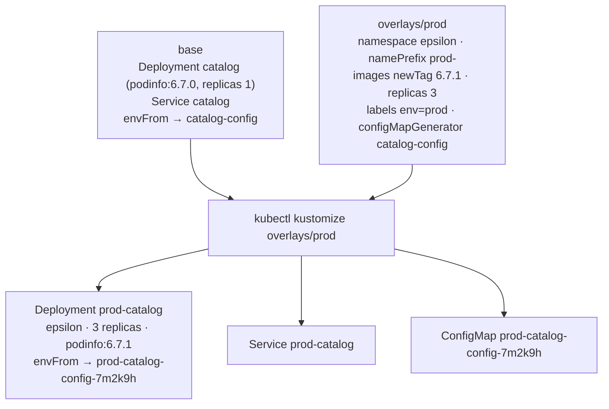

# q06 — Complete a Kustomize prod overlay · 풀이

← 문제: **[question.md](question.md)**

## 문제 (해석)

**원문**

> The `catalog` application is managed with Kustomize under `/opt/course/a06`. The base and the
> dev overlay are finished; the prod overlay is not. Do not change `base/` or `overlays/dev/`.
>
> Complete `/opt/course/a06/overlays/prod/kustomization.yaml` so that the prod overlay renders:
>
> 1. every resource in namespace `epsilon`, with names prefixed by `prod-`;
> 2. image `ghcr.io/stefanprodan/podinfo` with tag `6.7.1`;
> 3. the Deployment with `3` replicas;
> 4. the label `env: prod` on every resource and on the Pod template, set with the `labels`
>    field (not the deprecated `commonLabels`);
> 5. a ConfigMap generated by a `configMapGenerator` named `catalog-config` with the literals
>    `PODINFO_UI_MESSAGE=prod-catalog` and `PODINFO_LEVEL=info`, which the Deployment's
>    existing `envFrom` reference must pick up.
>
> Then write the rendered prod output to `/opt/course/a06/prod.yaml` and apply **only** the prod
> overlay with `kubectl apply -k`. Deployment `prod-catalog` in namespace `epsilon` must have 3
> ready Pods whose environment contains `PODINFO_UI_MESSAGE=prod-catalog`.

**해석**

`catalog` 애플리케이션은 `/opt/course/a06` 아래에서 Kustomize 로 관리된다. base 와 dev overlay 는 완성되어 있고
prod overlay 는 아니다. `base/` 와 `overlays/dev/` 는 바꾸지 않는다.

`/opt/course/a06/overlays/prod/kustomization.yaml` 을 완성해 prod overlay 가 다음을 렌더링하게 한다.

1. 모든 리소스가 `epsilon` 네임스페이스에 있고, 이름 앞에 `prod-` 가 붙는다.
2. 이미지 `ghcr.io/stefanprodan/podinfo` 의 태그가 `6.7.1` 이다.
3. Deployment 레플리카가 `3` 이다.
4. 모든 리소스와 Pod 템플릿에 라벨 `env: prod` 가 붙는다. deprecated 된 `commonLabels` 가 아니라 `labels` 필드로 설정한다.
5. `configMapGenerator` 로 `catalog-config` 라는 ConfigMap 을 생성한다. 리터럴은 `PODINFO_UI_MESSAGE=prod-catalog` 와
   `PODINFO_LEVEL=info` 이고, Deployment 에 이미 있는 `envFrom` 참조가 이것을 가리켜야 한다.

그다음 prod 렌더링 결과를 `/opt/course/a06/prod.yaml` 에 쓰고, `kubectl apply -k` 로 prod overlay **만** 적용한다.
`epsilon` 의 Deployment `prod-catalog` 은 Ready Pod 3개여야 하고, 그 환경 변수에 `PODINFO_UI_MESSAGE=prod-catalog` 가 있어야 한다.

## 모범 풀이

**0) base 와 dev 를 먼저 읽습니다**

```bash
cd /opt/course/a06
cat base/kustomization.yaml base/deployment.yaml overlays/dev/kustomization.yaml overlays/prod/kustomization.yaml
grep -n -A2 envFrom base/deployment.yaml
#       envFrom:
#       - configMapRef:
#           name: catalog-config      ← 생성기 이름은 이것과 정확히 같아야 한다
```

**1) ~ 5) prod overlay 완성**

```yaml
apiVersion: kustomize.config.k8s.io/v1beta1
kind: Kustomization
resources:
- ../../base
namespace: epsilon
namePrefix: prod-
images:
- name: ghcr.io/stefanprodan/podinfo     # base 의 이미지 이름(태그 제외)과 일치해야 한다
  newTag: 6.7.1
replicas:
- name: catalog                          # 접두사 붙기 전 base 이름
  count: 3
labels:
- pairs:
    env: prod
  includeSelectors: true                 # metadata + selector + Pod 템플릿에 모두 붙는다
configMapGenerator:
- name: catalog-config                   # 접두사·해시 없이 base 가 참조하는 이름 그대로
  literals:
  - PODINFO_UI_MESSAGE=prod-catalog
  - PODINFO_LEVEL=info
```

| 요구 | 필드 | 함정 |
|---|---|---|
| 네임스페이스 | `namespace` | 네임스페이스 리소스를 만들어 주지는 않는다(여기선 setup 이 만들어 둠) |
| 접두사 | `namePrefix` | 참조(`envFrom`, Service selector 대상 이름 등)도 같이 바뀐다 |
| 태그 | `images[].name` + `newTag` | `name` 은 태그를 뺀 이미지 이름 |
| 레플리카 | `replicas[].name` | 접두사 붙기 **전** 이름 `catalog` |
| 라벨 | `labels[].pairs` | `includeSelectors` 기본값 false → metadata 에만 붙고 Pod 템플릿에는 안 붙는다 |
| 생성기 | `configMapGenerator[].name` | `prod-catalog-config` 로 쓰면 접두사가 두 번 붙고 참조가 끊긴다 |

`labels` 의 `includeSelectors: false`(기본)는 리소스 metadata 에만 라벨을 붙입니다. Pod 템플릿까지 붙이려면
`includeSelectors: true`(selector 에도 들어감, 옛 `commonLabels` 와 같은 동작)를 쓰거나, selector 는 건드리지 않는
`includeTemplates: true` 를 씁니다. 이 문제는 새로 만드는 Deployment 라 selector 가 바뀌어도 문제가 없습니다.
이미 배포된 Deployment 에 나중에 selector 라벨을 더하면 selector 불변 규칙 때문에 apply 가 거부된다는 것은 기억해 둡니다.

**ConfigMap 해시 접미사 — 이 문제의 핵심 함정**

생성기는 `prod-catalog-config-<해시>` 라는 이름을 만들고, 같은 빌드 안에서 `catalog-config` 를 가리키는 참조
(`envFrom.configMapRef.name`)를 **자동으로 그 이름으로 바꿔 줍니다**. 그러려면 생성기 이름이 base 의 참조와
같아야 합니다. 해시를 직접 적거나, `kubectl create configmap` 으로 따로 만들면 참조가 맞지 않아 Pod 가
`CreateContainerConfigError`(configmap not found)에 빠집니다. 값이 바뀌면 해시가 바뀌고 Pod 템플릿도 바뀌므로
설정 변경이 자동으로 롤아웃되는 것이 이 방식의 장점입니다.

**6) 렌더링 저장과 적용**

```bash
kubectl kustomize overlays/prod > /opt/course/a06/prod.yaml
grep -nE 'name: prod-|namespace:|image:|replicas:|env: prod' /opt/course/a06/prod.yaml
kubectl apply -k overlays/prod
kubectl -n epsilon rollout status deploy prod-catalog
```

`kubectl apply -k /opt/course/a06` 처럼 상위 디렉터리를 주면 안 됩니다(거기엔 kustomization.yaml 이 없고,
있더라도 dev 까지 적용될 수 있음). 항상 overlay 디렉터리를 정확히 줍니다.

### 그림 — base 와 prod overlay 가 합쳐지는 방식



1. overlay 는 `resources` 로 base 를 불러온 뒤 자기 변환(namespace, prefix, images, replicas, labels)을 모든 리소스에 적용합니다.
2. 생성기가 만든 ConfigMap 에도 같은 namespace·prefix 와 내용 해시가 붙습니다.
3. 마지막으로 이름 참조 변환이 base 의 `catalog-config` 참조를 실제 생성된 이름으로 바꿉니다. 그래서 base 를 고치지 않아도 참조가 맞습니다.

## 검증

```bash
kubectl -n epsilon get deploy,svc,cm
# deployment.apps/prod-catalog   3/3   3   3
# service/prod-catalog           ClusterIP ...
# configmap/prod-catalog-config-xxxxxxxxxx
kubectl -n epsilon get deploy prod-catalog \
  -o jsonpath='{.spec.template.spec.containers[0].image} {.spec.template.metadata.labels.env} {.spec.template.spec.containers[0].envFrom[0].configMapRef.name}{"\n"}'
# ghcr.io/stefanprodan/podinfo:6.7.1 prod prod-catalog-config-xxxxxxxxxx
kubectl -n epsilon exec deploy/prod-catalog -- env | grep PODINFO_
# PODINFO_UI_MESSAGE=prod-catalog
# PODINFO_LEVEL=info
kubectl get ns zeta 2>/dev/null || echo "dev 는 적용되지 않음 (정상)"
```

## 오답 원인 / 배운 점

- **왜 틀렸나**:
- **기억할 것**: 생성기 이름은 base 가 참조하는 이름 그대로 쓰고 해시는 Kustomize 에게 맡긴다. `replicas`·`images` 의 이름도 접두사 전 원래 이름.
- **헷갈리는 지점**: Kustomize v5 에서 `commonLabels` 는 deprecated → `labels`(기본 `includeSelectors: false` 라 Pod 템플릿에 안 붙음), `patchesStrategicMerge` 는 `patches` 로 바뀌었습니다. `namespace` 필드는 Namespace 객체를 만들지 않습니다.

## 참고 문서

- 검색어: `kustomize`, `configMapGenerator`, `managing kubernetes objects using kustomize`
- https://kubernetes.io/docs/tasks/manage-kubernetes-objects/kustomization/

---

[↑ 문항 목록](../README.md) · [← 문제로](question.md) · [다음 문제 q07 →](../q07_startup_probe_slow_app/question.md)
