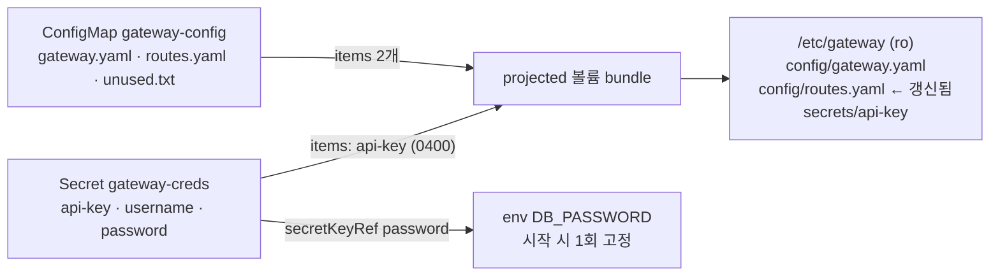

# q10 — Projected volume from a ConfigMap and a Secret · 풀이

← 문제: **[question.md](question.md)**

## 문제 (해석)

**원문**

> Pod `gateway` in namespace `kappa` must read its configuration and one credential from a single
> directory, and its database password from an environment variable.
>
> 1. Create Pod `gateway` in namespace `kappa` with image `busybox:1.36` and command
>    `sleep 86400`.
> 2. Mount one **projected** volume named `bundle` read-only at `/etc/gateway` that contains
>    exactly these files and nothing else:
>    - `/etc/gateway/config/gateway.yaml` from key `gateway.yaml` of ConfigMap `gateway-config`
>    - `/etc/gateway/config/routes.yaml` from key `routes.yaml` of ConfigMap `gateway-config`
>    - `/etc/gateway/secrets/api-key` from key `api-key` of Secret `gateway-creds`, with file
>      mode `0400`
> 3. Set the environment variable `DB_PASSWORD` from key `password` of Secret `gateway-creds`.
> 4. Change the value of key `routes.yaml` in ConfigMap `gateway-config` to
>    `- /orders -> orders-v2:80`. Without restarting the Pod, wait until
>    `/etc/gateway/config/routes.yaml` shows the new value, then write the file's content to
>    `/opt/course/a10/routes-after.txt`.
> 5. Write two lines to `/opt/course/a10/answer.txt`, each `yes` or `no`: line 1, whether the
>    file would also have been updated if `routes.yaml` had been mounted with `subPath`; line 2,
>    whether `DB_PASSWORD` in the running container changes when the Secret is changed.

**해석**

`kappa` 네임스페이스의 Pod `gateway` 는 설정과 자격 증명 하나를 한 디렉터리에서 읽고, DB 비밀번호는 환경 변수에서 읽어야 한다.

1. `kappa` 에 이미지 `busybox:1.36`, 명령 `sleep 86400` 인 Pod `gateway` 를 만든다.
2. `bundle` 이라는 **projected** 볼륨 하나를 `/etc/gateway` 에 읽기 전용으로 마운트한다. 이 볼륨에는 정확히 다음 파일만 있어야 한다.
   - ConfigMap `gateway-config` 의 키 `gateway.yaml` → `/etc/gateway/config/gateway.yaml`
   - ConfigMap `gateway-config` 의 키 `routes.yaml` → `/etc/gateway/config/routes.yaml`
   - Secret `gateway-creds` 의 키 `api-key` → `/etc/gateway/secrets/api-key`, 파일 모드 `0400`
3. Secret `gateway-creds` 의 키 `password` 로 환경 변수 `DB_PASSWORD` 를 설정한다.
4. ConfigMap `gateway-config` 의 키 `routes.yaml` 값을 `- /orders -> orders-v2:80` 으로 바꾼다. Pod 를 재시작하지 않고
   `/etc/gateway/config/routes.yaml` 에 새 값이 보일 때까지 기다린 뒤, 그 파일 내용을 `/opt/course/a10/routes-after.txt` 에 쓴다.
5. `/opt/course/a10/answer.txt` 에 `yes` 또는 `no` 로 두 줄을 쓴다. 1행: `routes.yaml` 을 `subPath` 로 마운트했어도 파일이
   갱신되었을지. 2행: Secret 을 바꾸면 실행 중인 컨테이너의 `DB_PASSWORD` 가 바뀌는지.

## 모범 풀이

**1) ~ 3) Pod**

```bash
alias k=kubectl; export do="--dry-run=client -o yaml"
k -n kappa run gateway --image=busybox:1.36 $do --command -- sleep 86400 > /tmp/gw.yaml
```

```yaml
apiVersion: v1
kind: Pod
metadata:
  name: gateway
  namespace: kappa
spec:
  containers:
  - name: gateway
    image: busybox:1.36
    command: ["sleep", "86400"]
    env:
    - name: DB_PASSWORD
      valueFrom:
        secretKeyRef:
          name: gateway-creds
          key: password
    volumeMounts:
    - name: bundle
      mountPath: /etc/gateway
      readOnly: true
  volumes:
  - name: bundle
    projected:
      sources:
      - configMap:
          name: gateway-config
          items:                       # items 를 쓰면 나열한 키만 들어간다 → unused.txt 제외
          - key: gateway.yaml
            path: config/gateway.yaml  # 상대 경로, 하위 디렉터리 가능
          - key: routes.yaml
            path: config/routes.yaml
      - secret:
          name: gateway-creds
          items:
          - key: api-key
            path: secrets/api-key
            mode: 0400                 # YAML 에서 0 으로 시작하면 8진수. JSON 이면 256
```

```bash
k apply -f /tmp/gw.yaml
k -n kappa wait --for=condition=Ready pod/gateway
```

projected 볼륨은 ConfigMap·Secret·downwardAPI·serviceAccountToken 을 **한 디렉터리에 합칩니다**. 각 소스에 `items`
를 주지 않으면 그 소스의 모든 키가 파일이 되므로 `unused.txt`, `username`, `password` 까지 들어갑니다. "정확히 이 파일만"
이라는 조건은 `items` 로 맞춥니다. 같은 디렉터리에 볼륨 두 개(ConfigMap 하나, Secret 하나)를 따로 마운트할 수는 없으므로
한 경로에 둘을 모으려면 projected 가 답입니다.

**4) ConfigMap 변경이 파일에 반영되는지 확인**

```bash
k -n kappa patch cm gateway-config --type merge -p '{"data":{"routes.yaml":"- /orders -> orders-v2:80\n"}}'
until k -n kappa exec gateway -- cat /etc/gateway/config/routes.yaml | grep -q orders-v2; do sleep 5; done
k -n kappa exec gateway -- cat /etc/gateway/config/routes.yaml > /opt/course/a10/routes-after.txt
cat /opt/course/a10/routes-after.txt         # - /orders -> orders-v2:80
```

kubelet 은 주기적인 동기화 때 볼륨 내용을 새로 씁니다. kubelet 동기화 주기와 ConfigMap 캐시 TTL 때문에 보통 수십 초에서
1~2분 걸립니다. 파일은 `..data` 심볼릭 링크를 원자적으로 바꿔치는 방식으로 갱신됩니다.

**5) subPath 와 env 는 갱신되지 않습니다**

```bash
printf 'no\nno\n' > /opt/course/a10/answer.txt
```

- **subPath**: `subPath` 는 컨테이너 시작 시점에 볼륨 안의 **한 파일을 직접 바인드 마운트**합니다. kubelet 의 갱신은
  `..data` 링크를 새 디렉터리로 바꾸는 방식이라, 이미 옛 파일을 붙잡은 subPath 마운트에는 전달되지 않습니다. 새 값을 보려면
  Pod 를 다시 만들어야 합니다.
- **env**: 환경 변수는 컨테이너 프로세스가 시작될 때 한 번 정해집니다. Secret/ConfigMap 을 바꿔도 컨테이너를 재시작하기 전에는
  그대로입니다.

### 그림 — 세 소스가 한 디렉터리로 모이는 방식



1. projected 볼륨은 소스마다 `items` 로 고른 키만 지정한 상대 경로에 파일로 만듭니다. 고르지 않은 키(`unused.txt`, `username`, `password`)는 들어가지 않습니다.
2. 볼륨 전체를 디렉터리로 마운트했으므로, ConfigMap 을 바꾸면 kubelet 이 `..data` 링크를 바꿔 새 내용이 보입니다.
3. 반면 env 는 컨테이너 시작 때 값이 복사되므로 Secret 을 바꿔도 따라가지 않습니다. subPath 마운트도 마찬가지로 갱신되지 않습니다.

## 검증

```bash
k -n kappa exec gateway -- ls -R /etc/gateway/config /etc/gateway/secrets
# /etc/gateway/config:   gateway.yaml  routes.yaml
# /etc/gateway/secrets:  api-key
k -n kappa exec gateway -- stat -L -c '%a %n' /etc/gateway/secrets/api-key     # 400 /etc/gateway/secrets/api-key
k -n kappa exec gateway -- sh -c 'echo $DB_PASSWORD'                           # S3cr3t-a10
k -n kappa exec gateway -- touch /etc/gateway/x 2>&1 | grep -i 'read-only'     # Read-only file system
cat /opt/course/a10/routes-after.txt /opt/course/a10/answer.txt
k -n kappa get pod gateway -o jsonpath='{.status.containerStatuses[0].restartCount}{"\n"}'   # 0
```

## 오답 원인 / 배운 점

- **왜 틀렸나**:
- **기억할 것**: 여러 ConfigMap/Secret 을 한 경로에 = `projected.sources`, 일부 키만 = `items`, 파일별 권한 = `items[].mode`.
- **헷갈리는 지점**: `subPath` 마운트와 env 는 원본이 바뀌어도 갱신되지 않습니다(재시작 필요). `mode` 는 YAML 에서 `0400`(8진수), JSON 에서는 `256`. `ls -l` 은 심볼릭 링크 권한을 보여 주므로 실제 모드는 `stat -L` 로 봅니다.

## 참고 문서

- 검색어: `projected volumes`, `configmap mounted as volume updated automatically`
- https://kubernetes.io/docs/concepts/storage/projected-volumes/
- https://kubernetes.io/docs/concepts/configuration/configmap/#mounted-configmaps-are-updated-automatically
- https://kubernetes.io/docs/concepts/configuration/secret/

---

[↑ 문항 목록](../README.md) · [← 문제로](question.md) · [다음 문제 q11 →](../q11_serviceaccount_rbac_can_i/question.md)
