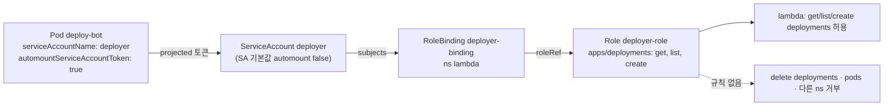

# q11 — ServiceAccount with least-privilege RBAC · 풀이

← 문제: **[question.md](question.md)**

## 문제 (해석)

**원문**

> A CI bot in namespace `lambda` must be able to read and create Deployments there, but never
> delete them. ServiceAccount `deployer` already exists and must not be modified.
>
> 1. Create Role `deployer-role` in namespace `lambda` that allows only the verbs `get`, `list`
>    and `create` on `deployments` in the `apps` API group.
> 2. Bind it to ServiceAccount `deployer` with RoleBinding `deployer-binding`.
> 3. Using `kubectl auth can-i` while impersonating the ServiceAccount, check the following and
>    write the answers (`yes`/`no`), one per line in this order, to `/opt/course/a11/can-i.txt`:
>    create deployments in `lambda`; delete deployments in `lambda`; list deployments in
>    `kube-system`; list pods in `lambda`.
> 4. Edit the draft `/opt/course/a11/deploy-bot.yaml` so that the Pods of Deployment `deploy-bot`
>    run as ServiceAccount `deployer` and have the API token mounted, by setting
>    `automountServiceAccountToken` explicitly in the Pod spec. Apply it.
> 5. The log of the `deploy-bot` Pod must show `list deployments: 200`.

**해석**

`lambda` 네임스페이스의 CI 봇은 그 네임스페이스의 Deployment 를 읽고 만들 수 있어야 하지만 절대 지우면 안 된다.
ServiceAccount `deployer` 는 이미 있고 수정하면 안 된다.

1. `lambda` 에 Role `deployer-role` 을 만든다. `apps` API 그룹의 `deployments` 에 대해 `get`, `list`, `create` 동사만 허용한다.
2. RoleBinding `deployer-binding` 으로 이 Role 을 ServiceAccount `deployer` 에 연결한다.
3. ServiceAccount 로 가장(impersonate)해 `kubectl auth can-i` 로 다음을 확인하고, 답(`yes`/`no`)을 이 순서대로 한 줄씩
   `/opt/course/a11/can-i.txt` 에 쓴다: `lambda` 에서 deployments 생성 / `lambda` 에서 deployments 삭제 /
   `kube-system` 에서 deployments 목록 조회 / `lambda` 에서 pods 목록 조회.
4. 초안 `/opt/course/a11/deploy-bot.yaml` 을 고쳐 Deployment `deploy-bot` 의 Pod 가 ServiceAccount `deployer` 로 실행되고
   API 토큰이 마운트되게 한다. 이때 Pod spec 에 `automountServiceAccountToken` 을 명시적으로 설정한다. 그리고 적용한다.
5. `deploy-bot` Pod 의 로그에 `list deployments: 200` 이 보여야 한다.

## 모범 풀이

**1) · 2) Role 과 RoleBinding — 명령형 두 줄**

```bash
alias k=kubectl
k -n lambda create role deployer-role --verb=get,list,create --resource=deployments.apps
k -n lambda create rolebinding deployer-binding --role=deployer-role --serviceaccount=lambda:deployer
k -n lambda get role deployer-role -o yaml | sed -n '/rules:/,$p'
# rules:
# - apiGroups: [apps]
#   resources: [deployments]
#   verbs: [get, list, create]
```

`--resource=deployments.apps` 처럼 그룹을 붙이면 `apiGroups: ["apps"]` 가 정확히 들어갑니다. `--serviceaccount` 형식은
`<네임스페이스>:<이름>` 입니다. `--user=deployer` 로 쓰면 `deployer` 라는 **사용자**에 바인딩되어 SA 에게는 아무 권한도 없습니다.

**3) can-i 로 확인**

```bash
SA=system:serviceaccount:lambda:deployer
{
  k auth can-i create deployments.apps -n lambda      --as=$SA
  k auth can-i delete deployments.apps -n lambda      --as=$SA
  k auth can-i list   deployments.apps -n kube-system --as=$SA
  k auth can-i list   pods             -n lambda      --as=$SA
} > /opt/course/a11/can-i.txt
cat /opt/course/a11/can-i.txt
# yes
# no
# no
# no
k auth can-i --list -n lambda --as=$SA | grep -E 'deployments|Resources'
```

`no` 일 때 `can-i` 는 종료 코드 1 을 돌려주지만 출력은 그대로 파일에 들어갑니다. `--as` 의 값은 반드시
`system:serviceaccount:<ns>:<sa>` 전체 형식이어야 합니다.

**4) Deployment 초안 고치기**

```bash
vi /opt/course/a11/deploy-bot.yaml
```

```yaml
    spec:
      serviceAccountName: deployer
      automountServiceAccountToken: true     # SA 의 false 보다 Pod spec 이 우선한다
      containers:
      - name: bot
        ...
```

```bash
k apply -f /opt/course/a11/deploy-bot.yaml
k -n lambda rollout status deploy deploy-bot
```

SA `deployer` 에는 `automountServiceAccountToken: false` 가 있어서, `serviceAccountName` 만 넣으면 토큰이 마운트되지 않고
봇은 `ca.crt` 를 못 찾아 `list deployments: 000` 을 찍습니다. **Pod spec 과 SA 둘 다 값을 가지면 Pod spec 이 이깁니다.**
SA 를 수정하지 말라고 했으므로 Pod 쪽에서 `true` 를 명시합니다.

v1.24 부터 SA 토큰 Secret 은 자동으로 만들어지지 않습니다. Pod 에 마운트되는 토큰은 kubelet 이 TokenRequest API 로
받아 오는 기한이 있는 projected 토큰(`/var/run/secrets/kubernetes.io/serviceaccount/token`)이고, 사람이 쓸 토큰이
필요하면 `kubectl create token deployer -n lambda --duration=1h` 를 씁니다.

**5) 로그 확인**

```bash
k -n lambda logs deploy/deploy-bot --tail=3
# list deployments: 200
```

### 그림 — 주체에서 권한까지의 연결



1. Pod 는 `serviceAccountName` 으로 신원을 정하고, `automountServiceAccountToken` 으로 그 신원의 토큰을 받을지 정합니다. 둘 다 값이 있으면 Pod 쪽이 우선합니다.
2. RoleBinding 의 `subjects` 가 SA 를, `roleRef` 가 Role 을 가리킵니다. RoleBinding 은 자기 네임스페이스(`lambda`)에서만 효력이 있습니다.
3. RBAC 는 허용 목록뿐이라 Role 에 없는 동사·리소스·네임스페이스는 전부 거부됩니다. 그래서 `delete` 를 막으려고 따로 할 일은 없습니다.

## 검증

```bash
k -n lambda get sa deployer -o jsonpath='{.automountServiceAccountToken}{"\n"}'          # false (그대로)
k -n lambda get rolebinding deployer-binding -o jsonpath='{.roleRef.name} {.subjects[0].kind}/{.subjects[0].name}{"\n"}'
# deployer-role ServiceAccount/deployer
k -n lambda get deploy deploy-bot -o jsonpath='{.spec.template.spec.serviceAccountName} {.spec.template.spec.automountServiceAccountToken}{"\n"}'
# deployer true
k -n lambda exec deploy/deploy-bot -- ls /var/run/secrets/kubernetes.io/serviceaccount/   # ca.crt namespace token
k -n lambda logs deploy/deploy-bot --tail=1                                               # list deployments: 200
cat /opt/course/a11/can-i.txt                                                             # yes no no no
```

## 오답 원인 / 배운 점

- **왜 틀렸나**:
- **기억할 것**: `--as=system:serviceaccount:<ns>:<sa>` 로 검증. Pod spec 의 `automountServiceAccountToken` 이 SA 의 값보다 우선한다.
- **헷갈리는 지점**: `create rolebinding --user=deployer` 는 SA 가 아니라 같은 이름의 사용자입니다. Deployment 의 그룹은 `apps` 라 `--resource=deployments` 로 써도 kubectl 이 찾아 주지만, YAML 로 쓸 때 `apiGroups: [""]` 로 두면 권한이 생기지 않습니다. 토큰 Secret 은 v1.24 부터 자동 생성되지 않습니다.

## 참고 문서

- 검색어: `using rbac authorization`, `configure service accounts for pods`, `kubectl auth can-i`
- https://kubernetes.io/docs/reference/access-authn-authz/rbac/
- https://kubernetes.io/docs/tasks/configure-pod-container/configure-service-account/

---

[↑ 문항 목록](../README.md) · [← 문제로](question.md) · [다음 문제 q12 →](../q12_quota_limitrange_guaranteed_qos/question.md)
