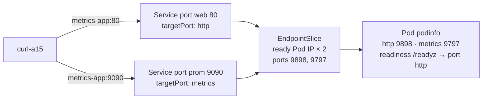

# q15 — Repair a multi-port Service with no endpoints · 풀이

← 문제: **[question.md](question.md)**

## 문제 (해석)

**원문**

> Service `metrics-app` in namespace `omicron` should expose the HTTP API of Deployment
> `metrics-app` on port `80` and its Prometheus metrics on port `9090`, but the Service has no
> endpoints.
>
> 1. Find every cause and write each one in one line to `/opt/course/a15/causes.txt`.
> 2. Fix all causes. Do not change the Service's ports (names, port numbers and `targetPort`
>    names) or the container ports of the Pods. You may change the Service selector and the
>    Deployment's probes.
> 3. The readiness probe must still check `/readyz` on the HTTP container port, referring to that
>    port by its **name**.
> 4. Confirm with the EndpointSlice of the Service that it lists 2 ready endpoints with both
>    ports. Save that EndpointSlice output (`kubectl get endpointslice ...`) to
>    `/opt/course/a15/endpointslice.txt`.
> 5. From a Pod with image `curlimages/curl:8.10.1` in namespace `omicron`, request
>    `http://metrics-app/` and `http://metrics-app:9090/metrics` and write the two HTTP status
>    codes to `/opt/course/a15/curl.txt` as `web=<code>` and `metrics=<code>` on separate lines.

**해석**

`omicron` 네임스페이스의 Service `metrics-app` 은 Deployment `metrics-app` 의 HTTP API 를 포트 `80` 으로, Prometheus 메트릭을
포트 `9090` 으로 노출해야 하지만 엔드포인트가 없다.

1. 원인을 **모두** 찾아 원인마다 한 줄씩 `/opt/course/a15/causes.txt` 에 쓴다.
2. 모든 원인을 고친다. Service 의 포트(이름, 포트 번호, `targetPort` 이름)와 Pod 의 컨테이너 포트는 바꾸지 않는다. Service selector 와
   Deployment 의 probe 는 바꿔도 된다.
3. readiness probe 는 계속 HTTP 컨테이너 포트의 `/readyz` 를 검사하되, 그 포트를 **이름**으로 가리켜야 한다.
4. Service 의 EndpointSlice 에 두 포트를 가진 Ready 엔드포인트 2개가 있는지 확인한다. 그 EndpointSlice 출력
   (`kubectl get endpointslice ...`)을 `/opt/course/a15/endpointslice.txt` 에 저장한다.
5. `omicron` 의 `curlimages/curl:8.10.1` 이미지 Pod 에서 `http://metrics-app/` 와 `http://metrics-app:9090/metrics` 를 요청하고,
   두 HTTP 상태 코드를 `web=<코드>`, `metrics=<코드>` 두 줄로 `/opt/course/a15/curl.txt` 에 쓴다.

## 모범 풀이

**1) 원인 좁히기 — selector 부터, 그다음 Ready**

```bash
alias k=kubectl
k -n omicron get endpointslice -l kubernetes.io/service-name=metrics-app
# NAME                ADDRESSTYPE   PORTS     ENDPOINTS   AGE
# metrics-app-8kq2x   IPv4          <unset>   <unset>     2m       ← 선택된 Pod 가 하나도 없다
k -n omicron get svc metrics-app -o jsonpath='{.spec.selector}{"\n"}'
# {"app":"metrics-app","tier":"back-end"}
k -n omicron get pod --show-labels
# metrics-app-...   0/1   Running   ...   app=metrics-app,pod-template-hash=...,tier=backend
```

첫 번째 원인: Service selector 의 `tier=back-end` 가 Pod 라벨 `tier=backend` 와 다릅니다. selector 의 모든 키가 맞아야 선택됩니다.

```bash
k -n omicron patch svc metrics-app -p '{"spec":{"selector":{"tier":"backend"}}}'
k -n omicron get endpointslice -l kubernetes.io/service-name=metrics-app \
  -o jsonpath='{range .items[*].endpoints[*]}{.addresses[0]} ready={.conditions.ready}{"\n"}{end}'
# 10.0.1.31 ready=false          ← 이제 선택은 되지만 Ready 가 아니다
# 10.0.2.18 ready=false
k -n omicron describe pod -l app=metrics-app | grep -E 'Readiness|Unhealthy' | head -3
#     Readiness:  http-get http://:9899/readyz delay=0s timeout=1s period=3s ...
#   Warning  Unhealthy  ...  Readiness probe failed: Get "http://10.0.1.31:9899/readyz": dial tcp ...: connect: connection refused
```

두 번째 원인: readiness probe 가 아무도 듣지 않는 9899 를 검사합니다. Pod 는 `Running` 이지만 Ready 가 아니므로 EndpointSlice 에
`ready=false` 로만 올라가고, Service 는 트래픽을 보내지 않습니다. 이것은 selector 를 고친 **뒤에야** 보이는 두 번째 고장입니다.

```bash
cat > /opt/course/a15/causes.txt <<'EOF'
Service selector tier=back-end does not match the Pod label tier=backend, so no Pods are selected
readinessProbe checks port 9899 where nothing listens, so the Pods never become Ready (endpoints ready=false)
EOF
```

**2) · 3) readiness 를 이름 있는 포트로**

```bash
k -n omicron patch deploy metrics-app --type=json \
  -p='[{"op":"replace","path":"/spec/template/spec/containers/0/readinessProbe/httpGet/port","value":"http"}]'
k -n omicron rollout status deploy metrics-app
```

probe 의 `port` 는 숫자 또는 컨테이너 포트 **이름**을 받습니다. 이름을 쓰면 포트 번호가 바뀌어도 probe 를 고칠 필요가 없습니다.
Service 의 `targetPort: http` / `targetPort: metrics` 도 같은 원리로 Pod 의 포트 이름을 찾아갑니다.

**4) EndpointSlice 확인**

```bash
k -n omicron get endpointslice -l kubernetes.io/service-name=metrics-app | tee /opt/course/a15/endpointslice.txt
# NAME                ADDRESSTYPE   PORTS       ENDPOINTS             AGE
# metrics-app-8kq2x   IPv4          9898,9797   10.0.1.40,10.0.2.22   5m
```

EndpointSlice 의 PORTS 열에는 Service 포트(80, 9090)가 아니라 **이름이 해석된 실제 Pod 포트**(9898, 9797)가 나옵니다.

**5) 클라이언트 Pod 에서 두 포트 요청**

```bash
k -n omicron run curl-a15 --image=curlimages/curl:8.10.1 --restart=Never --command -- sleep 3600
k -n omicron wait --for=condition=Ready pod/curl-a15
{
  echo "web=$(k -n omicron exec curl-a15 -- curl -s -o /dev/null -w '%{http_code}' http://metrics-app/)"
  echo "metrics=$(k -n omicron exec curl-a15 -- curl -s -o /dev/null -w '%{http_code}' http://metrics-app:9090/metrics)"
} > /opt/course/a15/curl.txt
cat /opt/course/a15/curl.txt
# web=200
# metrics=200
k -n omicron delete pod curl-a15 --now
```

### 그림 — 포트 이름이 이어지는 길



1. selector 가 Pod 라벨과 맞아야 EndpointSlice 에 Pod 가 올라갑니다. 첫 고장(`back-end`)은 여기서 막혔습니다.
2. 올라간 Pod 중 readiness 가 성공한 것만 `ready=true` 가 되어 트래픽을 받습니다. 두 번째 고장(9899)은 여기서 막혔습니다.
3. Service 의 각 포트는 `targetPort` 이름으로 Pod 의 포트를 찾아 9898·9797 로 이어집니다. 그래서 Service 포트 번호와 Pod 포트 번호가 달라도 됩니다.

## 검증

```bash
k -n omicron get pod -l app=metrics-app                     # 2개 모두 1/1 Running
k -n omicron get endpointslice -l kubernetes.io/service-name=metrics-app \
  -o jsonpath='{range .items[*].ports[*]}{.name}={.port} {end}{"\n"}{range .items[*].endpoints[*]}{.addresses[0]} {.conditions.ready}{"\n"}{end}'
# web=9898 prom=9797
# 10.0.1.40 true
# 10.0.2.22 true
k -n omicron get deploy metrics-app -o jsonpath='{.spec.template.spec.containers[0].readinessProbe.httpGet}{"\n"}'
# {"path":"/readyz","port":"http","scheme":"HTTP"}
cat /opt/course/a15/causes.txt /opt/course/a15/curl.txt
```

## 오답 원인 / 배운 점

- **왜 틀렸나**:
- **기억할 것**: 엔드포인트가 없으면 ① selector ↔ Pod 라벨 ② Pod Ready ③ targetPort ↔ 컨테이너 포트(이름) 순서로 본다. 하나 고친 뒤 다시 EndpointSlice 를 본다.
- **헷갈리는 지점**: Endpoints API 는 v1.33 에서 deprecated → `get endpointslice -l kubernetes.io/service-name=<svc>`. 슬라이스에 주소가 있어도 `ready=false` 면 트래픽이 가지 않습니다. 포트가 2개 이상인 Service 는 모든 포트에 `name` 이 필수입니다.

## 참고 문서

- 검색어: `debug services`, `endpointslices`, `service multi-port`
- https://kubernetes.io/docs/tasks/debug/debug-application/debug-service/
- https://kubernetes.io/docs/concepts/services-networking/service/#multi-port-services
- https://kubernetes.io/docs/concepts/services-networking/endpoint-slices/

---

[↑ 문항 목록](../README.md) · [← 문제로](question.md) · [다음 문제 q16 →](../q16_ingress_tls_two_paths_default_backend/question.md)
