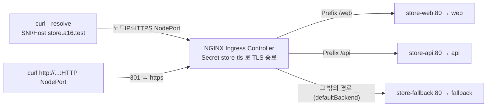

# q16 — TLS Ingress with two paths and a default backend · 풀이

← 문제: **[question.md](question.md)**

## 문제 (해석)

**원문**

> The `store` application in namespace `pi` must be published over HTTPS for host
> `store.a16.test`. A certificate and key for this host are stored at `/opt/course/a16/tls.crt`
> and `/opt/course/a16/tls.key`.
>
> 1. Create a TLS Secret named `store-tls` in namespace `pi` from these two files.
> 2. Create an Ingress named `store` in namespace `pi` with IngressClass `nginx` that
>    - terminates TLS for host `store.a16.test` with Secret `store-tls`,
>    - routes host `store.a16.test` path `/web` (type `Prefix`) to Service `store-web` port `80`
>      and path `/api` (type `Prefix`) to Service `store-api` port `80`,
>    - sends every other request to Service `store-fallback` port `80` with a `defaultBackend`.
> 3. Using `curl -k` against the HTTPS NodePort of the Ingress controller (with the host name
>    resolved to the node, so that SNI is `store.a16.test`), request `/web`, `/api/v1` and
>    `/other`. Write the three response bodies in this order, one per line, to
>    `/opt/course/a16/curl.txt`.
> 4. Request `http://store.a16.test/web` through the HTTP NodePort and write only the HTTP status
>    code to `/opt/course/a16/http-code.txt`.

**해석**

`pi` 네임스페이스의 `store` 애플리케이션을 호스트 `store.a16.test` 로 HTTPS 공개해야 한다. 이 호스트용 인증서와 키는
`/opt/course/a16/tls.crt`, `/opt/course/a16/tls.key` 에 있다.

1. 이 두 파일로 `pi` 에 TLS Secret `store-tls` 를 만든다.
2. IngressClass `nginx` 를 쓰는 Ingress `store` 를 `pi` 에 만든다. 이 Ingress 는
   - Secret `store-tls` 로 호스트 `store.a16.test` 의 TLS 를 종료하고,
   - 호스트 `store.a16.test` 의 경로 `/web`(`Prefix`)을 Service `store-web` 포트 `80` 으로, 경로 `/api`(`Prefix`)를
     Service `store-api` 포트 `80` 으로 보내고,
   - 그 밖의 모든 요청은 `defaultBackend` 로 Service `store-fallback` 포트 `80` 에 보낸다.
3. Ingress 컨트롤러의 HTTPS NodePort 로 `curl -k` 를 보낸다(호스트 이름을 노드로 해석시켜 SNI 가 `store.a16.test` 가 되게).
   `/web`, `/api/v1`, `/other` 를 요청하고 세 응답 본문을 이 순서대로 한 줄씩 `/opt/course/a16/curl.txt` 에 쓴다.
4. HTTP NodePort 로 `http://store.a16.test/web` 를 요청하고 HTTP 상태 코드만 `/opt/course/a16/http-code.txt` 에 쓴다.

## 모범 풀이

**1) TLS Secret**

```bash
alias k=kubectl; export do="--dry-run=client -o yaml"
openssl x509 -in /opt/course/a16/tls.crt -noout -subject -ext subjectAltName
# subject=CN = store.a16.test
# X509v3 Subject Alternative Name: DNS:store.a16.test
k -n pi create secret tls store-tls --cert=/opt/course/a16/tls.crt --key=/opt/course/a16/tls.key
k -n pi get secret store-tls        # TYPE kubernetes.io/tls, DATA 2 (tls.crt, tls.key)
```

`create secret generic --from-file` 로 만들면 타입이 `Opaque` 이고 키 이름도 파일명 그대로라 컨트롤러가 TLS Secret 으로
인정하지 않습니다. `secret tls` 는 타입 `kubernetes.io/tls` 와 키 `tls.crt`/`tls.key` 를 정확히 맞춰 줍니다.

**2) Ingress — 명령형 한 줄로 거의 다 됩니다**

```bash
k get ingressclass                   # nginx   nginx.org/ingress-controller
k -n pi create ingress store --class=nginx \
  --rule='store.a16.test/web*=store-web:80,tls=store-tls' \
  --rule='store.a16.test/api*=store-api:80' \
  --default-backend=store-fallback:80 $do > /tmp/store.yaml
k apply -f /tmp/store.yaml
```

만들어지는 YAML:

```yaml
apiVersion: networking.k8s.io/v1
kind: Ingress
metadata:
  name: store
  namespace: pi
spec:
  ingressClassName: nginx
  defaultBackend:                 # 어떤 규칙에도 맞지 않는 요청
    service:
      name: store-fallback
      port:
        number: 80
  tls:
  - hosts:
    - store.a16.test              # 인증서의 SAN 과 같은 이름
    secretName: store-tls         # Ingress 와 같은 네임스페이스의 Secret
  rules:
  - host: store.a16.test
    http:
      paths:
      - path: /web
        pathType: Prefix
        backend:
          service:
            name: store-web
            port:
              number: 80
      - path: /api
        pathType: Prefix
        backend:
          service:
            name: store-api
            port:
              number: 80
```

`--rule` 의 `path*` 는 `Prefix`, `*` 가 없으면 `Exact` 입니다. `,tls=<secret>` 을 붙이면 그 호스트가 `spec.tls` 에 들어갑니다.
Secret 은 **Ingress 와 같은 네임스페이스**에 있어야 합니다.

```bash
k -n pi describe ingress store | sed -n '/TLS:/,/Events/p'
# Events:  Normal  AddedOrUpdated  ...  Configuration for pi/store was added or updated
```

Secret 이 없거나 형식이 틀리면 F5 NGINX Ingress Controller 는 `Warning ... secret is invalid` 이벤트를 남기고 그 호스트의 TLS 핸드셰이크를 거부합니다.

**3) HTTPS 로 세 경로 확인**

```bash
NP=$(k -n nginx-ingress get svc nginx-ingress -o jsonpath='{.spec.ports[?(@.name=="http")].nodePort}')
NPS=$(k -n nginx-ingress get svc nginx-ingress -o jsonpath='{.spec.ports[?(@.name=="https")].nodePort}')
NODE=$(k get nodes -o jsonpath='{.items[0].status.addresses[?(@.type=="InternalIP")].address}')
for p in /web /api/v1 /other; do
  curl -sk --resolve store.a16.test:$NPS:$NODE https://store.a16.test:$NPS$p
done > /opt/course/a16/curl.txt
cat /opt/course/a16/curl.txt
# web
# api
# fallback
```

`-H 'Host: ...'` 만으로는 TLS 의 **SNI** 가 노드 IP 가 되어 컨트롤러가 어느 인증서·서버 블록을 쓸지 모릅니다. `--resolve 이름:포트:IP`
로 이름을 노드 IP 에 묶으면 SNI 와 Host 헤더가 모두 `store.a16.test` 가 됩니다. `-k` 는 자체 서명 인증서를 신뢰하지 않아도
접속하게 합니다(`--cacert /opt/course/a16/tls.crt` 를 주면 `-k` 없이도 검증 통과).

`/api/v1` 은 `Prefix /api` 에 경로 요소 단위로 맞아 `api` 로, `/other` 는 어떤 경로에도 맞지 않아 `defaultBackend` 로 갑니다.

**4) HTTP 는 HTTPS 로 리다이렉트됩니다**

```bash
curl -s -o /dev/null -w '%{http_code}\n' -H 'Host: store.a16.test' http://$NODE:$NP/web > /opt/course/a16/http-code.txt
cat /opt/course/a16/http-code.txt        # 301
```

Ingress 에 TLS 호스트가 있으면 F5 NGINX Ingress Controller 는 기본으로(`ingress.kubernetes.io/ssl-redirect: "true"`) 그 호스트의
HTTP 요청을 301 로 HTTPS 에 돌려보냅니다. 그래서 HTTP 로는 `web` 본문이 아니라 301 이 정답입니다.

### 그림 — TLS 종료와 경로 분기



1. 클라이언트가 HTTPS NodePort 로 접속하면서 SNI `store.a16.test` 를 보냅니다. 컨트롤러는 `spec.tls` 에서 그 호스트의 Secret 을 찾아 인증서를 내밀고 TLS 를 끝냅니다.
2. 복호화된 요청의 경로를 규칙과 비교합니다. `/web…` 은 store-web, `/api…` 는 store-api 로 갑니다.
3. 어느 경로에도 맞지 않으면 `defaultBackend` 인 store-fallback 이 응답합니다.
4. 같은 호스트로 HTTP 로 들어온 요청은 백엔드에 닿기 전에 301 로 HTTPS 에 리다이렉트됩니다.

## 검증

```bash
k -n pi get ingress store
# NAME    CLASS   HOSTS            ADDRESS   PORTS     AGE
# store   nginx   store.a16.test             80, 443   1m       ← 443 이 보이면 TLS 설정됨
k -n pi get ingress store -o jsonpath='{.spec.tls[0].secretName} {.spec.defaultBackend.service.name}{"\n"}'
# store-tls store-fallback
curl -skv --resolve store.a16.test:$NPS:$NODE https://store.a16.test:$NPS/web 2>&1 | grep -E 'subject:|^web'
# *  subject: CN=store.a16.test
cat /opt/course/a16/curl.txt /opt/course/a16/http-code.txt
```

## 오답 원인 / 배운 점

- **왜 틀렸나**:
- **기억할 것**: `kubectl create secret tls` + `kubectl create ingress --rule='host/path*=svc:port,tls=secret' --default-backend=svc:port`. HTTPS 테스트는 `curl -k --resolve host:port:ip`.
- **헷갈리는 지점**: TLS Secret 은 Ingress 와 같은 네임스페이스여야 합니다. `-H Host:` 만으로는 SNI 가 맞지 않습니다. TLS 호스트의 HTTP 요청은 기본 301 리다이렉트입니다. Ingress NGINX(kubernetes/ingress-nginx)는 2026-03 에 은퇴했지만 Ingress API 는 GA 그대로이며, 이 랩은 F5 NGINX Ingress Controller 를 씁니다(어노테이션 접두사도 `nginx.org/` 로 다름).

## 참고 문서

- 검색어: `ingress tls`, `ingress default backend`, `kubectl create ingress`
- https://kubernetes.io/docs/concepts/services-networking/ingress/#tls
- https://kubernetes.io/docs/concepts/services-networking/ingress/#default-backend
- https://kubernetes.io/docs/reference/kubectl/generated/kubectl_create/kubectl_create_ingress/

---

[↑ 문항 목록](../README.md) · [← 문제로](question.md) · [다음 문제 q17 →](../q17_networkpolicy_three_tier_and_or/question.md)
