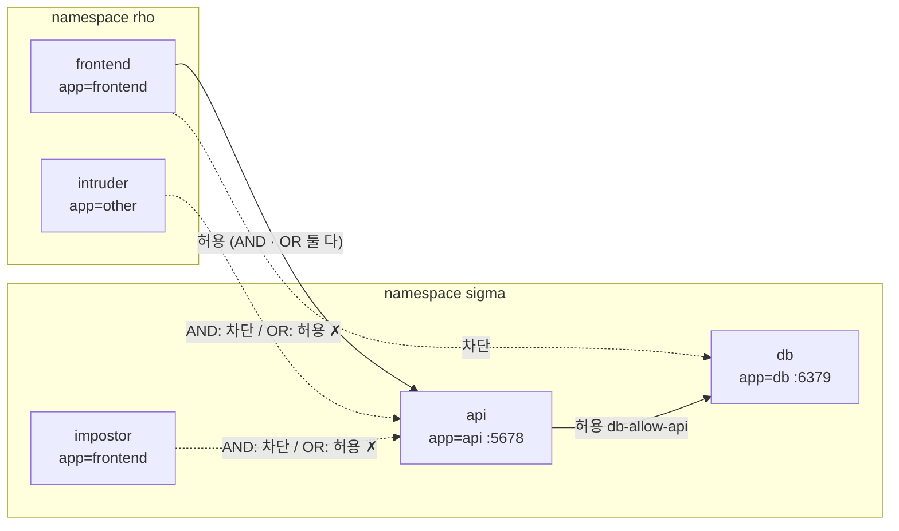

# q17 — Three-tier NetworkPolicy across namespaces · 풀이

← 문제: **[question.md](question.md)**

## 문제 (해석)

**원문**

> The application has three tiers: `frontend` in namespace `rho`, and `api` and `db` in
> namespace `sigma`. Restrict traffic so that each tier can only be reached by the tier in front
> of it. Do not change any labels and do not create policies other than the two below.
>
> 1. In namespace `sigma`, create NetworkPolicy `api-allow-frontend` that selects the Pods with
>    label `app=api` and allows ingress on TCP port `5678` **only** from Pods with label
>    `app=frontend` that run in namespace `rho`.
> 2. In namespace `sigma`, create NetworkPolicy `db-allow-api` that selects the Pods with label
>    `app=db` and allows ingress on TCP port `6379` only from Pods with label `app=api` in
>    namespace `sigma`.
> 3. Test the following connections and write one line per connection, in this order, to
>    `/opt/course/a17/results.txt` in the format `<from>-><to>=<allowed|blocked>`:
>    - `frontend->api` (Pod `rho/frontend` to `http://api.sigma`)
>    - `intruder->api` (Pod `rho/intruder` to `http://api.sigma`)
>    - `impostor->api` (Pod `sigma/impostor` to `http://api.sigma`)
>    - `api->db` (Pod `sigma/api` to `db.sigma:6379`)
>    - `frontend->db` (Pod `rho/frontend` to `db.sigma:6379`)

**해석**

애플리케이션은 세 계층이다. `rho` 네임스페이스의 `frontend`, `sigma` 네임스페이스의 `api` 와 `db`. 각 계층에는 바로 앞 계층만
접근할 수 있게 트래픽을 제한한다. 라벨은 바꾸지 않고, 아래 두 개 외의 정책은 만들지 않는다.

1. `sigma` 에 NetworkPolicy `api-allow-frontend` 를 만든다. 라벨 `app=api` 인 Pod 를 선택하고, **`rho` 네임스페이스에서 실행되는**
   라벨 `app=frontend` 인 Pod 로부터 오는 TCP `5678` 포트 ingress **만** 허용한다.
2. `sigma` 에 NetworkPolicy `db-allow-api` 를 만든다. 라벨 `app=db` 인 Pod 를 선택하고, `sigma` 네임스페이스의 라벨 `app=api` 인
   Pod 로부터 오는 TCP `6379` 포트 ingress 만 허용한다.
3. 다음 연결을 테스트하고, 연결마다 한 줄씩 이 순서대로 `<출발>-><도착>=<allowed|blocked>` 형식으로 `/opt/course/a17/results.txt` 에 쓴다.
   - `frontend->api` (Pod `rho/frontend` 에서 `http://api.sigma`)
   - `intruder->api` (Pod `rho/intruder` 에서 `http://api.sigma`)
   - `impostor->api` (Pod `sigma/impostor` 에서 `http://api.sigma`)
   - `api->db` (Pod `sigma/api` 에서 `db.sigma:6379`)
   - `frontend->db` (Pod `rho/frontend` 에서 `db.sigma:6379`)

## 모범 풀이

**0) 라벨 확인**

```bash
alias k=kubectl
k get ns rho sigma --show-labels          # kubernetes.io/metadata.name=rho / =sigma (자동 라벨)
k -n rho get pod --show-labels
k -n sigma get pod,svc --show-labels
```

네임스페이스에는 v1.21 부터 `kubernetes.io/metadata.name=<이름>` 라벨이 자동으로 붙습니다. 라벨을 새로 붙이지 말라고 했으므로
`namespaceSelector` 는 이 자동 라벨을 씁니다.

**1) api 정책 — namespaceSelector 와 podSelector 를 같은 항목에 (AND)**

```yaml
apiVersion: networking.k8s.io/v1
kind: NetworkPolicy
metadata:
  name: api-allow-frontend
  namespace: sigma
spec:
  podSelector:
    matchLabels:
      app: api
  policyTypes:
  - Ingress
  ingress:
  - from:
    - namespaceSelector:              # ← "-" 가 하나: 두 셀렉터가 한 항목 = AND
        matchLabels:
          kubernetes.io/metadata.name: rho
      podSelector:
        matchLabels:
          app: frontend
    ports:
    - protocol: TCP
      port: 5678                      # Service 포트 80 이 아니라 Pod 포트
```

**2) db 정책 — 같은 네임스페이스는 podSelector 만**

```yaml
apiVersion: networking.k8s.io/v1
kind: NetworkPolicy
metadata:
  name: db-allow-api
  namespace: sigma
spec:
  podSelector:
    matchLabels:
      app: db
  policyTypes:
  - Ingress
  ingress:
  - from:
    - podSelector:                    # namespaceSelector 없이 단독 = 정책과 같은 ns(sigma)의 Pod
        matchLabels:
          app: api
    ports:
    - protocol: TCP
      port: 6379
```

두 YAML 을 `---` 로 이어 `/tmp/a17-policies.yaml` 에 저장한 뒤 적용합니다.

```bash
k apply -f /tmp/a17-policies.yaml
k -n sigma get netpol
```

**함정 1 — AND 와 OR.** `from` 목록의 **한 항목 안에** `namespaceSelector` 와 `podSelector` 를 같이 쓰면 "rho 네임스페이스의
frontend Pod" 라는 AND 입니다. 아래처럼 `-` 를 두 번 써서 **두 항목**으로 나누면 "rho 의 모든 Pod **또는** (sigma 의) frontend
라벨 Pod" 라는 OR 이 됩니다.

```yaml
  ingress:
  - from:
    - namespaceSelector:              # 항목 1: rho 의 모든 Pod (intruder 포함!)
        matchLabels:
          kubernetes.io/metadata.name: rho
    - podSelector:                    # 항목 2: 정책 ns(sigma) 의 app=frontend (impostor 포함!)
        matchLabels:
          app: frontend
```

YAML 들여쓰기 한 칸, `-` 한 개 차이라서 눈으로는 거의 같아 보입니다. 이 문제의 `intruder` 와 `impostor` 가 정확히 이 실수를
잡아내도록 배치되어 있습니다.

**함정 2 — 포트.** NetworkPolicy 는 Service 를 거친 **뒤**의 패킷(목적지 Pod IP·Pod 포트)에 적용됩니다. 클라이언트는
`api.sigma:80` 으로 요청하지만 정책에는 Pod 포트 5678 을 적어야 합니다. 80 을 적으면 frontend 도 막힙니다.

### 그림 — AND(정답)와 OR(오답)의 허용 범위



1. `api-allow-frontend` 가 `app=api` Pod 를 선택하는 순간, 그 Pod 로 들어오는 트래픽은 정책에 적힌 출처만 허용되고 나머지는 모두 차단됩니다.
2. AND(한 항목): 출처 Pod 가 **rho 네임스페이스에 있으면서 동시에** `app=frontend` 여야 합니다. frontend 만 통과하고 intruder(라벨 다름)와 impostor(네임스페이스 다름)는 막힙니다.
3. OR(두 항목): rho 의 아무 Pod 이거나, sigma 의 `app=frontend` Pod 면 통과합니다. intruder 와 impostor 가 모두 새어 들어옵니다.
4. `db-allow-api` 는 sigma 의 `app=api` 만 허용하므로 api → db 는 열리고, frontend → db 는 다른 네임스페이스라 막힙니다.

**3) 연결 테스트**

```bash
t_http() { k -n $1 exec $2 -- wget -qO- -T 3 http://api.sigma >/dev/null 2>&1 && echo allowed || echo blocked; }
t_db()   { k -n $1 exec $2 -- sh -c 'echo PING | nc -w 3 db.sigma 6379' 2>/dev/null | grep -q PONG && echo allowed || echo blocked; }
{
  echo "frontend->api=$(t_http rho frontend)"
  echo "intruder->api=$(t_http rho intruder)"
  echo "impostor->api=$(t_http sigma impostor)"
  echo "api->db=$(t_db sigma api)"
  echo "frontend->db=$(t_db rho frontend)"
} > /opt/course/a17/results.txt
cat /opt/course/a17/results.txt
# frontend->api=allowed
# intruder->api=blocked
# impostor->api=blocked
# api->db=allowed
# frontend->db=blocked
```

`-T 3`(wget), `-w 3`(nc)으로 타임아웃을 주지 않으면 차단된 연결에서 오래 멈춥니다. 차단은 보통 "거부"가 아니라 응답 없음(타임아웃)으로 나타납니다.

## 검증

```bash
k -n sigma get netpol
# NAME                 POD-SELECTOR   AGE
# api-allow-frontend   app=api        1m
# db-allow-api         app=db         1m
k -n sigma describe netpol api-allow-frontend | sed -n '/Allowing ingress/,/Not affecting/p'
#   Allowing ingress traffic:
#     To Port: 5678/TCP
#     From:
#       NamespaceSelector: kubernetes.io/metadata.name=rho
#       PodSelector: app=frontend                 ← 한 From 블록 안에 둘 다 = AND
cat /opt/course/a17/results.txt
```

`describe` 에서 OR 로 잘못 쓴 정책은 `From:` 아래에 `NamespaceSelector` 와 `PodSelector` 가 `----------` 구분선으로 **나뉘어** 표시됩니다.

## 오답 원인 / 배운 점

- **왜 틀렸나**:
- **기억할 것**: 한 `from` 항목에 `namespaceSelector` + `podSelector` = AND, `-` 로 나눈 두 항목 = OR. 포트는 Pod 포트.
- **헷갈리는 지점**: `podSelector` 단독 출처는 **정책이 있는 네임스페이스**의 Pod 만 뜻합니다. 정책은 선택된 Pod 에 대해 허용 목록이 되므로 따로 deny 정책이 없어도 나머지는 막힙니다. 정책을 강제하지 않는 CNI 에서는 모든 테스트가 allowed 로 나옵니다.

## 참고 문서

- 검색어: `network policies`, `declare network policy`
- https://kubernetes.io/docs/concepts/services-networking/network-policies/
- https://kubernetes.io/docs/tasks/administer-cluster/declare-network-policy/

---

[↑ 문항 목록](../README.md) · [← 문제로](question.md)
