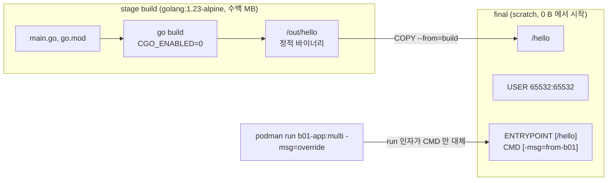

# q01 — Multi-stage build with a non-root image · 풀이

← 문제: **[question.md](question.md)**

## 문제 (해석)

**원문**

> A developer wrote a single-stage `Dockerfile` for a small Go program in `/opt/course/b01/app/`. The
> resulting image is large and runs as root. Use `podman` (or `docker`) for all steps.
>
> 1. Build the current `Dockerfile` unchanged as image `b01-app:single`.
> 2. Rewrite `/opt/course/b01/app/Dockerfile` as a multi-stage build:
>    - a build stage named `build` based on `docker.io/library/golang:1.23-alpine` that compiles a
>      statically linked binary,
>    - a final stage based on `scratch` that contains only the binary at `/hello`,
>    - the final image runs as UID `65532` and GID `65532`,
>    - the binary is the image `ENTRYPOINT`, and its default argument `-msg=from-b01` is supplied in
>      a way that can be replaced on `podman run` without retyping the binary path.
> 3. Build the new `Dockerfile` as image `b01-app:multi`. Running `podman run --rm b01-app:multi`
>    must print `from-b01 uid=65532 gid=65532`, and `podman run --rm b01-app:multi -msg=override`
>    must print `override uid=65532 gid=65532`.
> 4. Write the sizes of both images to `/opt/course/b01/sizes.txt`, one line each, in the form
>    `single <SIZE>` and `multi <SIZE>`, using the size shown by `podman images`.
> 5. Save image `b01-app:multi` in docker-archive format to `/opt/course/b01/b01-app-multi.tar`.

**해석**

개발자가 `/opt/course/b01/app/` 의 작은 Go 프로그램용으로 단일 스테이지 `Dockerfile` 을 작성했다.
결과 이미지는 크고 root 로 실행된다. 모든 단계에서 `podman`(또는 `docker`)을 쓴다.

1. 현재 `Dockerfile` 을 고치지 않고 이미지 `b01-app:single` 로 빌드한다.
2. `/opt/course/b01/app/Dockerfile` 을 멀티 스테이지 빌드로 다시 쓴다.
   - `docker.io/library/golang:1.23-alpine` 기반의 `build` 라는 이름의 빌드 스테이지가 **정적 링크**된 바이너리를 컴파일한다.
   - 최종 스테이지는 `scratch` 기반이고 `/hello` 위치의 바이너리만 담는다.
   - 최종 이미지는 UID `65532`, GID `65532` 로 실행된다.
   - 바이너리가 이미지의 `ENTRYPOINT` 이고, 기본 인자 `-msg=from-b01` 은 `podman run` 에서 바이너리 경로를 다시 치지 않고도 바꿀 수 있는 방식으로 넣는다.
3. 새 `Dockerfile` 을 이미지 `b01-app:multi` 로 빌드한다. `podman run --rm b01-app:multi` 는
   `from-b01 uid=65532 gid=65532` 를, `podman run --rm b01-app:multi -msg=override` 는
   `override uid=65532 gid=65532` 를 출력해야 한다.
4. 두 이미지의 크기를 `podman images` 가 보여 주는 값으로 `/opt/course/b01/sizes.txt` 에 한 줄씩
   `single <SIZE>`, `multi <SIZE>` 형식으로 적는다.
5. 이미지 `b01-app:multi` 를 docker-archive 형식으로 `/opt/course/b01/b01-app-multi.tar` 에 저장한다.

## 모범 풀이

아래는 `podman` 기준입니다. `docker` 도 `build`·`run`·`images`·`save` 사용법이 같습니다(`docker save` 는 항상 docker-archive 형식이라 `--format` 이 없습니다).

**1) 원래 Dockerfile 그대로 빌드**

```bash
cd /opt/course/b01/app
cat Dockerfile
# FROM docker.io/library/golang:1.23-alpine
# WORKDIR /src
# COPY go.mod main.go ./
# RUN go build -o /usr/local/bin/hello .
# CMD /usr/local/bin/hello -msg=from-b01
podman build -t b01-app:single .
podman run --rm b01-app:single          # from-b01 uid=0 gid=0   ← root 로 돈다
```

비교 기준을 남기려고 고치기 **전에** 빌드합니다. 원본 `CMD` 는 **shell form**(대괄호 없음)이라 실제로는 `/bin/sh -c "..."` 로 실행됩니다. `scratch` 에는 `/bin/sh` 가 없으므로 이 형태를 그대로 가져가면 최종 이미지는 실행조차 되지 않습니다.

**2) 멀티 스테이지로 다시 쓰기**

```bash
cat > /opt/course/b01/app/Dockerfile <<'DOCKERFILE'
FROM docker.io/library/golang:1.23-alpine AS build
WORKDIR /src
COPY go.mod main.go ./
RUN CGO_ENABLED=0 go build -ldflags="-s -w" -o /out/hello .

FROM scratch
COPY --from=build /out/hello /hello
USER 65532:65532
ENTRYPOINT ["/hello"]
CMD ["-msg=from-b01"]
DOCKERFILE
```

- `CGO_ENABLED=0` 으로 libc 에 의존하지 않는 정적 바이너리를 만듭니다. 동적 링크 바이너리를 `scratch` 에 넣으면 로더가 없어 `exec /hello: no such file or directory` 로 죽습니다.
- `scratch` 에는 `/etc/passwd` 가 없으므로 `USER nonroot` 처럼 **이름**을 쓰면 실행할 때 사용자를 찾지 못합니다. 반드시 **숫자** `65532:65532` 로 씁니다.
- `ENTRYPOINT` 는 고정 실행 파일, `CMD` 는 기본 인자입니다. 둘 다 **exec form**(JSON 배열)이어야 `podman run 이미지 -msg=override` 의 인자가 `CMD` 만 대체하고 `ENTRYPOINT` 뒤에 붙습니다. `ENTRYPOINT` 를 shell form 으로 쓰면 `CMD` 와 run 인자가 모두 무시됩니다.

### 그림 — 멀티 스테이지에서 최종 이미지에 남는 것



1. 빌드 스테이지에는 Go 툴체인 전체가 있지만, 최종 이미지로 넘어가는 것은 `COPY --from=build` 로 복사한 바이너리 하나뿐입니다.
2. `scratch` 는 빈 파일시스템이라 셸도 사용자 DB 도 없습니다. 그래서 정적 바이너리, 숫자 UID, exec form 이 모두 필요합니다.
3. 실행할 때 넘긴 인자는 `CMD` 자리만 바꾸고 `ENTRYPOINT` 는 그대로 남습니다.

**3) 빌드와 실행 확인**

```bash
podman build -t b01-app:multi /opt/course/b01/app
podman run --rm b01-app:multi                   # from-b01 uid=65532 gid=65532
podman run --rm b01-app:multi -msg=override     # override uid=65532 gid=65532
```

**4) 크기 기록**

```bash
podman images --format '{{.Repository}}:{{.Tag}} {{.Size}}' | grep b01-app
# localhost/b01-app:multi 1.6 MB
# localhost/b01-app:single 280 MB
S=$(podman images --format '{{.Size}}' localhost/b01-app:single)
M=$(podman images --format '{{.Size}}' localhost/b01-app:multi)
printf 'single %s\nmulti %s\n' "$S" "$M" > /opt/course/b01/sizes.txt
```

podman 은 레지스트리 없이 만든 로컬 이미지를 `localhost/` 아래에 둡니다. docker 라면 `docker images --format '{{.Size}}' b01-app:single` 처럼 `localhost/` 없이 씁니다.

**5) docker-archive 로 저장**

```bash
podman save -o /opt/course/b01/b01-app-multi.tar b01-app:multi     # podman 기본 형식이 docker-archive
# 명시하려면: podman save --format docker-archive -o /opt/course/b01/b01-app-multi.tar b01-app:multi
# docker:     docker save -o /opt/course/b01/b01-app-multi.tar b01-app:multi
```

`--format oci-archive` 는 OCI 레이아웃이라 요구 형식과 다릅니다. tar 안에 `manifest.json` 이 있으면 docker-archive 입니다.

## 검증

```bash
cat /opt/course/b01/sizes.txt
# single 280 MB
# multi 1.6 MB
podman inspect b01-app:multi --format '{{.Config.User}} {{.Config.Entrypoint}} {{.Config.Cmd}}'
# 65532:65532 [/hello] [-msg=from-b01]
podman run --rm b01-app:multi -msg=override     # override uid=65532 gid=65532
tar -tf /opt/course/b01/b01-app-multi.tar | grep manifest.json   # manifest.json
grep -c '^FROM' /opt/course/b01/app/Dockerfile  # 2
```

## 오답 원인 / 배운 점

- **왜 틀렸나**:
- **기억할 것**: `scratch` 최종 스테이지 = 정적 바이너리(`CGO_ENABLED=0`) + 숫자 `USER` + exec form `ENTRYPOINT`/`CMD`.
- **헷갈리는 지점**: run 뒤의 인자는 `CMD` 를 대체하고, `ENTRYPOINT` 를 바꾸려면 `--entrypoint` 가 필요합니다. Kubernetes 에서는 `command` 가 `ENTRYPOINT`, `args` 가 `CMD` 에 대응합니다. 시험 노드에는 docker 대신 podman 만 있는 경우가 많으니 `podman save` 의 기본 형식(docker-archive)과 `--format oci-archive` 를 구분해 둡니다.

## 참고 문서

시험 중에는 Docker 문서를 볼 수 없으니 `podman build --help`, `podman save --help` 를 활용합니다.

- 검색어: `images`, `define command argument container`
- https://kubernetes.io/docs/concepts/containers/images/
- https://kubernetes.io/docs/tasks/inject-data-application/define-command-argument-container/

---

[↑ 문항 목록](../README.md) · [← 문제로](question.md) · [다음 문제 q02 →](../q02_indexed_job_pod_failure_policy/question.md)
