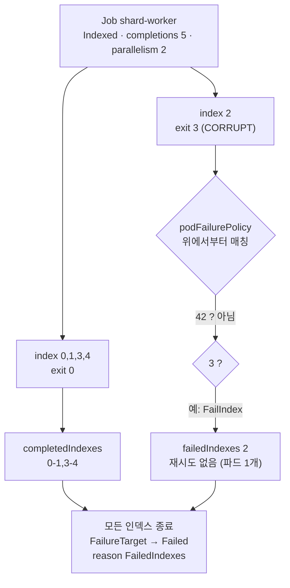

# q02 — Indexed Job with per-index retries and a pod failure policy · 풀이

← 문제: **[question.md](question.md)**

## 문제 (해석)

**원문**

> Namespace `mercury` contains ConfigMap `shard-data` with a script `worker.sh` and one input file per
> shard. The script picks its shard from the environment variable `JOB_COMPLETION_INDEX` and exits
> with code `3` for a corrupt shard and code `42` when its input is missing (a configuration error).
>
> 1. Create a Job `shard-worker` in namespace `mercury` with a single container named `worker`,
>    image `busybox:1.36`, command `sh /data/worker.sh`, and ConfigMap `shard-data` mounted at `/data`.
> 2. The Job must run 5 shards, numbered 0 to 4, so that each pod receives its shard number in
>    `JOB_COMPLETION_INDEX`, with at most 2 pods running at the same time.
> 3. Each shard may be retried at most once, counted per shard and not for the Job as a whole.
> 4. Add a pod failure policy for container `worker`: exit code `42` fails the whole Job immediately,
>    exit code `3` fails only that shard without retrying it, and exit code `143` is ignored (not
>    counted as a failure).
> 5. When the Job has finished, write its completed and failed shard numbers, exactly as reported
>    in the Job status, to `/opt/course/b02/indexes.txt` in the form
>    `completed=<value> failed=<value>`, and write the type and reason of its terminal condition
>    to `/opt/course/b02/condition.txt` in the form `<type> <reason>`.

**해석**

`mercury` 네임스페이스에 스크립트 `worker.sh` 와 샤드별 입력 파일이 든 ConfigMap `shard-data` 가 있다.
스크립트는 환경 변수 `JOB_COMPLETION_INDEX` 로 자기 샤드를 고르고, 샤드가 손상되었으면 종료 코드
`3`, 입력이 없으면(설정 오류) 종료 코드 `42` 로 끝난다.

1. `mercury` 에 Job `shard-worker` 를 만든다. 컨테이너는 `worker` 라는 이름 하나이고, 이미지
   `busybox:1.36`, 명령 `sh /data/worker.sh`, ConfigMap `shard-data` 를 `/data` 에 마운트한다.
2. Job 은 0~4 번의 샤드 5개를 실행하고, 각 파드가 자기 샤드 번호를 `JOB_COMPLETION_INDEX` 로 받게 하며,
   동시에 도는 파드는 최대 2개다.
3. 각 샤드는 최대 한 번만 재시도할 수 있고, 이 횟수는 Job 전체가 아니라 **샤드별로** 센다.
4. 컨테이너 `worker` 에 대한 pod failure policy 를 넣는다. 종료 코드 `42` 는 Job 전체를 즉시
   실패시키고, `3` 은 그 샤드만 재시도 없이 실패시키며, `143` 은 무시한다(실패로 세지 않는다).
5. Job 이 끝나면 Job status 에 보고된 그대로의 완료·실패 샤드 번호를 `/opt/course/b02/indexes.txt` 에
   `completed=<값> failed=<값>` 형식으로, 최종 condition 의 type 과 reason 을
   `/opt/course/b02/condition.txt` 에 `<type> <reason>` 형식으로 적는다.

## 모범 풀이

```bash
export do="--dry-run=client -o yaml"
kubectl -n mercury get cm shard-data -o jsonpath='{.data.worker\.sh}'    # 종료 코드 규칙 확인
```

**1) 뼈대 만들기 — 컨테이너 이름에 주의**

```bash
kubectl -n mercury create job shard-worker --image=busybox:1.36 $do \
  -- sh /data/worker.sh > /tmp/b02.yaml
```

`kubectl create job` 은 컨테이너 이름을 Job 이름(`shard-worker`)으로 만듭니다. podFailurePolicy 의
`containerName: worker` 와 맞지 않으면 규칙이 적용되지 않으므로 컨테이너 이름을 `worker` 로 바꿉니다.

**2)~4) Indexed 모드, 샤드별 재시도, failure policy**

```yaml
apiVersion: batch/v1
kind: Job
metadata:
  name: shard-worker
  namespace: mercury
spec:
  completionMode: Indexed          # 파드마다 JOB_COMPLETION_INDEX 환경 변수가 자동으로 들어간다
  completions: 5                   # 인덱스 0..4
  parallelism: 2
  backoffLimitPerIndex: 1          # 인덱스마다 재시도 1회 (backoffLimit 이 아니다)
  podFailurePolicy:
    rules:
    - action: FailJob              # 설정 오류 → Job 전체 즉시 실패
      onExitCodes:
        containerName: worker
        operator: In
        values: [42]
    - action: FailIndex            # 손상된 샤드 → 그 인덱스만 실패, 재시도 안 함
      onExitCodes:
        containerName: worker
        operator: In
        values: [3]
    - action: Ignore               # SIGTERM(축출 등) → 실패로 세지 않음
      onExitCodes:
        containerName: worker
        operator: In
        values: [143]
  template:
    spec:
      restartPolicy: Never         # podFailurePolicy 는 Never 에서만 허용된다
      containers:
      - name: worker
        image: busybox:1.36
        command: ["sh", "/data/worker.sh"]
        volumeMounts:
        - name: data
          mountPath: /data
      volumes:
      - name: data
        configMap:
          name: shard-data
```

```bash
kubectl apply -f /tmp/b02.yaml
kubectl -n mercury get pods -l job-name=shard-worker -L batch.kubernetes.io/job-completion-index -w
```

- `completionMode: Indexed` 가 없으면(기본 `NonIndexed`) `JOB_COMPLETION_INDEX` 가 비어 스크립트가 42 로 끝나고, FailJob 규칙 때문에 Job 이 **바로** 실패합니다.
- `backoffLimitPerIndex` 를 쓰면 Job 전체의 `backoffLimit` 기본값은 사실상 무한(2147483647)이 되고, 실패는 인덱스마다 따로 셉니다. `FailIndex` 동작은 `backoffLimitPerIndex` 가 있을 때만 허용됩니다.
- `restartPolicy: OnFailure`(create job 의 기본값)이면 kubelet 이 컨테이너를 제자리에서 재시작해 파드가 실패하지 않으므로, podFailurePolicy 가 있는 Job 은 검증에서 거부됩니다.
- 규칙은 **위에서부터** 처음 맞는 하나만 적용됩니다. `onExitCodes` 의 `In` 에는 0 을 넣을 수 없습니다.

### 그림 — 인덱스별 결과가 정해지는 과정



1. 다섯 인덱스가 동시에 최대 2개씩 실행됩니다. 0, 1, 3, 4 번은 정상 종료해 `completedIndexes` 에 모입니다.
2. 2 번 샤드는 `CORRUPT` 표시가 있어 종료 코드 3 으로 끝나고, 두 번째 규칙(`FailIndex`)에 걸려 `backoffLimitPerIndex: 1` 이 있어도 **재시도하지 않습니다**.
3. 실패한 인덱스가 있어도 나머지 인덱스는 끝까지 실행됩니다. 모두 끝나면 Job 은 `FailureTarget` 을 거쳐 `Failed`(reason `FailedIndexes`)가 됩니다. 42 가 나왔다면 다른 인덱스를 기다리지 않고 즉시 `PodFailurePolicy` 이유로 실패했을 것입니다.

**5) 결과 기록**

```bash
kubectl -n mercury get job shard-worker \
  -o jsonpath='completed={.status.completedIndexes} failed={.status.failedIndexes}{"\n"}' \
  > /opt/course/b02/indexes.txt
kubectl -n mercury get job shard-worker \
  -o jsonpath='{.status.conditions[?(@.type=="Failed")].type} {.status.conditions[?(@.type=="Failed")].reason}{"\n"}' \
  > /opt/course/b02/condition.txt
```

`completedIndexes` 는 압축 표기(`0-1,3-4`)로 보고되므로 손으로 풀어 쓰지 말고 그대로 옮깁니다.

## 검증

```bash
cat /opt/course/b02/indexes.txt      # completed=0-1,3-4 failed=2
cat /opt/course/b02/condition.txt    # Failed FailedIndexes
kubectl -n mercury get pods -l job-name=shard-worker -L batch.kubernetes.io/job-completion-index
# NAME                   READY  STATUS     ...  JOB-COMPLETION-INDEX
# shard-worker-2-xxxxx   0/1    Error      ...  2     ← 인덱스 2 파드는 하나뿐 (재시도 없음)
# shard-worker-0-xxxxx   0/1    Completed  ...  0
kubectl -n mercury logs -l job-name=shard-worker,batch.kubernetes.io/job-completion-index=2
# shard 2: corrupt input, giving up on this shard
kubectl -n mercury get job shard-worker -o jsonpath='{.spec.podFailurePolicy.rules[*].action}{"\n"}'
# FailJob FailIndex Ignore
```

## 오답 원인 / 배운 점

- **왜 틀렸나**:
- **기억할 것**: podFailurePolicy 는 `restartPolicy: Never` 필수, `FailIndex` 는 `backoffLimitPerIndex` 필수, 규칙은 첫 매칭 하나만.
- **헷갈리는 지점**: `kubectl create job` 이 만든 컨테이너 이름과 `restartPolicy`(OnFailure)를 그대로 두는 실수. podFailurePolicy 는 v1.31, `backoffLimitPerIndex` 는 v1.33 에 GA 되었고, v1.31 부터 Job 은 최종 `Failed`/`Complete` 전에 `FailureTarget`/`SuccessCriteriaMet` condition 을 먼저 붙입니다.

## 참고 문서

- 검색어: `indexed job`, `pod failure policy`, `backoffLimitPerIndex`
- https://kubernetes.io/docs/concepts/workloads/controllers/job/#backoff-limit-per-index
- https://kubernetes.io/docs/concepts/workloads/controllers/job/#pod-failure-policy
- https://kubernetes.io/docs/tasks/job/indexed-parallel-processing-static/

---

[↑ 문항 목록](../README.md) · [← 문제로](question.md) · [다음 문제 q03 →](../q03_ephemeral_volumes_memory_generic/question.md)
