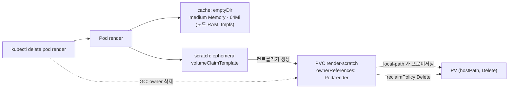

# q03 — Memory-backed and generic ephemeral volumes · 풀이

← 문제: **[question.md](question.md)**

## 문제 (해석)

**원문**

> A rendering job needs a small, fast cache and a larger scratch area. Neither may outlive the Pod.
>
> 1. Create a Pod `render` in namespace `venus` with one container `app`, image `busybox:1.36`,
>    memory request `64Mi` and memory limit `256Mi`, and the command
>    `sh -c 'echo warm > /cache/state; dd if=/dev/zero of=/scratch/blob bs=1M count=50; sleep 3600'`.
> 2. Mount at `/cache` a volume named `cache` that is backed by RAM and limited to `64Mi`.
> 3. Mount at `/scratch` a volume named `scratch` whose PersistentVolumeClaim is created and deleted
>    together with the Pod: StorageClass `local-path`, access mode `ReadWriteOnce`, `200Mi`.
> 4. Once the Pod is running, write the output of `df -h /cache /scratch` run inside the container to
>    `/opt/course/b03/df.txt`, and write the name of the PVC that was created for the Pod followed by
>    the kind and name of its owner to `/opt/course/b03/pvc.txt` in the form `<pvc> <Kind>/<name>`.
> 5. Delete the Pod and confirm that its PVC is removed as well.

**해석**

렌더링 작업에는 작고 빠른 캐시와 더 큰 스크래치 공간이 필요하다. 둘 다 Pod 보다 오래 남으면 안 된다.

1. `venus` 네임스페이스에 Pod `render` 를 만든다. 컨테이너는 `app` 하나, 이미지 `busybox:1.36`,
   메모리 request `64Mi`·limit `256Mi`, 명령은
   `sh -c 'echo warm > /cache/state; dd if=/dev/zero of=/scratch/blob bs=1M count=50; sleep 3600'` 이다.
2. `/cache` 에는 RAM 기반이고 `64Mi` 로 제한된 `cache` 라는 이름의 볼륨을 마운트한다.
3. `/scratch` 에는 PersistentVolumeClaim 이 Pod 와 함께 만들어지고 함께 삭제되는 `scratch` 라는 이름의
   볼륨을 마운트한다. StorageClass `local-path`, 접근 모드 `ReadWriteOnce`, `200Mi`.
4. Pod 가 Running 이 되면 컨테이너 안에서 실행한 `df -h /cache /scratch` 의 출력을
   `/opt/course/b03/df.txt` 에 적고, Pod 를 위해 만들어진 PVC 의 이름과 그 owner 의 kind·이름을
   `<pvc> <Kind>/<name>` 형식으로 `/opt/course/b03/pvc.txt` 에 적는다.
5. Pod 를 삭제하고 그 PVC 도 함께 지워졌는지 확인한다.

## 모범 풀이

**1)~3) Pod 한 번에 작성**

```bash
kubectl -n venus run render --image=busybox:1.36 --dry-run=client -o yaml \
  -- sh -c 'echo warm > /cache/state; dd if=/dev/zero of=/scratch/blob bs=1M count=50; sleep 3600' > /tmp/b03.yaml
```

컨테이너 이름을 `app` 으로 바꾸고 resources 와 volumes 를 채웁니다.

```yaml
apiVersion: v1
kind: Pod
metadata:
  name: render
  namespace: venus
spec:
  containers:
  - name: app
    image: busybox:1.36
    command: ["sh", "-c", "echo warm > /cache/state; dd if=/dev/zero of=/scratch/blob bs=1M count=50; sleep 3600"]
    resources:
      requests:
        memory: 64Mi
      limits:
        memory: 256Mi
    volumeMounts:
    - name: cache
      mountPath: /cache
    - name: scratch
      mountPath: /scratch
  volumes:
  - name: cache
    emptyDir:
      medium: Memory          # tmpfs (RAM)
      sizeLimit: 64Mi
  - name: scratch
    ephemeral:                # generic ephemeral volume
      volumeClaimTemplate:
        spec:
          accessModes: ["ReadWriteOnce"]
          storageClassName: local-path
          resources:
            requests:
              storage: 200Mi
```

```bash
kubectl apply -f /tmp/b03.yaml
kubectl -n venus wait pod render --for=condition=Ready --timeout=120s
```

- `kubectl run ... -- sh -c ...` 는 인자를 `args` 가 아니라 `command` 로 넣으려면 `--command` 가 필요합니다. 위처럼 YAML 에서 `command` 로 고쳐 쓰면 헷갈리지 않습니다.
- `medium: Memory` 인 emptyDir 에 쓴 데이터는 **컨테이너 메모리 사용량으로 계산**됩니다. 메모리 limit 이 작으면 캐시를 채우다 OOMKilled 될 수 있고, `sizeLimit` 을 넘기면 kubelet 이 파드를 축출합니다.
- generic ephemeral volume 은 `ephemeral.volumeClaimTemplate` 로 씁니다. 별도의 PVC 를 미리 만들지 않습니다. `local-path` 는 `WaitForFirstConsumer` 라 파드가 스케줄된 노드에 PV 가 만들어집니다.

### 그림 — 두 임시 볼륨의 수명



1. `cache` 는 kubelet 이 노드 메모리에 tmpfs 로 만들고, 파드가 지워지면 그대로 사라집니다.
2. `scratch` 는 ephemeral volume 컨트롤러가 `<파드이름>-<볼륨이름>` 이름의 PVC 를 만들고 ownerReference 를 파드로 겁니다.
3. 파드를 지우면 가비지 컬렉터가 owner 가 사라진 PVC 를 지우고, `local-path` StorageClass 의 `reclaimPolicy: Delete` 때문에 PV 와 노드의 디렉터리도 정리됩니다.

**4) 확인 결과 기록**

```bash
kubectl -n venus exec render -c app -- df -h /cache /scratch > /opt/course/b03/df.txt
cat /opt/course/b03/df.txt
# Filesystem   Size   Used  Available Use% Mounted on
# tmpfs        64.0M  4.0K   64.0M     0%  /cache       ← RAM(tmpfs), sizeLimit 크기
# /dev/sda1    ...    ...    ...       ..  /scratch     ← 노드 디스크 (local-path)

kubectl -n venus get pvc render-scratch \
  -o jsonpath='{.metadata.name} {.metadata.ownerReferences[0].kind}/{.metadata.ownerReferences[0].name}{"\n"}' \
  > /opt/course/b03/pvc.txt
cat /opt/course/b03/pvc.txt      # render-scratch Pod/render
```

local-path 는 실제 용량 제한을 걸지 않으므로 `/scratch` 의 Size 는 200Mi 가 아니라 노드 디스크 크기로 보입니다. `/cache` 의 tmpfs 크기는 `sizeLimit`(그리고 파드 메모리 limit 중 작은 값)으로 잡힙니다.

**5) Pod 삭제와 PVC 동반 삭제 확인**

```bash
kubectl -n venus delete pod render
kubectl -n venus get pvc                   # No resources found in venus namespace.
kubectl get pv | grep venus/render-scratch || echo "PV 도 정리됨"
```

## 검증

```bash
cat /opt/course/b03/df.txt | grep -E 'tmpfs.*/cache'     # cache 가 tmpfs
cat /opt/course/b03/pvc.txt                              # render-scratch Pod/render
kubectl -n venus get pod,pvc                             # No resources found
```

## 오답 원인 / 배운 점

- **왜 틀렸나**:
- **기억할 것**: 파드와 수명을 같이하는 PVC 는 `volumes[].ephemeral.volumeClaimTemplate`, 이름은 `<pod>-<volume>`.
- **헷갈리는 지점**: `emptyDir.medium: Memory` 의 사용량은 컨테이너 메모리 limit 에 포함됩니다. generic ephemeral volume 의 PVC 를 손으로 지우면 파드가 볼륨을 잃으니, 지울 때는 항상 파드를 지웁니다. StatefulSet 의 `volumeClaimTemplates`(파드가 지워져도 남음)와 이름이 비슷해 혼동하기 쉽습니다.

## 참고 문서

- 검색어: `ephemeral volumes`, `emptyDir medium Memory`
- https://kubernetes.io/docs/concepts/storage/ephemeral-volumes/#generic-ephemeral-volumes
- https://kubernetes.io/docs/concepts/storage/volumes/#emptydir

---

[↑ 문항 목록](../README.md) · [← 문제로](question.md) · [다음 문제 q04 →](../q04_canary_deployment_promote/question.md)
