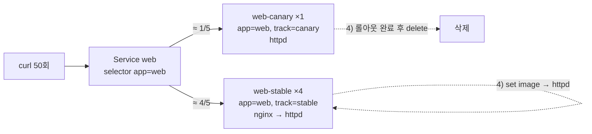

# q04 — Canary release behind a shared Service · 풀이

← 문제: **[question.md](question.md)**

## 문제 (해석)

**원문**

> In namespace `mars`, Deployment `web-stable` (4 replicas, image `nginx:1.27-alpine`, container
> `web`) serves traffic through Service `web` on port `80`. The team wants to try the new version,
> image `httpd:2.4-alpine`, on about 20% of the traffic first.
>
> 1. Create Deployment `web-canary` in `mars` with 1 replica, container `web`, image
>    `httpd:2.4-alpine`, and pod labels `app=web` and `track=canary`. Do not change the number of
>    stable replicas.
> 2. Make Service `web` send traffic to both stable and canary pods, without exposing any pods other
>    than those of the two Deployments.
> 3. From a temporary Pod using image `curlimages/curl:8.10.1`, send 50 requests to Service `web` and
>    write the number of answers from each version to `/opt/course/b04/split.txt` in the form
>    `stable=<n> canary=<n>`.
> 4. Promote the canary: update `web-stable` so that all 4 of its pods run `httpd:2.4-alpine`, and
>    only after that rollout has completed, delete `web-canary`.
> 5. Service `web` must end up with 4 ready endpoints, all running `httpd:2.4-alpine`.

**해석**

`mars` 네임스페이스에서 Deployment `web-stable`(레플리카 4, 이미지 `nginx:1.27-alpine`, 컨테이너 `web`)이
Service `web` 의 포트 `80` 으로 트래픽을 받고 있다. 팀은 새 버전 이미지 `httpd:2.4-alpine` 을 먼저
트래픽의 약 20% 에만 시험하려 한다.

1. `mars` 에 Deployment `web-canary` 를 만든다. 레플리카 1, 컨테이너 `web`, 이미지 `httpd:2.4-alpine`,
   파드 레이블 `app=web`, `track=canary`. stable 레플리카 수는 바꾸지 않는다.
2. Service `web` 이 stable 과 canary 파드 모두로 트래픽을 보내게 하되, 두 Deployment 의 파드 외에는
   어떤 파드도 노출하지 않는다.
3. 이미지 `curlimages/curl:8.10.1` 의 임시 Pod 에서 Service `web` 으로 요청 50개를 보내고, 버전별 응답
   수를 `/opt/course/b04/split.txt` 에 `stable=<n> canary=<n>` 형식으로 적는다.
4. canary 를 승격한다. `web-stable` 을 업데이트해 4개 파드 모두 `httpd:2.4-alpine` 을 실행하게 하고,
   그 롤아웃이 끝난 **뒤에** `web-canary` 를 삭제한다.
5. 최종적으로 Service `web` 에는 모두 `httpd:2.4-alpine` 을 실행하는 Ready 엔드포인트 4개가 있어야 한다.

## 모범 풀이

먼저 현재 레이블과 셀렉터를 확인합니다. 이 문제의 함정은 여기 있습니다.

```bash
kubectl -n mars get deploy web-stable -o jsonpath='{.spec.selector.matchLabels}{"\n"}'
# {"app":"web","track":"stable"}
kubectl -n mars get svc web -o jsonpath='{.spec.selector}{"\n"}'
# {"app":"web","track":"stable"}        ← Service 셀렉터에 track 이 들어 있다
kubectl -n mars get pods --show-labels
```

**1) canary Deployment**

```bash
kubectl -n mars create deployment web-canary --image=httpd:2.4-alpine --replicas=1 \
  --dry-run=client -o yaml > /tmp/b04.yaml
```

`create deployment` 는 레이블을 `app=web-canary` 로, 컨테이너 이름을 `httpd` 로 만듭니다. 셀렉터·템플릿 레이블과 컨테이너 이름을 고칩니다.

```yaml
apiVersion: apps/v1
kind: Deployment
metadata:
  name: web-canary
  namespace: mars
spec:
  replicas: 1
  selector:
    matchLabels:
      app: web
      track: canary          # stable 의 셀렉터(track=stable)와 겹치지 않게
  template:
    metadata:
      labels:
        app: web
        track: canary
    spec:
      containers:
      - name: web
        image: httpd:2.4-alpine
```

```bash
kubectl apply -f /tmp/b04.yaml
kubectl -n mars rollout status deploy web-canary
```

두 Deployment 의 셀렉터는 `track` 으로 서로 겹치지 않아야 합니다. 셀렉터를 `app=web` 만으로 하면 두 ReplicaSet 이 서로의 파드를 자기 것으로 셉니다.

**2) Service 셀렉터에서 track 빼기**

```bash
kubectl -n mars set selector svc web 'app=web'
# 또는: kubectl -n mars patch svc web --type=json -p='[{"op":"remove","path":"/spec/selector/track"}]'
kubectl get endpointslice -n mars -l kubernetes.io/service-name=web \
  -o jsonpath='{range .items[*].endpoints[*]}{.targetRef.name}{" "}{.conditions.ready}{"\n"}{end}'
# web-stable-...  true   (4줄)
# web-canary-...  true   (1줄)
```

Service 는 **공통 레이블(`app=web`)만**, Deployment 는 **공통 레이블 + 트랙**으로 고르는 것이 canary 의 기본 구조입니다. `set selector` 는 셀렉터 전체를 교체하므로 남길 레이블을 모두 적습니다. `app=web` 레이블을 가진 다른 파드가 이 네임스페이스에 없으므로 요구 2 의 "다른 파드 노출 금지"도 만족합니다. Endpoints API 는 1.33 부터 deprecated 이므로 EndpointSlice 로 확인합니다.

### 그림 — canary 트래픽 분배와 승격



1. Service 는 `app=web` 만 보므로 Ready 파드 5개에 연결을 고르게 나눕니다. 파드 수 비율(4:1)이 곧 트래픽 비율(약 80:20)입니다.
2. Deployment 마다 셀렉터에 `track` 을 넣어 두 ReplicaSet 이 서로 섞이지 않게 합니다.
3. 승격은 stable 의 이미지를 새 버전으로 바꾸는 것입니다. stable 롤아웃이 끝나기 전에 canary 를 지우면 그 사이 새 버전 처리 용량이 줄어드니, 롤아웃 완료를 확인한 다음 canary 를 지웁니다.

**3) 비율 측정**

```bash
kubectl -n mars run curl --image=curlimages/curl:8.10.1 --restart=Never --rm -i --command -- \
  sh -c 'for i in $(seq 1 50); do curl -s -o /dev/null -w "%header{server}\n" http://web; done' \
  > /tmp/b04.out
grep -c '^nginx' /tmp/b04.out      # 예: 41
grep -c '^Apache' /tmp/b04.out     # 예: 9
echo "stable=$(grep -c '^nginx' /tmp/b04.out) canary=$(grep -c '^Apache' /tmp/b04.out)" > /opt/course/b04/split.txt
```

`curl` 을 매번 새로 실행하므로 요청마다 새 연결이 되어 kube-proxy 가 다시 분배합니다. 비율은 무작위라 정확히 40:10 이 아니어도 됩니다. `--rm` 이 출력하는 `pod "curl" deleted` 줄은 grep 에 걸리지 않습니다.

**4) 승격과 canary 제거**

```bash
kubectl -n mars set image deploy/web-stable web=httpd:2.4-alpine
kubectl -n mars rollout status deploy web-stable        # successfully rolled out 을 본 다음
kubectl -n mars delete deploy web-canary
```

`set image` 의 `web=` 은 **컨테이너 이름**입니다. 이미지만 바꾸므로 셀렉터(불변)는 건드리지 않습니다.

## 검증

```bash
cat /opt/course/b04/split.txt                 # stable=41 canary=9 (합 50)
kubectl -n mars get deploy                    # web-stable 4/4, web-canary 없음
kubectl -n mars get svc web -o jsonpath='{.spec.selector}{"\n"}'     # {"app":"web"}
kubectl -n mars get pods -l app=web -o jsonpath='{range .items[*]}{.spec.containers[0].image}{"\n"}{end}' | sort | uniq -c
#   4 httpd:2.4-alpine
kubectl get endpointslice -n mars -l kubernetes.io/service-name=web \
  -o jsonpath='{range .items[*].endpoints[*]}{.conditions.ready}{"\n"}{end}' | grep -c true    # 4
```

## 오답 원인 / 배운 점

- **왜 틀렸나**:
- **기억할 것**: canary = Service 는 공통 레이블만, 각 Deployment 는 공통 레이블 + 트랙 레이블. 비율은 레플리카 수로 조절.
- **헷갈리는 지점**: Service 셀렉터에 `track=stable` 이 남아 있으면 canary 파드가 Ready 여도 트래픽을 0 건 받습니다. 반대로 Deployment 셀렉터에서 `track` 을 빼면 두 ReplicaSet 이 같은 파드를 다투게 됩니다. blue/green 은 반대로 Service 셀렉터의 버전 레이블을 한 번에 바꿔 전환합니다.

## 참고 문서

- 검색어: `canary deployment`, `managing resources canary`
- https://kubernetes.io/docs/concepts/workloads/management/#canary-deployments
- https://kubernetes.io/docs/concepts/services-networking/service/

---

[↑ 문항 목록](../README.md) · [← 문제로](question.md) · [다음 문제 q05 →](../q05_helm_upgrade_reuse_rollback/question.md)
