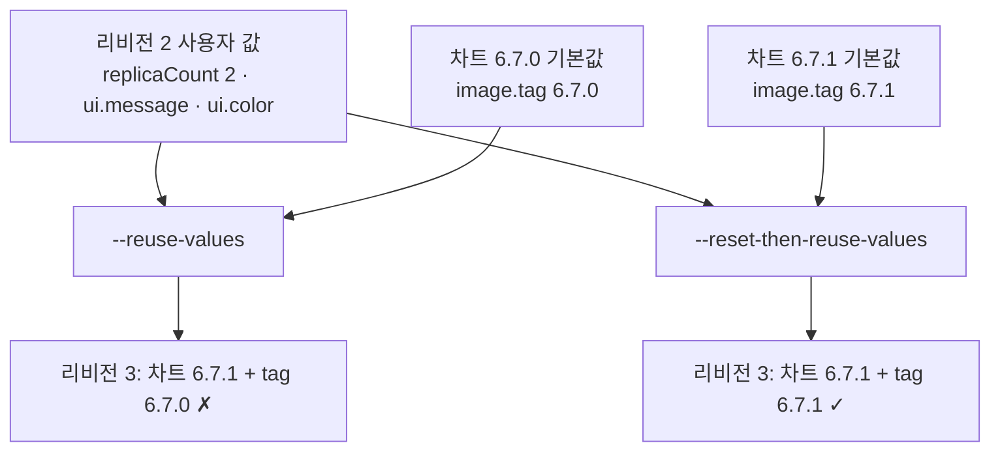

# q05 — Upgrade and roll back a Helm release without losing values · 풀이

← 문제: **[question.md](question.md)**

## 문제 (해석)

**원문**

> Helm release `podinfo` in namespace `jupiter` runs chart `podinfo/podinfo` version `6.7.0`. Over
> time, operators set several values on it with `--set` and values files.
>
> 1. Write the values that users supplied for the current revision, as YAML, to
>    `/opt/course/b05/user-values.yaml`, and the complete computed values (chart defaults merged with
>    user values), as YAML, to `/opt/course/b05/all-values.yaml`.
> 2. Upgrade the release to chart version `6.7.1`. Every user-supplied value must be kept, and every
>    value that users did not set must come from the defaults of chart `6.7.1`. Do not set any value
>    explicitly during this upgrade.
> 3. Verify that the Deployment of the release now runs image `ghcr.io/stefanprodan/podinfo:6.7.1`
>    and write the image to `/opt/course/b05/image.txt`.
> 4. Roll the release back to the revision in which it was first installed, then write the output of
>    `helm history podinfo -n jupiter` to `/opt/course/b05/history.txt`.

**해석**

`jupiter` 네임스페이스의 Helm 릴리스 `podinfo` 는 차트 `podinfo/podinfo` 버전 `6.7.0` 으로 돌고 있다.
그동안 운영자들이 `--set` 과 values 파일로 여러 값을 설정했다.

1. 현재 리비전에 사용자가 넣은 값을 YAML 로 `/opt/course/b05/user-values.yaml` 에, 계산된 전체 값(차트
   기본값 + 사용자 값)을 YAML 로 `/opt/course/b05/all-values.yaml` 에 적는다.
2. 릴리스를 차트 버전 `6.7.1` 로 업그레이드한다. 사용자가 넣은 값은 모두 유지하고, 사용자가 넣지
   않은 값은 모두 차트 `6.7.1` 의 기본값에서 와야 한다. 이 업그레이드에서 값을 명시적으로 설정하지 않는다.
3. 릴리스의 Deployment 가 이제 이미지 `ghcr.io/stefanprodan/podinfo:6.7.1` 을 쓰는지 확인하고 그 이미지를
   `/opt/course/b05/image.txt` 에 적는다.
4. 릴리스를 처음 설치된 리비전으로 롤백한 뒤, `helm history podinfo -n jupiter` 의 출력을
   `/opt/course/b05/history.txt` 에 적는다.

## 모범 풀이

```bash
helm -n jupiter list
# NAME     NAMESPACE  REVISION  STATUS    CHART          APP VERSION
# podinfo  jupiter    2         deployed  podinfo-6.7.0  6.7.0
helm -n jupiter history podinfo
helm search repo podinfo/podinfo --versions | head -5     # 6.7.1 이 있는지
```

**1) 사용자 값과 전체 값**

```bash
helm -n jupiter get values podinfo -o yaml > /opt/course/b05/user-values.yaml
helm -n jupiter get values podinfo -a -o yaml > /opt/course/b05/all-values.yaml
cat /opt/course/b05/user-values.yaml
# replicaCount: 2
# ui:
#   color: '#a33c3c'
#   message: hello from jupiter
grep -A3 '^image:' /opt/course/b05/all-values.yaml
# image:
#   pullPolicy: IfNotPresent
#   repository: ghcr.io/stefanprodan/podinfo
#   tag: 6.7.0
```

`-o yaml` 을 붙여야 `USER-SUPPLIED VALUES:` 머리줄 없이 순수 YAML 이 나옵니다. `-a`(`--all`)는 차트 기본값까지 합친 계산 결과입니다. `helm show values podinfo/podinfo --version 6.7.0` 은 차트 기본값만 보여 줍니다.

**2) 업그레이드 — `--reset-then-reuse-values`**

```bash
helm -n jupiter upgrade podinfo podinfo/podinfo --version 6.7.1 --reset-then-reuse-values --wait
```

podinfo 차트는 `values.yaml` 에 `image.tag` 를 차트 버전과 같게 적어 둡니다(6.7.0 차트는 `tag: 6.7.0`, 6.7.1 차트는 `tag: 6.7.1`). 그래서 어떤 옵션으로 올리느냐에 따라 결과 이미지가 달라집니다.

| 옵션 | 출발점 | 결과 (이 릴리스) |
|---|---|---|
| (값 없이) `helm upgrade` | 직전 사용자 값 + **새 차트** 기본값 | 이번에는 맞지만, `--set` 을 하나라도 주면 직전 사용자 값이 사라진다 |
| `--reuse-values` | 직전 사용자 값 + **옛 차트의 계산된 값** | 차트는 6.7.1 인데 `image.tag` 가 6.7.0 으로 남는다 ✗ |
| `--reset-then-reuse-values` | 직전 사용자 값 + **새 차트** 기본값 | 사용자 값 유지, `image.tag` 6.7.1 ✓ |
| `--reset-values` | 새 차트 기본값만 | `replicaCount` 1, 메시지·색상 사라짐 ✗ |

`--reset-then-reuse-values` 는 Helm 3.14 에 들어왔고 Helm 4 에도 그대로 있습니다. 차트 버전을 올리면서 값을 보존할 때는 이 옵션이 의도를 가장 정확히 드러냅니다. 값 없이 그냥 `helm upgrade` 해도 이번 결과는 같지만, 요구 2 의 "사용자 값을 보존"을 명시적으로 보장하는 것은 `--reset-then-reuse-values` 입니다.

### 그림 — 업그레이드할 때 값이 합쳐지는 순서



1. 두 옵션 모두 직전 리비전의 **사용자 값**(`helm get values`)을 그대로 가져옵니다.
2. 차이는 그 아래 깔리는 기본값입니다. `--reuse-values` 는 옛 차트로 계산했던 값을 새 차트의 기본값 자리에 덮어 버려서, 새 차트가 바꾼 기본값(`image.tag`)이 반영되지 않습니다.
3. `--reset-then-reuse-values` 는 새 차트의 기본값 위에 사용자 값만 다시 얹습니다.

**3) 이미지 확인**

```bash
kubectl -n jupiter get deploy podinfo -o jsonpath='{.spec.template.spec.containers[0].image}{"\n"}' \
  | tee /opt/course/b05/image.txt
# ghcr.io/stefanprodan/podinfo:6.7.1
```

여기서 `6.7.0` 이 보이면 `--reuse-values` 로 올린 것입니다. 다시 `--reset-then-reuse-values` 로 업그레이드하면 새 리비전으로 고쳐집니다.

**4) 처음 설치한 리비전으로 롤백**

```bash
helm -n jupiter history podinfo        # Install complete 인 리비전 번호 = 1
helm -n jupiter rollback podinfo 1 --wait
helm -n jupiter history podinfo > /opt/course/b05/history.txt
cat /opt/course/b05/history.txt
# REVISION  STATUS      CHART          APP VERSION  DESCRIPTION
# 1         superseded  podinfo-6.7.0  6.7.0        Install complete
# 2         superseded  podinfo-6.7.0  6.7.0        Upgrade complete
# 3         superseded  podinfo-6.7.1  6.7.1        Upgrade complete
# 4         deployed    podinfo-6.7.0  6.7.0        Rollback to 1
```

`helm rollback <rel> <rev>` 는 지정한 리비전의 차트와 값으로 **새 리비전**(4)을 만듭니다. 리비전 번호를 빼면 직전 리비전(3이 아니라 2)으로 돌아가므로 "처음 설치한 리비전"이라는 요구를 만족하지 못합니다.

## 검증

```bash
cat /opt/course/b05/image.txt                         # ghcr.io/stefanprodan/podinfo:6.7.1
grep -c 'Rollback to 1' /opt/course/b05/history.txt   # 1
helm -n jupiter get values podinfo -o yaml            # 리비전 1 의 사용자 값: replicaCount 2, ui.message (color 없음)
kubectl -n jupiter get deploy podinfo -o jsonpath='{.spec.replicas} {.spec.template.spec.containers[0].image}{"\n"}'
# 2 ghcr.io/stefanprodan/podinfo:6.7.0
```

## 오답 원인 / 배운 점

- **왜 틀렸나**:
- **기억할 것**: 차트 버전을 올리며 값을 지킬 때는 `--reset-then-reuse-values`, 특정 시점으로 돌릴 때는 `helm rollback <rel> <rev>`.
- **헷갈리는 지점**: `--reuse-values` 는 새 차트의 기본값 변경까지 막아 버립니다(이미지 태그가 차트 기본값인 차트에서 특히 위험). `helm get values` 는 사용자 값만, `-a` 는 계산된 전체 값입니다. Helm 4 에서 `--atomic` 은 `--rollback-on-failure` 로 이름이 바뀌었습니다.

## 참고 문서

시험 중에는 **helm.sh/docs** 도 열람할 수 있습니다.

- 검색어: `helm upgrade reset-then-reuse-values`, `helm rollback`, `helm get values`
- https://helm.sh/docs/helm/helm_upgrade/
- https://helm.sh/docs/helm/helm_rollback/
- https://helm.sh/docs/helm/helm_get_values/

---

[↑ 문항 목록](../README.md) · [← 문제로](question.md) · [다음 문제 q06 →](../q06_kustomize_patches_target_labels/question.md)
