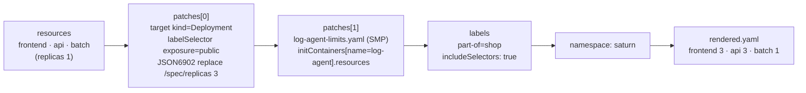

# q06 — Kustomize patches with target selectors and labels · 풀이

← 문제: **[question.md](question.md)**

## 문제 (해석)

**원문**

> The Kustomize directory `/opt/course/b06/app` was used to deploy Deployments `frontend`, `api` and
> `batch` to namespace `saturn`. Update the kustomization; do not edit `frontend.yaml`, `api.yaml` or
> `batch.yaml`.
>
> 1. Replace the deprecated `commonLabels` field with the `labels` field. The Deployments are already
>    running, so the rendered labels and selectors must stay exactly as they are today.
> 2. Add an entry to `patches` that uses a target selector to match every Deployment with the label
>    `exposure=public` and, using an inline JSON6902 operation, sets `spec.replicas` to `3`. Do not
>    name individual Deployments in this patch.
> 3. Create the strategic-merge patch file `/opt/course/b06/app/log-agent-limits.yaml`, reference it
>    from `patches`, and use it to give the `log-agent` sidecar of Deployment `api` requests
>    `cpu: 10m, memory: 16Mi` and limits `cpu: 50m, memory: 32Mi`.
> 4. Render the kustomization with `kubectl kustomize` into `/opt/course/b06/rendered.yaml`, then apply
>    that file. Rendering must not print any deprecation warning.
> 5. In the end, `frontend` and `api` run 3 replicas, `batch` still runs 1, and every `api` pod has
>    the `log-agent` sidecar with the resources above.

**해석**

Kustomize 디렉터리 `/opt/course/b06/app` 으로 Deployment `frontend`, `api`, `batch` 를 `saturn` 네임스페이스에
배포했다. kustomization 을 수정하되 `frontend.yaml`, `api.yaml`, `batch.yaml` 은 고치지 않는다.

1. deprecated 된 `commonLabels` 필드를 `labels` 필드로 바꾼다. Deployment 가 이미 돌고 있으므로 렌더링된
   레이블과 셀렉터는 지금과 정확히 같아야 한다.
2. `patches` 에 항목을 하나 추가한다. target 셀렉터로 레이블 `exposure=public` 이 있는 모든 Deployment 를
   고르고, 인라인 JSON6902 연산으로 `spec.replicas` 를 `3` 으로 설정한다. 이 패치에 개별 Deployment 이름을
   쓰지 않는다.
3. strategic-merge 패치 파일 `/opt/course/b06/app/log-agent-limits.yaml` 을 만들어 `patches` 에서 참조하고,
   이것으로 Deployment `api` 의 `log-agent` 사이드카에 requests `cpu: 10m, memory: 16Mi`, limits
   `cpu: 50m, memory: 32Mi` 를 준다.
4. `kubectl kustomize` 로 렌더링한 결과를 `/opt/course/b06/rendered.yaml` 에 저장하고 그 파일을 적용한다.
   렌더링할 때 deprecation 경고가 출력되면 안 된다.
5. 최종적으로 `frontend` 와 `api` 는 레플리카 3, `batch` 는 그대로 1 이고, 모든 `api` 파드에는 위 resources 를
   가진 `log-agent` 사이드카가 있다.

## 모범 풀이

```bash
cd /opt/course/b06/app
cat kustomization.yaml
kubectl kustomize . >/dev/null          # Warning: 'commonLabels' is deprecated. Please use 'labels' instead.
kubectl -n saturn get deploy api -o jsonpath='{.spec.selector.matchLabels}{"\n"}'
# {"app":"api","app.kubernetes.io/part-of":"shop"}     ← commonLabels 는 셀렉터에도 들어갔다
grep -n -A6 'initContainers' api.yaml                    # log-agent 는 containers 가 아니라 initContainers 에 있다
```

**1)~3) kustomization.yaml 다시 쓰기**

```yaml
apiVersion: kustomize.config.k8s.io/v1beta1
kind: Kustomization
namespace: saturn
labels:
- pairs:
    app.kubernetes.io/part-of: shop
  includeSelectors: true        # commonLabels 와 똑같이 selector·template 에도 넣는다
resources:
- frontend.yaml
- api.yaml
- batch.yaml
patches:
- target:
    kind: Deployment
    labelSelector: exposure=public
  patch: |-
    - op: replace
      path: /spec/replicas
      value: 3
- path: log-agent-limits.yaml
```

```yaml
# /opt/course/b06/app/log-agent-limits.yaml
apiVersion: apps/v1
kind: Deployment
metadata:
  name: api
spec:
  template:
    spec:
      initContainers:           # 사이드카가 있는 곳 그대로 — containers 로 쓰면 안 된다
      - name: log-agent
        resources:
          requests:
            cpu: 10m
            memory: 16Mi
          limits:
            cpu: 50m
            memory: 32Mi
```

- **`includeSelectors: true` 가 핵심 함정입니다.** `labels` 의 기본값(`includeSelectors: false`)은 `metadata.labels` 에만 레이블을 붙입니다. 그러면 렌더링된 셀렉터에서 `part-of` 가 빠지고, Deployment 의 `spec.selector` 는 불변이라 apply 가 `field is immutable` 로 실패합니다. 기존 `commonLabels` 와 같은 결과를 내려면 `includeSelectors: true` 를 줍니다(템플릿 레이블도 함께 붙습니다).
- `patches` 의 `target.labelSelector` 는 리소스의 `metadata.labels` 로 고릅니다. `frontend`·`api` 는 `exposure: public`, `batch` 는 `exposure: internal` 이라 두 개만 바뀝니다.
- strategic-merge 패치는 컨테이너 목록을 **`name` 으로 병합**합니다. 사이드카는 `initContainers` 에 있으므로 패치도 `initContainers` 아래에 씁니다. `containers` 아래에 `log-agent` 를 쓰면 이미지 없는 새 컨테이너가 하나 더 생겨 apply 가 `image: Required value` 로 거부됩니다.

### 그림 — 렌더링 파이프라인



1. 원본 매니페스트는 그대로 두고, kustomization 이 순서대로 변환을 얹어 최종 YAML 을 만듭니다.
2. 첫 번째 패치는 target 셀렉터에 걸린 Deployment 마다 JSON6902 연산을 적용하므로 이름을 몰라도 됩니다.
3. 두 번째 패치는 파일 안의 `metadata.name: api` 로 대상을 찾고, 리스트는 `name` 기준으로 병합됩니다.
4. `labels` 가 셀렉터까지 같은 레이블을 넣어 이미 배포된 셀렉터와 똑같아집니다.

**4) 렌더링과 적용**

```bash
kubectl kustomize /opt/course/b06/app > /opt/course/b06/rendered.yaml   # 경고 없이 끝나야 한다
grep -n 'replicas' /opt/course/b06/rendered.yaml                       # 3, 3, 1
kubectl apply -f /opt/course/b06/rendered.yaml
kubectl -n saturn rollout status deploy api
```

`kubectl apply -k /opt/course/b06/app` 와 결과는 같지만, 요구는 렌더링한 파일을 적용하는 것입니다. 적용 전에 `kubectl diff -f /opt/course/b06/rendered.yaml` 로 바뀌는 부분을 미리 볼 수 있습니다.

## 검증

```bash
kubectl kustomize /opt/course/b06/app 2>&1 >/dev/null | grep -i deprecat || echo "경고 없음"
kubectl -n saturn get deploy
# NAME       READY   UP-TO-DATE   AVAILABLE
# api        3/3     3            3
# batch      1/1     1            1
# frontend   3/3     3            3
kubectl -n saturn get deploy api -o jsonpath='{.spec.selector.matchLabels}{"\n"}'
# {"app":"api","app.kubernetes.io/part-of":"shop"}     ← 그대로
kubectl -n saturn get deploy api \
  -o jsonpath='{.spec.template.spec.initContainers[?(@.name=="log-agent")].resources}{"\n"}'
# {"limits":{"cpu":"50m","memory":"32Mi"},"requests":{"cpu":"10m","memory":"16Mi"}}
kubectl -n saturn get deploy api -o jsonpath='{.spec.template.spec.containers[*].name}{"\n"}'    # api (하나뿐)
```

## 오답 원인 / 배운 점

- **왜 틀렸나**:
- **기억할 것**: `commonLabels` → `labels: [{pairs: ..., includeSelectors: true}]` 로 바꿔야 기존 셀렉터가 유지된다.
- **헷갈리는 지점**: Kustomize v5 에서 `commonLabels`·`patchesStrategicMerge`·`patchesJson6902` 는 모두 deprecated 이고 `labels`·`patches` 로 통합되었습니다. JSON6902 는 인덱스 경로(`/spec/template/spec/containers/1`)라 순서가 바뀌면 엉뚱한 컨테이너를 고치므로, 이름으로 고를 때는 strategic-merge 가 안전합니다. native sidecar 는 `initContainers` 에 있다는 것을 잊지 않습니다.

## 참고 문서

- 검색어: `kustomize`, `kustomization labels includeSelectors`, `patches target`
- https://kubernetes.io/docs/tasks/manage-kubernetes-objects/kustomization/
- https://kubernetes.io/docs/concepts/workloads/pods/sidecar-containers/

---

[↑ 문항 목록](../README.md) · [← 문제로](question.md) · [다음 문제 q07 →](../q07_readiness_probe_stuck_rollout/question.md)
