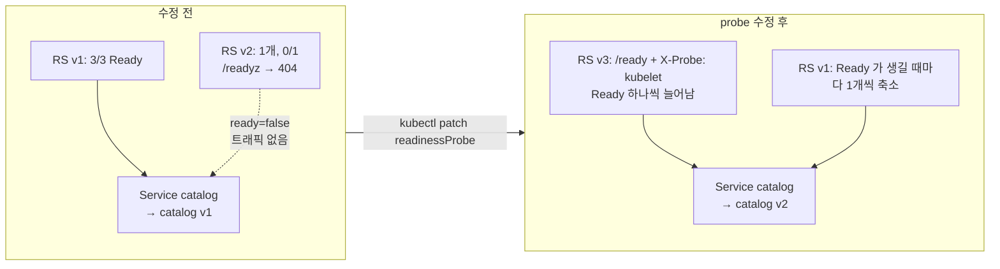

# q07 — Unblock a rollout gated by a readiness probe · 풀이

← 문제: **[question.md](question.md)**

## 문제 (해석)

**원문**

> In namespace `neptune`, a rollout of Deployment `catalog` from v1 (ConfigMap `catalog-v1`) to v2
> (ConfigMap `catalog-v2`) was started but has not finished. Users report no outage.
>
> 1. Find out why the rollout does not progress. Write the exact readiness failure message from the
>    events of the new pod to `/opt/course/b07/reason.txt` (one line, starting with
>    `Readiness probe failed`).
> 2. Write the response body that Service `catalog` returns on path `/` right now to
>    `/opt/course/b07/during.txt`, and in one line in `/opt/course/b07/why-no-outage.txt` name the
>    rollout setting that keeps the old pods serving.
> 3. Fix the readiness probe of the new version so that it matches the health endpoint defined in
>    ConfigMap `catalog-v2`. Do not roll back, and do not change the image, the ConfigMaps or the
>    rollout strategy.
> 4. Let the rollout finish: all 3 pods must be ready and use ConfigMap `catalog-v2`, and Service
>    `catalog` must answer `catalog v2` on path `/`.

**해석**

`neptune` 네임스페이스에서 Deployment `catalog` 를 v1(ConfigMap `catalog-v1`)에서 v2(ConfigMap `catalog-v2`)로
바꾸는 롤아웃이 시작되었지만 끝나지 않았다. 사용자들은 장애를 느끼지 못했다.

1. 롤아웃이 진행되지 않는 이유를 찾는다. 새 파드의 이벤트에 있는 readiness 실패 메시지를 그대로
   `/opt/course/b07/reason.txt` 에 적는다(`Readiness probe failed` 로 시작하는 한 줄).
2. Service `catalog` 가 지금 경로 `/` 에 돌려주는 응답 본문을 `/opt/course/b07/during.txt` 에 적고, 옛 파드가
   계속 트래픽을 받게 해 주는 롤아웃 설정을 `/opt/course/b07/why-no-outage.txt` 에 한 줄로 적는다.
3. 새 버전의 readiness probe 를 ConfigMap `catalog-v2` 에 정의된 헬스 엔드포인트에 맞게 고친다. 롤백하지
   않으며, 이미지·ConfigMap·롤아웃 전략은 바꾸지 않는다.
4. 롤아웃을 끝낸다. 파드 3개가 모두 Ready 이고 ConfigMap `catalog-v2` 를 써야 하며, Service `catalog` 는
   경로 `/` 에 `catalog v2` 를 응답해야 한다.

## 모범 풀이

**1) 멈춘 이유 찾기**

```bash
kubectl -n neptune rollout status deploy catalog --timeout=10s
# Waiting for deployment "catalog" rollout to finish: 1 out of 3 new replicas have been updated...
# (2분이 지나면) error: deployment "catalog" exceeded its progress deadline
kubectl -n neptune get rs -l app=catalog
# NAME                 DESIRED   CURRENT   READY
# catalog-5d8...       3         3         3      ← v1
# catalog-7f4...       1         1         0      ← v2, Ready 가 안 된다
kubectl -n neptune get pods -l app=catalog
kubectl -n neptune describe pod <v2 파드> | grep -A3 -i readiness
#    Readiness:  http-get http://:8080/readyz delay=0s timeout=1s period=5s #success=1 #failure=3
# Warning  Unhealthy  ...  Readiness probe failed: HTTP probe failed with statuscode: 404
kubectl -n neptune get events --field-selector reason=Unhealthy \
  -o jsonpath='{.items[-1:].message}{"\n"}' > /opt/course/b07/reason.txt
cat /opt/course/b07/reason.txt     # Readiness probe failed: HTTP probe failed with statuscode: 404
```

readiness 가 실패하는 파드는 재시작되지 않습니다(그건 liveness). 그냥 Ready 가 되지 않을 뿐이라 STATUS 는 `Running`, READY 는 `0/1` 입니다. Deployment 는 새 파드가 Ready 가 되어야 다음 단계로 가므로 여기서 멈춥니다.

**2) 지금은 누가 응답하는가, 왜 장애가 없는가**

```bash
kubectl -n neptune exec deploy/catalog -c web -- wget -qO- http://catalog/ | tee /opt/course/b07/during.txt
# catalog v1
kubectl -n neptune get deploy catalog -o jsonpath='{.spec.strategy}{"\n"}'
# {"rollingUpdate":{"maxSurge":1,"maxUnavailable":0},"type":"RollingUpdate"}
echo "maxUnavailable: 0 - old pods are only removed after new pods become ready" > /opt/course/b07/why-no-outage.txt
```

`maxUnavailable: 0` 이면 컨트롤러는 Ready 파드 수를 3 아래로 내리지 않습니다. `maxSurge: 1` 로 새 파드 하나만 더 만들고, 그 파드가 Ready 가 되기 전까지 옛 파드를 하나도 지우지 않습니다. 또 Ready 가 아닌 파드는 EndpointSlice 에서 `ready: false` 라 Service 트래픽을 받지 않으므로, 사용자는 계속 v1 을 봅니다.

**3) v2 의 진짜 헬스 엔드포인트 확인 후 probe 수정**

```bash
kubectl -n neptune get cm catalog-v2 -o jsonpath='{.data.default\.conf}'
#    location = /ready {
#        if ($http_x_probe != "kubelet") { return 403; }
kubectl -n neptune get deploy catalog -o jsonpath='{.spec.template.spec.containers[0].readinessProbe}{"\n"}'
# {"httpGet":{"httpHeaders":[{"name":"X-Probe","value":"k8s"}],"path":"/readyz","port":8080,...}
```

경로(`/readyz` → `/ready`)와 헤더 값(`k8s` → `kubelet`) **두 군데**가 틀렸습니다. 경로만 고치면 상태 코드가 404 에서 403 으로 바뀔 뿐 여전히 실패합니다.

```bash
kubectl -n neptune patch deploy catalog --type=json -p='[
  {"op":"replace","path":"/spec/template/spec/containers/0/readinessProbe/httpGet/path","value":"/ready"},
  {"op":"replace","path":"/spec/template/spec/containers/0/readinessProbe/httpGet/httpHeaders/0/value","value":"kubelet"}
]'
# 또는 kubectl -n neptune edit deploy catalog
```

pod template 이 바뀌므로 새 ReplicaSet(리비전 3)이 만들어지고, 멈춰 있던 리비전 2 의 ReplicaSet 은 0 으로 줄어듭니다. `rollout undo` 는 요구 위반이고, 데드라인을 넘긴 롤아웃도 템플릿을 고치면 다시 진행됩니다.

### 그림 — maxUnavailable 0 에서 readiness 가 롤아웃을 붙잡는 방식



1. 수정 전: 새 파드가 Ready 가 아니므로 EndpointSlice 에 `ready=false` 로만 올라가고, `maxUnavailable: 0` 때문에 v1 파드는 하나도 줄지 않습니다.
2. probe 를 고치면 새 ReplicaSet 의 파드가 Ready 가 될 때마다 v1 을 하나씩 줄입니다(`maxSurge: 1`).
3. 마지막 v1 파드가 내려가면 Service 는 v2 만 응답하고, 롤아웃이 `successfully rolled out` 으로 끝납니다.

**4) 롤아웃 완료**

```bash
kubectl -n neptune rollout status deploy catalog --timeout=180s
# deployment "catalog" successfully rolled out
kubectl -n neptune exec deploy/catalog -c web -- wget -qO- http://catalog/     # catalog v2
```

## 검증

```bash
cat /opt/course/b07/reason.txt /opt/course/b07/during.txt /opt/course/b07/why-no-outage.txt
kubectl -n neptune get deploy catalog          # READY 3/3, UP-TO-DATE 3
kubectl -n neptune get pods -l app=catalog \
  -o jsonpath='{range .items[*]}{.metadata.name}{" "}{.spec.volumes[0].configMap.name}{" "}{.status.containerStatuses[0].ready}{"\n"}{end}'
# catalog-...  catalog-v2  true   (3줄)
kubectl -n neptune get deploy catalog -o jsonpath='{.spec.strategy.rollingUpdate}{"\n"}'   # maxSurge 1, maxUnavailable 0 그대로
kubectl -n neptune exec deploy/catalog -c web -- wget -qO- http://catalog/     # catalog v2
```

## 오답 원인 / 배운 점

- **왜 틀렸나**:
- **기억할 것**: readiness 실패 = 재시작 없음 + 트래픽 제외 + 롤아웃 정지. 원인은 `describe pod` 의 `Unhealthy` 이벤트에 상태 코드로 나온다.
- **헷갈리는 지점**: 상태 코드가 404 에서 403 으로 바뀌면 "다른 오류"가 아니라 경로는 맞고 헤더가 틀렸다는 뜻입니다. `progressDeadlineSeconds` 를 넘겨도 Deployment 는 자동 롤백하지 않고 `Progressing=False`(ProgressDeadlineExceeded) 조건만 남깁니다.

## 참고 문서

- 검색어: `configure liveness readiness startup probes`, `deployment progress deadline`
- https://kubernetes.io/docs/tasks/configure-pod-container/configure-liveness-readiness-startup-probes/
- https://kubernetes.io/docs/concepts/workloads/controllers/deployment/#failed-deployment

---

[↑ 문항 목록](../README.md) · [← 문제로](question.md) · [다음 문제 q08 →](../q08_debug_distroless_ephemeral/question.md)
