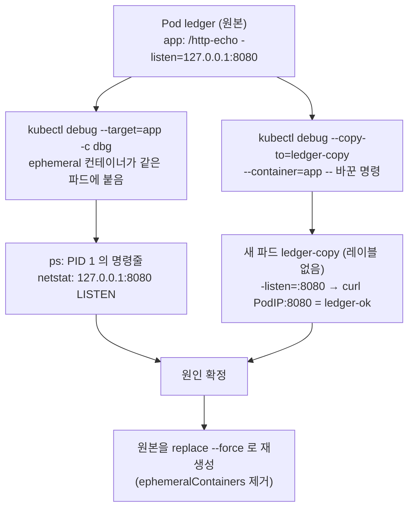

# q08 — Debug a container that has no shell · 풀이

← 문제: **[question.md](question.md)**

## 문제 (해석)

**원문**

> Pod `ledger` in namespace `pluto` is `Running`, but requests to Service `ledger` on port `80` are
> refused. Its image has no shell, so `kubectl exec ... -- sh` does not work.
>
> 1. Add an ephemeral container named `dbg` with image `busybox:1.36` to Pod `ledger` that shares the
>    process namespace of container `app`. Using it, write the full command line of the application
>    process to `/opt/course/b08/cmdline.txt` and the list of listening TCP sockets to
>    `/opt/course/b08/listen.txt`.
> 2. With `kubectl debug`, create a copy of the Pod named `ledger-copy` in which container `app` runs
>    `/http-echo -listen=:8080 -text=ledger-ok` instead of its original command. The copy must not
>    receive traffic from Service `ledger`.
> 3. Send a request to port `8080` of `ledger-copy`'s Pod IP from a temporary Pod using image
>    `curlimages/curl:8.10.1` and write the response to `/opt/course/b08/copy-test.txt`.
> 4. In one line in `/opt/course/b08/cause.txt`, state why Service `ledger` could not reach the
>    application.
> 5. Fix Pod `ledger` so that Service `ledger` answers `ledger-ok` on port `80`. Keep the Pod name,
>    labels, image and container name. Then delete `ledger-copy`.

**해석**

`pluto` 네임스페이스의 Pod `ledger` 는 `Running` 이지만 Service `ledger` 의 포트 `80` 으로 보낸 요청이 거부된다.
이미지에 셸이 없어 `kubectl exec ... -- sh` 는 동작하지 않는다.

1. 컨테이너 `app` 의 프로세스 네임스페이스를 공유하는, 이미지 `busybox:1.36` 의 `dbg` 라는 ephemeral 컨테이너를
   Pod `ledger` 에 추가한다. 이것으로 애플리케이션 프로세스의 전체 명령줄을 `/opt/course/b08/cmdline.txt` 에,
   LISTEN 중인 TCP 소켓 목록을 `/opt/course/b08/listen.txt` 에 적는다.
2. `kubectl debug` 로 Pod 의 복사본 `ledger-copy` 를 만들되, 그 안의 컨테이너 `app` 은 원래 명령 대신
   `/http-echo -listen=:8080 -text=ledger-ok` 를 실행하게 한다. 복사본은 Service `ledger` 의 트래픽을 받으면 안 된다.
3. 이미지 `curlimages/curl:8.10.1` 의 임시 Pod 에서 `ledger-copy` 의 Pod IP 포트 `8080` 으로 요청을 보내고 응답을
   `/opt/course/b08/copy-test.txt` 에 적는다.
4. Service `ledger` 가 애플리케이션에 닿지 못한 이유를 `/opt/course/b08/cause.txt` 에 한 줄로 적는다.
5. Service `ledger` 가 포트 `80` 에서 `ledger-ok` 를 응답하도록 Pod `ledger` 를 고친다. Pod 이름, 레이블, 이미지,
   컨테이너 이름은 유지한다. 그다음 `ledger-copy` 를 삭제한다.

## 모범 풀이

```bash
kubectl -n pluto get pod ledger -o wide          # Running 1/1
kubectl -n pluto exec ledger -c app -- sh
# error: ... exec: "sh": executable file not found in $PATH      ← scratch 기반, 셸 없음
kubectl get endpointslice -n pluto -l kubernetes.io/service-name=ledger   # 엔드포인트는 있다 (8080)
```

엔드포인트가 있는데 연결이 거부되면 셀렉터 문제가 아니라 **파드 안에서 그 포트를 실제로 누가 어디서 듣고 있는지**를 봐야 합니다.

**1) ephemeral 컨테이너로 프로세스와 소켓 보기**

```bash
kubectl -n pluto debug ledger -c dbg --image=busybox:1.36 --target=app -- sleep 3600
kubectl -n pluto get pod ledger -o jsonpath='{.status.ephemeralContainerStatuses[0].state}{"\n"}'   # running

kubectl -n pluto exec ledger -c dbg -- ps -o pid,user,args
# PID   USER     COMMAND
#     1 root     /http-echo -listen=127.0.0.1:8080 -text=ledger-ok
#     7 root     sleep 3600
kubectl -n pluto exec ledger -c dbg -- sh -c 'tr "\0" " " < /proc/1/cmdline; echo' > /opt/course/b08/cmdline.txt
kubectl -n pluto exec ledger -c dbg -- netstat -tln > /opt/course/b08/listen.txt
cat /opt/course/b08/listen.txt
# Proto Recv-Q Send-Q Local Address    Foreign Address  State
# tcp        0      0 127.0.0.1:8080   0.0.0.0:*        LISTEN      ← 루프백에서만 듣는다
```

- `--target=app` 이 있어야 디버그 컨테이너가 `app` 의 **PID 네임스페이스**에 들어가 앱 프로세스(PID 1)가 보입니다. 없으면 `ps` 에 자기 프로세스만 나옵니다. 네트워크 네임스페이스는 파드 전체가 원래 공유하므로 `netstat` 은 어느 쪽이든 보입니다.
- 대상 컨테이너의 파일은 `/proc/1/root/` 아래로 볼 수 있습니다(예: `ls /proc/1/root/`).
- ephemeral 컨테이너는 한 번 넣으면 **지울 수도 바꿀 수도 없습니다**. 그래서 `sleep` 으로 띄워 두고 `exec` 로 여러 번 들어가는 방식이 편합니다.

**2) 명령을 바꾼 복사본 만들기**

```bash
kubectl -n pluto debug ledger --copy-to=ledger-copy --container=app \
  -- /http-echo -listen=:8080 -text=ledger-ok
kubectl -n pluto get pod ledger-copy --show-labels      # LABELS <none>
```

`--copy-to` 는 기본적으로 레이블을 복사하지 않으므로(`--keep-labels=false`) Service 셀렉터에 걸리지 않습니다. `--image` 없이 `--container` 와 `--` 뒤의 명령만 주면 그 컨테이너의 이미지는 그대로 두고 **명령만** 바꿉니다. 원본 파드는 건드리지 않으므로 운영 파드를 살려 둔 채 가설을 시험할 수 있습니다.

**3) 복사본 시험**

```bash
IP=$(kubectl -n pluto get pod ledger-copy -o jsonpath='{.status.podIP}')
kubectl -n pluto run curl --image=curlimages/curl:8.10.1 --restart=Never --rm -i \
  -- -s "http://$IP:8080/" | grep ledger > /opt/course/b08/copy-test.txt
cat /opt/course/b08/copy-test.txt     # ledger-ok
```

**4) 원인**

```bash
echo "http-echo listens on 127.0.0.1:8080 (loopback only), so traffic to the pod IP on 8080 is refused" \
  > /opt/course/b08/cause.txt
```

**5) 원본 수정 — 파드 args 는 불변이라 다시 만든다**

```bash
kubectl -n pluto get pod ledger -o yaml > /tmp/ledger.yaml
# 편집:
#  - args 의 -listen=127.0.0.1:8080 → -listen=:8080
#  - spec.ephemeralContainers 블록 전체 삭제   ← 남겨 두면 생성이 거부된다
#  - status, metadata.uid / resourceVersion / creationTimestamp 삭제
kubectl replace --force -f /tmp/ledger.yaml
kubectl -n pluto wait pod ledger --for=condition=Ready --timeout=60s
kubectl -n pluto delete pod ledger-copy
```

`spec.ephemeralContainers` 는 파드 **생성 시에는 설정할 수 없는** 필드라(`ephemeralcontainers` 서브리소스로만 추가), 내보낸 YAML 에 그대로 두면 `spec.ephemeralContainers: Forbidden: cannot be set on create` 로 실패합니다.

### 그림 — 셸 없는 파드를 들여다보는 두 가지 방법



1. ephemeral 컨테이너는 원본 파드 안에서 **지금 상태**를 관찰합니다(프로세스, 소켓, 파일). 원본을 재시작하지 않습니다.
2. `--copy-to` 는 원본과 같은 스펙의 **새 파드**를 만들어 명령·이미지를 바꿔 실험합니다. 레이블이 없어 Service 트래픽과 분리됩니다.
3. 관찰과 실험으로 원인을 확정한 뒤, 불변 필드(args)를 고치려면 원본을 다시 만듭니다.

## 검증

```bash
cat /opt/course/b08/cmdline.txt       # /http-echo -listen=127.0.0.1:8080 -text=ledger-ok
grep 127.0.0.1:8080 /opt/course/b08/listen.txt
cat /opt/course/b08/copy-test.txt     # ledger-ok
kubectl -n pluto get pod              # ledger 1/1 Running, ledger-copy 없음
kubectl -n pluto get pod ledger -o jsonpath='{.metadata.labels} {.spec.containers[0].name} {.spec.containers[0].args}{"\n"}'
# {"app":"ledger"} app ["-listen=:8080","-text=ledger-ok"]
kubectl -n pluto run curl --image=curlimages/curl:8.10.1 --restart=Never --rm -i -- -s http://ledger/
# ledger-ok
```

## 오답 원인 / 배운 점

- **왜 틀렸나**:
- **기억할 것**: 셸 없는 컨테이너는 `kubectl debug -it <pod> --image=busybox:1.36 --target=<container>`, 명령을 바꿔 실험할 때는 `--copy-to=<new> --container=<c> -- <cmd>`.
- **헷갈리는 지점**: `--target` 을 빼면 다른 컨테이너의 프로세스가 보이지 않습니다. 엔드포인트가 있는데 `connection refused` 면 앱이 `127.0.0.1` 에만 바인드했거나 다른 포트를 듣는 경우가 많습니다. ephemeral 컨테이너는 파드 스펙에 영구히 남아 내보낸 YAML 로 재생성할 때 지워야 합니다.

## 참고 문서

- 검색어: `debug running pod ephemeral container`, `kubectl debug copy-to`
- https://kubernetes.io/docs/tasks/debug/debug-application/debug-running-pod/#ephemeral-container
- https://kubernetes.io/docs/tasks/debug/debug-application/debug-running-pod/#copying-a-pod-while-changing-its-command
- https://kubernetes.io/docs/concepts/workloads/pods/ephemeral-containers/

---

[↑ 문항 목록](../README.md) · [← 문제로](question.md) · [다음 문제 q09 →](../q09_top_memory_oomkilled/question.md)
