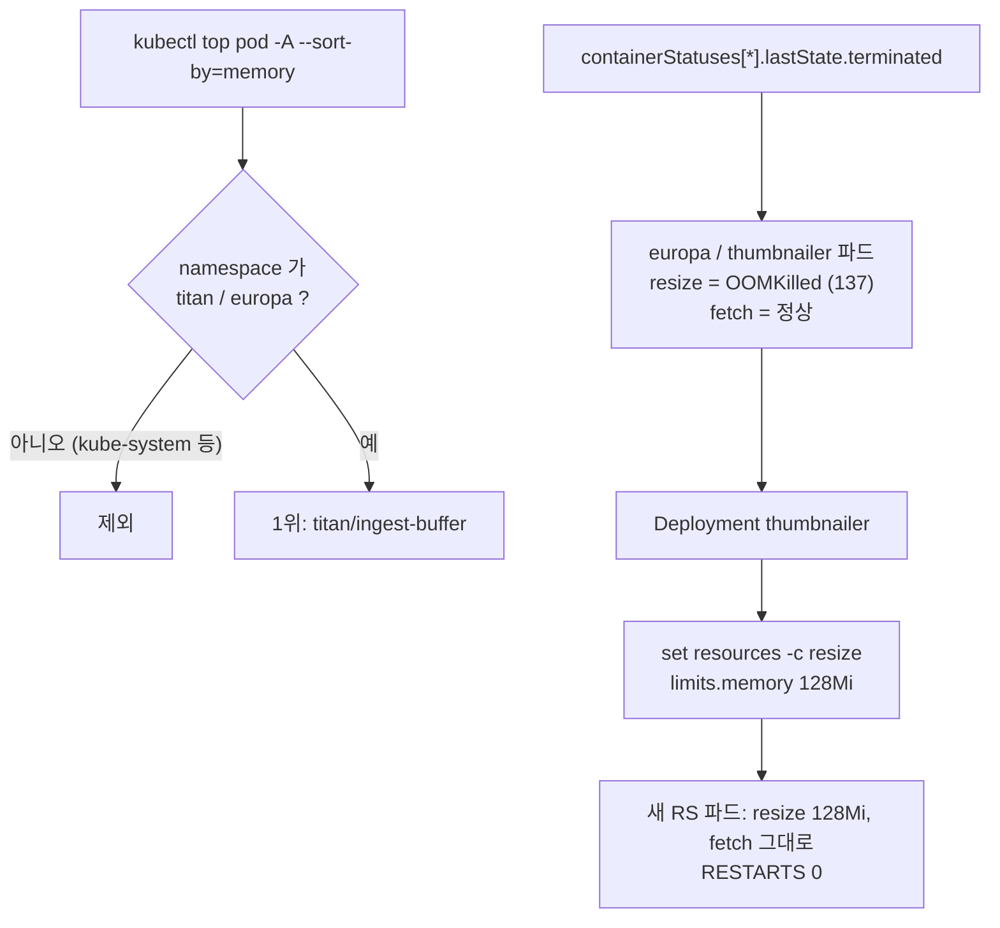

# q09 — Find a memory hog and an OOMKilled container · 풀이

← 문제: **[question.md](question.md)**

## 문제 (해석)

**원문**

> The platform team asks you to review the memory behaviour of the workloads in namespaces `titan`
> and `europa`. Pods in other namespaces are out of scope.
>
> 1. Using `kubectl top`, find the Pod that currently uses the most memory in these two namespaces
>    and write it to `/opt/course/b09/top-memory.txt` in the form `<namespace>/<pod>`.
> 2. One container in these namespaces has been killed because it ran out of memory. Write it to
>    `/opt/course/b09/oomkilled.txt` in the form `<namespace>/<owning-deployment>/<container>`, and
>    write its last termination reason and exit code to `/opt/course/b09/last-state.txt` in the form
>    `<reason> <exitCode>`.
> 3. Raise the memory limit of only that container to `128Mi` in its Deployment. Do not change the
>    other containers of the Pod.
> 4. Confirm that the new Pods of that Deployment stay `Running` without restarts.

**해석**

플랫폼 팀이 `titan` 과 `europa` 네임스페이스 워크로드의 메모리 사용을 점검해 달라고 한다. 다른 네임스페이스의
파드는 범위 밖이다.

1. `kubectl top` 으로 두 네임스페이스에서 지금 메모리를 가장 많이 쓰는 Pod 를 찾아
   `/opt/course/b09/top-memory.txt` 에 `<namespace>/<pod>` 형식으로 적는다.
2. 이 네임스페이스들의 컨테이너 하나가 메모리 부족으로 죽은 적이 있다. 그 컨테이너를
   `<namespace>/<owning-deployment>/<container>` 형식으로 `/opt/course/b09/oomkilled.txt` 에 적고, 마지막 종료
   이유와 종료 코드를 `<reason> <exitCode>` 형식으로 `/opt/course/b09/last-state.txt` 에 적는다.
3. 그 Deployment 에서 **그 컨테이너만** 메모리 limit 을 `128Mi` 로 올린다. Pod 의 다른 컨테이너는 바꾸지 않는다.
4. 그 Deployment 의 새 Pod 들이 재시작 없이 `Running` 을 유지하는지 확인한다.

## 모범 풀이

**1) 두 네임스페이스에서 메모리 1위**

```bash
kubectl top pod -A --sort-by=memory | head -5
# NAMESPACE     NAME                    CPU(cores)   MEMORY(bytes)
# kube-system   kube-apiserver-...      45m          310Mi        ← 범위 밖
# titan         ingest-buffer           1m           211Mi
kubectl top pod -A --sort-by=memory --no-headers | grep -E '^(titan|europa) ' | head -1
# titan    ingest-buffer   1m   211Mi
echo "titan/ingest-buffer" > /opt/course/b09/top-memory.txt
```

`-A --sort-by=memory` 의 첫 줄을 그대로 적으면 대개 `kube-system` 의 컨트롤 플레인 파드가 나옵니다. 문제의 범위(두 네임스페이스)로 걸러야 합니다. `kubectl top pod -n titan --sort-by=memory` 와 `-n europa` 를 따로 보고 비교해도 됩니다. 값은 컨테이너 cgroup 의 working set(파드는 컨테이너 합)이며, `medium: Memory` emptyDir 에 쓴 데이터도 여기 포함됩니다. `--containers` 를 붙이면 컨테이너별로 나눠 볼 수 있습니다.

**2) OOMKilled 컨테이너 찾기**

```bash
for ns in titan europa; do
  kubectl -n $ns get pods -o jsonpath='{range .items[*]}{.metadata.namespace}{"/"}{.metadata.name}{"\t"}{range .status.containerStatuses[*]}{.name}{"="}{.lastState.terminated.reason}{" "}{end}{"\n"}{end}'
done
# europa/thumbnailer-6b9c...-x2k4p    fetch= resize=OOMKilled
kubectl -n europa get pods -l app=thumbnailer       # RESTARTS 2 (...)   CrashLoopBackOff 또는 Running
kubectl -n europa describe pod -l app=thumbnailer | grep -B2 -A6 'Last State'
#   resize:
#     Last State:  Terminated
#       Reason:    OOMKilled
#       Exit Code: 137
kubectl -n europa get pod -l app=thumbnailer -o jsonpath='{.items[0].metadata.ownerReferences[0].name}{"\n"}'
# thumbnailer-6b9c...    ← ReplicaSet → Deployment thumbnailer
echo "europa/thumbnailer/resize" > /opt/course/b09/oomkilled.txt
echo "OOMKilled 137" > /opt/course/b09/last-state.txt
```

파드의 STATUS 열은 컨테이너 하나만 요약하므로, 컨테이너가 여러 개인 파드는 `containerStatuses[*].lastState.terminated` 를 컨테이너별로 봐야 합니다. 원인은 `state` 가 아니라 직전 종료 기록인 `lastState` 에 있습니다. 파드 owner 는 ReplicaSet 이고, 그 이름에서 해시를 뗀 것이 Deployment 입니다(`kubectl -n europa get rs -o wide` 로 확인).

**3) 그 컨테이너만 limit 올리기**

```bash
kubectl -n europa set resources deploy thumbnailer -c resize --limits=memory=128Mi
kubectl -n europa rollout status deploy thumbnailer
```

`-c resize` 를 빼면 `set resources` 가 **모든 컨테이너**의 limit 을 바꿉니다. Deployment 의 파드 템플릿을 바꾸므로 새 ReplicaSet 의 파드로 교체됩니다(Deployment 가 관리하는 파드를 `--subresource resize` 로 직접 고치면 다음 롤아웃 때 원래 값으로 돌아갑니다).

### 그림 — 범위 좁히기와 수정 대상



1. 메모리 1위는 범위 안의 네임스페이스로 거른 뒤에 고릅니다.
2. OOM 은 파드가 아니라 **컨테이너** 단위로 일어나므로, 컨테이너별 `lastState` 에서 `OOMKilled` 를 찾습니다.
3. 수정은 파드가 아니라 owner 인 Deployment 의 템플릿에서, `-c` 로 그 컨테이너만 바꿉니다.

**4) 확인**

```bash
kubectl -n europa get pods -l app=thumbnailer -w     # 새 파드 2/2 Running, RESTARTS 0 유지
```

## 검증

```bash
cat /opt/course/b09/top-memory.txt      # titan/ingest-buffer
cat /opt/course/b09/oomkilled.txt       # europa/thumbnailer/resize
cat /opt/course/b09/last-state.txt      # OOMKilled 137
kubectl -n europa get deploy thumbnailer \
  -o jsonpath='{range .spec.template.spec.containers[*]}{.name}{" "}{.resources.limits.memory}{"\n"}{end}'
# fetch 64Mi      ← 그대로
# resize 128Mi
kubectl -n europa get pods -l app=thumbnailer \
  -o jsonpath='{range .items[*]}{.metadata.name}{" "}{.status.phase}{" "}{range .status.containerStatuses[*]}{.restartCount}{" "}{end}{"\n"}{end}'
# thumbnailer-...  Running 0 0
```

## 오답 원인 / 배운 점

- **왜 틀렸나**:
- **기억할 것**: `kubectl top pod -A --sort-by=memory` 다음엔 범위로 거르기, OOM 은 `containerStatuses[*].lastState.terminated.reason`.
- **헷갈리는 지점**: `kubectl set resources` 에 `-c` 를 빼면 사이드카까지 모두 바뀝니다. `kubectl top` 은 metrics-server 가 첫 수집을 마치기 전엔 `metrics not available yet` 을 냅니다. Deployment 소유 파드는 in-place resize 보다 템플릿 수정이 정답입니다.

## 참고 문서

- 검색어: `resource metrics pipeline kubectl top`, `assign memory resources`
- https://kubernetes.io/docs/tasks/debug/debug-cluster/resource-metrics-pipeline/
- https://kubernetes.io/docs/tasks/configure-pod-container/assign-memory-resource/#exceed-a-container-s-memory-limit

---

[↑ 문항 목록](../README.md) · [← 문제로](question.md) · [다음 문제 q10 →](../q10_inplace_pod_resize/question.md)
