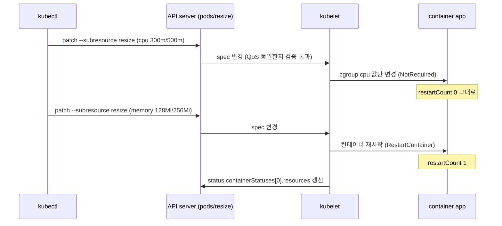

# q10 — Resize a running Pod in place · 풀이

← 문제: **[question.md](question.md)**

## 문제 (해석)

**원문**

> A trading component must get more CPU during market hours without being restarted, while a
> memory change may restart its container.
>
> 1. Create Pod `trader` in namespace `io` with one container `app`, image `nginx:1.27-alpine`,
>    requests `cpu: 100m, memory: 64Mi` and limits `cpu: 200m, memory: 128Mi`. Configure the
>    container so that a CPU change does not restart it and a memory change restarts it.
> 2. Without deleting or recreating the Pod, change the CPU to request `300m` and limit `500m`. Write
>    the container's restart count afterwards to `/opt/course/b10/after-cpu.txt`.
> 3. Without deleting or recreating the Pod, change the memory to request `128Mi` and limit `256Mi`.
>    Write the container's restart count afterwards to `/opt/course/b10/after-memory.txt`.
> 4. Write the resources that the kubelet reports as actually applied to the running container (from
>    the Pod status, not the spec) to `/opt/course/b10/status-resources.json`.
> 5. The Pod's QoS class must be the same at the end as at the start.

**해석**

트레이딩 컴포넌트는 장중에 재시작 없이 CPU 를 더 받아야 하고, 메모리 변경은 컨테이너를 재시작해도 된다.

1. `io` 네임스페이스에 Pod `trader` 를 만든다. 컨테이너는 `app` 하나, 이미지 `nginx:1.27-alpine`, requests
   `cpu: 100m, memory: 64Mi`, limits `cpu: 200m, memory: 128Mi`. CPU 변경은 컨테이너를 재시작하지 않고
   메모리 변경은 재시작하도록 컨테이너를 설정한다.
2. Pod 를 지우거나 다시 만들지 않고 CPU 를 request `300m`, limit `500m` 으로 바꾼다. 그 뒤 컨테이너의 재시작
   횟수를 `/opt/course/b10/after-cpu.txt` 에 적는다.
3. Pod 를 지우거나 다시 만들지 않고 메모리를 request `128Mi`, limit `256Mi` 로 바꾼다. 그 뒤 컨테이너의 재시작
   횟수를 `/opt/course/b10/after-memory.txt` 에 적는다.
4. kubelet 이 실행 중인 컨테이너에 실제로 적용했다고 보고하는 resources 를(spec 이 아니라 Pod status 에서)
   `/opt/course/b10/status-resources.json` 에 적는다.
5. 마지막의 Pod QoS 클래스는 처음과 같아야 한다.

## 모범 풀이

**1) resizePolicy 를 넣어 Pod 생성**

```bash
kubectl -n io run trader --image=nginx:1.27-alpine --dry-run=client -o yaml > /tmp/b10.yaml
```

컨테이너 이름을 `app` 으로 바꾸고 resources 와 `resizePolicy` 를 넣습니다.

```yaml
apiVersion: v1
kind: Pod
metadata:
  name: trader
  namespace: io
spec:
  containers:
  - name: app
    image: nginx:1.27-alpine
    resizePolicy:
    - resourceName: cpu
      restartPolicy: NotRequired        # 기본값이지만 명시
    - resourceName: memory
      restartPolicy: RestartContainer
    resources:
      requests:
        cpu: 100m
        memory: 64Mi
      limits:
        cpu: 200m
        memory: 128Mi
```

```bash
kubectl apply -f /tmp/b10.yaml
kubectl -n io wait pod trader --for=condition=Ready
kubectl -n io get pod trader -o jsonpath='{.status.qosClass}{"\n"}'      # Burstable
```

`resizePolicy` 는 컨테이너마다, 리소스(cpu/memory)마다 정합니다. `NotRequired` 는 cgroup 값만 바꾸고 프로세스는 그대로 두며, `RestartContainer` 는 새 값으로 컨테이너를 재시작합니다(파드는 그대로, `restartCount` 만 오른다). 대부분의 런타임 프로세스(JVM 힙 등)는 실행 중에 메모리 limit 변화를 반영하지 못하므로 메모리에 `RestartContainer` 를 쓰는 경우가 많습니다.

**2) CPU 변경 — resize 서브리소스**

```bash
kubectl -n io patch pod trader --subresource resize --patch \
  '{"spec":{"containers":[{"name":"app","resources":{"requests":{"cpu":"300m"},"limits":{"cpu":"500m"}}}]}}'
kubectl -n io get pod trader -o jsonpath='{.status.containerStatuses[0].restartCount}{"\n"}' \
  | tee /opt/course/b10/after-cpu.txt      # 0
```

`--subresource resize` 없이 `kubectl edit`/`patch` 로 resources 를 바꾸면 `pod updates may not change fields other than ...` 로 거부됩니다. `kubectl edit pod trader --subresource resize` 도 됩니다.

**3) 메모리 변경**

```bash
kubectl -n io patch pod trader --subresource resize --patch \
  '{"spec":{"containers":[{"name":"app","resources":{"requests":{"memory":"128Mi"},"limits":{"memory":"256Mi"}}}]}}'
kubectl -n io get pod trader -w          # RESTARTS 0 → 1 로 바뀌는 것을 본다 (Ctrl-C)
kubectl -n io get pod trader -o jsonpath='{.status.containerStatuses[0].restartCount}{"\n"}' \
  | tee /opt/course/b10/after-memory.txt   # 1
```

진행 상태는 파드 조건으로 봅니다. 노드에 여유가 없으면 `PodResizePending`(reason `Deferred`/`Infeasible`), 적용 중이면 `PodResizeInProgress` 가 붙고, 끝나면 둘 다 사라집니다. 예전의 `status.resize` 필드는 v1.33 에 deprecated 되어 이 조건들로 바뀌었습니다.

```bash
kubectl -n io get pod trader -o jsonpath='{range .status.conditions[*]}{.type}={.status} {end}{"\n"}'
```

### 그림 — resizePolicy 에 따른 두 갈래



1. 두 변경 모두 `resize` 서브리소스로 들어가며, API 서버는 QoS 클래스가 바뀌지 않는지 먼저 검증합니다.
2. CPU 는 `NotRequired` 라 kubelet 이 cgroup 값만 바꿉니다. 프로세스는 계속 돕니다.
3. 메모리는 `RestartContainer` 라 kubelet 이 컨테이너를 새 limit 으로 다시 띄웁니다. 파드 UID 와 IP 는 그대로입니다.
4. 실제 적용된 값은 `status.containerStatuses[].resources` 에 보고됩니다. spec 은 "원하는 값", status 는 "적용된 값"입니다.

**4) 실제 적용된 값**

```bash
kubectl -n io get pod trader -o jsonpath='{.status.containerStatuses[0].resources}' \
  > /opt/course/b10/status-resources.json
cat /opt/course/b10/status-resources.json
# {"limits":{"cpu":"500m","memory":"256Mi"},"requests":{"cpu":"300m","memory":"128Mi"}}
```

`status.containerStatuses[0].allocatedResources` 는 kubelet 이 이 컨테이너 몫으로 승인(할당)한 값이고, 런타임에 실제로 설정된 requests/limits 는 `.resources` 로 보고됩니다.

**5) QoS 유지**

requests < limits 이므로 계속 `Burstable` 입니다. 예를 들어 CPU·메모리 모두 requests = limits 로 맞추면 `Guaranteed` 가 되어야 하므로 resize 가 `Pod QoS is immutable` 로 거부됩니다.

## 검증

```bash
cat /opt/course/b10/after-cpu.txt        # 0
cat /opt/course/b10/after-memory.txt     # 1
cat /opt/course/b10/status-resources.json
kubectl -n io get pod trader -o jsonpath='{.metadata.uid} {.status.qosClass} {.spec.containers[0].resizePolicy}{"\n"}'
# <처음과 같은 UID> Burstable [{"resourceName":"cpu","restartPolicy":"NotRequired"},{"resourceName":"memory","restartPolicy":"RestartContainer"}]
```

## 오답 원인 / 배운 점

- **왜 틀렸나**:
- **기억할 것**: 실행 중인 파드의 CPU/메모리 변경은 `kubectl patch pod <p> --subresource resize`, 재시작 여부는 `resizePolicy`.
- **헷갈리는 지점**: spec 값만 보면 적용이 끝났는지 알 수 없습니다. `status.containerStatuses[].resources` 와 `PodResizePending`/`PodResizeInProgress` 조건을 봅니다. QoS 클래스가 바뀌는 resize 는 거부되고, Deployment 가 관리하는 파드는 템플릿을 고쳐야 다음 롤아웃 후에도 값이 유지됩니다.

## 참고 문서

- 검색어: `resize container resources`, `in-place pod resize`
- https://kubernetes.io/docs/tasks/configure-pod-container/resize-container-resources/

---

[↑ 문항 목록](../README.md) · [← 문제로](question.md) · [다음 문제 q11 →](../q11_projected_sa_token_audience/question.md)
