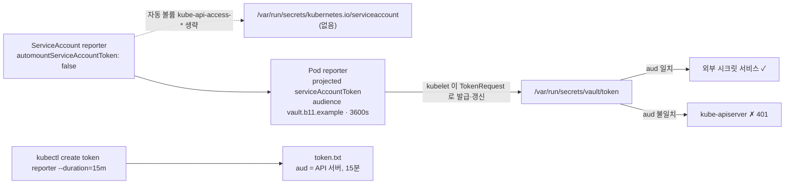

# q11 — Projected ServiceAccount token with a custom audience · 풀이

← 문제: **[question.md](question.md)**

## 문제 (해석)

**원문**

> A reporting Pod must authenticate to an external secrets service that accepts only Kubernetes
> tokens issued for the audience `vault.b11.example`. It must not receive a token for the Kubernetes
> API.
>
> 1. Create ServiceAccount `reporter` in namespace `ganymede` that does not automatically mount API
>    credentials into Pods.
> 2. Create Pod `reporter` in `ganymede` with image `busybox:1.36`, command `sleep 3600`, using
>    ServiceAccount `reporter`. Mount a projected ServiceAccount token with audience
>    `vault.b11.example` and a lifetime of `3600` seconds as file `token` in a read-only volume at
>    `/var/run/secrets/vault`. Nothing may be mounted at
>    `/var/run/secrets/kubernetes.io/serviceaccount`.
> 3. Write the output of `ls /var/run/secrets` run inside the Pod to `/opt/course/b11/secrets-ls.txt`,
>    and the `aud` claim of the mounted token (the audience string only) to `/opt/course/b11/aud.txt`.
> 4. Create a token for ServiceAccount `reporter` that is valid for 15 minutes, without creating any
>    Secret, and save only the token to `/opt/course/b11/token.txt`.

**해석**

리포팅 Pod 는 audience `vault.b11.example` 로 발급된 Kubernetes 토큰만 받아 주는 외부 시크릿 서비스에 인증해야
한다. Kubernetes API 용 토큰은 받으면 안 된다.

1. `ganymede` 네임스페이스에 Pod 에 API 자격 증명을 자동으로 마운트하지 않는 ServiceAccount `reporter` 를 만든다.
2. `ganymede` 에 이미지 `busybox:1.36`, 명령 `sleep 3600`, ServiceAccount `reporter` 를 쓰는 Pod `reporter` 를
   만든다. audience `vault.b11.example`, 수명 `3600` 초인 projected ServiceAccount 토큰을 `/var/run/secrets/vault`
   의 읽기 전용 볼륨에 `token` 파일로 마운트한다. `/var/run/secrets/kubernetes.io/serviceaccount` 에는 아무것도
   마운트되면 안 된다.
3. Pod 안에서 실행한 `ls /var/run/secrets` 의 출력을 `/opt/course/b11/secrets-ls.txt` 에, 마운트된 토큰의 `aud`
   클레임(audience 문자열만)을 `/opt/course/b11/aud.txt` 에 적는다.
4. Secret 을 만들지 않고 ServiceAccount `reporter` 의 15분짜리 토큰을 만들어, 토큰만 `/opt/course/b11/token.txt`
   에 저장한다.

## 모범 풀이

**1) 자동 마운트를 끈 ServiceAccount**

```bash
kubectl -n ganymede create sa reporter --dry-run=client -o yaml > /tmp/b11-sa.yaml
echo 'automountServiceAccountToken: false' >> /tmp/b11-sa.yaml
kubectl apply -f /tmp/b11-sa.yaml
# 또는: kubectl -n ganymede create sa reporter && \
#       kubectl -n ganymede patch sa reporter -p '{"automountServiceAccountToken":false}'
```

`automountServiceAccountToken` 은 ServiceAccount 의 **최상위 필드**입니다(`spec` 아래가 아님). 파드 spec 에 같은 이름의 필드가 있으면 **파드 쪽이 우선**하므로, 파드에 `true` 를 쓰면 SA 설정이 무시됩니다.

**2) projected 토큰을 쓰는 Pod**

```yaml
apiVersion: v1
kind: Pod
metadata:
  name: reporter
  namespace: ganymede
spec:
  serviceAccountName: reporter
  containers:
  - name: reporter
    image: busybox:1.36
    command: ["sleep", "3600"]
    volumeMounts:
    - name: vault-token
      mountPath: /var/run/secrets/vault
      readOnly: true
  volumes:
  - name: vault-token
    projected:
      sources:
      - serviceAccountToken:
          audience: vault.b11.example
          expirationSeconds: 3600
          path: token
```

```bash
kubectl apply -f /tmp/b11-pod.yaml
kubectl -n ganymede wait pod reporter --for=condition=Ready
```

- 자동 마운트를 꺼도 **직접 선언한** projected `serviceAccountToken` 은 그대로 발급됩니다. 자동 마운트가 하는 일은 `kube-api-access-xxxxx` 라는 projected 볼륨(토큰 + `ca.crt` + namespace)을 몰래 붙이는 것뿐이기 때문입니다.
- `expirationSeconds` 는 최소 600 초입니다. kubelet 은 수명의 80% 가 지나거나 24시간이 넘으면 토큰을 자동으로 갱신해 파일을 바꿔 씁니다. 그래서 앱은 토큰을 캐시하지 말고 파일을 다시 읽어야 합니다.
- `audience` 를 주면 그 audience 를 가진 토큰만 발급됩니다. API 서버는 자기 audience(보통 `https://kubernetes.default.svc...`)가 아닌 토큰을 거부하므로, 이 토큰이 새어도 클러스터 API 에는 쓸 수 없습니다.

**3) 마운트 확인과 aud 클레임**

```bash
kubectl -n ganymede exec reporter -- ls /var/run/secrets > /opt/course/b11/secrets-ls.txt
cat /opt/course/b11/secrets-ls.txt          # vault   (kubernetes.io 는 없다)

jwt_payload() { p=$(cut -d. -f2 | tr '_-' '/+'); while [ $(( ${#p} % 4 )) -ne 0 ]; do p="$p="; done; echo "$p" | base64 -d; }
kubectl -n ganymede exec reporter -- cat /var/run/secrets/vault/token | jwt_payload; echo
# {"aud":["vault.b11.example"],"exp":...,"iat":...,"iss":"https://kubernetes.default.svc.cluster.local",
#  "kubernetes.io":{"namespace":"ganymede","pod":{"name":"reporter",...},"serviceaccount":{"name":"reporter",...}},
#  "sub":"system:serviceaccount:ganymede:reporter"}
kubectl -n ganymede exec reporter -- cat /var/run/secrets/vault/token | jwt_payload \
  | sed -E 's/.*"aud":\["([^"]+)".*/\1/' > /opt/course/b11/aud.txt
cat /opt/course/b11/aud.txt                 # vault.b11.example
```

JWT 는 `header.payload.signature` 이고 각 부분이 **padding 없는 base64url** 이라, `-_` 를 `+/` 로 바꾸고 `=` 를 채워야 `base64 -d` 가 풉니다. `jq` 가 있으면 `jq -R 'split(".")[1] | @base64d | fromjson | .aud[0]' -r` 로도 됩니다.

### 그림 — 자동 마운트 토큰과 projected 토큰



1. SA 의 자동 마운트를 끄면 kubelet 은 기본 API 자격 증명 볼륨을 붙이지 않습니다.
2. 파드에 선언한 projected `serviceAccountToken` 은 kubelet 이 TokenRequest API 로 발급하며, 파드·SA 에 묶이고 수명이 짧습니다.
3. audience 가 다르기 때문에 이 토큰은 외부 서비스에서만 유효하고 kube-apiserver 에서는 거부됩니다.
4. `kubectl create token` 도 같은 TokenRequest API 를 쓰지만 audience 를 주지 않으면 API 서버용 토큰이 나옵니다.

**4) 15분 토큰**

```bash
kubectl -n ganymede create token reporter --duration=15m > /opt/course/b11/token.txt
jwt_payload < /opt/course/b11/token.txt; echo     # exp - iat = 900
kubectl -n ganymede get secret                     # No resources found  ← Secret 은 만들어지지 않는다
```

v1.24 부터 ServiceAccount 에 토큰 Secret 이 자동으로 생기지 않습니다. `kubectl create token` 은 TokenRequest 로 시간 제한 토큰을 바로 발급하고 아무것도 저장하지 않습니다. 오래 가는 토큰이 꼭 필요할 때만 `kubernetes.io/service-account-token` 타입 Secret 을 직접 만듭니다.

## 검증

```bash
kubectl -n ganymede get sa reporter -o jsonpath='{.automountServiceAccountToken}{"\n"}'     # false
kubectl -n ganymede get pod reporter -o jsonpath='{.spec.volumes[*].name}{"\n"}'          # vault-token (kube-api-access-* 없음)
kubectl -n ganymede exec reporter -- ls /var/run/secrets/kubernetes.io/serviceaccount     # No such file or directory
cat /opt/course/b11/secrets-ls.txt /opt/course/b11/aud.txt                                 # vault / vault.b11.example
jwt_payload < /opt/course/b11/token.txt | grep -o '"sub":"[^"]*"'   # "sub":"system:serviceaccount:ganymede:reporter"
```

## 오답 원인 / 배운 점

- **왜 틀렸나**:
- **기억할 것**: 용도별 토큰은 `projected.sources[].serviceAccountToken{audience, expirationSeconds, path}`, 일회성 토큰은 `kubectl create token <sa> --duration=`.
- **헷갈리는 지점**: `automountServiceAccountToken` 은 SA 와 Pod 양쪽에 있고 Pod 가 우선합니다. 자동 마운트를 꺼도 직접 선언한 projected 토큰은 막지 않습니다. `kubectl create token` 의 기본 수명은 1시간이고, 최소 10분이며, API 서버 설정에 따라 최대값이 잘릴 수 있습니다.

## 참고 문서

- 검색어: `configure service accounts for pods`, `service account token volume projection`
- https://kubernetes.io/docs/tasks/configure-pod-container/configure-service-account/#opt-out-of-api-credential-automounting
- https://kubernetes.io/docs/tasks/configure-pod-container/configure-service-account/#serviceaccount-token-volume-projection
- https://kubernetes.io/docs/reference/kubectl/generated/kubectl_create/kubectl_create_token/

---

[↑ 문항 목록](../README.md) · [← 문제로](question.md) · [다음 문제 q12 →](../q12_validating_admission_policy/question.md)
