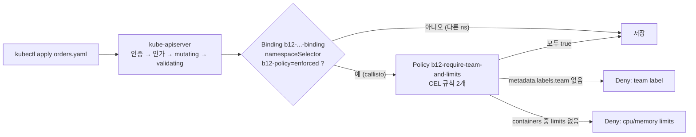

# q12 — Get a Deployment past a ValidatingAdmissionPolicy · 풀이

← 문제: **[question.md](question.md)**

## 문제 (해석)

**원문**

> The platform team enforces rules for Deployments with an admission policy. A developer cannot
> apply `/opt/course/b12/orders.yaml` to namespace `callisto`.
>
> 1. Apply `/opt/course/b12/orders.yaml` and write the complete error returned by the API server to
>    `/opt/course/b12/denied.txt`.
> 2. Find the ValidatingAdmissionPolicy and the ValidatingAdmissionPolicyBinding responsible, and
>    write their names to `/opt/course/b12/policy.txt` in the form `<policy> <binding>`. In
>    `/opt/course/b12/scope.txt`, write the namespace label (`key=value`) that makes the binding
>    apply to `callisto`.
> 3. Fix `/opt/course/b12/orders.yaml` so that it satisfies every rule of the policy: the Deployment
>    must belong to team `payments`, and any container without limits gets limits `cpu: 50m` and
>    `memory: 32Mi`. Do not remove containers and do not change the existing values.
> 4. Apply the fixed manifest. Deployment `orders` must have 2 ready replicas.
> 5. Do not modify the policy, the binding or the labels of namespace `callisto`.

**해석**

플랫폼 팀은 admission 정책으로 Deployment 규칙을 강제한다. 한 개발자가 `/opt/course/b12/orders.yaml` 을
`callisto` 네임스페이스에 적용하지 못하고 있다.

1. `/opt/course/b12/orders.yaml` 을 적용해 보고, API 서버가 돌려준 오류 전체를 `/opt/course/b12/denied.txt` 에 적는다.
2. 원인이 되는 ValidatingAdmissionPolicy 와 ValidatingAdmissionPolicyBinding 을 찾아 그 이름을
   `/opt/course/b12/policy.txt` 에 `<policy> <binding>` 형식으로 적는다. Binding 이 `callisto` 에 적용되게 만드는
   네임스페이스 레이블(`key=value`)을 `/opt/course/b12/scope.txt` 에 적는다.
3. `/opt/course/b12/orders.yaml` 이 정책의 모든 규칙을 만족하도록 고친다. Deployment 는 팀 `payments` 소속이어야
   하고, limits 가 없는 컨테이너에는 limits `cpu: 50m`, `memory: 32Mi` 를 준다. 컨테이너를 빼거나 기존 값을
   바꾸지 않는다.
4. 고친 매니페스트를 적용한다. Deployment `orders` 는 Ready 레플리카 2개여야 한다.
5. 정책, Binding, 네임스페이스 `callisto` 의 레이블은 바꾸지 않는다.

## 모범 풀이

**1) 거부 메시지 확보**

```bash
kubectl apply -f /opt/course/b12/orders.yaml 2> /opt/course/b12/denied.txt; cat /opt/course/b12/denied.txt
# Error from server (Forbidden): error when creating "/opt/course/b12/orders.yaml": deployments.apps "orders"
# is forbidden: ValidatingAdmissionPolicy 'b12-require-team-and-limits' with binding
# 'b12-require-team-and-limits-binding' denied request: b12: Deployment must carry a 'team' label
```

오류는 stderr 로 나오므로 `2>` 로 받습니다. 메시지에 정책 이름과 Binding 이름이 그대로 들어 있습니다. `--dry-run=client` 는 API 서버에 가지 않아 admission 을 거치지 않으므로, 고친 뒤 시험할 때는 `--dry-run=server` 를 씁니다.

**2) 정책·Binding·적용 범위 확인**

```bash
kubectl get validatingadmissionpolicy,validatingadmissionpolicybinding
kubectl get validatingadmissionpolicy b12-require-team-and-limits -o yaml
#   matchConstraints: apps/v1 deployments, CREATE/UPDATE
#   validations:
#   - expression: has(object.metadata.labels) && 'team' in object.metadata.labels
#   - expression: object.spec.template.spec.containers.all(c, has(c.resources) && has(c.resources.limits) && 'cpu' in c.resources.limits && 'memory' in c.resources.limits)
kubectl get validatingadmissionpolicybinding b12-require-team-and-limits-binding \
  -o jsonpath='{.spec.policyName} {.spec.validationActions} {.spec.matchResources.namespaceSelector}{"\n"}'
# b12-require-team-and-limits ["Deny"] {"matchLabels":{"b12-policy":"enforced"}}
kubectl get ns callisto --show-labels          # ... b12-policy=enforced ...

echo "b12-require-team-and-limits b12-require-team-and-limits-binding" > /opt/course/b12/policy.txt
echo "b12-policy=enforced" > /opt/course/b12/scope.txt
```

정책(무엇을 검사하나)과 Binding(어디에, 어떤 동작으로)은 별개 객체입니다. 정책만 있고 Binding 이 없으면 아무 일도 일어나지 않습니다. 둘 다 클러스터 범위라 `-n` 을 주지 않습니다. 정확한 리소스 이름이 기억나지 않으면 `kubectl api-resources | grep -i admissionpolicy` 로 찾습니다.

**3) 매니페스트 수정 — 규칙을 끝까지 읽는다**

함정 두 가지:
- 원본에도 `team: payments` 가 있지만 **pod template** 의 레이블입니다. 정책은 `object.metadata.labels`, 즉 **Deployment 자신의** 레이블을 봅니다.
- 첫 번째 규칙만 고치면 다음 적용에서 두 번째 규칙(`metrics` 컨테이너에 limits 없음)으로 다시 거부됩니다.

```yaml
apiVersion: apps/v1
kind: Deployment
metadata:
  name: orders
  namespace: callisto
  labels:
    app: orders
    team: payments              # ← 추가 (Deployment 메타데이터)
spec:
  replicas: 2
  selector:
    matchLabels:
      app: orders
  template:
    metadata:
      labels:
        app: orders
        team: payments
    spec:
      containers:
      - name: api
        image: nginx:1.27-alpine
        resources:
          requests: {cpu: 50m, memory: 64Mi}
          limits: {cpu: 200m, memory: 128Mi}
      - name: metrics
        image: busybox:1.36
        command: ["sh", "-c", "while true; do sleep 30; done"]
        resources:
          requests: {cpu: 10m, memory: 16Mi}
          limits: {cpu: 50m, memory: 32Mi}     # ← 추가
```

```bash
kubectl apply -f /opt/course/b12/orders.yaml --dry-run=server     # 통과하는지 먼저 확인
```

### 그림 — admission 요청이 정책에 걸리는 경로



1. 요청은 인증·인가·mutating admission 을 지난 뒤 validating 단계에서 정책을 만납니다.
2. Binding 의 `namespaceSelector` 가 대상 네임스페이스를 고릅니다. `callisto` 에 `b12-policy=enforced` 가 있어 정책이 적용됩니다.
3. 정책의 CEL 식이 하나라도 false 면 `validationActions: [Deny]` 에 따라 요청이 거부되고, 그 규칙의 `message` 가 오류에 실립니다.
4. 모든 식이 true 여야 etcd 에 저장되고 Deployment 컨트롤러가 파드를 만듭니다.

**4) 적용**

```bash
kubectl apply -f /opt/course/b12/orders.yaml
kubectl -n callisto rollout status deploy orders
```

## 검증

```bash
grep -c "denied request" /opt/course/b12/denied.txt                 # 1
cat /opt/course/b12/policy.txt /opt/course/b12/scope.txt
kubectl -n callisto get deploy orders --show-labels                 # READY 2/2, LABELS app=orders,team=payments
kubectl -n callisto get deploy orders \
  -o jsonpath='{range .spec.template.spec.containers[*]}{.name}{" "}{.resources.limits}{"\n"}{end}'
# api {"cpu":"200m","memory":"128Mi"}
# metrics {"cpu":"50m","memory":"32Mi"}
kubectl get ns callisto --show-labels | grep -c b12-policy=enforced  # 1 (그대로)
```

## 오답 원인 / 배운 점

- **왜 틀렸나**:
- **기억할 것**: 거부 메시지의 `ValidatingAdmissionPolicy '<p>' with binding '<b>'` 로 정책을 찾고, `kubectl get validatingadmissionpolicy <p> -o yaml` 의 CEL 식을 끝까지 읽는다.
- **헷갈리는 지점**: `object.metadata.labels` 는 Deployment 자신의 레이블이고 pod template 레이블이 아닙니다. 검사는 `--dry-run=server` 로(클라이언트 dry-run 은 admission 을 건너뜀). ValidatingAdmissionPolicy 는 v1.30 GA 이며 웹훅 서버 없이 CEL 로 동작합니다. `validationActions` 가 `Warn`/`Audit` 이면 거부하지 않고 경고만 남깁니다.

## 참고 문서

- 검색어: `validating admission policy`
- https://kubernetes.io/docs/reference/access-authn-authz/validating-admission-policy/

---

[↑ 문항 목록](../README.md) · [← 문제로](question.md) · [다음 문제 q13 →](../q13_securitycontext_fsgroup_capabilities/question.md)
