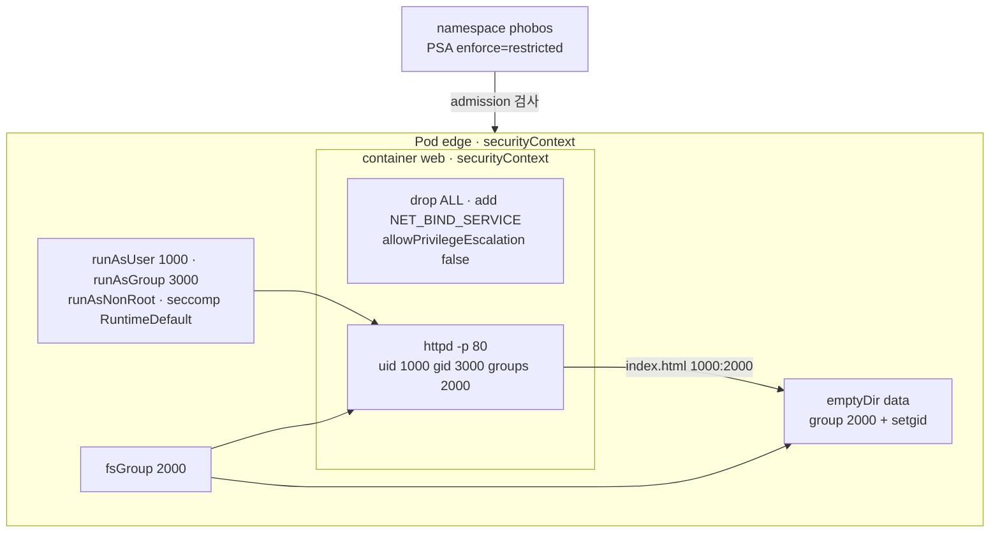

# q13 — Non-root Pod with fsGroup and minimal capabilities · 풀이

← 문제: **[question.md](question.md)**

## 문제 (해석)

**원문**

> A small web server must run in namespace `phobos` without root privileges and still serve on port
> `80`. Files it writes to its data volume must be group-owned by the shared group `2000`.
>
> 1. Create Pod `edge` in `phobos` with one container `web`, image `busybox:1.36`, and the command
>    `sh -c 'echo hello-b13 > /data/index.html && exec httpd -f -p 80 -h /data'`. Mount an `emptyDir`
>    volume named `data` at `/data`.
> 2. All processes in the Pod run as UID `1000` and primary GID `3000`, volumes are owned by group
>    `2000`, and the Pod must refuse to start as root.
> 3. Container `web` drops all Linux capabilities and adds back only `NET_BIND_SERVICE`, and it may
>    not gain more privileges than its parent process.
> 4. The Pod must be admitted by the namespace's existing Pod Security settings, which you may not
>    change.
> 5. Write the output of `id` run in the container to `/opt/course/b13/id.txt`, the output of
>    `ls -ln /data` to `/opt/course/b13/ls.txt`, and the `CapBnd` and `CapEff` lines of
>    `/proc/1/status` to `/opt/course/b13/caps.txt`. Confirm that `http://127.0.0.1:80/` inside the
>    container returns `hello-b13`.

**해석**

작은 웹 서버를 `phobos` 네임스페이스에서 root 권한 없이 실행하면서도 포트 `80` 으로 서비스해야 한다. 데이터
볼륨에 쓰는 파일은 공유 그룹 `2000` 소유여야 한다.

1. `phobos` 에 Pod `edge` 를 만든다. 컨테이너는 `web` 하나, 이미지 `busybox:1.36`, 명령
   `sh -c 'echo hello-b13 > /data/index.html && exec httpd -f -p 80 -h /data'`. `data` 라는 `emptyDir` 볼륨을
   `/data` 에 마운트한다.
2. Pod 의 모든 프로세스는 UID `1000`, 기본 GID `3000` 으로 실행되고, 볼륨은 그룹 `2000` 소유이며, Pod 는 root 로는
   시작을 거부해야 한다.
3. 컨테이너 `web` 은 모든 Linux capability 를 버리고 `NET_BIND_SERVICE` 만 다시 추가하며, 부모 프로세스보다 더 많은
   권한을 얻을 수 없어야 한다.
4. Pod 는 네임스페이스에 이미 설정된 Pod Security 설정을 통과해야 하고, 그 설정은 바꾸면 안 된다.
5. 컨테이너에서 실행한 `id` 의 출력을 `/opt/course/b13/id.txt` 에, `ls -ln /data` 의 출력을 `/opt/course/b13/ls.txt` 에,
   `/proc/1/status` 의 `CapBnd`·`CapEff` 줄을 `/opt/course/b13/caps.txt` 에 적는다. 컨테이너 안에서
   `http://127.0.0.1:80/` 이 `hello-b13` 을 돌려주는지 확인한다.

## 모범 풀이

```bash
kubectl get ns phobos --show-labels       # pod-security.kubernetes.io/enforce=restricted
```

`restricted` 는 `runAsNonRoot: true`, `allowPrivilegeEscalation: false`, `capabilities.drop: [ALL]`(추가는 `NET_BIND_SERVICE` 만 허용), `seccompProfile` 이 `RuntimeDefault` 또는 `Localhost` 일 것을 요구합니다. 문제에 적힌 요구만 넣고 **seccompProfile 을 빠뜨리면** 거부됩니다. 이것이 요구 4 의 함정입니다.

**1)~4) Pod 작성**

```yaml
apiVersion: v1
kind: Pod
metadata:
  name: edge
  namespace: phobos
spec:
  securityContext:              # 파드 수준: 모든 컨테이너와 볼륨에 적용
    runAsNonRoot: true
    runAsUser: 1000
    runAsGroup: 3000
    fsGroup: 2000
    seccompProfile:
      type: RuntimeDefault      # restricted 필수
  containers:
  - name: web
    image: busybox:1.36
    command: ["sh", "-c", "echo hello-b13 > /data/index.html && exec httpd -f -p 80 -h /data"]
    ports:
    - containerPort: 80
    securityContext:            # 컨테이너 수준: capabilities 와 allowPrivilegeEscalation 은 여기에만 있다
      allowPrivilegeEscalation: false
      capabilities:
        drop: ["ALL"]
        add: ["NET_BIND_SERVICE"]
    volumeMounts:
    - name: data
      mountPath: /data
  volumes:
  - name: data
    emptyDir: {}
```

```bash
kubectl apply -f /tmp/b13.yaml
# seccompProfile 을 빼면:
# Error from server (Forbidden): pods "edge" is forbidden: violates PodSecurity "restricted:latest":
#   seccompProfile (pod or container "web" must set securityContext.seccompProfile.type to "RuntimeDefault" or "Localhost")
kubectl -n phobos wait pod edge --for=condition=Ready
```

- `capabilities` 와 `allowPrivilegeEscalation` 은 **컨테이너** securityContext 에만 있는 필드입니다. 파드 securityContext 에 쓰면 `unknown field` 로 거부됩니다.
- `fsGroup` 은 지원되는 볼륨(emptyDir 등)의 그룹을 2000 으로 바꾸고 setgid 비트를 켜서, 그 안에 만든 파일도 그룹 2000 이 되게 합니다. 또 프로세스의 보조 그룹에 2000 을 넣습니다.
- `runAsGroup` 을 빼면 기본 GID 는 이미지의 값(busybox 는 0)이 됩니다. root 그룹으로 도는 것을 막으려면 명시합니다.

**5) 확인 결과 기록**

```bash
kubectl -n phobos exec edge -c web -- id | tee /opt/course/b13/id.txt
# uid=1000 gid=3000 groups=2000,3000          (보조 그룹 순서는 런타임에 따라 다를 수 있다)
kubectl -n phobos exec edge -c web -- ls -ln /data | tee /opt/course/b13/ls.txt
# -rw-r--r--    1 1000     2000            10 ... index.html   ← 소유 1000, 그룹 2000(fsGroup)
kubectl -n phobos exec edge -c web -- grep -E '^Cap(Bnd|Eff)' /proc/1/status | tee /opt/course/b13/caps.txt
# CapEff: 0000000000000000
# CapBnd: 0000000000000400                     ← 비트 10 = CAP_NET_BIND_SERVICE 하나만
kubectl -n phobos exec edge -c web -- wget -qO- http://127.0.0.1:80/      # hello-b13
```

`CapBnd`(bounding set)에는 `NET_BIND_SERVICE` 만 남았지만 `CapEff` 는 0 입니다. 리눅스는 root 가 아닌 사용자가 `execve` 할 때 파일 capability 나 ambient capability 가 없으면 effective/permitted 를 비우고, Kubernetes 는 ambient 를 설정하지 않기 때문입니다. 그런데도 포트 80 에 바인드되는 이유는 최근 컨테이너 런타임(containerd 2.x 등)이 파드 네트워크 네임스페이스에 `net.ipv4.ip_unprivileged_port_start=0` 을 기본으로 설정하기 때문입니다. 즉 이 설정의 실제 효과는 "**ALL 을 버리고 필요한 것 하나만 bounding set 에 남긴다**"는 최소 권한 선언이며, 바이너리에 파일 capability 가 있거나 root 로 시작하는 이미지라면 그 하나만 쓸 수 있게 됩니다.

런타임이 그 sysctl 을 켜지 않아 `httpd: bind: Permission denied` 로 죽는다면, `restricted` 에서도 허용되는 안전한 sysctl 을 파드에 넣습니다.

```yaml
spec:
  securityContext:
    sysctls:
    - name: net.ipv4.ip_unprivileged_port_start
      value: "0"
```

### 그림 — 파드·컨테이너 securityContext 가 적용되는 범위



1. PSA 가 파드 생성 요청을 `restricted` 기준으로 검사합니다. 필드 하나라도 빠지면 파드 자체가 만들어지지 않습니다.
2. 파드 수준의 사용자·그룹·seccomp 설정은 모든 컨테이너에 기본으로 적용됩니다.
3. `fsGroup` 은 볼륨 소유 그룹과 프로세스의 보조 그룹에 함께 들어가, 프로세스가 쓴 파일이 그룹 2000 소유가 됩니다.
4. capabilities 와 권한 상승 금지는 컨테이너마다 따로 정합니다.

## 검증

```bash
kubectl -n phobos get pod edge                          # 1/1 Running
cat /opt/course/b13/id.txt                              # uid=1000 gid=3000 groups=...2000...
grep ' 1000 *2000 ' /opt/course/b13/ls.txt              # index.html 1000:2000
grep CapBnd /opt/course/b13/caps.txt                    # CapBnd: 0000000000000400
kubectl -n phobos get pod edge -o jsonpath='{.spec.containers[0].securityContext}{"\n"}'
kubectl -n phobos exec edge -c web -- wget -qO- http://127.0.0.1:80/     # hello-b13
```

## 오답 원인 / 배운 점

- **왜 틀렸나**:
- **기억할 것**: restricted 4종 세트 = `runAsNonRoot`, `allowPrivilegeEscalation: false`, `capabilities.drop: [ALL]`, `seccompProfile.type: RuntimeDefault`.
- **헷갈리는 지점**: capabilities 는 컨테이너 securityContext 에만 있습니다. 비 root 프로세스에서는 추가한 capability 가 `CapBnd` 에만 들어가고 `CapEff` 는 0 일 수 있습니다. `fsGroup` 은 볼륨 소유권, `runAsGroup` 은 프로세스 기본 GID 로 서로 다른 필드입니다. CKAD v1.37 기준 PSA 레이블 값 `latest` 는 클러스터 버전의 정책을 뜻합니다.

## 참고 문서

- 검색어: `configure security context`, `pod security standards restricted`
- https://kubernetes.io/docs/tasks/configure-pod-container/security-context/
- https://kubernetes.io/docs/concepts/security/pod-security-standards/#restricted

---

[↑ 문항 목록](../README.md) · [← 문제로](question.md) · [다음 문제 q14 →](../q14_crd_finalizer_terminating/question.md)
