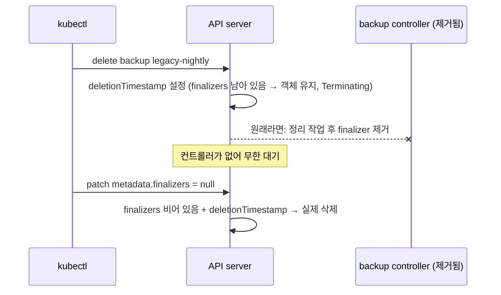

# q14 — Custom resources and a stuck finalizer · 풀이

← 문제: **[question.md](question.md)**

## 문제 (해석)

**원문**

> A backup operator was installed with the CustomResourceDefinition `backups.b14.example.com`. Its
> controller has since been removed, but the CRD must stay.
>
> 1. Create a `Backup` named `db-daily` in namespace `deimos` with `schedule` `0 2 * * *`, `target`
>    `postgres` and `retentionDays` `7`.
> 2. Apply `/opt/course/b14/files-weekly.yaml`. It is rejected; fix the file so that it is accepted
>    while keeping the intended schedule, target and a retention of 30 days, then apply it.
> 3. Using the short name of the resource, list the `Backup` resources in `deimos` and write the
>    output, including the custom columns, to `/opt/course/b14/list.txt`.
> 4. `Backup` `legacy-nightly` in `deimos` was deleted some time ago but still exists. Write the
>    value of its `metadata.finalizers` to `/opt/course/b14/finalizer.txt` and, in one line in
>    `/opt/course/b14/why.txt`, explain why it does not disappear.
> 5. Make the deletion of `legacy-nightly` complete without deleting the CRD, the namespace or the
>    other `Backup` resources.

**해석**

백업 오퍼레이터가 CustomResourceDefinition `backups.b14.example.com` 과 함께 설치되었다. 그 뒤 컨트롤러는 제거되었지만
CRD 는 남겨 두어야 한다.

1. `deimos` 네임스페이스에 `schedule` `0 2 * * *`, `target` `postgres`, `retentionDays` `7` 인 `Backup` `db-daily` 를 만든다.
2. `/opt/course/b14/files-weekly.yaml` 을 적용한다. 거부되므로 의도한 schedule, target, 30일 보존을 유지하면서 받아들여지게
   파일을 고친 뒤 적용한다.
3. 리소스의 **짧은 이름**으로 `deimos` 의 `Backup` 리소스를 나열하고, 사용자 정의 열을 포함한 출력을
   `/opt/course/b14/list.txt` 에 적는다.
4. `deimos` 의 `Backup` `legacy-nightly` 는 오래전에 삭제했는데 아직 남아 있다. 그 `metadata.finalizers` 값을
   `/opt/course/b14/finalizer.txt` 에 적고, 사라지지 않는 이유를 `/opt/course/b14/why.txt` 에 한 줄로 설명한다.
5. CRD, 네임스페이스, 다른 `Backup` 리소스는 지우지 않고 `legacy-nightly` 의 삭제가 끝나게 한다.

## 모범 풀이

**먼저 CRD 를 읽습니다 — 짧은 이름, 버전, 스키마, 열**

```bash
kubectl api-resources --api-group=b14.example.com
# NAME      SHORTNAMES   APIVERSION           NAMESPACED   KIND
# backups   bk           b14.example.com/v1   true         Backup
kubectl explain backup.spec --recursive
#   retentionDays   <integer>
#   schedule        <string> -required-
#   target          <string> -required-   (enum: postgres, redis, nfs)
kubectl get crd backups.b14.example.com -o jsonpath='{.spec.versions[0].additionalPrinterColumns}{"\n"}'
```

**1) db-daily**

```bash
cat <<'YAML' | kubectl apply -f -
apiVersion: b14.example.com/v1
kind: Backup
metadata:
  name: db-daily
  namespace: deimos
spec:
  schedule: "0 2 * * *"
  target: postgres
  retentionDays: 7
YAML
```

`schedule` 은 따옴표로 감쌉니다. YAML 에서 `*` 로 시작하는 값은 alias 로 해석되어 파싱 오류가 납니다.

**2) files-weekly 의 거부 원인**

```bash
kubectl apply -f /opt/course/b14/files-weekly.yaml
# The Backup "files-weekly" is invalid: spec.retentionDays: Invalid value: "string":
#   spec.retentionDays in body must be of type integer: "string"
sed -i 's/retentionDays: "30"/retentionDays: 30/' /opt/course/b14/files-weekly.yaml
kubectl apply -f /opt/course/b14/files-weekly.yaml
```

CRD 의 `openAPIV3Schema` 는 API 서버가 저장 전에 검사합니다(structural schema). 따옴표 때문에 `"30"` 은 문자열이 되어 `integer` 검사에 걸립니다.

**3) 짧은 이름으로 나열**

```bash
kubectl -n deimos get bk | tee /opt/course/b14/list.txt
# NAME             SCHEDULE    TARGET     RETENTION   AGE
# db-daily         0 2 * * *   postgres   7           2m
# files-weekly     0 3 * * 0   nfs        30          1m
# legacy-nightly   0 1 * * *   redis      14          10m
```

열은 CRD 의 `additionalPrinterColumns` 에서 옵니다. 정의가 없으면 `NAME`, `AGE` 만 나옵니다.

**4) 사라지지 않는 이유**

```bash
kubectl -n deimos get bk legacy-nightly \
  -o jsonpath='{.metadata.deletionTimestamp}{"  "}{.metadata.finalizers}{"\n"}'
# 2026-10-24T01:02:03Z  ["b14.example.com/snapshot-cleanup"]
kubectl -n deimos get bk legacy-nightly -o jsonpath='{.metadata.finalizers}' > /opt/course/b14/finalizer.txt
echo "deletionTimestamp is set but finalizer b14.example.com/snapshot-cleanup is never removed because its controller no longer runs" \
  > /opt/course/b14/why.txt
```

`kubectl delete` 는 finalizer 가 있는 객체를 바로 지우지 않고 `deletionTimestamp` 만 찍습니다. 이후 finalizer 를 소유한 컨트롤러가 정리 작업(여기서는 스냅샷 삭제)을 마치고 자기 finalizer 를 목록에서 빼야, 목록이 비는 순간 API 서버가 객체를 실제로 지웁니다. 컨트롤러가 없으니 영원히 기다립니다.

**5) finalizer 를 직접 제거**

```bash
kubectl -n deimos patch bk legacy-nightly --type=merge -p '{"metadata":{"finalizers":null}}'
# 또는: kubectl -n deimos patch bk legacy-nightly --type=json -p='[{"op":"remove","path":"/metadata/finalizers"}]'
kubectl -n deimos get bk          # legacy-nightly 사라짐
```

finalizer 를 손으로 지우면 컨트롤러가 했어야 할 정리(외부 스냅샷 삭제 등)는 **실행되지 않습니다**. 실제 운영에서는 컨트롤러를 되살리는 것이 먼저이고, 정리할 외부 자원이 없음을 확인한 뒤에만 이렇게 합니다. `kubectl delete --force --grace-period=0` 은 파드에만 의미가 있고 finalizer 는 우회하지 못합니다.

### 그림 — finalizer 가 있는 객체의 삭제 순서



1. 삭제 요청은 객체에 `deletionTimestamp` 를 찍을 뿐이고, finalizer 가 남아 있으면 객체는 그대로 있습니다.
2. 원래는 finalizer 를 단 컨트롤러가 정리를 끝내고 자기 항목을 빼 줍니다.
3. 컨트롤러가 없으면 누군가 finalizer 목록을 직접 비워야 합니다. 목록이 비는 순간 API 서버가 삭제를 마칩니다.

## 검증

```bash
kubectl -n deimos get bk                                  # db-daily, files-weekly 만
kubectl -n deimos get bk files-weekly -o jsonpath='{.spec.retentionDays}{"\n"}'     # 30
cat /opt/course/b14/list.txt | head -1                    # NAME SCHEDULE TARGET RETENTION AGE
cat /opt/course/b14/finalizer.txt                         # ["b14.example.com/snapshot-cleanup"]
kubectl get crd backups.b14.example.com                   # CRD 그대로
```

## 오답 원인 / 배운 점

- **왜 틀렸나**:
- **기억할 것**: Terminating 에서 멈춘 커스텀 리소스 = `deletionTimestamp` + 남은 `finalizers`. 컨트롤러가 없으면 `patch ... '{"metadata":{"finalizers":null}}'`.
- **헷갈리는 지점**: finalizer 가 남은 CR 이 있으면 CRD 삭제와 네임스페이스 삭제도 같이 멈춥니다. `kubectl api-resources` 와 `kubectl explain` 이 CRD 의 짧은 이름과 스키마를 바로 알려 줍니다. 스키마의 `integer` 필드에 따옴표를 붙이면 문자열로 거부됩니다.

## 참고 문서

- 검색어: `custom resource definitions additionalPrinterColumns`, `finalizers`
- https://kubernetes.io/docs/tasks/extend-kubernetes/custom-resources/custom-resource-definitions/#additional-printer-columns
- https://kubernetes.io/docs/concepts/overview/working-with-objects/finalizers/

---

[↑ 문항 목록](../README.md) · [← 문제로](question.md) · [다음 문제 q15 →](../q15_statefulset_headless_dns/question.md)
