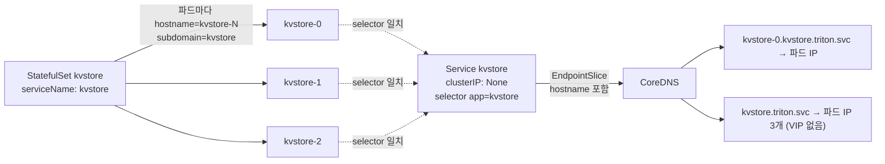

# q15 — StatefulSet pod DNS through a headless Service · 풀이

← 문제: **[question.md](question.md)**

## 문제 (해석)

**원문**

> Clients of the key-value store in namespace `triton` must address each replica by a stable DNS
> name. The StatefulSet `kvstore` and the Service `kvstore` exist, but the per-pod names do not
> resolve.
>
> 1. Make every Pod of StatefulSet `kvstore` resolvable as
>    `kvstore-<ordinal>.kvstore.triton.svc.cluster.local`.
> 2. Service `kvstore` must keep its name, its selector and port `6379`, and must not have a cluster
>    IP. StatefulSet `kvstore` must keep its name, labels, image and 3 replicas.
> 3. In `/opt/course/b15/fixes.txt`, write one line per object you had to change, in the form
>    `<kind>/<name> <field> <old value> -> <new value>`.
> 4. From a temporary Pod with image `busybox:1.36`, run `nslookup` for
>    `kvstore-0.kvstore.triton.svc.cluster.local` and write the output to
>    `/opt/course/b15/pod-dns.txt`. Then run `nslookup` for `kvstore.triton.svc.cluster.local` and
>    write the output, which must list the addresses of all 3 Pods, to `/opt/course/b15/svc-dns.txt`.

**해석**

`triton` 네임스페이스의 키-값 저장소 클라이언트는 각 레플리카를 고정된 DNS 이름으로 불러야 한다. StatefulSet `kvstore` 와
Service `kvstore` 는 있지만 파드별 이름이 풀리지 않는다.

1. StatefulSet `kvstore` 의 모든 Pod 가 `kvstore-<ordinal>.kvstore.triton.svc.cluster.local` 로 조회되게 한다.
2. Service `kvstore` 는 이름, 셀렉터, 포트 `6379` 를 유지하고 cluster IP 가 없어야 한다. StatefulSet `kvstore` 는 이름,
   레이블, 이미지, 레플리카 3 을 유지한다.
3. 바꿔야 했던 객체마다 한 줄씩 `<kind>/<name> <field> <old value> -> <new value>` 형식으로 `/opt/course/b15/fixes.txt` 에 적는다.
4. 이미지 `busybox:1.36` 의 임시 Pod 에서 `kvstore-0.kvstore.triton.svc.cluster.local` 을 `nslookup` 해 출력을
   `/opt/course/b15/pod-dns.txt` 에 적는다. 이어서 `kvstore.triton.svc.cluster.local` 을 `nslookup` 해, 파드 3개의 주소가
   모두 나오는 출력을 `/opt/course/b15/svc-dns.txt` 에 적는다.

## 모범 풀이

**진단 — 파드 DNS 의 두 조건**

파드별 A 레코드 `<hostname>.<subdomain>.<ns>.svc.cluster.local` 은 **(a) 파드의 `subdomain` 과 같은 이름의 (b) headless Service** 가 같은 네임스페이스에 있을 때만 만들어집니다. StatefulSet 은 `spec.serviceName` 을 각 파드의 `subdomain` 으로 넣습니다.

```bash
kubectl -n triton get sts kvstore -o jsonpath='{.spec.serviceName}{"\n"}'        # kvstore-headless  ✗
kubectl -n triton get pod kvstore-0 -o jsonpath='{.spec.hostname} {.spec.subdomain}{"\n"}'   # kvstore-0 kvstore-headless
kubectl -n triton get svc kvstore -o jsonpath='{.spec.clusterIP} {.spec.selector}{"\n"}'   # 10.96.x.y {"app":"kvstore"}  ✗ headless 아님
kubectl -n triton get svc kvstore-headless                                       # NotFound
```

두 군데가 틀렸습니다. StatefulSet 은 존재하지 않는 Service 이름을 가리키고, 원하는 이름의 Service 는 headless 가 아닙니다.

**1)~2) Service 를 headless 로 — clusterIP 는 불변이라 다시 만든다**

```bash
kubectl -n triton patch svc kvstore -p '{"spec":{"clusterIP":"None"}}'
# The Service "kvstore" is invalid: spec.clusterIPs[0]: Invalid value: ["None"]: may not change once set
kubectl -n triton get svc kvstore -o yaml > /tmp/b15-svc.yaml
# 편집: spec.clusterIP: None, spec.clusterIPs 삭제(또는 [None]), status·uid·resourceVersion 삭제
kubectl replace --force -f /tmp/b15-svc.yaml
kubectl -n triton get svc kvstore          # CLUSTER-IP None
```

**StatefulSet 의 serviceName 도 불변이다**

```bash
kubectl -n triton patch sts kvstore -p '{"spec":{"serviceName":"kvstore"}}'
# The StatefulSet "kvstore" is invalid: spec: Forbidden: updates to statefulset spec for fields other than
# 'replicas', 'ordinals', 'template', 'updateStrategy', 'persistentVolumeClaimRetentionPolicy' and 'minReadySeconds' are forbidden
kubectl -n triton get sts kvstore -o yaml > /tmp/b15-sts.yaml
# 편집: spec.serviceName: kvstore, status·uid·resourceVersion 삭제
kubectl replace --force -f /tmp/b15-sts.yaml
kubectl -n triton rollout status sts kvstore
kubectl -n triton get pod kvstore-0 -o jsonpath='{.spec.subdomain}{"\n"}'      # kvstore
```

`--cascade=orphan` 으로 StatefulSet 만 지우고 다시 만들면 기존 파드가 입양되지만, 파드의 `subdomain` 은 생성 시점 값(`kvstore-headless`) 그대로라 DNS 가 여전히 안 풀립니다. 파드를 새로 만들어야 하므로 이 문제에서는 `replace --force`(StatefulSet 과 파드 삭제 후 재생성)가 가장 간단합니다. 볼륨이 있는 StatefulSet 이었다면 PVC 는 남아 있다가 같은 이름의 파드에 다시 붙습니다.

**3) 변경 기록**

```bash
cat > /opt/course/b15/fixes.txt <<'EOF'
Service/kvstore spec.clusterIP 10.96.x.y -> None
StatefulSet/kvstore spec.serviceName kvstore-headless -> kvstore
EOF
```

(`10.96.x.y` 는 원래 보였던 실제 IP 로 적습니다.)

### 그림 — StatefulSet 파드 DNS 가 만들어지는 조건



1. StatefulSet 은 `serviceName` 을 파드의 `subdomain` 으로, 파드 이름을 `hostname` 으로 넣습니다.
2. 같은 이름의 Service 가 headless(`clusterIP: None`)이고 셀렉터가 파드를 고르면, EndpointSlice 에 각 파드의 hostname 이 함께 실립니다.
3. CoreDNS 는 이것으로 파드별 A 레코드와, Service 이름에 대해 파드 IP 전부를 돌려주는 A 레코드를 만듭니다. ClusterIP Service 라면 Service 이름은 VIP 하나로만 풀리고 파드별 레코드는 생기지 않습니다.

**4) DNS 확인**

```bash
kubectl -n triton run dns-test --image=busybox:1.36 --restart=Never --rm -i -- \
  nslookup kvstore-0.kvstore.triton.svc.cluster.local > /opt/course/b15/pod-dns.txt
kubectl -n triton run dns-test --image=busybox:1.36 --restart=Never --rm -i -- \
  nslookup kvstore.triton.svc.cluster.local > /opt/course/b15/svc-dns.txt
cat /opt/course/b15/svc-dns.txt
# Name:	kvstore.triton.svc.cluster.local
# Address: 10.244.1.12
# Name:	kvstore.triton.svc.cluster.local
# Address: 10.244.2.8
# Name:	kvstore.triton.svc.cluster.local
# Address: 10.244.1.13
```

## 검증

```bash
grep -c '^Address' /opt/course/b15/svc-dns.txt     # 3 (DNS 서버 줄이 Address 로 시작하면 4)
grep -A1 'kvstore-0.kvstore' /opt/course/b15/pod-dns.txt
kubectl -n triton get svc kvstore -o jsonpath='{.spec.clusterIP} {.spec.ports[0].port} {.spec.selector}{"\n"}'
# None 6379 {"app":"kvstore"}
kubectl -n triton get sts kvstore -o jsonpath='{.spec.serviceName} {.spec.replicas} {.spec.template.spec.containers[0].image}{"\n"}'
# kvstore 3 redis:7.4-alpine
kubectl get endpointslice -n triton -l kubernetes.io/service-name=kvstore \
  -o jsonpath='{range .items[*].endpoints[*]}{.hostname}{" "}{.addresses[0]}{"\n"}{end}'
# kvstore-0 10.244.1.12 ...
```

## 오답 원인 / 배운 점

- **왜 틀렸나**:
- **기억할 것**: 파드별 DNS = `spec.serviceName` 과 **같은 이름의 headless Service**. 둘 다 생성 후 바꿀 수 없으니 다시 만든다.
- **헷갈리는 지점**: Service 의 `clusterIP` 와 StatefulSet 의 `serviceName` 은 모두 불변 필드입니다. `--cascade=orphan` 은 파드를 살려 두지만 파드의 `subdomain` 도 그대로라 DNS 는 고쳐지지 않습니다. Endpoints 대신 EndpointSlice 로 hostname 을 확인합니다(Endpoints API 는 v1.33 에 deprecated).

## 참고 문서

- 검색어: `statefulset stable network id`, `dns for services and pods`, `headless services`
- https://kubernetes.io/docs/concepts/workloads/controllers/statefulset/#stable-network-id
- https://kubernetes.io/docs/concepts/services-networking/dns-pod-service/#pods
- https://kubernetes.io/docs/concepts/services-networking/service/#headless-services

---

[↑ 문항 목록](../README.md) · [← 문제로](question.md) · [다음 문제 q16 →](../q16_ingress_named_port_pathtype/question.md)
