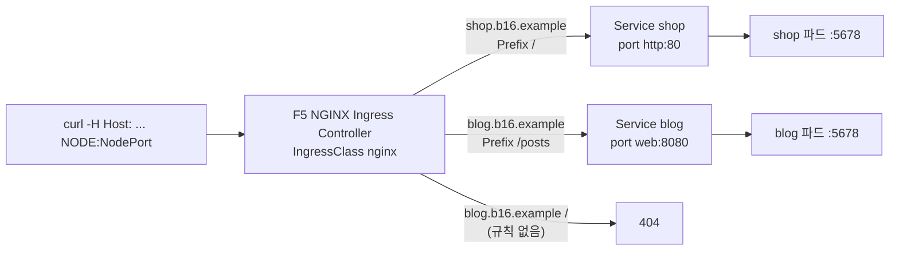

# q16 — Repair an Ingress that serves two hosts · 풀이

← 문제: **[question.md](question.md)**

## 문제 (해석)

**원문**

> Ingress `sites` in namespace `oberon` should publish two applications through the Ingress
> controller (IngressClass `nginx`): host `shop.b16.example` for Service `shop`, and host
> `blog.b16.example` for Service `blog`. Users report errors on both hosts.
>
> 1. Using `curl` against the Ingress controller's NodePort, record the HTTP status codes for
>    `shop.b16.example/`, `shop.b16.example/cart` and `blog.b16.example/posts/hello` in
>    `/opt/course/b16/before.txt`, one line each in the form `<host><path> <code>`.
> 2. Fix Ingress `sites` so that every path on `shop.b16.example` is served by Service `shop`, and
>    path `/posts` and everything below it on `blog.b16.example` is served by Service `blog`. Both
>    backends must keep referring to the Service port by name. Do not modify Services or
>    Deployments.
> 3. Requests to `blog.b16.example/` (outside `/posts`) must not reach Service `blog`.
> 4. Record the same three URLs again in `/opt/course/b16/after.txt` in the same format; all of them
>    must return `200`, with the body `shop` or `blog` respectively.

**해석**

`oberon` 네임스페이스의 Ingress `sites` 는 Ingress 컨트롤러(IngressClass `nginx`)를 통해 두 애플리케이션을 공개해야 한다.
호스트 `shop.b16.example` 은 Service `shop`, 호스트 `blog.b16.example` 은 Service `blog` 로 간다. 사용자들이 두 호스트
모두에서 오류를 보고하고 있다.

1. Ingress 컨트롤러의 NodePort 로 `curl` 을 보내 `shop.b16.example/`, `shop.b16.example/cart`,
   `blog.b16.example/posts/hello` 의 HTTP 상태 코드를 `/opt/course/b16/before.txt` 에 한 줄씩 `<host><path> <code>` 형식으로 적는다.
2. `shop.b16.example` 의 모든 경로는 Service `shop` 이, `blog.b16.example` 의 경로 `/posts` 와 그 아래 전부는 Service `blog`
   가 처리하도록 Ingress `sites` 를 고친다. 두 backend 모두 Service 포트를 계속 **이름으로** 참조해야 한다. Service 와
   Deployment 는 고치지 않는다.
3. `blog.b16.example/`(`/posts` 밖)으로 온 요청은 Service `blog` 에 닿으면 안 된다.
4. 같은 세 URL 을 같은 형식으로 다시 `/opt/course/b16/after.txt` 에 적는다. 모두 `200` 이고 본문은 각각 `shop` 또는 `blog` 여야 한다.

## 모범 풀이

**1) 수정 전 상태 기록**

```bash
NP=$(kubectl -n nginx-ingress get svc nginx-ingress -o jsonpath='{.spec.ports[?(@.name=="http")].nodePort}')
NODE=$(kubectl get nodes -o jsonpath='{.items[0].status.addresses[?(@.type=="InternalIP")].address}')
check() {
  for u in shop.b16.example/ shop.b16.example/cart blog.b16.example/posts/hello; do
    h=${u%%/*}; p=/${u#*/}
    echo "$u $(curl -s -o /dev/null -w '%{http_code}' -H "Host: $h" http://$NODE:$NP$p)"
  done
}
check | tee /opt/course/b16/before.txt
# shop.b16.example/ 200
# shop.b16.example/cart 404
# blog.b16.example/posts/hello 502          ← 컨트롤러에 따라 503
```

**원인 찾기 — Ingress 와 Service 를 나란히 놓고 본다**

```bash
kubectl -n oberon get ingress sites -o yaml | grep -A12 'rules:'
#  - host: shop.b16.example        path: /        pathType: Exact    service shop  port.name: http
#  - host: blog.b16.example        path: /posts   pathType: Prefix   service blog  port.name: http
kubectl -n oberon get svc -o custom-columns=NAME:.metadata.name,PORTNAME:.spec.ports[0].name,PORT:.spec.ports[0].port
# NAME   PORTNAME   PORT
# blog   web        8080        ← blog Service 의 포트 이름은 web
# shop   http       80
kubectl -n oberon describe ingress sites      # Backends 열에서 blog:http 가 연결되지 않은 것이 보인다
```

- `shop`: `pathType: Exact` 의 `/` 는 **정확히 `/`** 만 맞습니다. `/cart` 는 어떤 규칙에도 맞지 않아 컨트롤러가 404 를 냅니다.
- `blog`: backend 가 Service `blog` 의 포트 이름 `http` 를 참조하지만 그런 포트가 없습니다(실제 이름은 `web`). 컨트롤러는 upstream 서버를 하나도 만들지 못해 5xx 를 돌려줍니다. Ingress 의 `port.name` 은 **Service 의 `ports[].name`** 이지 컨테이너 포트 이름이 아닙니다.

**2)~3) Ingress 수정**

```bash
kubectl -n oberon edit ingress sites
```

```yaml
spec:
  ingressClassName: nginx
  rules:
  - host: shop.b16.example
    http:
      paths:
      - path: /
        pathType: Prefix          # Exact → Prefix : / 아래 모든 경로
        backend:
          service:
            name: shop
            port:
              name: http
  - host: blog.b16.example
    http:
      paths:
      - path: /posts
        pathType: Prefix          # /posts, /posts/, /posts/hello (그러나 /postsx 는 아님)
        backend:
          service:
            name: blog
            port:
              name: web           # http → web : Service 에 실제로 있는 포트 이름
```

`blog.b16.example` 에는 `/posts` 규칙만 있으므로 `/` 요청은 아무 규칙에도 맞지 않아 404 가 됩니다(요구 3). 숫자 `port.number: 8080` 으로 바꿔도 동작은 하지만 "이름으로 참조" 요구를 어기게 됩니다.

### 그림 — 호스트·경로별 라우팅 (수정 후)



1. 컨트롤러는 먼저 `Host` 헤더로 규칙을 고르고, 그 안에서 경로를 `pathType` 에 따라 맞춥니다.
2. backend 의 `port.name` 은 Service 의 포트 이름으로 해석되고, Service 가 그 포트의 `targetPort` 로 파드에 보냅니다. 이름이 맞지 않으면 upstream 이 비어 5xx 가 납니다.
3. 맞는 경로가 없으면(기본 backend 가 없으므로) 컨트롤러가 404 를 직접 돌려줍니다.

**4) 수정 후 기록**

```bash
sleep 3            # 컨트롤러가 설정을 다시 읽을 시간
check | tee /opt/course/b16/after.txt
# shop.b16.example/ 200
# shop.b16.example/cart 200
# blog.b16.example/posts/hello 200
curl -s -H 'Host: shop.b16.example' http://$NODE:$NP/cart          # shop
curl -s -H 'Host: blog.b16.example' http://$NODE:$NP/posts/hello   # blog
curl -s -o /dev/null -w '%{http_code}\n' -H 'Host: blog.b16.example' http://$NODE:$NP/    # 404
```

## 검증

```bash
cat /opt/course/b16/before.txt /opt/course/b16/after.txt
kubectl -n oberon get ingress sites \
  -o jsonpath='{range .spec.rules[*]}{.host}{" "}{.http.paths[0].path}{" "}{.http.paths[0].pathType}{" "}{.http.paths[0].backend.service.port.name}{"\n"}{end}'
# shop.b16.example / Prefix http
# blog.b16.example /posts Prefix web
kubectl -n oberon get svc,deploy        # 변경 없음
```

## 오답 원인 / 배운 점

- **왜 틀렸나**:
- **기억할 것**: Ingress `backend.service.port.name` 은 Service `spec.ports[].name` 과 정확히 같아야 하고, "그 아래 전부"는 `pathType: Prefix`.
- **헷갈리는 지점**: 404 는 "맞는 규칙이 없다"(host/path/pathType), 502·503 은 "규칙은 맞았는데 backend 가 없다"(Service 이름·포트·엔드포인트)로 나눠 생각합니다. Ingress NGINX(kubernetes/ingress-nginx)는 2026년 3월 은퇴했고, 이 실습은 F5 NGINX Ingress Controller 를 씁니다. 표준 필드만 쓰면 Ingress API 동작은 같습니다.

## 참고 문서

- 검색어: `ingress path types`, `ingress name based virtual hosting`
- https://kubernetes.io/docs/concepts/services-networking/ingress/#path-types
- https://kubernetes.io/docs/concepts/services-networking/ingress/#name-based-virtual-hosting

---

[↑ 문항 목록](../README.md) · [← 문제로](question.md) · [다음 문제 q17 →](../q17_networkpolicy_default_deny_allow/question.md)
