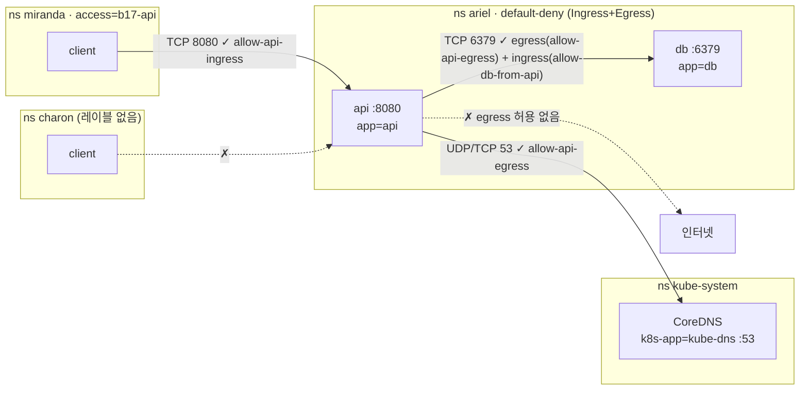

# q17 — Open precise paths through a default-deny namespace · 풀이

← 문제: **[question.md](question.md)**

## 문제 (해석)

**원문**

> Namespace `ariel` has a NetworkPolicy `default-deny` that blocks all ingress and egress traffic.
> Open only the paths below. Do not modify or delete `default-deny`, and do not change any labels on
> Pods or namespaces.
>
> 1. Create NetworkPolicy `allow-api-ingress` in `ariel`: Pods with label `app=api` accept incoming
>    traffic only from Pods in namespaces labeled `access=b17-api`, and only on TCP port `8080`.
> 2. Create NetworkPolicy `allow-api-egress` in `ariel`: Pods with label `app=api` may send traffic
>    only to the cluster DNS Pods (label `k8s-app=kube-dns` in namespace `kube-system`) on UDP and TCP
>    port `53`, and to Pods with label `app=db` in `ariel` on TCP port `6379`.
> 3. The `api` Pod must actually be able to talk to the `db` Pod:
>    `printf 'PING\r\n' | nc -w 2 db 6379` run in Pod `api` must answer `+PONG`. Any additional
>    NetworkPolicy you need must have a name starting with `allow-`, and no Pod other than those with
>    label `app=api` may reach `db`.
> 4. Test the four paths below and write the results to `/opt/course/b17/results.txt`, one line each,
>    as `<path> ok` or `<path> blocked`:
>    `miranda->api` (Pod `client` in `miranda` to `http://api.ariel:8080`),
>    `charon->api` (Pod `client` in `charon` to the same URL),
>    `api->db` (the `nc` test above), and
>    `api->internet` (`wget -T 3 -qO- http://example.com` in Pod `api`).

**해석**

`ariel` 네임스페이스에는 모든 ingress·egress 트래픽을 막는 NetworkPolicy `default-deny` 가 있다. 아래 경로만 연다.
`default-deny` 는 수정하거나 지우지 않으며, Pod 와 네임스페이스의 레이블도 바꾸지 않는다.

1. `ariel` 에 NetworkPolicy `allow-api-ingress` 를 만든다. 레이블 `app=api` 인 Pod 는 레이블 `access=b17-api` 가 있는
   네임스페이스의 Pod 에서 오는 트래픽만, TCP 포트 `8080` 으로만 받는다.
2. `ariel` 에 NetworkPolicy `allow-api-egress` 를 만든다. 레이블 `app=api` 인 Pod 는 클러스터 DNS Pod(`kube-system` 의
   레이블 `k8s-app=kube-dns`)의 UDP·TCP `53` 과, `ariel` 의 레이블 `app=db` 인 Pod 의 TCP `6379` 로만 트래픽을 보낼 수 있다.
3. `api` Pod 는 실제로 `db` Pod 와 통신할 수 있어야 한다. Pod `api` 에서 실행한 `printf 'PING\r\n' | nc -w 2 db 6379`
   가 `+PONG` 을 돌려줘야 한다. 추가로 필요한 NetworkPolicy 는 이름이 `allow-` 로 시작해야 하고, 레이블 `app=api` 인
   Pod 외에는 어떤 Pod 도 `db` 에 닿으면 안 된다.
4. 아래 네 경로를 시험해 결과를 `/opt/course/b17/results.txt` 에 한 줄씩 `<경로> ok` 또는 `<경로> blocked` 로 적는다.
   `miranda->api`(`miranda` 의 Pod `client` 에서 `http://api.ariel:8080`), `charon->api`(`charon` 의 Pod `client` 에서
   같은 URL), `api->db`(위의 `nc` 시험), `api->internet`(Pod `api` 에서 `wget -T 3 -qO- http://example.com`).

## 모범 풀이

```bash
kubectl -n ariel get netpol default-deny -o yaml       # podSelector: {} , policyTypes: [Ingress, Egress]
kubectl -n ariel get pods --show-labels                # api: app=api, db: app=db
kubectl get ns miranda charon kube-system --show-labels
kubectl -n kube-system get pods -l k8s-app=kube-dns    # CoreDNS 파드 레이블 확인
```

NetworkPolicy 는 **허용 목록의 합집합**입니다. 파드를 고르는 정책이 하나라도 있으면 그 방향은 기본 차단이 되고, 어떤 정책이든 허용한 트래픽만 통과합니다. 그리고 연결 하나가 성공하려면 **보내는 쪽의 egress 와 받는 쪽의 ingress 가 모두** 허용되어야 합니다.

**1) api 의 ingress**

```yaml
apiVersion: networking.k8s.io/v1
kind: NetworkPolicy
metadata:
  name: allow-api-ingress
  namespace: ariel
spec:
  podSelector:
    matchLabels:
      app: api
  policyTypes: ["Ingress"]
  ingress:
  - from:
    - namespaceSelector:
        matchLabels:
          access: b17-api
    ports:
    - protocol: TCP
      port: 8080
```

**2) api 의 egress — DNS 는 namespaceSelector 와 podSelector 를 한 항목에**

```yaml
apiVersion: networking.k8s.io/v1
kind: NetworkPolicy
metadata:
  name: allow-api-egress
  namespace: ariel
spec:
  podSelector:
    matchLabels:
      app: api
  policyTypes: ["Egress"]
  egress:
  - to:
    - namespaceSelector:
        matchLabels:
          kubernetes.io/metadata.name: kube-system
      podSelector:                 # 앞에 '-' 가 없다 → 같은 항목 = AND
        matchLabels:
          k8s-app: kube-dns
    ports:
    - protocol: UDP
      port: 53
    - protocol: TCP
      port: 53
  - to:
    - podSelector:                 # namespaceSelector 없음 = 정책과 같은 네임스페이스(ariel)
        matchLabels:
          app: db
    ports:
    - protocol: TCP
      port: 6379
```

`- namespaceSelector` 와 `- podSelector` 를 **각각 `-` 로** 쓰면 OR 가 되어 "kube-system 의 모든 파드" 또는 "ariel 의 kube-dns 파드"를 허용하게 됩니다. kube-system 네임스페이스는 이름 레이블 `kubernetes.io/metadata.name` 으로 고릅니다(v1.22+ 자동 레이블). DNS 는 대부분 UDP 지만 응답이 크면 TCP 로 재시도하므로 둘 다 엽니다.

**3) 함정 — db 의 ingress 도 default-deny 에 막혀 있다**

`allow-api-egress` 만으로는 api → db 가 열리지 않습니다. `default-deny` 는 db 파드의 ingress 도 막고 있기 때문입니다.

```yaml
apiVersion: networking.k8s.io/v1
kind: NetworkPolicy
metadata:
  name: allow-db-from-api
  namespace: ariel
spec:
  podSelector:
    matchLabels:
      app: db
  policyTypes: ["Ingress"]
  ingress:
  - from:
    - podSelector:
        matchLabels:
          app: api
    ports:
    - protocol: TCP
      port: 6379
```

```bash
kubectl apply -f /tmp/b17-policies.yaml
kubectl -n ariel get netpol
# NAME                POD-SELECTOR
# allow-api-egress    app=api
# allow-api-ingress   app=api
# allow-db-from-api   app=db
# default-deny        <none>
```

### 그림 — 허용 경로 (그 밖은 default-deny)



1. miranda 의 client 는 자기 네임스페이스에 정책이 없어 egress 가 자유롭고, api 의 ingress 는 `access=b17-api` 네임스페이스에서 온 8080 만 허용하므로 통과합니다. charon 은 레이블이 없어 막힙니다.
2. api 가 `db` 라는 이름을 쓰려면 먼저 DNS 가 되어야 합니다. 그래서 kube-dns 파드로 가는 53 을 엽니다.
3. api → db 는 api 의 egress 와 db 의 ingress 가 **둘 다** 허용되어야 합니다. 세 번째 정책이 db 의 ingress 를 api 에게만 엽니다.
4. 그 밖의 egress(인터넷 등)는 api 를 고른 egress 정책 어디에도 없으므로 막힙니다. DNS 조회는 성공하지만 연결은 시간 초과됩니다.

**4) 시험과 기록**

```bash
t() { if eval "$2" >/dev/null 2>&1; then echo "$1 ok"; else echo "$1 blocked"; fi; }
{
t 'miranda->api'  'kubectl -n miranda exec client -- curl -s -m 3 http://api.ariel:8080'
t 'charon->api'   'kubectl -n charon exec client -- curl -s -m 3 http://api.ariel:8080'
t 'api->db'       "kubectl -n ariel exec api -- sh -c 'printf \"PING\r\n\" | nc -w 2 db 6379' | grep -q PONG"
t 'api->internet' 'kubectl -n ariel exec api -- wget -T 3 -qO- http://example.com'
} | tee /opt/course/b17/results.txt
# miranda->api ok
# charon->api blocked
# api->db ok
# api->internet blocked
```

경로 이름의 `>` 는 셸에서 리다이렉트로 해석되므로 따옴표로 감쌉니다. 손으로 하나씩 실행해도 됩니다. 차단은 대개 연결 거부가 아니라 **시간 초과**로 나타나므로 `-m 3`, `-T 3`, `-w 2` 처럼 짧은 타임아웃을 꼭 줍니다.

## 검증

```bash
cat /opt/course/b17/results.txt
kubectl -n ariel get netpol default-deny -o jsonpath='{.spec}{"\n"}'     # {"podSelector":{},"policyTypes":["Ingress","Egress"]} 그대로
kubectl -n ariel describe netpol allow-api-egress
kubectl -n ariel exec api -- nslookup db.ariel.svc.cluster.local           # DNS 동작
kubectl -n miranda exec client -- curl -s -m 3 http://db.ariel:6379 ; echo "exit=$?"   # 시간 초과 (db 는 api 만 허용)
```

## 오답 원인 / 배운 점

- **왜 틀렸나**:
- **기억할 것**: 연결 하나 = 보내는 파드의 egress + 받는 파드의 ingress. default-deny 네임스페이스 안끼리의 통신은 정책이 두 개 필요하다.
- **헷갈리는 지점**: `to`/`from` 의 한 항목 안에 `namespaceSelector` 와 `podSelector` 를 함께 쓰면 AND, 따로 `-` 를 붙이면 OR 입니다. egress 를 막으면 DNS 부터 막히므로 53(UDP·TCP)을 여는 것을 잊지 않습니다. NetworkPolicy 의 `ports` 는 Service 포트가 아니라 **파드(컨테이너) 포트**입니다.

## 참고 문서

- 검색어: `network policies`, `declare network policy`
- https://kubernetes.io/docs/concepts/services-networking/network-policies/
- https://kubernetes.io/docs/concepts/services-networking/network-policies/#behavior-of-to-and-from-selectors

---

[↑ 문항 목록](../README.md) · [← 문제로](question.md)
