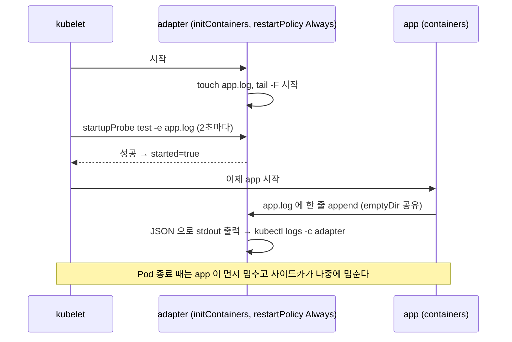

# q03 — Log adapter as a native sidecar with a startup probe · 풀이

← 문제: **[question.md](question.md)**

## 문제 (해석)

**원문**

> Pod `legacy-app` in namespace `maple` writes its log only to `/var/log/legacy/app.log`, one line per
> event in the format `<time>|<LEVEL>|<message>`. The log platform only collects container stdout, as
> JSON.
>
> 1. Recreate Pod `legacy-app` (keep container `app` unchanged) with an adapter container named
>    `adapter` that is a native sidecar: an entry under `initContainers` that keeps running for the
>    whole life of the Pod. Use image `busybox:1.36` and mount the existing log volume at
>    `/var/log/legacy`.
> 2. The adapter must print every line of `app.log`, starting from the first line of the file, to its
>    stdout as `{"time":"<time>","level":"<LEVEL>","msg":"<message>"}`.
> 3. Give the adapter a `startupProbe` that runs `test -e /var/log/legacy/app.log` every `2` seconds.
>    Container `app` must only start after this probe has succeeded.
> 4. Save the first `3` lines of the adapter's log to `/opt/course/c03/adapter.log`.
> 5. Write the start times of both containers to `/opt/course/c03/start-order.txt` in the form
>    `adapter=<startedAt> app=<startedAt>`.

**해석**

namespace `maple` 의 Pod `legacy-app` 은 로그를 `/var/log/legacy/app.log` 에만 쓴다. 이벤트 하나가 한 줄이고 형식은
`<time>|<LEVEL>|<message>` 이다. 로그 플랫폼은 컨테이너 stdout 만, 그것도 JSON 으로만 수집한다.

1. Pod `legacy-app` 을 다시 만든다(컨테이너 `app` 은 그대로). 이름이 `adapter` 인 어댑터 컨테이너를 네이티브
   사이드카로 넣는다. 즉 `initContainers` 아래에 있으면서 Pod 수명 내내 계속 도는 항목이다. 이미지는
   `busybox:1.36`, 기존 로그 볼륨을 `/var/log/legacy` 에 마운트한다.
2. 어댑터는 `app.log` 의 모든 줄을 파일의 첫 줄부터 stdout 에
   `{"time":"<time>","level":"<LEVEL>","msg":"<message>"}` 형식으로 출력해야 한다.
3. 어댑터에 `test -e /var/log/legacy/app.log` 를 `2` 초마다 실행하는 `startupProbe` 를 준다. 컨테이너 `app` 은
   이 probe 가 성공한 뒤에만 시작해야 한다.
4. 어댑터 로그의 처음 `3` 줄을 `/opt/course/c03/adapter.log` 에 저장한다.
5. 두 컨테이너의 시작 시각을 `adapter=<startedAt> app=<startedAt>` 형식으로 `/opt/course/c03/start-order.txt` 에
   쓴다.

## 모범 풀이

**1)~3) 사이드카를 넣은 매니페스트** — Pod 의 컨테이너 목록은 바꿀 수 없으므로(불변 필드) 다시 만듭니다.

```bash
cp /opt/course/c03/legacy-app.yaml /tmp/c03.yaml
vi /tmp/c03.yaml      # spec 아래에 initContainers 추가
```

```yaml
spec:
  initContainers:
  - name: adapter
    image: busybox:1.36
    restartPolicy: Always            # 이 한 줄이 "네이티브 사이드카"를 만든다
    command:
    - sh
    - -c
    - |
      touch /var/log/legacy/app.log
      tail -n +1 -F /var/log/legacy/app.log | while IFS='|' read -r t l m; do
        echo "{\"time\":\"$t\",\"level\":\"$l\",\"msg\":\"$m\"}"
      done
    startupProbe:
      exec:
        command: ["test", "-e", "/var/log/legacy/app.log"]
      periodSeconds: 2
      failureThreshold: 15
    volumeMounts:
    - name: logs
      mountPath: /var/log/legacy
  containers:
  - name: app
    # ... 기존 그대로 ...
```

```bash
kubectl replace --force -f /tmp/c03.yaml          # delete + create
kubectl -n maple wait --for=condition=Ready pod/legacy-app --timeout=90s
kubectl -n maple get pod legacy-app               # READY 2/2
```

핵심은 세 가지입니다.

- `initContainers` 항목에 `restartPolicy: Always` 를 주면 그 컨테이너는 "끝나야 다음으로 넘어가는" 일반 init
  컨테이너가 아니라, **시작된 뒤 계속 살아 있는 사이드카**가 됩니다. kubelet 은 사이드카가 시작(started)되면
  바로 다음 init 컨테이너나 메인 컨테이너로 넘어갑니다.
- 사이드카에 `startupProbe` 가 있으면 "started" 의 기준이 **probe 성공**으로 바뀝니다. 그래서 `app` 은 어댑터의
  probe 가 성공한 뒤에야 시작됩니다. 일반 `containers` 두 개로 두면 순서 보장이 없습니다.
- **함정 — 교착 상태**: 새 Pod 의 emptyDir 은 비어 있습니다. 로그 파일을 만드는 것은 `app` 인데 `app` 은 probe
  성공 뒤에야 시작하므로, 어댑터가 `touch` 로 파일을 먼저 만들지 않으면 probe 가 영원히 실패하고(재시작 반복)
  `app` 은 시작조차 못 합니다.

`tail -n +1 -F` 는 첫 줄부터 읽고(`+1`), 파일이 다시 만들어져도 따라갑니다(`-F`). `while read` 루프의 `echo` 는
줄마다 바로 내보내므로 파이프 버퍼링으로 로그가 늦게 나오는 문제도 없습니다. stdout 으로 나간 내용이 곧
`kubectl logs -c adapter` 입니다.

**4) 어댑터 로그 저장**

```bash
kubectl -n maple logs legacy-app -c adapter | head -n 3 > /opt/course/c03/adapter.log
cat /opt/course/c03/adapter.log
# {"time":"2026-10-24T10:00:01Z","level":"INFO","msg":"request 1 served"}
# {"time":"2026-10-24T10:00:03Z","level":"INFO","msg":"request 2 served"}
# {"time":"2026-10-24T10:00:05Z","level":"INFO","msg":"request 3 served"}
```

컨테이너가 둘 이상이면 `-c` 를 빼면 기본 컨테이너(`kubectl.kubernetes.io/default-container` 어노테이션 또는 첫
번째 일반 컨테이너인 `app`)의 로그가 나옵니다. `app` 의 stdout 은 비어 있으므로 아무것도 안 보입니다.

**5) 시작 순서 기록** — 사이드카의 상태는 `containerStatuses` 가 아니라 `initContainerStatuses` 에 있습니다.

```bash
A=$(kubectl -n maple get pod legacy-app -o jsonpath='{.status.initContainerStatuses[?(@.name=="adapter")].state.running.startedAt}')
B=$(kubectl -n maple get pod legacy-app -o jsonpath='{.status.containerStatuses[?(@.name=="app")].state.running.startedAt}')
echo "adapter=$A app=$B" | tee /opt/course/c03/start-order.txt
# adapter=2026-10-24T10:00:00Z app=2026-10-24T10:00:01Z
```

### 그림 — init → 사이드카 → 앱 시작 순서



1. kubelet 은 `initContainers` 를 순서대로 처리합니다. `restartPolicy: Always` 인 항목은 완료를 기다리지 않고 "started" 만 기다립니다.
2. startupProbe 가 있으므로 started 는 probe 가 처음 성공한 순간입니다. 어댑터가 직접 파일을 만들어 두었기 때문에 곧바로 성공합니다.
3. 그다음에야 `app` 이 시작되어 공유 emptyDir 의 파일에 로그를 씁니다. 어댑터는 `tail -F` 로 이를 읽어 JSON 으로 바꿔 stdout 에 냅니다.
4. 종료 순서는 반대입니다. 메인 컨테이너가 끝난 뒤 사이드카가 멈추므로 마지막 로그까지 넘겨줄 수 있습니다(일반 sidecar 패턴과의 차이).

## 검증

```bash
kubectl -n maple get pod legacy-app                          # 2/2 Running
kubectl -n maple get pod legacy-app -o jsonpath='{.spec.initContainers[0].name} {.spec.initContainers[0].restartPolicy}{"\n"}'
# adapter Always
kubectl -n maple get pod legacy-app -o jsonpath='{.spec.initContainers[0].startupProbe}{"\n"}'
# {"exec":{"command":["test","-e","/var/log/legacy/app.log"]},"periodSeconds":2,...}
kubectl -n maple logs legacy-app -c adapter --tail=2          # JSON 줄이 계속 늘어난다
kubectl -n maple logs legacy-app -c app                       # 비어 있음 (app 은 그대로)
cat /opt/course/c03/adapter.log | wc -l                       # 3
cat /opt/course/c03/start-order.txt                           # adapter 시각 <= app 시각
```

## 오답 원인 / 배운 점

- **왜 틀렸나**:
- **기억할 것**: 네이티브 사이드카 = `initContainers` + `restartPolicy: Always`. 사이드카에 startupProbe 를 주면 메인 컨테이너는 probe 성공 뒤에 시작한다.
- **헷갈리는 지점**: probe 가 기다리는 조건(파일 존재)을 메인 컨테이너가 만든다면 교착입니다. 사이드카 상태는 `initContainerStatuses` 에, 로그는 `kubectl logs -c adapter` 로 봅니다. 사이드카는 v1.33 에서 GA 가 되었고, Job 에서도 사이드카가 남아 있어도 메인 컨테이너가 끝나면 Job 이 완료됩니다.

## 참고 문서

- 검색어: `sidecar containers`, `init containers`, `startup probe`
- https://kubernetes.io/docs/concepts/workloads/pods/sidecar-containers/
- https://kubernetes.io/docs/tasks/configure-pod-container/configure-liveness-readiness-startup-probes/

---

[↑ 문항 목록](../README.md) · [← 문제로](question.md) · [다음 문제 q04 →](../q04_rollout_deadline_undo_revision/question.md)
