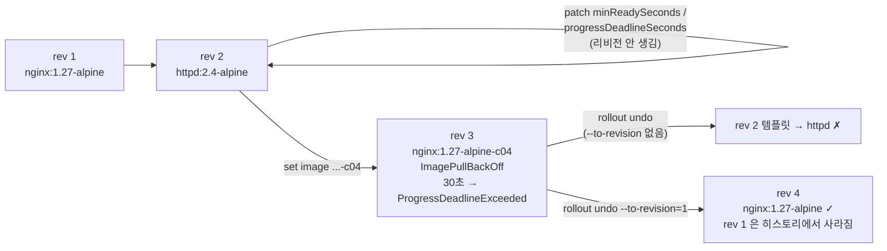

# q04 — Detect a stalled rollout and undo to a chosen revision · 풀이

← 문제: **[question.md](question.md)**

## 문제 (해석)

**원문**

> Deployment `shop` in namespace `birch` has two revisions. A new release must go out with tighter
> rollout guards. The release is expected to fail and must be detected and reverted.
>
> 1. Configure `shop` so that a new Pod only counts as available after it has been ready for `10`
>    seconds, and a rollout that makes no progress for `30` seconds is reported as failed.
> 2. Update container `web` to image `nginx:1.27-alpine-c04` (this tag does not exist) and record the
>    change-cause `release c04`.
> 3. Wait until the Deployment reports the rollout as failed. Write the `reason` of its `Progressing`
>    condition to `/opt/course/c04/condition.txt` and the revision number of this failed rollout to
>    `/opt/course/c04/failed-revision.txt`.
> 4. Roll back to the revision that runs `nginx:1.27-alpine` (this is not simply the previous
>    revision) and set the change-cause to `rollback to nginx 1.27`. All `3` replicas must be
>    available with image `nginx:1.27-alpine`.
> 5. Save the output of `kubectl rollout history` for `shop` to `/opt/course/c04/history.txt`.

**해석**

namespace `birch` 의 Deployment `shop` 에는 리비전이 두 개 있다. 새 릴리스를 더 엄격한 롤아웃 조건으로 내보내야
한다. 이 릴리스는 실패할 것으로 예상되며, 실패를 감지하고 되돌려야 한다.

1. 새 파드가 `10` 초 동안 Ready 를 유지해야 available 로 세어지고, `30` 초 동안 진전이 없는 롤아웃은 실패로
   보고되도록 `shop` 을 설정한다.
2. 컨테이너 `web` 의 이미지를 `nginx:1.27-alpine-c04`(존재하지 않는 태그)로 바꾸고 change-cause 를
   `release c04` 로 기록한다.
3. Deployment 가 롤아웃 실패를 보고할 때까지 기다린다. `Progressing` 조건의 `reason` 을
   `/opt/course/c04/condition.txt` 에, 이 실패한 롤아웃의 리비전 번호를 `/opt/course/c04/failed-revision.txt` 에
   쓴다.
4. `nginx:1.27-alpine` 을 실행하는 리비전으로 롤백한다(단순히 직전 리비전이 아니다). change-cause 를
   `rollback to nginx 1.27` 로 설정한다. 레플리카 `3` 개가 모두 `nginx:1.27-alpine` 으로 available 이어야 한다.
5. `shop` 의 `kubectl rollout history` 출력을 `/opt/course/c04/history.txt` 에 저장한다.

## 모범 풀이

**1) 롤아웃 가드 설정**

```bash
kubectl -n birch patch deploy shop -p '{"spec":{"minReadySeconds":10,"progressDeadlineSeconds":30}}'
kubectl -n birch rollout history deploy shop      # 여전히 리비전 1, 2 뿐
```

두 필드는 Deployment `spec` 바로 아래에 있고 파드 템플릿이 아니므로 **새 리비전을 만들지 않습니다**. 그래서
다음 단계의 실패 롤아웃이 리비전 3 이 됩니다. `minReadySeconds` 는 "Ready 후 이 시간이 지나야 available",
`progressDeadlineSeconds` 는 "이 시간 동안 새 ReplicaSet 의 진전이 없으면 `Progressing=False`" 입니다.

**2) 깨진 이미지 배포 + change-cause**

```bash
kubectl -n birch set image deploy/shop web=nginx:1.27-alpine-c04
kubectl -n birch annotate deploy shop kubernetes.io/change-cause="release c04" --overwrite
```

`--record` 는 오래전에 deprecated 되었으므로 `kubernetes.io/change-cause` 어노테이션을 직접 붙입니다.
Deployment 컨트롤러가 이 어노테이션을 **현재 새 ReplicaSet** 에 복사하고, `rollout history` 의 CHANGE-CAUSE 열은
ReplicaSet 의 값을 보여 줍니다.

**3) 실패 감지**

```bash
kubectl -n birch rollout status deploy shop --timeout=90s
# Waiting for deployment "shop" rollout to finish: 1 out of 3 new replicas have been updated...
# error: deployment "shop" exceeded its progress deadline        ← exit code 1

kubectl -n birch get deploy shop \
  -o jsonpath='{.status.conditions[?(@.type=="Progressing")].reason}' > /opt/course/c04/condition.txt
cat /opt/course/c04/condition.txt          # ProgressDeadlineExceeded

kubectl -n birch get deploy shop \
  -o jsonpath='{.metadata.annotations.deployment\.kubernetes\.io/revision}' > /opt/course/c04/failed-revision.txt
cat /opt/course/c04/failed-revision.txt    # 3
```

ImagePullBackOff 상태에서는 파드가 Ready 가 되지 않으므로 30초 뒤 조건이 `Progressing=False,
reason=ProgressDeadlineExceeded` 로 바뀝니다. **Deployment 는 스스로 롤백하지 않습니다**. 조건만 바뀝니다.
replicas 3 에서 기본값 maxSurge 25% 는 올림으로 1, maxUnavailable 25% 는 내림으로 0 이므로, 새 파드 1개만
실패한 채 떠 있고 기존 httpd 파드 3개는 그대로 서비스합니다. jsonpath 에서 어노테이션 키의 점은 `\.` 으로 이스케이프합니다.

**4) 특정 리비전으로 롤백**

```bash
kubectl -n birch rollout history deploy shop
# REVISION  CHANGE-CAUSE
# 1         initial release nginx 1.27
# 2         switch to httpd 2.4
# 3         release c04
kubectl -n birch rollout history deploy shop --revision=1 | grep Image     # nginx:1.27-alpine 확인

kubectl -n birch rollout undo deploy shop --to-revision=1
kubectl -n birch annotate deploy shop kubernetes.io/change-cause="rollback to nginx 1.27" --overwrite
kubectl -n birch rollout status deploy shop
```

`rollout undo` 만 치면 "직전 리비전" = 2(httpd) 로 갑니다. 이미지 조건을 맞추려면 `--to-revision=1` 이어야 합니다.
롤백은 리비전 1 의 템플릿을 **새 리비전 4** 로 다시 쓰는 것이라, 리비전 1 은 히스토리에서 사라지고 4 가 됩니다.
또 `rollout undo` 는 리비전 1 ReplicaSet 의 change-cause("initial release nginx 1.27")까지 Deployment 에 되돌려
놓으므로, 요구한 문구로 **롤백 뒤에** 다시 annotate 해야 합니다. `minReadySeconds: 10` 이 걸려 있어 파드마다
10초씩 더 기다리므로 롤아웃이 평소보다 느립니다.

**5) 히스토리 저장**

```bash
kubectl -n birch rollout history deploy shop | tee /opt/course/c04/history.txt
# REVISION  CHANGE-CAUSE
# 2         switch to httpd 2.4
# 3         release c04
# 4         rollback to nginx 1.27
```

### 그림 — 리비전 흐름



1. 리비전은 **파드 템플릿**이 바뀔 때만 생깁니다. 1단계의 patch 는 템플릿 밖이라 리비전을 만들지 않습니다.
2. 존재하지 않는 태그의 rev 3 은 새 파드가 Ready 가 되지 못해 30초 뒤 실패로 표시됩니다. 롤아웃은 멈춘 채로 남고 자동 롤백은 없습니다.
3. 옵션 없는 undo 는 직전(rev 2 = httpd)으로 가므로 조건을 못 맞춥니다. `--to-revision=1` 로 rev 1 의 템플릿을 rev 4 로 다시 씁니다.

## 검증

```bash
cat /opt/course/c04/condition.txt          # ProgressDeadlineExceeded
cat /opt/course/c04/failed-revision.txt    # 3
kubectl -n birch get deploy shop -o jsonpath='{.spec.minReadySeconds} {.spec.progressDeadlineSeconds} {.spec.template.spec.containers[0].image}{"\n"}'
# 10 30 nginx:1.27-alpine
kubectl -n birch get deploy shop           # READY 3/3, AVAILABLE 3
kubectl -n birch get deploy shop -o jsonpath='{.status.conditions[?(@.type=="Progressing")].reason}{"\n"}'
# NewReplicaSetAvailable
cat /opt/course/c04/history.txt            # 2, 3, 4 (4 = rollback to nginx 1.27)
```

## 오답 원인 / 배운 점

- **왜 틀렸나**:
- **기억할 것**: 특정 리비전으로는 `kubectl rollout undo deploy/<d> --to-revision=<n>`. 롤백은 새 리비전 번호로 기록된다.
- **헷갈리는 지점**: `progressDeadlineSeconds` 를 넘겨도 Deployment 는 롤백하지 않고 조건만 `ProgressDeadlineExceeded` 로 바꿉니다. `rollout undo` 는 대상 리비전의 change-cause 까지 되돌리므로 원하는 문구는 롤백 뒤에 annotate 합니다. `--record` 플래그는 deprecated 입니다.

## 참고 문서

- 검색어: `deployment progress deadline`, `rolling back a deployment`
- https://kubernetes.io/docs/concepts/workloads/controllers/deployment/#failed-deployment
- https://kubernetes.io/docs/concepts/workloads/controllers/deployment/#rolling-back-to-a-previous-revision

---

[↑ 문항 목록](../README.md) · [← 문제로](question.md) · [다음 문제 q05 →](../q05_helm_local_chart_list_values/question.md)
