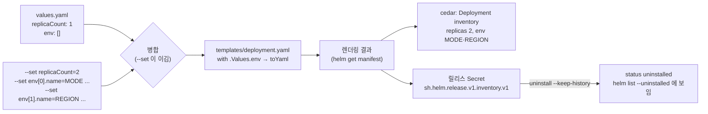

# q05 — Install a local Helm chart with list values and keep its history · 풀이

← 문제: **[question.md](question.md)**

## 문제 (해석)

**원문**

> The team packages its inventory service as a local chart in `/opt/course/c05/inventory/`. Install it,
> capture what Helm rendered, then remove it while keeping the release record for auditing.
>
> 1. Install release `inventory` from the chart directory `/opt/course/c05/inventory` into namespace
>    `cedar`, which does not exist yet and must be created by the same `helm` command. Using only
>    `--set` (no values file), set `replicaCount` to `2` and set the list `env` to two items:
>    `MODE=production` and `REGION=eu-west-1` (each item has the keys `name` and `value`).
> 2. Confirm that both Pods have the two environment variables. Save the output of
>    `helm get values` for the release to `/opt/course/c05/values.txt` and the rendered manifests
>    (`helm get manifest`) to `/opt/course/c05/manifest.yaml`.
> 3. Uninstall the release so that its history is kept. Save the output of
>    `helm list -n cedar --uninstalled` to `/opt/course/c05/uninstalled.txt`.
> 4. Write the output of `kubectl get ns cedar -o name` to `/opt/course/c05/namespace.txt`.

**해석**

팀은 inventory 서비스를 `/opt/course/c05/inventory/` 의 로컬 차트로 패키징했다. 설치하고, Helm 이 렌더링한
결과를 남긴 뒤, 감사용으로 릴리스 기록은 남긴 채 제거한다.

1. 차트 디렉터리 `/opt/course/c05/inventory` 로 릴리스 `inventory` 를 namespace `cedar` 에 설치한다. `cedar` 는
   아직 없으며 같은 `helm` 명령으로 만들어야 한다. `--set` 만으로(values 파일 없이) `replicaCount` 를 `2` 로,
   리스트 `env` 를 두 항목 `MODE=production`, `REGION=eu-west-1` 로 설정한다(각 항목은 `name`, `value` 키를 가진다).
2. 두 파드 모두 환경 변수 두 개를 가졌는지 확인한다. 릴리스의 `helm get values` 출력을
   `/opt/course/c05/values.txt` 에, 렌더링된 매니페스트(`helm get manifest`)를 `/opt/course/c05/manifest.yaml` 에
   저장한다.
3. 히스토리가 남도록 릴리스를 uninstall 한다. `helm list -n cedar --uninstalled` 출력을
   `/opt/course/c05/uninstalled.txt` 에 저장한다.
4. `kubectl get ns cedar -o name` 출력을 `/opt/course/c05/namespace.txt` 에 쓴다.

## 모범 풀이

**0) 차트가 env 를 어떻게 쓰는지 먼저 봅니다**

```bash
cat /opt/course/c05/inventory/values.yaml            # env: []
grep -n -A3 'with .Values.env' /opt/course/c05/inventory/templates/deployment.yaml
#   {{- with .Values.env }}
#   env:
#     {{- toYaml . | nindent 10 }}
```

`env` 는 `[{name, value}, ...]` 리스트를 그대로 컨테이너 `env:` 에 붙입니다. 그래서 `--set` 으로 리스트의 각
항목과 그 안의 키를 지정해야 합니다.

**1) 설치 — namespace 생성과 리스트 `--set`**

```bash
helm install inventory /opt/course/c05/inventory -n cedar --create-namespace \
  --set replicaCount=2 \
  --set 'env[0].name=MODE,env[0].value=production' \
  --set 'env[1].name=REGION,env[1].value=eu-west-1'
```

- 리스트는 `키[인덱스].필드=값` 으로 씁니다. 인덱스는 0 부터이고, 중간 인덱스를 건너뛰면 그 자리가 `null` 로
  채워져 렌더링이 깨집니다.
- 대괄호는 셸 glob 문자이므로 작은따옴표로 감쌉니다(같은 이름의 파일이 있으면 bash 가 바꿔 버립니다).
- `--set env[0]=MODE=production` 같은 형태는 문자열 하나가 될 뿐 `name`/`value` 맵이 되지 않습니다.
- `--create-namespace` 가 없으면 `Error: INSTALLATION FAILED: create: failed to create: namespaces "cedar" not found`.
- `eu-west-1` 처럼 숫자로 해석될 수 없는 값은 문자열이 됩니다. `"1.0"`·`true` 같은 값을 문자열로 강제하려면
  `--set-string` 을 씁니다.

`helm install ... --dry-run=server` 또는 `helm template` 로 먼저 렌더링을 확인해도 좋습니다.

**2) 확인과 기록**

```bash
kubectl -n cedar rollout status deploy inventory
for p in $(kubectl -n cedar get pod -l app.kubernetes.io/instance=inventory -o name); do
  kubectl -n cedar exec $p -- printenv MODE REGION
done
# production
# eu-west-1
# production
# eu-west-1

helm get values inventory -n cedar | tee /opt/course/c05/values.txt
# USER-SUPPLIED VALUES:
# env:
# - name: MODE
#   value: production
# - name: REGION
#   value: eu-west-1
# replicaCount: 2
helm get manifest inventory -n cedar > /opt/course/c05/manifest.yaml
grep -A4 'env:' /opt/course/c05/manifest.yaml
```

`helm get manifest` 는 **클러스터에 실제로 보낸** 렌더링 결과(릴리스 Secret 에 저장된 것)입니다. 차트 파일이
나중에 바뀌어도 이 출력은 설치 당시 그대로입니다.

**3) 히스토리를 남기는 uninstall**

```bash
helm uninstall inventory -n cedar --keep-history
helm list -n cedar                         # 비어 있음 — 기본 list 는 deployed/failed 만 보여 준다
helm list -n cedar --uninstalled | tee /opt/course/c05/uninstalled.txt
# NAME       NAMESPACE  REVISION  UPDATED  STATUS       CHART            APP VERSION
# inventory  cedar      1         ...      uninstalled  inventory-0.3.0  1.27
```

`--keep-history` 는 쿠버네티스 리소스(Deployment, Service)는 지우되 릴리스 기록 Secret
(`sh.helm.release.v1.inventory.v1`)을 `uninstalled` 상태로 남깁니다. 그래서 `helm history inventory -n cedar` 로
볼 수 있고 `helm rollback inventory 1 -n cedar` 로 되살릴 수도 있습니다.

**4) namespace 는 남는다**

```bash
kubectl get ns cedar -o name | tee /opt/course/c05/namespace.txt     # namespace/cedar
```

`--create-namespace` 로 만든 namespace 는 릴리스의 리소스가 아니므로 `helm uninstall` 이 지우지 않습니다.
게다가 히스토리 Secret 이 그 안에 있으므로 namespace 를 지우면 기록도 사라집니다.

### 그림 — 값이 들어가 매니페스트가 되기까지



1. 차트의 `values.yaml` 이 기본값이고, `--set` 은 그 위에 덮입니다. 리스트는 통째로 교체되므로 기본값 `[]` 은 사라집니다.
2. 템플릿이 병합된 값으로 렌더링되고, 그 결과가 클러스터에 적용되며 동시에 릴리스 Secret 에 저장됩니다. `helm get manifest` 가 이것을 보여 줍니다.
3. `--keep-history` 로 uninstall 하면 리소스만 지워지고 릴리스 Secret 은 `uninstalled` 상태로 남습니다.

## 검증

```bash
cat /opt/course/c05/values.txt | grep -c 'name:'          # 2
grep -q 'value: eu-west-1' /opt/course/c05/manifest.yaml && echo ok
grep -q 'replicas: 2' /opt/course/c05/manifest.yaml && echo ok
cat /opt/course/c05/uninstalled.txt                     # STATUS uninstalled
helm history inventory -n cedar                         # REVISION 1 ... uninstalled
kubectl -n cedar get deploy,svc                         # No resources found
kubectl -n cedar get secret -l owner=helm,name=inventory    # sh.helm.release.v1.inventory.v1 남아 있음
cat /opt/course/c05/namespace.txt                       # namespace/cedar
```

## 오답 원인 / 배운 점

- **왜 틀렸나**:
- **기억할 것**: 리스트 값은 `--set 'list[0].key=v,list[1].key=v'`. 히스토리를 남기는 제거는 `helm uninstall --keep-history`, 보는 것은 `helm list --uninstalled`.
- **헷갈리는 지점**: `helm uninstall` 은 `--create-namespace` 로 만든 namespace 를 지우지 않습니다. 기본 `helm list` 에는 uninstalled 릴리스가 안 보입니다(`--all` 또는 `--uninstalled`). Helm 4(2025.11)에서도 이 명령들은 같고, `--atomic` 은 `--rollback-on-failure` 로 이름이 바뀌었습니다.

## 참고 문서

시험 중에는 **helm.sh/docs** 도 열람할 수 있습니다.

- 검색어: `helm install set`, `helm uninstall keep-history`
- https://helm.sh/docs/helm/helm_install/
- https://helm.sh/docs/intro/using_helm/#the-format-and-limitations-of---set
- https://helm.sh/docs/helm/helm_uninstall/

---

[↑ 문항 목록](../README.md) · [← 문제로](question.md) · [다음 문제 q06 →](../q06_kustomize_secretgenerator_overlay/question.md)
