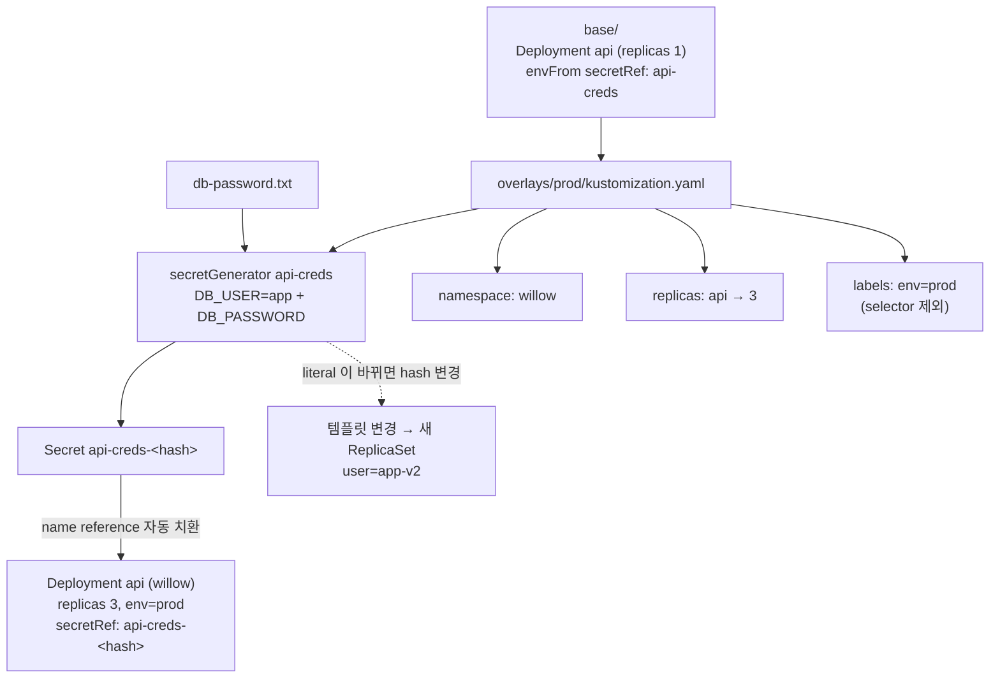

# q06 — Kustomize overlay with a generated Secret · 풀이

← 문제: **[question.md](question.md)**

## 문제 (해석)

**원문**

> The `api` application is deployed with Kustomize. The base is in `/opt/course/c06/base/`. Build the
> production overlay in `/opt/course/c06/overlays/prod/`, without editing the base.
>
> 1. Create `/opt/course/c06/overlays/prod/kustomization.yaml` that uses `../../base` and:
>    - puts all resources into namespace `willow`,
>    - sets the replicas of Deployment `api` to `3`,
>    - generates Secret `api-creds` with the literal `DB_USER=app` and the key `DB_PASSWORD` taken
>      from the file `db-password.txt`,
>    - adds the label `env=prod` to the metadata of all resources but not to selectors. Do not use
>      the deprecated `commonLabels` field.
> 2. Before applying, save the output of `kubectl diff -k` for the overlay to
>    `/opt/course/c06/diff-1.txt`.
> 3. Apply the overlay and wait for the rollout. Write the name of the Secret that was actually
>    created to `/opt/course/c06/secret-1.txt`.
> 4. Change the literal to `DB_USER=app-v2` and apply again. Write the new Secret name to
>    `/opt/course/c06/secret-2.txt`. The Deployment must roll out new Pods whose log shows
>    `user=app-v2`.

**해석**

`api` 애플리케이션은 Kustomize 로 배포한다. base 는 `/opt/course/c06/base/` 에 있다. base 를 고치지 않고
`/opt/course/c06/overlays/prod/` 에 운영 overlay 를 만든다.

1. `../../base` 를 쓰는 `/opt/course/c06/overlays/prod/kustomization.yaml` 을 만든다. 이 overlay 는
   - 모든 리소스를 namespace `willow` 에 넣고,
   - Deployment `api` 의 replicas 를 `3` 으로 하고,
   - literal `DB_USER=app` 과, 파일 `db-password.txt` 에서 가져온 키 `DB_PASSWORD` 로 Secret `api-creds` 를 생성하고,
   - 모든 리소스의 metadata 에 라벨 `env=prod` 를 붙이되 selector 에는 붙이지 않는다. deprecated 필드
     `commonLabels` 는 쓰지 않는다.
2. 적용하기 전에 overlay 에 대한 `kubectl diff -k` 출력을 `/opt/course/c06/diff-1.txt` 에 저장한다.
3. overlay 를 적용하고 롤아웃을 기다린다. 실제로 만들어진 Secret 의 이름을 `/opt/course/c06/secret-1.txt` 에 쓴다.
4. literal 을 `DB_USER=app-v2` 로 바꿔 다시 적용한다. 새 Secret 이름을 `/opt/course/c06/secret-2.txt` 에 쓴다.
   Deployment 는 로그에 `user=app-v2` 가 찍히는 새 파드로 롤아웃되어야 한다.

## 모범 풀이

**1) overlay 작성**

```bash
cat > /opt/course/c06/overlays/prod/kustomization.yaml <<'EOF'
apiVersion: kustomize.config.k8s.io/v1beta1
kind: Kustomization
resources:
- ../../base
namespace: willow
replicas:
- name: api
  count: 3
secretGenerator:
- name: api-creds
  literals:
  - DB_USER=app
  files:
  - DB_PASSWORD=db-password.txt
labels:
- pairs:
    env: prod
EOF
kubectl kustomize /opt/course/c06/overlays/prod          # 렌더링만 해서 눈으로 확인
```

- `files:` 의 `키=파일` 형식에서 `키=` 를 빼면 파일 이름(`db-password.txt`)이 키가 됩니다. 파일 내용이 그대로
  값이므로 끝의 줄바꿈도 값에 들어갑니다(setup 은 줄바꿈 없이 만들었습니다).
- `replicas:` 필드는 이름으로 Deployment 를 찾아 숫자만 바꿉니다. patch 로 해도 되지만 가장 짧습니다.
- Kustomize v5 에서 `commonLabels` 는 deprecated 이고 `labels:` 로 대체됩니다. `labels` 는 기본이
  `includeSelectors: false` 라서 metadata 에만 붙고 `spec.selector`·파드 템플릿에는 붙지 않습니다. `commonLabels`
  는 selector 까지 바꿔 버려서, 이미 배포된 Deployment 에 적용하면 selector 불변 오류가 납니다.
- base 의 `envFrom.secretRef.name: api-creds` 는 kustomize 가 생성된 이름(`api-creds-<hash>`)으로 **자동으로
  바꿔 줍니다**(name reference). 그래서 base 를 고칠 필요가 없습니다.

**2) diff**

```bash
kubectl diff -k /opt/course/c06/overlays/prod > /opt/course/c06/diff-1.txt; echo "exit=$?"
# exit=1   ← 차이가 있으면 1. 오류가 아니다
grep -E '^\+  name:' /opt/course/c06/diff-1.txt
# +  name: api
# +  name: api-creds-<hash>
```

`kubectl diff` 는 차이가 없으면 0, **차이가 있으면 1**, 실제 오류면 1보다 큰 값을 돌려줍니다. `set -e` 스크립트나
`&&` 로 이어 쓰면 여기서 멈춥니다. 서버 쪽 dry-run 과 비교하므로 namespace `willow` 가 있어야 합니다. Secret 의
data 값은 diff 출력에서 가려집니다.

**3) 적용과 Secret 이름**

```bash
kubectl apply -k /opt/course/c06/overlays/prod
kubectl -n willow rollout status deploy api
kubectl -n willow get deploy api \
  -o jsonpath='{.spec.template.spec.containers[0].envFrom[0].secretRef.name}' | tee /opt/course/c06/secret-1.txt; echo
# api-creds-<hash1>
```

**4) literal 변경 → 새 Secret → 롤아웃**

```bash
sed -i 's/DB_USER=app$/DB_USER=app-v2/' /opt/course/c06/overlays/prod/kustomization.yaml
kubectl apply -k /opt/course/c06/overlays/prod
kubectl -n willow rollout status deploy api
kubectl -n willow get deploy api \
  -o jsonpath='{.spec.template.spec.containers[0].envFrom[0].secretRef.name}' | tee /opt/course/c06/secret-2.txt; echo
# api-creds-<hash2>
kubectl -n willow logs deploy/api        # user=app-v2
```

내용이 바뀌면 해시가 바뀌어 **다른 이름의 Secret** 이 생기고, 파드 템플릿의 참조 이름도 바뀝니다. 템플릿이
바뀌었으니 Deployment 가 롤링 업데이트를 합니다. 해시 접미사 덕분에 "Secret 만 바뀌고 파드는 옛 값을 계속 쓰는"
문제가 자동으로 풀립니다. 옛 Secret `api-creds-<hash1>` 은 남아 있습니다(`kubectl apply` 는 prune 하지 않음).

### 그림 — base 와 overlay 가 합쳐지는 방식



1. overlay 는 base 를 `resources` 로 읽어 와 그 위에 namespace, replicas, 라벨을 덮습니다. base 파일은 그대로입니다.
2. secretGenerator 는 literal 과 파일로 Secret 을 만들고 내용의 해시를 이름 뒤에 붙입니다.
3. kustomize 는 base 의 `secretRef: api-creds` 를 생성된 이름으로 바꿔 줍니다.
4. 값이 바뀌면 해시가 바뀌고, 참조 이름이 바뀌니 파드 템플릿이 바뀌어 롤아웃이 일어납니다.

## 검증

```bash
kubectl -n willow get deploy api -o jsonpath='{.spec.replicas} {.metadata.labels.env} {.spec.selector.matchLabels}{"\n"}'
# 3 prod {"app":"api"}            ← selector 에는 env 가 없다
kubectl -n willow get secret
# api-creds-<hash1>   Opaque   2
# api-creds-<hash2>   Opaque   2
cat /opt/course/c06/secret-1.txt /opt/course/c06/secret-2.txt     # 서로 다른 이름
kubectl -n willow get secret $(cat /opt/course/c06/secret-2.txt) -o jsonpath='{.data.DB_PASSWORD}' | base64 -d; echo
# S3cr3t-c06
kubectl -n willow rollout history deploy api       # 리비전 2개
kubectl -n willow logs deploy/api                  # user=app-v2
test -s /opt/course/c06/diff-1.txt && echo diff-saved
```

## 오답 원인 / 배운 점

- **왜 틀렸나**:
- **기억할 것**: `kubectl diff -k` 는 차이가 있으면 exit 1 이다. secretGenerator 의 해시 접미사가 바뀌면 참조하는 Deployment 가 자동으로 롤아웃된다.
- **헷갈리는 지점**: Kustomize v5 에서는 `commonLabels` 대신 `labels:`(기본 selector 제외), `patchesStrategicMerge` 대신 `patches:` 를 씁니다. `files:` 에 `키=` 를 빼면 파일 이름이 키가 됩니다. 옛 해시 Secret 은 자동으로 지워지지 않습니다.

## 참고 문서

- 검색어: `kustomize secretGenerator`, `managing secrets using kustomize`
- https://kubernetes.io/docs/tasks/manage-kubernetes-objects/kustomization/
- https://kubernetes.io/docs/tasks/configmap-secret/managing-secret-using-kustomize/

---

[↑ 문항 목록](../README.md) · [← 문제로](question.md) · [다음 문제 q07 →](../q07_graceful_shutdown_prestop/question.md)
