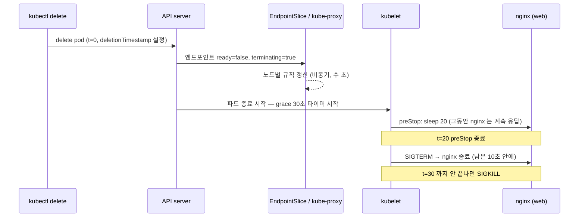

# q07 — Graceful shutdown with preStop and the grace period · 풀이

← 문제: **[question.md](question.md)**

## 문제 (해석)

**원문**

> Clients of Service `checkout` in namespace `aspen` see failed requests whenever Pods are replaced.
> Make the shutdown of Deployment `checkout` graceful.
>
> 1. Add a readiness probe to container `web`: HTTP GET `/` on port `80`, every `2` seconds.
> 2. Add a `preStop` hook to container `web` that runs `sh -c "sleep 20"`, so the Pod keeps serving
>    in-flight requests while it is removed from the Service.
> 3. Set the termination grace period so that the `preStop` hook always completes and nginx still
>    gets `10` more seconds afterwards. Wait for the rollout.
> 4. Delete one `checkout` Pod and measure how long the deletion takes. Write
>    `start=<epoch> end=<epoch> elapsed=<seconds>` to `/opt/course/c07/timing.txt`.
> 5. About `3` seconds after issuing that deletion, while the Pod is still terminating, save each
>    endpoint of Service `checkout` as `<pod> ready=<bool> terminating=<bool>` from its
>    EndpointSlice to `/opt/course/c07/endpoints.txt`.

**해석**

namespace `aspen` 의 Service `checkout` 클라이언트는 파드가 교체될 때마다 요청 실패를 겪는다. Deployment
`checkout` 의 종료를 graceful 하게 만든다.

1. 컨테이너 `web` 에 readiness probe 를 추가한다. 포트 `80` 의 `/` 로 HTTP GET, `2` 초마다.
2. 컨테이너 `web` 에 `sh -c "sleep 20"` 을 실행하는 `preStop` hook 을 추가해, 파드가 Service 에서 빠지는 동안
   처리 중인 요청을 계속 처리하게 한다.
3. `preStop` hook 이 항상 끝까지 실행되고 그 뒤에도 nginx 에 `10` 초가 더 남도록 termination grace period 를
   설정한다. 롤아웃을 기다린다.
4. `checkout` 파드 하나를 지우고 삭제에 걸린 시간을 잰다. `start=<epoch> end=<epoch> elapsed=<seconds>` 를
   `/opt/course/c07/timing.txt` 에 쓴다.
5. 그 삭제를 실행하고 약 `3` 초 뒤, 파드가 아직 종료 중일 때 Service `checkout` 의 EndpointSlice 에서 각 엔드포인트를
   `<pod> ready=<bool> terminating=<bool>` 형식으로 `/opt/course/c07/endpoints.txt` 에 저장한다.

## 모범 풀이

**1)~3) 한 번의 edit/patch 로 세 가지를 함께** — 따로 바꾸면 롤아웃이 세 번 일어납니다.

```bash
kubectl -n aspen edit deploy checkout
```

```yaml
    spec:
      terminationGracePeriodSeconds: 30        # 15 → 30 (preStop 20 + nginx 10)
      containers:
      - name: web
        image: nginx:1.27-alpine
        ports:
        - containerPort: 80
        readinessProbe:
          httpGet:
            path: /
            port: 80
          periodSeconds: 2
        lifecycle:
          preStop:
            exec:
              command: ["sh", "-c", "sleep 20"]
```

```bash
kubectl -n aspen rollout status deploy checkout
```

같은 내용의 patch 한 줄:

```bash
kubectl -n aspen patch deploy checkout -p '{"spec":{"template":{"spec":{"terminationGracePeriodSeconds":30,"containers":[{"name":"web","readinessProbe":{"httpGet":{"path":"/","port":80},"periodSeconds":2},"lifecycle":{"preStop":{"exec":{"command":["sh","-c","sleep 20"]}}}}]}}}}'
```

**함정 — preStop 시간은 grace period 안에서 소비됩니다.** grace period 타이머는 파드 삭제 요청 순간부터 흐르고,
preStop 도 그 안에서 실행됩니다. 원래 값 15초 그대로면 20초짜리 preStop 은 15초에 잘리고(kubelet 이 1회 2초 유예를
더 준 뒤) 컨테이너가 SIGKILL 됩니다. 문제의 조건(preStop 20 + nginx 10)을 만족하는 값은 **30** 입니다.

preStop 의 `sleep` 이 왜 필요한가: 파드가 삭제되면 EndpointSlice 갱신 → 각 노드의 kube-proxy 규칙 갱신 → Ingress
컨트롤러 갱신이 **비동기로** 일어납니다. 그 몇 초 동안 아직 이 파드로 오는 요청이 있으므로, SIGTERM 을 조금 늦춰
nginx 가 계속 응답하게 하는 것입니다. 셸이 없는 이미지라면 `lifecycle.preStop.sleep.seconds: 20` (sleep action)을
쓸 수 있습니다.

**4)~5) 측정과 종료 중 엔드포인트 상태**

```bash
P=$(kubectl -n aspen get pod -l app=checkout -o jsonpath='{.items[0].metadata.name}')
S=$(date +%s)
kubectl -n aspen delete pod $P --wait=false
sleep 3
kubectl -n aspen get endpointslice -l kubernetes.io/service-name=checkout \
  -o jsonpath='{range .items[*].endpoints[*]}{.targetRef.name}{" ready="}{.conditions.ready}{" terminating="}{.conditions.terminating}{"\n"}{end}' \
  | tee /opt/course/c07/endpoints.txt
# checkout-xxxx-aaaaa ready=false terminating=true     ← 지우는 중인 파드
# checkout-xxxx-bbbbb ready=true terminating=false
# checkout-xxxx-ccccc ready=false terminating=false    ← 새로 뜨는 파드 (readiness 통과 전이면 false)
kubectl -n aspen wait --for=delete pod/$P --timeout=60s
E=$(date +%s)
echo "start=$S end=$E elapsed=$((E-S))" | tee /opt/course/c07/timing.txt
# start=1793... end=1793... elapsed=21
```

`--wait=false` 로 삭제 요청만 보내고 바로 돌아와야 3초 뒤의 상태를 볼 수 있습니다. 종료 중인 엔드포인트는
`ready=false, terminating=true` 이고(`serving` 은 readiness 가 통과하는 동안 `true`), kube-proxy 는 `ready` 인
엔드포인트로만 새 연결을 보냅니다. elapsed 가 약 20초면 preStop 이 끝까지 돌았다는 뜻입니다. 15초 그대로였다면
약 17초(15 + 2초 유예)에 강제 종료됩니다. `kubectl get ep` 는 Endpoints API 가 v1.33 에서 deprecated 이고
terminating 정보도 없으므로 EndpointSlice 를 봅니다.

### 그림 — 파드 삭제 타임라인



1. 삭제 요청 즉시 파드는 EndpointSlice 에서 `ready=false` 가 되지만, 각 노드의 kube-proxy 가 이를 반영하기까지 시간이 걸립니다.
2. kubelet 은 grace period 타이머를 시작하고 먼저 preStop 을 실행합니다. 이 20초 동안 nginx 는 살아 있어 늦게 도착한 요청도 처리합니다.
3. preStop 이 끝나야 SIGTERM 이 갑니다. preStop 과 SIGTERM 이후 정리 시간을 모두 grace period 30초 안에서 끝내야 하고, 넘기면 SIGKILL 입니다.

## 검증

```bash
kubectl -n aspen get deploy checkout -o jsonpath='{.spec.template.spec.terminationGracePeriodSeconds} {.spec.template.spec.containers[0].lifecycle.preStop.exec.command} {.spec.template.spec.containers[0].readinessProbe.periodSeconds}{"\n"}'
# 30 ["sh","-c","sleep 20"] 2
kubectl -n aspen get deploy checkout          # READY 2/2
cat /opt/course/c07/timing.txt                # elapsed 가 20 이상, 30 미만
grep 'terminating=true' /opt/course/c07/endpoints.txt    # 한 줄, ready=false
kubectl -n aspen get events --field-selector reason=FailedPreStopHook   # 없음
```

## 오답 원인 / 배운 점

- **왜 틀렸나**:
- **기억할 것**: `terminationGracePeriodSeconds` 는 preStop 실행 시간 + 앱 종료 시간을 모두 담아야 한다. preStop 은 grace period 를 늘려 주지 않는다.
- **헷갈리는 지점**: 엔드포인트에서 빠지는 것과 컨테이너 종료는 동시에, 서로 기다리지 않고 진행됩니다. preStop sleep 은 그 차이를 메우는 장치입니다. readiness probe 가 없으면 새 파드가 준비되기 전에 트래픽을 받아 롤아웃 중에도 실패가 납니다.

## 참고 문서

- 검색어: `pod termination`, `container lifecycle hooks`
- https://kubernetes.io/docs/concepts/workloads/pods/pod-lifecycle/#pod-termination
- https://kubernetes.io/docs/concepts/containers/container-lifecycle-hooks/
- https://kubernetes.io/docs/concepts/services-networking/endpoint-slices/#conditions

---

[↑ 문항 목록](../README.md) · [← 문제로](question.md) · [다음 문제 q08 →](../q08_events_triage_broken_pods/question.md)
