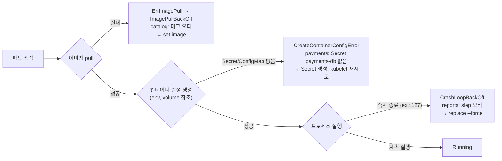

# q08 — Triage several broken Pods from events · 풀이

← 문제: **[question.md](question.md)**

## 문제 (해석)

**원문**

> Three Pods in namespace `elm` (`catalog`, `payments`, `reports`) are not running, each for a different
> reason. Diagnose them from the cluster's own signals, record the evidence, then repair them.
>
> 1. Save all `Warning` events of namespace `elm`, ordered from oldest to newest, to
>    `/opt/course/c08/events.txt`.
> 2. Before changing anything, write one line per Pod, sorted by Pod name, in the form
>    `<pod> <reason>` to `/opt/course/c08/reasons.txt`, where `<reason>` is the current `waiting`
>    reason of the Pod's container taken from the Pod status.
> 3. Repair the Pods:
>    - `catalog` must run image `nginx:1.27-alpine`.
>    - `payments` must start **without modifying the Pod**: create what it is missing, a Secret
>      with the key `password` and the value `pay-c08`.
>    - `reports` must run `sleep 3600` with its current image.
> 4. When all three Pods are `Running`, save the output of `kubectl -n elm get pods` to
>    `/opt/course/c08/pods-after.txt`.

**해석**

namespace `elm` 의 Pod 세 개(`catalog`, `payments`, `reports`)가 각기 다른 이유로 돌지 않는다. 클러스터 자체의
신호로 진단하고 증거를 남긴 뒤 고친다.

1. namespace `elm` 의 `Warning` 이벤트를 모두, 오래된 것부터 최신 순으로 `/opt/course/c08/events.txt` 에 저장한다.
2. 아무것도 바꾸기 전에 파드마다 한 줄씩, 파드 이름순으로 `<pod> <reason>` 을 `/opt/course/c08/reasons.txt` 에 쓴다.
   `<reason>` 은 파드 status 에서 가져온, 그 파드 컨테이너의 현재 `waiting` reason 이다.
3. 파드를 고친다.
   - `catalog` 는 이미지 `nginx:1.27-alpine` 으로 돌아야 한다.
   - `payments` 는 **파드를 수정하지 않고** 시작해야 한다. 없는 것을 만든다 — 키 `password`, 값 `pay-c08` 인 Secret.
   - `reports` 는 현재 이미지 그대로 `sleep 3600` 을 실행해야 한다.
4. 세 파드가 모두 `Running` 이 되면 `kubectl -n elm get pods` 출력을 `/opt/course/c08/pods-after.txt` 에 저장한다.

## 모범 풀이

**1) Warning 이벤트를 시간순으로**

```bash
kubectl -n elm events --types=Warning | tee /opt/course/c08/events.txt
# LAST SEEN   TYPE      REASON    OBJECT             MESSAGE
# 60s         Warning   Failed    Pod/catalog        Failed to pull image "nginx:1.27-alpnie": ... not found
# 58s         Warning   Failed    Pod/payments       Error: secret "payments-db" not found
# 40s         Warning   BackOff   Pod/reports        Back-off restarting failed container app ...
# 같은 결과 (구형 방식)
kubectl -n elm get events --field-selector type=Warning --sort-by=.lastTimestamp
```

`kubectl events` 는 기본으로 시간순(오래된 것 → 최신) 정렬이고 `--types=Warning` 으로 거를 수 있습니다.
`kubectl get events` 는 정렬이 보장되지 않으므로 `--sort-by=.lastTimestamp` 를 붙입니다(최근 이벤트 API 에서는
`lastTimestamp` 가 비어 있고 `eventTime` 만 있는 경우도 있어 `kubectl events` 가 더 안전합니다).

**2) 고치기 전에 reason 기록**

```bash
kubectl -n elm get pods -o jsonpath='{range .items[*]}{.metadata.name}{" "}{.status.containerStatuses[0].state.waiting.reason}{"\n"}{end}' \
  | sort | tee /opt/course/c08/reasons.txt
# catalog ImagePullBackOff          (pull 재시도 직후라면 ErrImagePull)
# payments CreateContainerConfigError
# reports CrashLoopBackOff
```

`kubectl get pods` 의 STATUS 열도 같은 값을 보여 주지만, 문제는 **파드 status 에서** 가져오라고 했으므로 jsonpath
가 정석입니다. 세 reason 의 의미:

| reason | 단계 | 원인 찾는 곳 |
|---|---|---|
| `ErrImagePull` / `ImagePullBackOff` | 이미지를 받지도 못함, RESTARTS 0 | 이벤트 `Failed to pull image ... not found` |
| `CreateContainerConfigError` | 이미지는 있으나 컨테이너 설정(env/volume 의 Secret·ConfigMap)을 못 만듦 | 이벤트 `secret "payments-db" not found` |
| `CrashLoopBackOff` | 컨테이너가 실행됐다가 죽음, RESTARTS 증가 | `lastState.terminated.exitCode` = 127, `logs --previous` |

```bash
kubectl -n elm logs reports --previous           # sh: slep: not found
kubectl -n elm get pod reports -o jsonpath='{.status.containerStatuses[0].lastState.terminated.exitCode}{"\n"}'   # 127
```

**3) 각각 고치기**

```bash
# catalog: 이미지는 Pod 에서 바꿀 수 있는 몇 안 되는 필드다
kubectl -n elm set image pod/catalog web=nginx:1.27-alpine

# payments: 파드는 그대로, 빠진 Secret 만 만든다. kubelet 이 재시도하며 스스로 시작한다
kubectl -n elm create secret generic payments-db --from-literal=password=pay-c08

# reports: command 는 불변 → 다시 만든다
kubectl -n elm get pod reports -o yaml > /tmp/reports.yaml
sed -i 's/slep 3600/sleep 3600/' /tmp/reports.yaml
kubectl replace --force -f /tmp/reports.yaml
```

- Secret 이름(`payments-db`)은 이벤트 메시지나 `kubectl -n elm get pod payments -o yaml` 의 `secretKeyRef` 에서 찾습니다.
  키 이름까지 맞아야 합니다. 이름은 맞고 키가 틀리면 `couldn't find key password in Secret elm/payments-db` 로 같은
  `CreateContainerConfigError` 가 남습니다.
- `reports` 는 `kubectl edit` 으로 command 를 바꾸면 `spec: Forbidden: pod updates may not change fields other than
  ...` 로 거부되고 임시 파일이 `/tmp/kubectl-edit-*.yaml` 에 남습니다. `replace --force` 가 delete + create 를 한 번에 합니다.

**4) 결과 확인과 저장**

```bash
kubectl -n elm get pods -w           # 세 개 모두 Running 이 될 때까지 (payments 는 백오프 때문에 수십 초 걸릴 수 있다)
kubectl -n elm get pods | tee /opt/course/c08/pods-after.txt
# NAME       READY   STATUS    RESTARTS   AGE
# catalog    1/1     Running   0          5m
# payments   1/1     Running   0          5m
# reports    1/1     Running   0          30s
```

### 그림 — 상태 이름으로 고장 단계 좁히기



1. 파드는 pull → 컨테이너 설정 → 실행 순서로 진행합니다. 어느 단계에서 멈췄는지가 waiting reason 에 그대로 드러납니다.
2. pull 단계 실패는 이미지 이름/태그 문제이고, 고칠 때 파드를 다시 만들 필요 없이 이미지만 바꾸면 됩니다.
3. 설정 단계 실패는 참조 대상(Secret·ConfigMap·키)이 없을 때입니다. 대상을 만들어 주면 kubelet 이 재시도하다 스스로 시작합니다.
4. 실행 단계 실패는 명령·앱 문제로, 종료 코드와 `logs --previous` 가 증거입니다. command 는 불변이라 다시 만듭니다.

## 검증

```bash
cat /opt/course/c08/reasons.txt
# catalog ImagePullBackOff
# payments CreateContainerConfigError
# reports CrashLoopBackOff
grep -c Warning /opt/course/c08/events.txt          # 1 이상
kubectl -n elm get pod catalog -o jsonpath='{.spec.containers[0].image}{"\n"}'   # nginx:1.27-alpine
kubectl -n elm get pod reports -o jsonpath='{.spec.containers[0].command}{"\n"}' # ["sh","-c","sleep 3600"]
kubectl -n elm exec payments -- printenv DB_PASSWORD                             # pay-c08
grep -c Running /opt/course/c08/pods-after.txt      # 3
```

## 오답 원인 / 배운 점

- **왜 틀렸나**:
- **기억할 것**: `kubectl events --types=Warning` 은 시간순 정렬이 기본이다. waiting reason 은 `.status.containerStatuses[*].state.waiting.reason`.
- **헷갈리는 지점**: `CreateContainerConfigError` 는 파드를 지울 필요가 없습니다. 빠진 Secret/ConfigMap 을 만들면 kubelet 이 알아서 시작합니다. 반대로 command 오타는 파드를 다시 만들어야 합니다. 이미지·tolerations 일부·activeDeadlineSeconds 와 (v1.35 부터) resources(resize 서브리소스)만 실행 중인 파드에서 바꿀 수 있습니다.

## 참고 문서

- 검색어: `debug pods`, `kubectl events`
- https://kubernetes.io/docs/tasks/debug/debug-application/debug-pods/
- https://kubernetes.io/docs/reference/kubectl/generated/kubectl_events/

---

[↑ 문항 목록](../README.md) · [← 문제로](question.md) · [다음 문제 q09 →](../q09_api_deprecation_hpa_v2/question.md)
