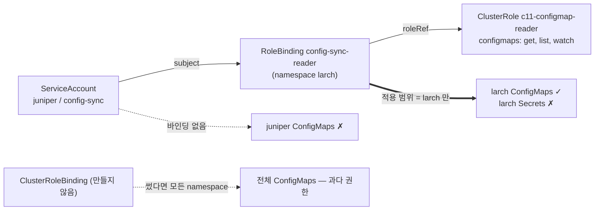

# q11 — Grant cross-namespace ConfigMap read with a RoleBinding · 풀이

← 문제: **[question.md](question.md)**

## 문제 (해석)

**원문**

> ServiceAccount `config-sync` in namespace `juniper` must read the ConfigMaps of namespace `larch`, and
> nothing else. The cluster already has ClusterRole `c11-configmap-reader`, which must be reused.
>
> 1. Grant the access by binding ClusterRole `c11-configmap-reader` to ServiceAccount
>    `juniper:config-sync` with a RoleBinding named `config-sync-reader`. Do not create any new Role,
>    ClusterRole or ClusterRoleBinding.
> 2. Using `kubectl auth can-i` while impersonating the ServiceAccount, write one line per check in
>    the form `<check> <yes|no>` to `/opt/course/c11/can-i.txt`, in this order:
>    `list-cm-larch`, `get-cm-larch`, `list-cm-juniper`, `list-cm-all-namespaces`,
>    `get-secrets-larch`.
> 3. From inside Pod `sync-agent`, call the API server with the Pod's own ServiceAccount token to list
>    ConfigMaps in `larch` and in `juniper`. Write the two HTTP status codes to
>    `/opt/course/c11/api.txt` in the form `larch=<code> juniper=<code>`.

**해석**

namespace `juniper` 의 ServiceAccount `config-sync` 는 namespace `larch` 의 ConfigMap 을 읽을 수 있어야 하고, 그 밖의
것은 안 된다. 클러스터에는 이미 ClusterRole `c11-configmap-reader` 가 있으며 이것을 재사용해야 한다.

1. 이름이 `config-sync-reader` 인 RoleBinding 으로 ClusterRole `c11-configmap-reader` 를 ServiceAccount
   `juniper:config-sync` 에 바인딩해 권한을 준다. 새 Role, ClusterRole, ClusterRoleBinding 은 만들지 않는다.
2. ServiceAccount 로 가장(impersonate)한 `kubectl auth can-i` 로, 검사마다 한 줄씩 `<check> <yes|no>` 형식으로
   다음 순서대로 `/opt/course/c11/can-i.txt` 에 쓴다: `list-cm-larch`, `get-cm-larch`, `list-cm-juniper`,
   `list-cm-all-namespaces`, `get-secrets-larch`.
3. Pod `sync-agent` 안에서 파드 자신의 ServiceAccount 토큰으로 API 서버를 호출해 `larch` 와 `juniper` 의 ConfigMap
   목록을 요청한다. 두 HTTP 상태 코드를 `larch=<code> juniper=<code>` 형식으로 `/opt/course/c11/api.txt` 에 쓴다.

## 모범 풀이

**1) RoleBinding 이 어느 namespace 에 있어야 하나** — 권한을 받을 **대상 리소스의 namespace**(`larch`)입니다.
SA 가 사는 `juniper` 가 아닙니다.

```bash
kubectl -n larch create rolebinding config-sync-reader \
  --clusterrole=c11-configmap-reader \
  --serviceaccount=juniper:config-sync
```

```yaml
# 같은 결과의 yaml
apiVersion: rbac.authorization.k8s.io/v1
kind: RoleBinding
metadata:
  name: config-sync-reader
  namespace: larch               # 권한이 적용되는 범위
roleRef:
  apiGroup: rbac.authorization.k8s.io
  kind: ClusterRole              # 클러스터 범위로 "정의"만 된 규칙 묶음
  name: c11-configmap-reader
subjects:
- kind: ServiceAccount
  name: config-sync
  namespace: juniper             # SA 의 namespace 는 subject 에 적는다
```

RoleBinding 이 ClusterRole 을 참조하면 그 규칙이 **RoleBinding 의 namespace 안에서만** 적용됩니다. 같은 ClusterRole
을 ClusterRoleBinding 으로 묶으면 모든 namespace 의 ConfigMap 을 읽게 되어 "nothing else" 조건을 어깁니다.
`--serviceaccount` 의 형식은 `<namespace>:<name>` 이고, `--user=system:serviceaccount:...` 로 줘도 동작하긴 하지만
subject kind 가 User 가 되므로 정석이 아닙니다. `roleRef` 는 바인딩을 만든 뒤 바꿀 수 없습니다(틀리면 지우고 다시).

**2) can-i 로 범위 확인**

```bash
SA=system:serviceaccount:juniper:config-sync
{
  echo "list-cm-larch $(kubectl auth can-i list configmaps -n larch --as=$SA)"
  echo "get-cm-larch $(kubectl auth can-i get configmaps -n larch --as=$SA)"
  echo "list-cm-juniper $(kubectl auth can-i list configmaps -n juniper --as=$SA)"
  echo "list-cm-all-namespaces $(kubectl auth can-i list configmaps -A --as=$SA)"
  echo "get-secrets-larch $(kubectl auth can-i get secrets -n larch --as=$SA)"
} | tee /opt/course/c11/can-i.txt
# list-cm-larch yes
# get-cm-larch yes
# list-cm-juniper no
# list-cm-all-namespaces no
# get-secrets-larch no
```

`can-i` 는 `no` 일 때 **exit code 1** 을 돌려줍니다. `$( )` 안이라 출력은 그대로 잡히지만, `set -e` 스크립트에서
단독으로 쓰면 거기서 멈춥니다. `-A`(all namespaces)가 `no` 인 것이 RoleBinding 을 쓴 증거입니다.
`kubectl auth can-i --list -n larch --as=$SA` 로 허용 목록 전체를 볼 수도 있습니다.

**3) 파드 안에서 실제 토큰으로 호출**

```bash
kubectl -n juniper exec sync-agent -- sh -c '
D=/var/run/secrets/kubernetes.io/serviceaccount
T=$(cat $D/token)
for ns in larch juniper; do
  printf "%s=%s " $ns $(curl -s -o /dev/null -w "%{http_code}" --cacert $D/ca.crt \
    -H "Authorization: Bearer $T" https://kubernetes.default.svc/api/v1/namespaces/$ns/configmaps)
done' | sed 's/ $//' | tee /opt/course/c11/api.txt; echo
# larch=200 juniper=403
```

v1.24 부터 SA 토큰 Secret 은 자동으로 만들어지지 않고, 파드에는 kubelet 이 받아 주는 **projected 토큰**(기본 1시간,
자동 갱신)이 `/var/run/secrets/kubernetes.io/serviceaccount/token` 에 마운트됩니다. 파드 밖에서 토큰이 필요하면
`kubectl -n juniper create token config-sync --duration=10m` 을 씁니다. 403 은 "인증은 되었지만(SA 로 인식) 권한이
없다", 401 은 "토큰 자체가 무효" 입니다.

### 그림 — subject → binding → role, 그리고 적용 범위



1. 권한의 **내용**은 ClusterRole 이 정의하고, 권한의 **범위**는 바인딩의 종류와 위치가 정합니다.
2. `larch` 에 있는 RoleBinding 이 ClusterRole 을 참조하므로, `config-sync` 는 `larch` 의 ConfigMap 만 get/list/watch 할 수 있습니다.
3. SA 의 집인 `juniper` 에는 바인딩이 없으니 자기 namespace 의 ConfigMap 도 못 읽습니다. ClusterRole 에 secrets 규칙이 없으니 `larch` 의 Secret 도 못 읽습니다.
4. ClusterRoleBinding 을 쓰면 범위가 클러스터 전체로 넓어집니다. 이 문제에서는 그것이 오답입니다.

## 검증

```bash
kubectl -n larch get rolebinding config-sync-reader -o wide
# NAME                 ROLE                               AGE   USERS   GROUPS   SERVICEACCOUNTS
# config-sync-reader   ClusterRole/c11-configmap-reader   1m                     juniper/config-sync
kubectl get clusterrolebinding -o wide | grep config-sync || echo "ClusterRoleBinding 없음 (정상)"
kubectl get role -A | grep -E 'larch|juniper' || echo "새 Role 없음 (정상)"
cat /opt/course/c11/can-i.txt                # yes yes no no no
cat /opt/course/c11/api.txt                  # larch=200 juniper=403
```

## 오답 원인 / 배운 점

- **왜 틀렸나**:
- **기억할 것**: 다른 namespace 의 리소스를 읽게 하려면 RoleBinding 을 **대상 namespace** 에 만들고 subject 에 SA 의 namespace 를 적는다.
- **헷갈리는 지점**: RoleBinding 은 ClusterRole 을 참조할 수 있고, 그때 권한은 RoleBinding 의 namespace 로 제한됩니다. `kubectl auth can-i` 의 `no` 는 exit 1 입니다. SA 토큰 Secret 은 v1.24 부터 자동 생성되지 않으므로 `kubectl create token` 을 씁니다.

## 참고 문서

- 검색어: `using rbac authorization rolebinding clusterrole`, `service account token`
- https://kubernetes.io/docs/reference/access-authn-authz/rbac/#rolebinding-and-clusterrolebinding
- https://kubernetes.io/docs/tasks/run-application/access-api-from-pod/

---

[↑ 문항 목록](../README.md) · [← 문제로](question.md) · [다음 문제 q12 →](../q12_qos_classes_limitrange/question.md)
