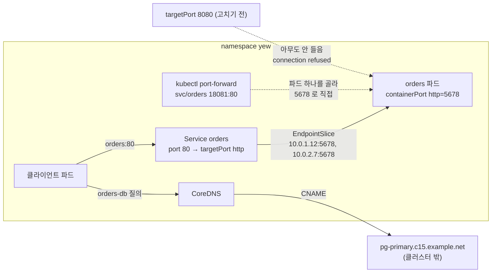

# q15 — Repair a Service port and add an ExternalName alias · 풀이

← 문제: **[question.md](question.md)**

## 문제 (해석)

**원문**

> Clients in namespace `yew` cannot reach Service `orders`, although its EndpointSlice is not empty.
> The team also wants a stable in-cluster name for an external database.
>
> 1. Without changing Deployment `orders`, fix Service `orders` so that its port `80` reaches the
>    Pods. Reference the container port by its **name**, not by number.
> 2. Write the port number that the EndpointSlice of Service `orders` advertises after the fix to
>    `/opt/course/c15/endpointslice-port.txt`.
> 3. Using `kubectl port-forward` to the **Service** on local port `18081`, fetch `/` and save the
>    response body to `/opt/course/c15/port-forward.txt`.
> 4. Create Service `orders-db` of type `ExternalName` in `yew` that resolves to
>    `pg-primary.c15.example.net`.
> 5. From a temporary Pod with image `busybox:1.36` in `yew`, query the `CNAME` record of
>    `orders-db.yew.svc.cluster.local` and save the output to `/opt/course/c15/dns.txt`. The
>    temporary Pod must not remain afterwards.

**해석**

namespace `yew` 의 클라이언트가 Service `orders` 에 접속하지 못한다. EndpointSlice 는 비어 있지 않은데도 그렇다. 팀은
외부 데이터베이스에 대한 고정된 클러스터 내부 이름도 원한다.

1. Deployment `orders` 는 바꾸지 않고, Service `orders` 의 포트 `80` 이 파드에 닿도록 고친다. 컨테이너 포트는 번호가
   아니라 **이름**으로 참조한다.
2. 고친 뒤 Service `orders` 의 EndpointSlice 가 알리는 포트 번호를 `/opt/course/c15/endpointslice-port.txt` 에 쓴다.
3. **Service** 를 대상으로 로컬 포트 `18081` 에 `kubectl port-forward` 를 걸어 `/` 를 요청하고 응답 본문을
   `/opt/course/c15/port-forward.txt` 에 저장한다.
4. `yew` 에 `pg-primary.c15.example.net` 으로 해석되는 `ExternalName` 타입 Service `orders-db` 를 만든다.
5. `yew` 에서 이미지 `busybox:1.36` 의 임시 파드로 `orders-db.yew.svc.cluster.local` 의 `CNAME` 레코드를 조회하고 출력을
   `/opt/course/c15/dns.txt` 에 저장한다. 임시 파드는 끝난 뒤 남아 있으면 안 된다.

## 모범 풀이

**0) "EndpointSlice 가 있는데 안 된다" 는 포트 문제다**

```bash
kubectl -n yew get endpointslice -l kubernetes.io/service-name=orders \
  -o jsonpath='{.items[0].ports}{"  "}{.items[0].endpoints[*].addresses}{"\n"}'
# [{"name":"web","port":8080,"protocol":"TCP"}]  ["10.0.1.12"] ["10.0.2.7"]
kubectl -n yew get pod -l app=orders -o jsonpath='{.items[0].spec.containers[0].ports}{"\n"}'
# [{"containerPort":5678,"name":"http","protocol":"TCP"}]
```

EndpointSlice 의 **주소**는 selector 로 고른 파드에서 오고, **포트**는 Service 의 `targetPort` 에서 옵니다. selector 가
맞으면 targetPort 가 틀려도 엔드포인트는 채워집니다. 그래서 "엔드포인트 있음 = 정상" 이 아닙니다. 파드는 5678 에서
듣는데 Service 는 8080 으로 보내므로 connection refused 가 납니다.

**1) targetPort 를 포트 이름으로**

```bash
kubectl -n yew patch svc orders --type=json \
  -p='[{"op":"replace","path":"/spec/ports/0/targetPort","value":"http"}]'
kubectl -n yew get svc orders -o jsonpath='{.spec.ports[0]}{"\n"}'
# {"name":"web","port":80,"protocol":"TCP","targetPort":"http"}
```

`targetPort` 에 문자열을 주면 **각 파드의 컨테이너 포트 이름**으로 찾아 번호를 정합니다. 나중에 컨테이너 포트 번호가
바뀌어도 이름만 같으면 Service 는 고칠 필요가 없습니다. `kubectl edit svc orders` 로 `targetPort: http` 로 바꿔도
됩니다. Service 의 `ports[].name`(`web`)과 컨테이너 포트 이름(`http`)은 서로 다른 것입니다.

**2) EndpointSlice 포트 확인**

```bash
kubectl -n yew get endpointslice -l kubernetes.io/service-name=orders \
  -o jsonpath='{.items[0].ports[0].port}' | tee /opt/course/c15/endpointslice-port.txt; echo
# 5678
```

`kubectl get ep` 는 Endpoints API 가 v1.33 에서 deprecated 되어 경고가 나옵니다. 라벨
`kubernetes.io/service-name=<svc>` 로 EndpointSlice 를 찾습니다.

**3) Service 로 port-forward**

```bash
kubectl -n yew port-forward svc/orders 18081:80 >/dev/null &
sleep 2
curl -s http://localhost:18081/ | tee /opt/course/c15/port-forward.txt      # orders ok
kill %1
```

`port-forward svc/...` 는 Service 를 거쳐 부하 분산하는 것이 아니라, Service 의 selector 로 **파드 하나를 골라** 그
파드의 targetPort 로 직접 터널을 엽니다. 그래서 targetPort 가 틀린 상태였다면 port-forward 도 실패했습니다. 로컬:원격
순서이고 원격 쪽은 Service 의 `port`(80)입니다.

**4) ExternalName Service**

```bash
kubectl -n yew create service externalname orders-db --external-name=pg-primary.c15.example.net
kubectl -n yew get svc orders-db
# NAME        TYPE           CLUSTER-IP   EXTERNAL-IP                  PORT(S)   AGE
# orders-db   ExternalName   <none>       pg-primary.c15.example.net   <none>    5s
```

ExternalName 은 selector·ClusterIP·EndpointSlice 가 없고, CoreDNS 가 `orders-db.yew.svc.cluster.local` 질의에 CNAME
을 돌려줄 뿐입니다. 프록시가 없으므로 `ports` 를 적어도 포트 변환은 일어나지 않습니다. 앱은 DB 주소를
`orders-db` 로 고정해 두고, DB 가 옮겨 가면 Service 의 `externalName` 만 바꾸면 됩니다.

**5) CNAME 조회 — 끝나면 지워지는 임시 파드**

```bash
kubectl -n yew run dns-test --image=busybox:1.36 --rm -i --restart=Never -- \
  nslookup -type=CNAME orders-db.yew.svc.cluster.local | tee /opt/course/c15/dns.txt
# Server:    10.96.0.10
# Address:   10.96.0.10:53
#
# orders-db.yew.svc.cluster.local	canonical name = pg-primary.c15.example.net
kubectl -n yew get pod dns-test 2>&1 | head -1     # NotFound
```

`--rm -i --restart=Never` 조합이 "실행 → 출력 → 삭제" 입니다. `-type=CNAME` 으로 CNAME 레코드만 물으면 대상 이름이
실제로 존재하지 않아도 CoreDNS 가 응답합니다. 기본 조회(A 레코드)는 CNAME 을 따라가다 대상이 없으면 NXDOMAIN 으로
끝나, 출력만 보고는 Service 가 잘못된 것처럼 보일 수 있습니다.

### 그림 — 두 Service 의 동작



1. Service `orders` 는 selector 로 파드를 고르고, `targetPort: http` 를 각 파드의 이름 있는 포트(5678)로 바꿔 EndpointSlice 에 적습니다.
2. 고치기 전에도 EndpointSlice 에는 파드 주소가 있었지만 포트가 8080 이라 연결이 거부되었습니다.
3. port-forward 는 Service 를 통해 파드 하나를 고른 뒤 그 파드로 직접 터널을 엽니다.
4. ExternalName Service 는 트래픽을 다루지 않고, DNS 이름을 외부 이름으로 CNAME 하는 별칭일 뿐입니다.

## 검증

```bash
kubectl -n yew get svc orders -o jsonpath='{.spec.ports[0].targetPort}{"\n"}'        # http
cat /opt/course/c15/endpointslice-port.txt                                          # 5678
cat /opt/course/c15/port-forward.txt                                                # orders ok
kubectl -n yew run t --image=busybox:1.36 --rm -i --restart=Never -- wget -qO- -T 3 http://orders   # orders ok
kubectl -n yew get svc orders-db -o jsonpath='{.spec.type} {.spec.externalName}{"\n"}'   # ExternalName pg-primary.c15.example.net
kubectl -n yew get endpointslice -l kubernetes.io/service-name=orders-db            # No resources found
grep 'canonical name = pg-primary.c15.example.net' /opt/course/c15/dns.txt
kubectl -n yew get pod                                                              # orders 파드 2개만
kubectl -n yew get deploy orders -o jsonpath='{.metadata.generation}{"\n"}'          # 1 (Deployment 는 안 바뀜)
```

## 오답 원인 / 배운 점

- **왜 틀렸나**:
- **기억할 것**: EndpointSlice 가 차 있어도 포트가 틀릴 수 있다. 주소는 selector, 포트는 targetPort 에서 온다. `targetPort` 는 컨테이너 포트 이름으로도 줄 수 있다.
- **헷갈리는 지점**: ExternalName 은 EndpointSlice·ClusterIP 가 없는 DNS CNAME 별칭입니다. `kubectl port-forward svc/x` 는 부하 분산이 아니라 파드 하나로 가는 터널입니다. Endpoints API 는 v1.33 부터 deprecated 이니 `get endpointslice -l kubernetes.io/service-name=<svc>` 를 씁니다.

## 참고 문서

- 검색어: `service targetPort`, `externalname`, `debug service`
- https://kubernetes.io/docs/concepts/services-networking/service/#externalname
- https://kubernetes.io/docs/tasks/debug/debug-application/debug-service/
- https://kubernetes.io/docs/tasks/access-application-cluster/port-forward-access-application-cluster/

---

[↑ 문항 목록](../README.md) · [← 문제로](question.md) · [다음 문제 q16 →](../q16_ingressclass_default/question.md)
