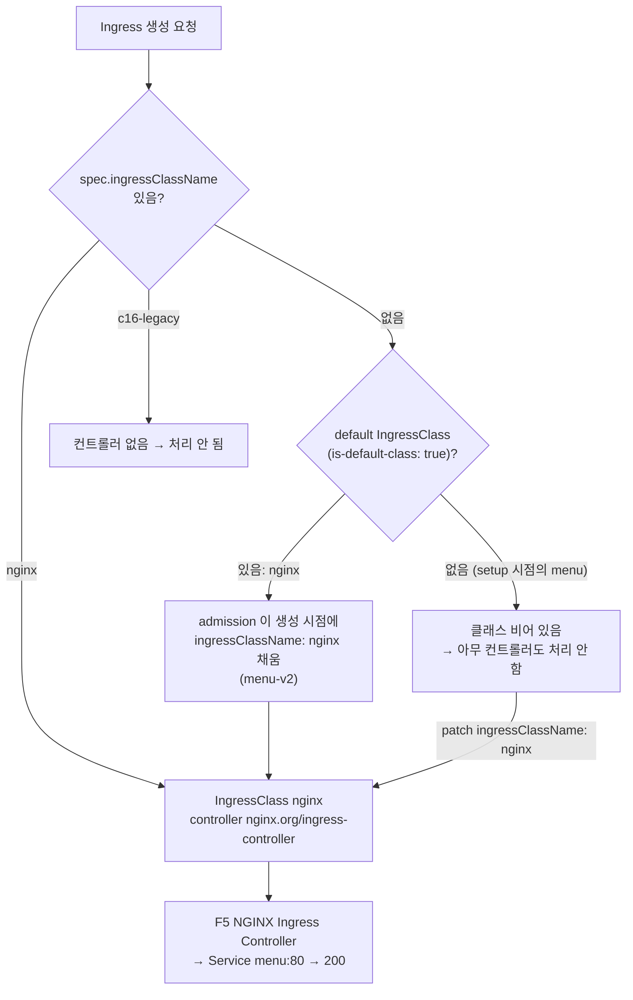

# q16 — Serve an Ingress through the right IngressClass · 풀이

← 문제: **[question.md](question.md)**

## 문제 (해석)

**원문**

> Ingress `menu` in namespace `sequoia` returns nothing useful: no controller serves it. The cluster
> has two IngressClasses and teams keep forgetting to set a class on new Ingresses.
>
> 1. Write every IngressClass in the form `<name> <controller>`, one per line, to
>    `/opt/course/c16/classes.txt`.
> 2. Make Ingress `menu` served by the IngressClass whose controller is actually running, using the
>    Ingress field meant for this (not an annotation). `curl` with `Host: menu.c16.local` through the
>    controller must return HTTP `200`.
> 3. Mark IngressClass `nginx` as the cluster's default class with the standard annotation, and make
>    sure `c16-legacy` is not a default class.
> 4. Create Ingress `menu-v2` in `sequoia` **without** specifying any class: host `menu-v2.c16.local`,
>    path `/` (type `Prefix`) to Service `menu` port `80`. Write the class it ended up with to
>    `/opt/course/c16/v2-class.txt`.
> 5. Write the HTTP status codes of both hosts to `/opt/course/c16/curl.txt` in the form
>    `menu=<code> menu-v2=<code>`.

**해석**

namespace `sequoia` 의 Ingress `menu` 는 쓸모 있는 응답을 주지 않는다. 어떤 컨트롤러도 이것을 처리하지 않기 때문이다.
클러스터에는 IngressClass 가 두 개 있고, 팀들이 새 Ingress 에 클래스 지정을 자꾸 잊는다.

1. 모든 IngressClass 를 `<name> <controller>` 형식으로 한 줄에 하나씩 `/opt/course/c16/classes.txt` 에 쓴다.
2. 실제로 컨트롤러가 돌고 있는 IngressClass 가 Ingress `menu` 를 처리하게 한다. 이를 위한 Ingress 필드를 쓰고
   어노테이션은 쓰지 않는다. 컨트롤러를 거쳐 `Host: menu.c16.local` 로 `curl` 하면 HTTP `200` 이 나와야 한다.
3. 표준 어노테이션으로 IngressClass `nginx` 를 클러스터 기본 클래스로 지정하고, `c16-legacy` 는 기본 클래스가 아니게 한다.
4. `sequoia` 에 클래스를 **지정하지 않고** Ingress `menu-v2` 를 만든다: host `menu-v2.c16.local`, 경로 `/`(타입
   `Prefix`) → Service `menu` 포트 `80`. 그것이 최종적으로 갖게 된 클래스를 `/opt/course/c16/v2-class.txt` 에 쓴다.
5. 두 호스트의 HTTP 상태 코드를 `menu=<code> menu-v2=<code>` 형식으로 `/opt/course/c16/curl.txt` 에 쓴다.

## 모범 풀이

**1) 클래스와 컨트롤러 확인**

```bash
kubectl get ingressclass -o jsonpath='{range .items[*]}{.metadata.name}{" "}{.spec.controller}{"\n"}{end}' \
  | tee /opt/course/c16/classes.txt
# c16-legacy example.com/c16-legacy-controller
# nginx nginx.org/ingress-controller
kubectl get pods -A | grep -i ingress          # 실제로 도는 건 nginx-ingress 네임스페이스의 컨트롤러뿐
```

IngressClass 는 "이 클래스는 어떤 컨트롤러가 맡는다" 는 선언일 뿐입니다. `c16-legacy` 는 객체만 있고 그
`spec.controller` 값을 자기 것이라 주장하는 컨트롤러가 없으므로, 그 클래스를 가리키는 Ingress 는 아무도 처리하지 않습니다.

**2) 기존 Ingress 에 클래스 지정**

```bash
kubectl -n sequoia get ingress menu        # CLASS <none>, ADDRESS 비어 있음
kubectl -n sequoia patch ingress menu -p '{"spec":{"ingressClassName":"nginx"}}'
kubectl -n sequoia get ingress menu        # CLASS nginx
```

`spec.ingressClassName` 은 Ingress 를 만든 뒤에도 바꿀 수 있습니다. 옛 방식인 `kubernetes.io/ingress.class` 어노테이션은
deprecated 이고 문제에서도 금지했습니다. F5 NGINX Ingress Controller 는 기본 설정에서 클래스가 없는 Ingress 를 무시합니다
(`-watch-ingress-without-class` 를 켜지 않는 한).

**3) 기본 클래스 지정**

```bash
kubectl annotate ingressclass nginx ingressclass.kubernetes.io/is-default-class="true" --overwrite
kubectl annotate ingressclass c16-legacy ingressclass.kubernetes.io/is-default-class- 2>/dev/null || true   # 혹시 있으면 제거
kubectl get ingressclass -o custom-columns=NAME:.metadata.name,DEFAULT:'.metadata.annotations.ingressclass\.kubernetes\.io/is-default-class'
# NAME         DEFAULT
# c16-legacy   <none>
# nginx        true
```

값은 문자열 `"true"` 입니다. 기본 클래스가 둘 이상이면 클래스 없는 Ingress 생성 시 admission 이 어느 쪽을 쓸지
정할 수 없으므로(문서는 생성을 막는다고 설명합니다) 하나만 기본으로 둡니다.

**4) 클래스 없이 만든 Ingress 에 기본값이 채워진다**

```bash
kubectl -n sequoia create ingress menu-v2 --rule='menu-v2.c16.local/*=menu:80'
kubectl -n sequoia get ingress menu-v2 -o jsonpath='{.spec.ingressClassName}' | tee /opt/course/c16/v2-class.txt; echo
# nginx
```

`--rule` 의 경로 끝 `*` 가 `pathType: Prefix`, `--class` 를 주지 않았으니 클래스는 비어 있는 채로 요청됩니다.
`DefaultIngressClass` admission 플러그인이 **생성 시점에** 기본 클래스 이름을 `spec.ingressClassName` 에 써 넣습니다.
중요한 함정: 기본 클래스를 지정해도 **이미 있는 Ingress(2번 이전의 `menu`)에는 소급 적용되지 않습니다**. 그래서 2번에서
`menu` 는 직접 고쳐야 했습니다.

**5) curl**

```bash
NP=$(kubectl -n nginx-ingress get svc nginx-ingress -o jsonpath='{.spec.ports[?(@.name=="http")].nodePort}')
NODE=$(kubectl get nodes -o jsonpath='{.items[0].status.addresses[?(@.type=="InternalIP")].address}')
A=$(curl -s -o /dev/null -w '%{http_code}' -H 'Host: menu.c16.local' http://$NODE:$NP/)
B=$(curl -s -o /dev/null -w '%{http_code}' -H 'Host: menu-v2.c16.local' http://$NODE:$NP/)
echo "menu=$A menu-v2=$B" | tee /opt/course/c16/curl.txt
# menu=200 menu-v2=200
```

컨트롤러가 설정을 다시 읽는 데 몇 초 걸릴 수 있으니 404 가 나오면 잠시 뒤 다시 시도합니다.

**배경 — Ingress NGINX 은퇴와 Ingress API**: 커뮤니티 컨트롤러 kubernetes/ingress-nginx 는 2026년 3월에 은퇴해 더 이상
릴리스·보안 패치가 없습니다. 그러나 **Ingress API(`networking.k8s.io/v1`)는 GA 그대로**이며 CKAD 범위입니다. 이 실습은
F5 NGINX Ingress Controller(클래스 `nginx`, 컨트롤러 `nginx.org/ingress-controller`)를 씁니다. 컨트롤러 전용
어노테이션(`nginx.ingress.kubernetes.io/...`)은 컨트롤러마다 다르므로 표준 필드만 쓰면 컨트롤러를 바꿔도 Ingress 를
그대로 쓸 수 있습니다.

### 그림 — Ingress 가 컨트롤러에 닿기까지



1. Ingress 는 `ingressClassName` 으로 맡을 컨트롤러를 고릅니다. 비어 있으면 default 클래스가 **있을 때, 생성 시점에만** 채워집니다.
2. setup 은 default 가 없을 때 `menu` 를 만들었으므로 클래스가 비어 있고, 나중에 default 를 지정해도 바뀌지 않습니다. 그래서 직접 patch 합니다.
3. `c16-legacy` 처럼 컨트롤러가 없는 클래스를 가리키면 오류 없이 무시됩니다. ADDRESS 가 비어 있는 것이 신호입니다.
4. default 지정 뒤 클래스 없이 만든 `menu-v2` 에는 `nginx` 가 채워져 바로 서비스됩니다.

## 검증

```bash
cat /opt/course/c16/classes.txt                   # 2줄
kubectl -n sequoia get ingress
# NAME      CLASS   HOSTS               ADDRESS   PORTS   AGE
# menu      nginx   menu.c16.local      ...       80      10m
# menu-v2   nginx   menu-v2.c16.local   ...       80      1m
kubectl -n sequoia get ingress menu -o jsonpath='{.metadata.annotations}{"\n"}'   # kubernetes.io/ingress.class 없음
kubectl get ingressclass nginx -o jsonpath='{.metadata.annotations.ingressclass\.kubernetes\.io/is-default-class}{"\n"}'   # true
kubectl get ingressclass c16-legacy -o jsonpath='{.metadata.annotations}{"\n"}'   # 비어 있음
cat /opt/course/c16/v2-class.txt                  # nginx
cat /opt/course/c16/curl.txt                      # menu=200 menu-v2=200
```

## 오답 원인 / 배운 점

- **왜 틀렸나**:
- **기억할 것**: 기본 클래스는 `ingressclass.kubernetes.io/is-default-class: "true"` 이고, 클래스 없는 Ingress 를 **새로 만들 때만** 채워진다.
- **헷갈리는 지점**: 기존 Ingress 는 default 지정 후에도 클래스가 비어 있으니 `spec.ingressClassName` 을 직접 넣습니다. `kubernetes.io/ingress.class` 어노테이션은 deprecated 입니다. Ingress NGINX(kubernetes/ingress-nginx)는 2026-03 은퇴했지만 Ingress API 는 GA 이고, CKAD 에서 Gateway API 문서는 열람 대상이 아닙니다.

## 참고 문서

- 검색어: `ingress class default`, `ingress controllers`
- https://kubernetes.io/docs/concepts/services-networking/ingress/#default-ingress-class
- https://kubernetes.io/docs/concepts/services-networking/ingress-controllers/
- https://kubernetes.io/blog/2025/11/11/ingress-nginx-retirement/

---

[↑ 문항 목록](../README.md) · [← 문제로](question.md) · [다음 문제 q17 →](../q17_networkpolicy_three_faults/question.md)
