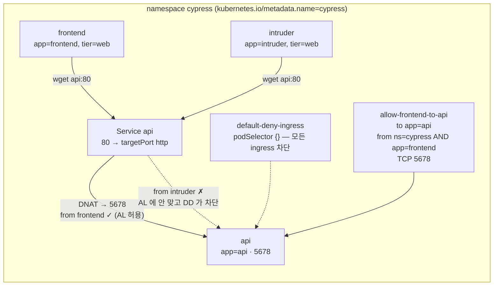

# q17 — Repair a NetworkPolicy with three faults · 풀이

← 문제: **[question.md](question.md)**

## 문제 (해석)

**원문**

> In namespace `cypress`, Pod `frontend` must reach Pod `api` through Service `api` on port `80`, but
> every request times out. A default-deny policy is in place on purpose, and policy
> `allow-frontend-to-api` was meant to open exactly this path, but it contains three faults.
>
> 1. Fix NetworkPolicy `allow-frontend-to-api` so that `frontend` can reach `api` via Service `api`.
>    Do not delete or change `default-deny-ingress`, and do not create other policies.
> 2. Do not broaden the policy: it must still admit only Pods labelled like `frontend` that are in a
>    namespace selected by its `kubernetes.io/metadata.name` label with the value `cypress` (both
>    conditions together), and only on the single TCP port that the `api` container listens on.
>    `intruder` must stay blocked.
> 3. Write the three faults, one per line, to `/opt/course/c17/faults.txt`.
> 4. Test with `wget -qO- -T 3 http://api` from both Pods and write
>    `frontend=<ok|blocked> intruder=<ok|blocked>` to `/opt/course/c17/result.txt`.

**해석**

namespace `cypress` 에서 Pod `frontend` 는 Service `api` 의 포트 `80` 을 통해 Pod `api` 에 닿아야 하는데, 모든 요청이
타임아웃된다. default-deny 정책은 의도적으로 걸려 있고, 정책 `allow-frontend-to-api` 는 바로 이 경로만 열려고 만든
것이지만 고장이 세 개 있다.

1. `frontend` 가 Service `api` 를 통해 `api` 에 닿도록 NetworkPolicy `allow-frontend-to-api` 를 고친다.
   `default-deny-ingress` 는 지우거나 바꾸지 않고, 다른 정책도 만들지 않는다.
2. 정책을 넓히지 않는다: `kubernetes.io/metadata.name` 라벨 값이 `cypress` 인 namespace 에 있으면서(두 조건 동시)
   `frontend` 와 같은 라벨을 가진 파드만, 그리고 `api` 컨테이너가 듣는 TCP 포트 하나만 허용해야 한다. `intruder` 는
   계속 막혀 있어야 한다.
3. 고장 세 개를 한 줄에 하나씩 `/opt/course/c17/faults.txt` 에 쓴다.
4. 두 파드에서 `wget -qO- -T 3 http://api` 로 시험하고 `frontend=<ok|blocked> intruder=<ok|blocked>` 를
   `/opt/course/c17/result.txt` 에 쓴다.

## 모범 풀이

**0) 정책과 실제 라벨·포트를 나란히 놓습니다**

```bash
kubectl -n cypress get networkpolicy allow-frontend-to-api -o yaml | sed -n '/^spec:/,$p'
kubectl -n cypress get pod --show-labels
# api        app=api,tier=backend
# frontend   app=frontend,tier=web
# intruder   app=intruder,tier=web
kubectl get ns cypress --show-labels
# cypress    kubernetes.io/metadata.name=cypress          ← name=cypress 라벨은 없다
kubectl -n cypress get pod api -o jsonpath='{.spec.containers[0].ports}{"\n"}'
# [{"containerPort":5678,"name":"http","protocol":"TCP"}]
kubectl -n cypress get svc api -o jsonpath='{.spec.ports[0]}{"\n"}'
# {"port":80,"protocol":"TCP","targetPort":"http"}
```

세 가지가 어긋나 있습니다.

| # | 정책에 쓰인 것 | 실제 | 결과 |
|---|---|---|---|
| 1 | `podSelector: app: front-end` | 파드 라벨 `app: frontend` | 어떤 파드도 안 맞음 |
| 2 | `port: 80` | 컨테이너는 `5678` 에서 들음 | NetworkPolicy 는 Service 포트가 아니라 **파드 포트**를 본다 |
| 3 | `namespaceSelector: name: cypress` | namespace 라벨은 `kubernetes.io/metadata.name: cypress` 뿐 | 어떤 namespace 도 안 맞음 |

```bash
cat > /opt/course/c17/faults.txt <<'EOF'
from.podSelector uses app=front-end but the frontend Pod is labelled app=frontend
ports uses the Service port 80 instead of the api container port 5678
namespaceSelector uses name=cypress but the namespace only has kubernetes.io/metadata.name=cypress
EOF
```

**1)~2) 세 곳만 고친다**

```bash
kubectl -n cypress edit networkpolicy allow-frontend-to-api
```

```yaml
spec:
  podSelector:
    matchLabels:
      app: api
  policyTypes:
  - Ingress
  ingress:
  - from:
    - namespaceSelector:                       # ← "-" 하나 아래에 두 셀렉터 = AND
        matchLabels:
          kubernetes.io/metadata.name: cypress # 고장 3
      podSelector:
        matchLabels:
          app: frontend                        # 고장 1
    ports:
    - protocol: TCP
      port: 5678                               # 고장 2 (port: http 로 이름을 써도 된다)
```

넓히지 않는다는 조건에서 흔한 오답:

- `namespaceSelector` 앞에 `-` 를 하나 더 붙여 `podSelector` 와 **별도 항목**으로 만들면 OR 이 되어 "cypress 의 모든
  파드 **또는** 어느 namespace 든 app=frontend 파드" 가 허용됩니다. `intruder` 까지 열립니다.
- `tier: web` 으로 고르면 `intruder` 도 `tier=web` 이라 함께 열립니다.
- `ports:` 를 지우면 모든 포트가 열립니다. `podSelector: {}` 나 `namespaceSelector: {}` 도 넓히는 것입니다.

`kubernetes.io/metadata.name` 은 v1.21 부터 모든 namespace 에 자동으로 붙는 불변 라벨이라 namespace 를 이름으로 고르는
가장 안전한 방법입니다. 포트는 kube-proxy 가 Service 포트 80 을 파드 포트 5678 로 바꾼 **뒤의** 패킷에 정책이
적용되므로 5678 이어야 합니다.

**4) 시험**

```bash
r() { kubectl -n cypress exec $1 -- wget -qO- -T 3 http://api >/dev/null 2>&1 && echo ok || echo blocked; }
echo "frontend=$(r frontend) intruder=$(r intruder)" | tee /opt/course/c17/result.txt
# frontend=ok intruder=blocked
```

### 그림 — 허용 경로와 차단 경로



1. `default-deny-ingress` 가 namespace 의 모든 파드를 ingress 격리 상태로 만듭니다. 격리된 파드는 어떤 정책이 명시적으로 허용한 트래픽만 받습니다.
2. 두 클라이언트 모두 Service `api:80` 으로 요청하고, kube-proxy 가 목적지를 `api` 파드의 5678 로 바꿉니다. 정책은 이 바뀐 목적지 포트로 판단합니다.
3. `allow-frontend-to-api` 는 "namespace 라벨 `kubernetes.io/metadata.name=cypress` **이면서** 파드 라벨 `app=frontend`" 인 출발지의 TCP 5678 만 엽니다. `frontend` 는 맞고 `intruder` 는 `app` 라벨이 달라 맞지 않습니다.
4. 정책은 더하기(합집합)로만 동작하므로, 어떤 정책에도 맞지 않은 `intruder` 의 요청은 default deny 에 막혀 타임아웃됩니다.

## 검증

```bash
kubectl -n cypress get networkpolicy
# default-deny-ingress    <none>
# allow-frontend-to-api   app=api
kubectl -n cypress get networkpolicy allow-frontend-to-api \
  -o jsonpath='{.spec.ingress[0].from}{"  "}{.spec.ingress[0].ports}{"\n"}'
# [{"namespaceSelector":{"matchLabels":{"kubernetes.io/metadata.name":"cypress"}},"podSelector":{"matchLabels":{"app":"frontend"}}}]  [{"port":5678,"protocol":"TCP"}]
kubectl -n cypress get networkpolicy allow-frontend-to-api -o jsonpath='{.spec.ingress[0].from[*]}' | grep -o namespaceSelector | wc -l   # 1 (항목이 하나 = AND)
kubectl -n cypress get networkpolicy default-deny-ingress -o jsonpath='{.spec}{"\n"}'   # {"podSelector":{},"policyTypes":["Ingress"]}
cat /opt/course/c17/faults.txt          # 3줄
cat /opt/course/c17/result.txt          # frontend=ok intruder=blocked
```

## 오답 원인 / 배운 점

- **왜 틀렸나**:
- **기억할 것**: NetworkPolicy 의 `ports` 는 Service 포트가 아니라 파드(컨테이너) 포트다. namespace 를 이름으로 고를 때는 `kubernetes.io/metadata.name`.
- **헷갈리는 지점**: `from` 의 한 항목 안에 `namespaceSelector` 와 `podSelector` 를 같이 두면 AND, `-` 로 나누면 OR 입니다. 셀렉터가 아무것도 안 고르면 오류 없이 조용히 막힐 뿐이므로 `--show-labels` 로 실제 라벨과 대조합니다.

## 참고 문서

- 검색어: `network policies`, `declare network policy`
- https://kubernetes.io/docs/concepts/services-networking/network-policies/
- https://kubernetes.io/docs/tasks/administer-cluster/declare-network-policy/

---

[↑ 문항 목록](../README.md) · [← 문제로](question.md)
