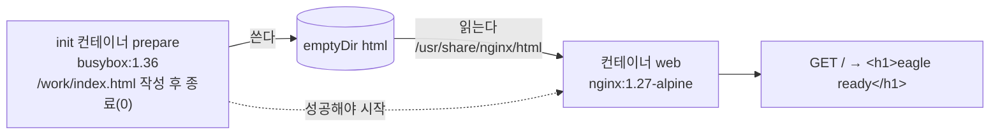

# q03 — Prepare web content with an init container · 풀이

← 문제: **[question.md](question.md)**

## 문제 (해석)

**원문**

> In namespace `eagle`, the web page must be generated before the web server starts.
>
> 1. Create a Pod named `eagle-web` in namespace `eagle` with an `emptyDir` volume named `html`.
> 2. Add an init container named `prepare` (image `busybox:1.36`) that mounts `html` at `/work` and
>    writes the text `<h1>eagle ready</h1>` to `/work/index.html`.
> 3. Add a container named `web` (image `nginx:1.27-alpine`) that mounts `html` at
>    `/usr/share/nginx/html`.
> 4. When the Pod is `Running`, write the response of `http://localhost/` as seen from inside
>    container `web` to `/opt/course/d03/response.txt`.

**해석**

`eagle` 네임스페이스에서는 웹 서버가 시작되기 전에 웹 페이지가 만들어져 있어야 한다.

1. `eagle` 네임스페이스에 `emptyDir` 볼륨 `html` 을 가진 Pod `eagle-web` 을 만든다.
2. init 컨테이너 `prepare`(이미지 `busybox:1.36`)를 추가한다. `html` 을 `/work` 에 마운트하고
   `/work/index.html` 에 `<h1>eagle ready</h1>` 라는 글자를 쓴다.
3. 컨테이너 `web`(이미지 `nginx:1.27-alpine`)을 추가하고 `html` 을 `/usr/share/nginx/html` 에 마운트한다.
4. 파드가 `Running` 이 되면 컨테이너 `web` 안에서 본 `http://localhost/` 의 응답을
   `/opt/course/d03/response.txt` 에 적는다.

## 모범 풀이

**1)–3) 뼈대를 만들고 init 컨테이너와 볼륨을 붙입니다**

```bash
export do="--dry-run=client -o yaml"
kubectl -n eagle run eagle-web --image=nginx:1.27-alpine $do > pod.yaml
```

```yaml
apiVersion: v1
kind: Pod
metadata:
  name: eagle-web
  namespace: eagle
spec:
  volumes:
  - name: html
    emptyDir: {}
  initContainers:
  - name: prepare
    image: busybox:1.36
    command: ["sh", "-c", "echo '<h1>eagle ready</h1>' > /work/index.html"]
    volumeMounts:
    - name: html
      mountPath: /work
  containers:
  - name: web                       # run 이 만든 이름 eagle-web → web 으로 고친다
    image: nginx:1.27-alpine
    volumeMounts:
    - name: html
      mountPath: /usr/share/nginx/html
```

```bash
kubectl apply -f pod.yaml
kubectl -n eagle get pod eagle-web -w      # Init:0/1 → PodInitializing → Running
```

같은 `emptyDir` 를 두 컨테이너가 서로 다른 경로에 마운트해도 내용은 하나입니다. init 컨테이너가 `/work` 에 쓴
파일이 nginx 에서는 `/usr/share/nginx/html/index.html` 로 보입니다. 문자열 안의 `<`, `>` 는 셸 리다이렉션으로
읽히지 않도록 반드시 따옴표 안에 넣습니다.

**4) 컨테이너 안에서 확인**

```bash
kubectl -n eagle exec eagle-web -c web -- wget -qO- http://localhost/ > /opt/course/d03/response.txt
cat /opt/course/d03/response.txt           # <h1>eagle ready</h1>
```

`nginx:1.27-alpine` 에는 `curl` 이 없지만 busybox `wget` 이 있습니다. 컨테이너가 둘 이상(init 포함)이면
`-c web` 을 붙여 대상 컨테이너를 정합니다.

### 그림 — init 컨테이너와 emptyDir



1. kubelet 은 `initContainers` 를 순서대로 하나씩 실행하고, 각각이 exit 0 으로 끝나야 다음으로 넘어갑니다.
2. `prepare` 가 emptyDir 에 `index.html` 을 쓰고 끝납니다. 실패하면 파드는 `Init:Error`/`Init:CrashLoopBackOff` 에 머뭅니다.
3. 그다음 `web` 이 시작되고, 같은 emptyDir 을 nginx 문서 루트에 마운트하므로 기본 페이지 대신 방금 만든 파일을 응답합니다.

## 검증

```bash
kubectl -n eagle get pod eagle-web                    # READY 1/1, STATUS Running
kubectl -n eagle get pod eagle-web \
  -o jsonpath='{.spec.initContainers[0].name} {.status.initContainerStatuses[0].state.terminated.reason}{"\n"}'
# prepare Completed
kubectl -n eagle get pod eagle-web -o jsonpath='{.spec.volumes[0]}{"\n"}'   # {"emptyDir":{},"name":"html"}
cat /opt/course/d03/response.txt                      # <h1>eagle ready</h1>
```

## 오답 원인 / 배운 점

- **왜 틀렸나**:
- **기억할 것**: init 컨테이너는 `spec.initContainers`, 볼륨은 `spec.volumes` 에 한 번 정의하고 각 컨테이너에서 `volumeMounts` 로 경로만 다르게 붙인다.
- **헷갈리는 지점**: `initContainers` 항목에 `restartPolicy: Always` 를 넣으면 끝나지 않고 계속 도는 **네이티브 사이드카**(1.33 GA)가 됩니다. 이 문제처럼 "먼저 한 번 실행하고 끝나는" 작업에는 넣지 않습니다. emptyDir 내용은 컨테이너 재시작에는 남고 파드가 삭제되면 사라집니다.

## 참고 문서

- 검색어: `init containers`, `emptydir`
- https://kubernetes.io/docs/concepts/workloads/pods/init-containers/
- https://kubernetes.io/docs/tasks/configure-pod-container/configure-pod-initialization/

---

[↑ 문항 목록](../README.md) · [← 문제로](question.md) · [다음 문제 q04 →](../q04_rolling_update_rollback/question.md)
