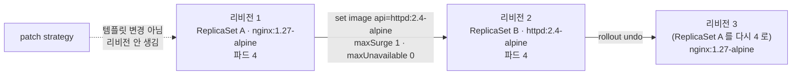

# q04 — Rolling update and rollback of a Deployment · 풀이

← 문제: **[question.md](question.md)**

## 문제 (해석)

**원문**

> Deployment `heron-api` in namespace `heron` must be updated without ever dropping below its
> desired number of ready Pods.
>
> 1. Change the rolling update strategy of `heron-api` to `maxSurge: 1` and `maxUnavailable: 0`.
> 2. Using `kubectl set image`, change the image of container `api` to `httpd:2.4-alpine` and wait
>    until the rollout has finished.
> 3. Write the output of `kubectl rollout history` for `heron-api` to
>    `/opt/course/d04/history.txt`. It must list two revisions.
> 4. The new image turned out to be wrong. Roll `heron-api` back to the previous revision and make
>    sure all 4 Pods run `nginx:1.27-alpine` again.

**해석**

`heron` 네임스페이스의 Deployment `heron-api` 를, Ready 파드 수가 원하는 수 아래로 한 번도 내려가지 않게
업데이트해야 한다.

1. `heron-api` 의 롤링 업데이트 전략을 `maxSurge: 1`, `maxUnavailable: 0` 으로 바꾼다.
2. `kubectl set image` 로 컨테이너 `api` 의 이미지를 `httpd:2.4-alpine` 으로 바꾸고 rollout 이 끝날 때까지
   기다린다.
3. `heron-api` 의 `kubectl rollout history` 출력을 `/opt/course/d04/history.txt` 에 적는다. 리비전 두 개가
   보여야 한다.
4. 새 이미지가 잘못된 것으로 밝혀졌다. `heron-api` 를 이전 리비전으로 되돌리고 4개 파드가 모두 다시
   `nginx:1.27-alpine` 으로 도는지 확인한다.

## 모범 풀이

**1) 전략 변경**

```bash
kubectl -n heron patch deploy heron-api \
  -p '{"spec":{"strategy":{"type":"RollingUpdate","rollingUpdate":{"maxSurge":1,"maxUnavailable":0}}}}'
```

`kubectl edit deploy heron-api -n heron` 으로 `spec.strategy.rollingUpdate` 를 고쳐도 됩니다. 전략은 파드
템플릿 밖의 필드라 바꿔도 **새 리비전이 생기지 않고** 파드도 재시작되지 않습니다. 그래서 3번에서 리비전이
정확히 두 개가 됩니다. `maxUnavailable: 0` 이면 새 파드가 Ready 가 된 뒤에만 옛 파드를 하나씩 내립니다.

**2) 이미지 교체**

```bash
kubectl -n heron set image deploy/heron-api api=httpd:2.4-alpine
kubectl -n heron rollout status deploy/heron-api
# deployment "heron-api" successfully rolled out
```

`set image` 의 `api=` 는 **컨테이너 이름**입니다. Deployment 이름이나 이미지 이름을 쓰면
`unable to find container named` 에러가 납니다. 변경 사유를 남기고 싶으면
`kubectl -n heron annotate deploy heron-api kubernetes.io/change-cause='image httpd:2.4-alpine'` 로 붙이면
history 의 CHANGE-CAUSE 열에 보입니다(`--record` 는 없어졌습니다).

**3) 히스토리 기록**

```bash
kubectl -n heron rollout history deploy/heron-api > /opt/course/d04/history.txt
cat /opt/course/d04/history.txt
# deployment.apps/heron-api
# REVISION  CHANGE-CAUSE
# 1         <none>
# 2         <none>
kubectl -n heron rollout history deploy/heron-api --revision=1   # 리비전 1 의 파드 템플릿(이미지) 확인
```

**4) 되돌리기**

```bash
kubectl -n heron rollout undo deploy/heron-api            # 직전 리비전으로
# 또는 kubectl -n heron rollout undo deploy/heron-api --to-revision=1
kubectl -n heron rollout status deploy/heron-api
```

### 그림 — 리비전과 ReplicaSet



1. 처음 상태는 ReplicaSet A(리비전 1) 하나입니다. strategy 만 바꾸는 patch 는 파드 템플릿을 건드리지 않으므로 리비전이 늘지 않습니다.
2. `set image` 는 템플릿을 바꿔 ReplicaSet B(리비전 2)를 만듭니다. `maxSurge 1 · maxUnavailable 0` 이라 B 를 하나 늘리고 Ready 가 되면 A 를 하나 줄이는 일을 4번 반복합니다.
3. `rollout undo` 는 리비전 1 의 템플릿을 다시 적용합니다. 새 ReplicaSet 을 만들지 않고 A 를 다시 키우며, A 의 리비전 번호가 3 으로 바뀌어 history 에서 1 은 사라지고 2, 3 이 남습니다.

## 검증

```bash
cat /opt/course/d04/history.txt                     # REVISION 1, 2
kubectl -n heron get deploy heron-api \
  -o jsonpath='{.spec.strategy.rollingUpdate.maxSurge} {.spec.strategy.rollingUpdate.maxUnavailable} {.spec.template.spec.containers[0].image}{"\n"}'
# 1 0 nginx:1.27-alpine
kubectl -n heron get deploy heron-api               # READY 4/4
kubectl -n heron get pods -o jsonpath='{range .items[*]}{.spec.containers[0].image}{"\n"}{end}' | sort | uniq -c
#   4 nginx:1.27-alpine
kubectl -n heron rollout history deploy/heron-api   # 2, 3 (undo 로 1 이 3 이 됨)
kubectl -n heron get rs                             # nginx RS 4/4, httpd RS 0/0
```

## 오답 원인 / 배운 점

- **왜 틀렸나**:
- **기억할 것**: `kubectl set image deploy/<d> <컨테이너>=<이미지>` → `rollout status` → `rollout history` → `rollout undo [--to-revision=N]`.
- **헷갈리는 지점**: `maxSurge`·`maxUnavailable` 은 둘 다 0 일 수 없습니다(검증 에러). undo 뒤 리비전 번호는 되돌아가는 게 아니라 **새 번호(3)** 가 됩니다. `rollout undo` 는 Deployment 의 다른 필드(replicas, strategy)는 되돌리지 않고 파드 템플릿만 되돌립니다.

## 참고 문서

- 검색어: `deployments rolling update`, `rollout undo`
- https://kubernetes.io/docs/concepts/workloads/controllers/deployment/
- https://kubernetes.io/docs/reference/kubectl/generated/kubectl_rollout/kubectl_rollout_undo/

---

[↑ 문항 목록](../README.md) · [← 문제로](question.md) · [다음 문제 q05 →](../q05_helm_reinstall_namespace/question.md)
