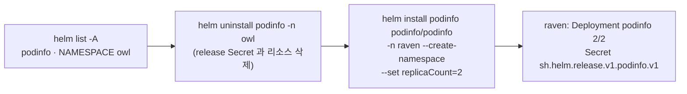

# q05 — Move a Helm release to the right namespace · 풀이

← 문제: **[question.md](question.md)**

## 문제 (해석)

**원문**

> A colleague installed the Helm release `podinfo` (chart `podinfo`) into the wrong namespace. It
> belongs in namespace `raven`.
>
> 1. Add the chart repository `podinfo` with URL `https://stefanprodan.github.io/podinfo` and
>    refresh the repository index.
> 2. List the Helm releases of all namespaces, find the namespace where release `podinfo` is
>    currently installed and write only that namespace name to `/opt/course/d05/wrong-ns.txt`.
> 3. Uninstall release `podinfo` from that namespace.
> 4. Install release `podinfo` from chart `podinfo/podinfo` into namespace `raven` (create the
>    namespace) with the value `replicaCount=2`. Both Pods must become ready.

**해석**

동료가 Helm 릴리스 `podinfo`(차트 `podinfo`)를 엉뚱한 네임스페이스에 설치했다. 원래 자리는
`raven` 네임스페이스다.

1. URL `https://stefanprodan.github.io/podinfo` 를 차트 저장소 `podinfo` 로 추가하고 인덱스를 갱신한다.
2. 모든 네임스페이스의 Helm 릴리스를 나열해 릴리스 `podinfo` 가 지금 설치된 네임스페이스를 찾고, 그
   네임스페이스 이름만 `/opt/course/d05/wrong-ns.txt` 에 적는다.
3. 그 네임스페이스에서 릴리스 `podinfo` 를 삭제(uninstall)한다.
4. 차트 `podinfo/podinfo` 로 릴리스 `podinfo` 를 `raven` 네임스페이스(함께 생성)에 `replicaCount=2` 값으로
   설치한다. 파드 두 개가 모두 Ready 가 되어야 한다.

## 모범 풀이

**1) 저장소 추가**

```bash
helm repo add podinfo https://stefanprodan.github.io/podinfo
helm repo update
helm search repo podinfo/podinfo        # podinfo/podinfo  6.x.y  ...
```

**2) 모든 네임스페이스의 릴리스**

```bash
helm list -A
# NAME     NAMESPACE  REVISION  UPDATED   STATUS    CHART          APP VERSION
# podinfo  owl        1         ...       deployed  podinfo-6.x.y  6.x.y
helm list -A | awk '$1=="podinfo"{print $2}' > /opt/course/d05/wrong-ns.txt
cat /opt/course/d05/wrong-ns.txt        # owl
```

`helm list` 는 `-n` 을 주지 않으면 **현재 컨텍스트의 네임스페이스(보통 default)** 만 봅니다. 다른 네임스페이스의
릴리스는 `-A`(`--all-namespaces`)를 줘야 보입니다. 파일에는 이름만 한 줄 적습니다.

**3) 잘못된 곳에서 삭제**

```bash
helm uninstall podinfo -n owl
```

Helm 릴리스 정보는 그 네임스페이스의 Secret(`sh.helm.release.v1.podinfo.v1`)에 저장되므로 `-n owl` 을 빼면
`release: not found` 가 납니다. uninstall 은 네임스페이스 자체는 지우지 않습니다(문제도 요구하지 않음).

**4) 올바른 곳에 설치**

```bash
helm install podinfo podinfo/podinfo -n raven --create-namespace \
  --set replicaCount=2 --wait --timeout 3m
```

`--create-namespace` 가 없으면 `namespaces "raven" not found` 로 실패합니다. 대신 `kubectl create ns raven` 을
먼저 해도 됩니다. `--wait` 은 파드가 Ready 가 될 때까지 기다리고, 실패하면 `--rollback-on-failure`(Helm 4, 예전
`--atomic`)로 되돌리게 할 수도 있습니다.

### 그림 — 릴리스를 옮기는 순서



1. Helm 릴리스는 네임스페이스에 묶인 객체라 "다른 네임스페이스로 옮기는" 명령이 없습니다. 지우고 다시 설치합니다.
2. `helm list -A` 의 NAMESPACE 열이 지금 릴리스가 있는 곳입니다.
3. uninstall 은 차트가 만든 리소스와 릴리스 기록(Secret)을 함께 지웁니다.
4. 새 네임스페이스에 설치하면 리비전 1 부터 새로 시작합니다.

## 검증

```bash
cat /opt/course/d05/wrong-ns.txt                  # owl
helm repo list                                    # podinfo  https://stefanprodan.github.io/podinfo
helm list -A | grep podinfo                       # podinfo  raven  1  ...  deployed  podinfo-6.x.y
helm status podinfo -n owl                        # Error: release: not found
helm get values podinfo -n raven                  # replicaCount: 2
kubectl -n raven get deploy podinfo               # READY 2/2
```

## 오답 원인 / 배운 점

- **왜 틀렸나**:
- **기억할 것**: 릴리스는 네임스페이스 단위다. 찾을 때는 `helm list -A`, 지우고 설치할 때는 항상 `-n <ns>`.
- **헷갈리는 지점**: `helm uninstall` 에 `-n` 을 빼면 default 에서 찾다가 not found 가 납니다. Helm 4(2025.11)에서도 `repo add/list/install/uninstall` 은 같고 `--atomic` 만 `--rollback-on-failure` 로 바뀌었습니다. Bitnami 무료 카탈로그가 줄어 연습용으로는 podinfo 같은 차트를 씁니다.

## 참고 문서

시험 중에는 kubernetes.io 문서와 함께 **helm.sh/docs** 도 열람할 수 있습니다.

- 검색어: `helm list`, `helm uninstall`, `helm install`
- https://helm.sh/docs/helm/helm_list/
- https://helm.sh/docs/helm/helm_uninstall/
- https://helm.sh/docs/helm/helm_install/

---

[↑ 문항 목록](../README.md) · [← 문제로](question.md) · [다음 문제 q06 →](../q06_kustomize_overlay/question.md)
