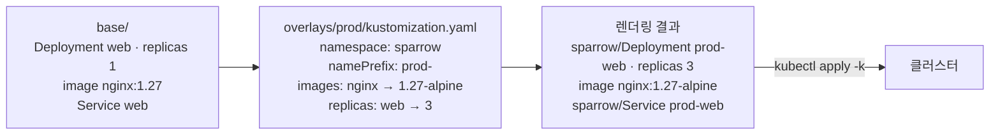

# q06 — Customize a Deployment with a Kustomize overlay · 풀이

← 문제: **[question.md](question.md)**

## 문제 (해석)

**원문**

> The manifests in `/opt/course/d06/base/` must be deployed to namespace `sparrow` through the
> overlay `/opt/course/d06/overlays/prod/`. Change only the overlay's `kustomization.yaml`; do not
> edit any file in `base/`.
>
> 1. Make every resource name of the overlay start with the prefix `prod-`.
> 2. Change the tag of image `nginx` to `1.27-alpine` using the `images` field.
> 3. Set the replica count of the Deployment to `3` using the `replicas` field.
> 4. Apply the overlay with `kubectl apply -k` so that Deployment `prod-web` runs 3 ready Pods with
>    image `nginx:1.27-alpine` in namespace `sparrow`.

**해석**

`/opt/course/d06/base/` 의 매니페스트를 오버레이 `/opt/course/d06/overlays/prod/` 를 거쳐 `sparrow`
네임스페이스에 배포해야 한다. 오버레이의 `kustomization.yaml` 만 고치고 `base/` 의 파일은 고치지 않는다.

1. 오버레이의 모든 리소스 이름이 접두사 `prod-` 로 시작하게 한다.
2. `images` 필드로 이미지 `nginx` 의 태그를 `1.27-alpine` 으로 바꾼다.
3. `replicas` 필드로 Deployment 의 레플리카 수를 `3` 으로 정한다.
4. `kubectl apply -k` 로 오버레이를 적용해, `sparrow` 네임스페이스의 Deployment `prod-web` 이 이미지
   `nginx:1.27-alpine` 의 Ready 파드 3개로 돌게 한다.

## 모범 풀이

**0) 구조 확인**

```bash
cat /opt/course/d06/base/kustomization.yaml          # resources: deployment.yaml, service.yaml
cat /opt/course/d06/overlays/prod/kustomization.yaml # namespace: sparrow, resources: ../../base
```

**1)–3) 오버레이 kustomization.yaml**

```yaml
apiVersion: kustomize.config.k8s.io/v1beta1
kind: Kustomization
namespace: sparrow
namePrefix: prod-
resources:
- ../../base
images:
- name: nginx              # 매니페스트에 적힌 이미지 이름 (태그 제외)
  newTag: 1.27-alpine
replicas:
- name: web                # base 의 원래 이름
  count: 3
```

- `namePrefix` 는 이 오버레이가 만드는 모든 리소스 이름 앞에 붙고, Deployment 안에서 참조하는 이름(ConfigMap 등)도
  함께 바꿉니다. Service `web` 도 `prod-web` 이 됩니다. Service 의 selector(`app: web`)는 라벨이라 바뀌지 않습니다.
- `images[].name` 은 컨테이너 `image:` 값에서 태그를 뺀 부분과 정확히 같아야 합니다(`nginx`). `newName` 을 주면
  레지스트리/이름까지 바꿉니다.
- `replicas[].name` 은 base 의 이름 `web` 으로 씁니다. kustomize 는 접두사 붙기 전 이름으로도 리소스를 찾습니다.

kustomize CLI 가 있으면 같은 내용을 명령으로도 넣을 수 있습니다(시험 환경에는 없을 수 있음).

```bash
cd /opt/course/d06/overlays/prod
kustomize edit set nameprefix prod-
kustomize edit set image nginx=nginx:1.27-alpine
kustomize edit set replicas web=3
```

**4) 미리 보고 적용**

```bash
kubectl kustomize /opt/course/d06/overlays/prod      # 결과 YAML 미리 보기 (적용 안 함)
kubectl apply -k /opt/course/d06/overlays/prod
# service/prod-web created
# deployment.apps/prod-web created
kubectl -n sparrow rollout status deploy prod-web
```

`-k` 는 디렉터리를 받습니다(`-f` 아님). `kubectl kustomize` 로 먼저 렌더링해 보면 이름·이미지·replicas 가 제대로
바뀌었는지 적용 전에 확인할 수 있습니다.

### 그림 — base 와 overlay 가 합쳐지는 방식



1. base 는 환경과 무관한 원본이고 그대로 둡니다.
2. overlay 는 `resources: ../../base` 로 base 를 불러온 뒤 자기 변환(namespace, 접두사, 이미지, replicas)을 덧씌웁니다.
3. 렌더링된 결과만 클러스터에 적용됩니다. 같은 base 로 `overlays/dev` 를 따로 두면 다른 값으로 배포할 수 있습니다.

## 검증

```bash
kubectl -n sparrow get deploy,svc
# deployment.apps/prod-web   3/3   3   3
# service/prod-web           ClusterIP ...   80/TCP
kubectl -n sparrow get deploy prod-web -o jsonpath='{.spec.replicas} {.spec.template.spec.containers[0].image}{"\n"}'
# 3 nginx:1.27-alpine
kubectl -n sparrow get deploy web                    # NotFound — 접두사 없는 web 은 없어야 한다
grep -n 'nginx:1.27$' /opt/course/d06/base/deployment.yaml   # base 는 그대로
```

## 오답 원인 / 배운 점

- **왜 틀렸나**:
- **기억할 것**: 오버레이 = `resources: [../../base]` + `namePrefix`/`images`/`replicas`, 적용은 `kubectl apply -k <디렉터리>`.
- **헷갈리는 지점**: `images[].name` 에 태그까지 적으면(`nginx:1.27`) 매칭되지 않아 아무것도 바뀌지 않습니다. Kustomize v5 에서 `commonLabels` 는 `labels:`, `patchesStrategicMerge` 는 `patches:` 로 바뀌었으니 새로 쓸 때는 새 필드를 씁니다.

## 참고 문서

- 검색어: `kustomize`, `declarative management kustomization`
- https://kubernetes.io/docs/tasks/manage-kubernetes-objects/kustomization/

---

[↑ 문항 목록](../README.md) · [← 문제로](question.md) · [다음 문제 q07 →](../q07_liveness_readiness_probes/question.md)
