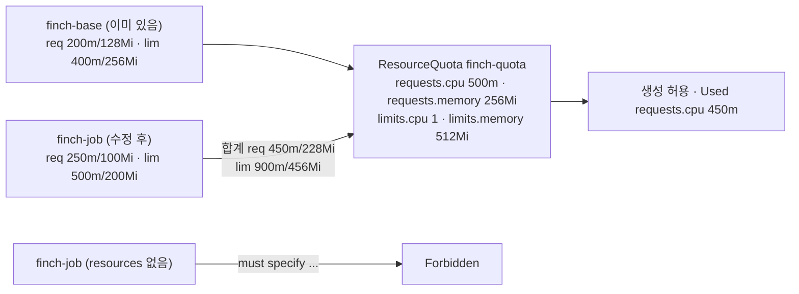

# q13 — Fit a Pod under a ResourceQuota · 풀이

← 문제: **[question.md](question.md)**

## 문제 (해석)

**원문**

> Namespace `finch` is protected by ResourceQuota `finch-quota`. A new Pod must run there.
>
> 1. Try to create the Pod from `/opt/course/d13/finch-job.yaml` without changes and write the error
>    message you get to `/opt/course/d13/error.txt`.
> 2. Edit `/opt/course/d13/finch-job.yaml` so that container `app` requests `250m` CPU and `100Mi`
>    memory and is limited to `500m` CPU and `200Mi` memory. Create the Pod; it must be `Running`.
> 3. Write the amount of `requests.cpu` that the quota now reports as used to
>    `/opt/course/d13/used-cpu.txt`.

**해석**

`finch` 네임스페이스는 ResourceQuota `finch-quota` 로 보호된다. 새 파드 하나를 이곳에서 돌려야 한다.

1. `/opt/course/d13/finch-job.yaml` 을 고치지 않은 채 파드를 만들어 보고, 받은 에러 메시지를
   `/opt/course/d13/error.txt` 에 적는다.
2. `/opt/course/d13/finch-job.yaml` 을 고쳐 컨테이너 `app` 이 CPU `250m`·메모리 `100Mi` 를 요청(requests)하고
   CPU `500m`·메모리 `200Mi` 로 제한(limits)되게 한다. 파드를 만들고 `Running` 이어야 한다.
3. 쿼터가 지금 사용 중이라고 보고하는 `requests.cpu` 양을 `/opt/course/d13/used-cpu.txt` 에 적는다.

## 모범 풀이

**0) 쿼터와 현재 사용량**

```bash
kubectl -n finch describe quota finch-quota
# Resource         Used   Hard
# --------         ----   ----
# limits.cpu       400m   1
# limits.memory    256Mi  512Mi
# pods             1      5
# requests.cpu     200m   500m
# requests.memory  128Mi  256Mi
```

남은 여유는 requests.cpu 300m, requests.memory 128Mi, limits.cpu 600m, limits.memory 256Mi 입니다. 주어진 값
(250m/100Mi, 500m/200Mi)은 모두 여유 안에 들어갑니다.

**1) 그대로 만들어 에러 받기**

```bash
kubectl apply -f /opt/course/d13/finch-job.yaml 2> /opt/course/d13/error.txt
cat /opt/course/d13/error.txt
# Error from server (Forbidden): error when creating "/opt/course/d13/finch-job.yaml": pods "finch-job" is forbidden:
# failed quota: finch-quota: must specify limits.cpu for: app; limits.memory for: app; requests.cpu for: app; requests.memory for: app
```

에러는 표준에러(stderr)로 나오므로 `2>` 로 받습니다. `>` 만 쓰면 파일이 비어 있습니다. 쿼터가 `requests.*`/`limits.*`
를 제한하면, 그 값을 적지 않은 파드는 **생성 자체가 거부**됩니다(LimitRange 기본값이 없을 때). 파드가 Pending 으로
남는 것이 아니라 API 서버가 바로 막는다는 점이 스케줄링 실패와 다릅니다.

**2) resources 추가**

```yaml
apiVersion: v1
kind: Pod
metadata:
  name: finch-job
  namespace: finch
spec:
  containers:
  - name: app
    image: busybox:1.36
    command: ["sh", "-c", "sleep 3600"]
    resources:
      requests:
        cpu: 250m
        memory: 100Mi
      limits:
        cpu: 500m
        memory: 200Mi
```

```bash
kubectl apply -f /opt/course/d13/finch-job.yaml
kubectl -n finch get pod finch-job         # Running
```

값이 여유를 넘으면 `exceeded quota: finch-quota, requested: requests.cpu=..., used: ..., limited: ...` 처럼 어느 항목이
모자란지 알려 줍니다.

**3) 사용량 기록**

```bash
kubectl -n finch get quota finch-quota -o jsonpath='{.status.used.requests\.cpu}' > /opt/course/d13/used-cpu.txt
cat /opt/course/d13/used-cpu.txt           # 450m
```

JSONPath 에서 키 이름의 점은 `\.` 로 이스케이프합니다.

### 그림 — 쿼터 계산



1. 쿼터는 네임스페이스 안 모든 파드의 requests/limits **합계**를 제한합니다. 이미 `finch-base` 가 일부를 쓰고 있습니다.
2. 쿼터가 거는 항목을 비워 둔 파드는 계산할 수 없어서 "must specify" 로 거부됩니다.
3. 값을 넣은 파드는 기존 사용량에 더해 Hard 를 넘지 않을 때만 받아들여지고, Used 가 그만큼 늘어납니다.

## 검증

```bash
cat /opt/course/d13/error.txt              # ... failed quota: finch-quota: must specify ...
kubectl -n finch get pod finch-job -o jsonpath='{.spec.containers[0].resources}{"\n"}'
# {"limits":{"cpu":"500m","memory":"200Mi"},"requests":{"cpu":"250m","memory":"100Mi"}}
kubectl -n finch get pod finch-job         # Running
kubectl -n finch describe quota finch-quota | grep -E 'requests.cpu|limits.cpu'
# limits.cpu    900m  1
# requests.cpu  450m  500m
cat /opt/course/d13/used-cpu.txt           # 450m
```

## 오답 원인 / 배운 점

- **왜 틀렸나**:
- **기억할 것**: 쿼터 확인은 `kubectl describe quota -n <ns>` (Used/Hard), 에러 저장은 `2>`.
- **헷갈리는 지점**: 쿼터가 `requests.cpu` 만 걸면 limits 는 없어도 됩니다. 항목마다 따로 계산합니다. LimitRange 가 있으면 빠진 값이 기본값으로 채워져 "must specify" 없이 통과할 수 있습니다. 1.35 부터는 실행 중인 파드의 CPU/메모리도 `--subresource resize` 로 바꿀 수 있지만, 늘린 값도 쿼터 검사를 받습니다.

## 참고 문서

- 검색어: `resource quotas`, `manage resources for containers`
- https://kubernetes.io/docs/concepts/policy/resource-quotas/
- https://kubernetes.io/docs/tasks/administer-cluster/manage-resources/quota-memory-cpu-namespace/

---

[↑ 문항 목록](../README.md) · [← 문제로](question.md) · [다음 문제 q14 →](../q14_securitycontext_busybox/question.md)
