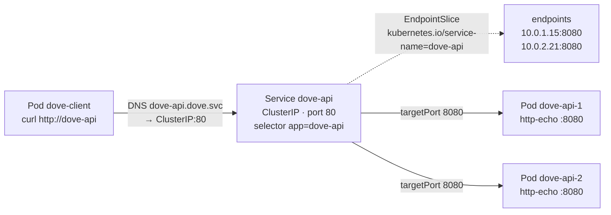

# q15 — Expose a Deployment with a ClusterIP Service · 풀이

← 문제: **[question.md](question.md)**

## 문제 (해석)

**원문**

> Other applications in namespace `dove` need a stable address for Deployment `dove-api`.
>
> 1. Create a Service named `dove-api` of type `ClusterIP` in namespace `dove` that selects the Pods
>    of Deployment `dove-api` and forwards port `80` to container port `8080`.
> 2. Using the EndpointSlice API, confirm that the Service has two ready endpoints and write their
>    Pod IP addresses (separated by spaces) to `/opt/course/d15/endpoints.txt`.
> 3. Create a Pod named `dove-client` (image `curlimages/curl:8.10.1`) in namespace `dove` that keeps
>    running with `sleep 3600`. From it, request `http://dove-api` and write the response to
>    `/opt/course/d15/response.txt`.

**해석**

`dove` 네임스페이스의 다른 애플리케이션들이 Deployment `dove-api` 에 접근할 고정 주소가 필요하다.

1. `dove` 네임스페이스에 `ClusterIP` 타입 Service `dove-api` 를 만든다. Deployment `dove-api` 의 파드를 선택하고
   포트 `80` 을 컨테이너 포트 `8080` 으로 넘긴다.
2. EndpointSlice API 로 Service 에 Ready 엔드포인트가 두 개 있는지 확인하고, 그 파드 IP 들을 공백으로 구분해
   `/opt/course/d15/endpoints.txt` 에 적는다.
3. `dove` 네임스페이스에 `sleep 3600` 으로 계속 도는 Pod `dove-client`(이미지 `curlimages/curl:8.10.1`)를 만든다.
   그 파드에서 `http://dove-api` 로 요청을 보내 응답을 `/opt/course/d15/response.txt` 에 적는다.

## 모범 풀이

**1) Service — `expose` 한 줄**

```bash
kubectl -n dove expose deploy dove-api --name=dove-api --type=ClusterIP --port=80 --target-port=8080
kubectl -n dove get svc dove-api
# NAME       TYPE        CLUSTER-IP     EXTERNAL-IP   PORT(S)   AGE
# dove-api   ClusterIP   10.96.14.20    <none>        80/TCP    5s
```

`expose deploy` 는 Deployment 의 `selector`(`app=dove-api`)를 그대로 Service selector 로 가져옵니다. `--port` 는
Service 가 듣는 포트, `--target-port` 는 파드(컨테이너)가 실제로 듣는 포트입니다. `kubectl create service clusterip`
은 selector 를 `app=<서비스이름>` 으로 만들기 때문에 이름이 다르면 엔드포인트가 비게 됩니다.

**2) EndpointSlice 로 확인**

```bash
kubectl -n dove get endpointslice -l kubernetes.io/service-name=dove-api
# NAME             ADDRESSTYPE   PORTS   ENDPOINTS               AGE
# dove-api-x7k2p   IPv4          8080    10.0.1.15,10.0.2.21     10s
kubectl -n dove get endpointslice -l kubernetes.io/service-name=dove-api \
  -o jsonpath='{.items[*].endpoints[*].addresses[*]}' > /opt/course/d15/endpoints.txt
cat /opt/course/d15/endpoints.txt      # 10.0.1.15 10.0.2.21
kubectl -n dove get endpointslice -l kubernetes.io/service-name=dove-api \
  -o jsonpath='{range .items[*].endpoints[*]}{.addresses[0]}{" ready="}{.conditions.ready}{"\n"}{end}'
# 10.0.1.15 ready=true
# 10.0.2.21 ready=true
kubectl -n dove get pods -l app=dove-api -o wide     # 같은 IP 인지 대조
```

Endpoints API(`kubectl get ep`)는 1.33 부터 deprecated 이고 경고가 나옵니다. EndpointSlice 는 이름이 무작위라서
`kubernetes.io/service-name=<서비스>` 라벨로 찾습니다. PORTS 가 `80` 이 아니라 `8080`(targetPort)으로 보이는 것이
정상입니다. 엔드포인트가 비어 있으면 selector 와 파드 라벨부터 비교합니다.

**3) 클라이언트 파드에서 요청**

```bash
kubectl -n dove run dove-client --image=curlimages/curl:8.10.1 --command -- sleep 3600
kubectl -n dove wait pod dove-client --for=condition=Ready --timeout=60s
kubectl -n dove exec dove-client -- curl -s http://dove-api > /opt/course/d15/response.txt
cat /opt/course/d15/response.txt       # dove-api
```

같은 네임스페이스라 짧은 이름 `dove-api` 로 DNS 가 풀립니다. 다른 네임스페이스에서는 `dove-api.dove` 또는
`dove-api.dove.svc.cluster.local` 을 씁니다. URL 에 포트를 안 적었으므로 80 으로 가고, Service 가 8080 으로 넘깁니다.

### 그림 — ClusterIP 트래픽 흐름



1. 클라이언트는 이름 `dove-api` 를 CoreDNS 로 풀어 Service 의 ClusterIP 를 얻고, 포트 80 으로 보냅니다.
2. EndpointSlice 컨트롤러는 selector `app=dove-api` 에 맞고 Ready 인 파드의 IP:targetPort 를 EndpointSlice 에 적습니다.
3. kube-proxy(또는 CNI)가 그 목록으로 ClusterIP:80 을 파드 IP:8080 중 하나로 바꿔 보냅니다. 응답 `dove-api` 가 같은 길로 돌아옵니다.

## 검증

```bash
kubectl -n dove get svc dove-api -o jsonpath='{.spec.type} {.spec.ports[0].port} {.spec.ports[0].targetPort} {.spec.selector}{"\n"}'
# ClusterIP 80 8080 {"app":"dove-api"}
kubectl -n dove get endpointslice -l kubernetes.io/service-name=dove-api   # ENDPOINTS 에 IP 두 개
cat /opt/course/d15/endpoints.txt                                          # IP 두 개, 공백 구분
kubectl -n dove get pod dove-client                                        # Running
cat /opt/course/d15/response.txt                                           # dove-api
```

## 오답 원인 / 배운 점

- **왜 틀렸나**:
- **기억할 것**: `kubectl expose deploy <d> --port=<svc포트> --target-port=<컨테이너포트>`, 확인은 `kubectl get endpointslice -l kubernetes.io/service-name=<svc>`.
- **헷갈리는 지점**: `port` 와 `targetPort` 를 뒤바꾸는 것. `targetPort` 를 생략하면 `port` 와 같은 값(80)이 되어 연결이 거부됩니다. Endpoints API 는 1.33 에서 deprecated 되었으니 확인은 EndpointSlice 로 합니다.

## 참고 문서

- 검색어: `service`, `endpointslices`, `connecting applications with services`
- https://kubernetes.io/docs/concepts/services-networking/service/
- https://kubernetes.io/docs/concepts/services-networking/endpoint-slices/

---

[↑ 문항 목록](../README.md) · [← 문제로](question.md) · [다음 문제 q16 →](../q16_ingress_two_paths/question.md)
