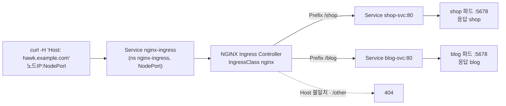

# q16 — Route two paths with an Ingress · 풀이

← 문제: **[question.md](question.md)**

## 문제 (해석)

**원문**

> The `hawk` team publishes two applications under one host name.
>
> 1. Create an Ingress named `hawk-ingress` in namespace `hawk` with IngressClass `nginx` for host
>    `hawk.example.com`.
> 2. Requests for path `/shop` (path type `Prefix`) must go to Service `shop-svc` on port `80`, and
>    requests for path `/blog` (path type `Prefix`) must go to Service `blog-svc` on port `80`.
> 3. Through the Ingress controller's NodePort, send requests with header `Host: hawk.example.com`
>    to `/shop` and `/blog`, and write the responses to `/opt/course/d16/shop.txt` and
>    `/opt/course/d16/blog.txt`.

**해석**

`hawk` 팀은 호스트 이름 하나로 애플리케이션 두 개를 공개한다.

1. `hawk` 네임스페이스에 호스트 `hawk.example.com` 용으로 IngressClass `nginx` 를 쓰는 Ingress `hawk-ingress` 를 만든다.
2. 경로 `/shop`(path type `Prefix`) 요청은 Service `shop-svc` 의 포트 `80` 으로, 경로 `/blog`(path type `Prefix`)
   요청은 Service `blog-svc` 의 포트 `80` 으로 가야 한다.
3. Ingress 컨트롤러의 NodePort 로 `Host: hawk.example.com` 헤더를 붙여 `/shop` 과 `/blog` 에 요청을 보내고, 응답을
   각각 `/opt/course/d16/shop.txt` 와 `/opt/course/d16/blog.txt` 에 적는다.

## 모범 풀이

**0) 클래스와 백엔드 확인**

```bash
kubectl get ingressclass                 # nginx   nginx.org/ingress-controller
kubectl -n hawk get svc                  # shop-svc 80/TCP, blog-svc 80/TCP
```

**1)–2) Ingress — 명령형 한 줄에 규칙 두 개**

```bash
kubectl -n hawk create ingress hawk-ingress --class=nginx \
  --rule='hawk.example.com/shop*=shop-svc:80' \
  --rule='hawk.example.com/blog*=blog-svc:80'
```

경로 끝의 `*` 가 `pathType: Prefix` 이고, 빼면 `Exact` 가 됩니다. 같은 결과의 yaml:

```yaml
apiVersion: networking.k8s.io/v1
kind: Ingress
metadata:
  name: hawk-ingress
  namespace: hawk
spec:
  ingressClassName: nginx
  rules:
  - host: hawk.example.com
    http:
      paths:
      - path: /shop
        pathType: Prefix
        backend:
          service:
            name: shop-svc
            port:
              number: 80
      - path: /blog
        pathType: Prefix
        backend:
          service:
            name: blog-svc
            port:
              number: 80
```

같은 host 의 두 경로는 **한 rule 의 `paths` 목록**에 들어갑니다. `pathType` 은 v1 에서 필수입니다.
`backend.service.port.number` 는 Service 의 port(80)이지 컨테이너 포트(5678)가 아닙니다.

**3) NodePort 로 확인**

```bash
NP=$(kubectl -n nginx-ingress get svc nginx-ingress -o jsonpath='{.spec.ports[?(@.name=="http")].nodePort}')
NODE=$(kubectl get nodes -o jsonpath='{.items[0].status.addresses[?(@.type=="InternalIP")].address}')
curl -s -H 'Host: hawk.example.com' http://$NODE:$NP/shop > /opt/course/d16/shop.txt
curl -s -H 'Host: hawk.example.com' http://$NODE:$NP/blog > /opt/course/d16/blog.txt
cat /opt/course/d16/shop.txt /opt/course/d16/blog.txt      # shop / blog
```

Ingress 를 만든 직후에는 컨트롤러가 설정을 다시 읽는 데 몇 초 걸려 404 가 나올 수 있습니다. 잠시 뒤 다시 보냅니다.
`Host` 헤더를 빼면 규칙의 host 와 맞지 않아 404 입니다.

### 그림 — 트래픽 흐름



1. 요청은 노드 IP 의 NodePort 로 들어와 컨트롤러 Service `nginx-ingress` 를 거쳐 컨트롤러 파드에 닿습니다.
2. 컨트롤러는 `ingressClassName: nginx` 인 Ingress 만 읽고, Host 헤더가 `hawk.example.com` 인지 먼저 봅니다.
3. 경로가 `/shop`(또는 `/shop/...`)이면 `shop-svc:80`, `/blog` 이면 `blog-svc:80` 으로 보내고, Service 가 파드의 5678 로 넘깁니다.
4. 어느 경로에도 맞지 않거나 Host 가 다르면 컨트롤러가 직접 404 를 돌려줍니다.

## 검증

```bash
kubectl -n hawk get ingress hawk-ingress
# NAME           CLASS   HOSTS              ADDRESS   PORTS   AGE
# hawk-ingress   nginx   hawk.example.com             80      30s
kubectl -n hawk describe ingress hawk-ingress | grep -A3 Rules
#   hawk.example.com
#                     /shop   shop-svc:80 (10.0.1.31:5678)
#                     /blog   blog-svc:80 (10.0.2.17:5678)
cat /opt/course/d16/shop.txt          # shop
cat /opt/course/d16/blog.txt          # blog
curl -s -o /dev/null -w '%{http_code}\n' -H 'Host: hawk.example.com' http://$NODE:$NP/other   # 404
```

## 오답 원인 / 배운 점

- **왜 틀렸나**:
- **기억할 것**: `kubectl create ingress <n> --class=<c> --rule='host/path*=svc:port'` 를 경로마다 반복. `*` = Prefix.
- **헷갈리는 지점**: Ingress NGINX(kubernetes/ingress-nginx) 프로젝트는 2026년 3월 은퇴했지만 Ingress **API** 는 GA 그대로이고, 이 실습은 F5 NGINX Ingress Controller(클래스 `nginx`)를 씁니다. `nginx.ingress.kubernetes.io/rewrite-target` 같은 컨트롤러 전용 어노테이션은 컨트롤러가 바뀌면 동작하지 않으니 표준 필드만 씁니다.

## 참고 문서

- 검색어: `ingress`, `ingress path types`
- https://kubernetes.io/docs/concepts/services-networking/ingress/
- https://kubernetes.io/docs/reference/kubectl/generated/kubectl_create/kubectl_create_ingress/

---

[↑ 문항 목록](../README.md) · [← 문제로](question.md) · [다음 문제 q17 →](../q17_networkpolicy_pod_label/question.md)
