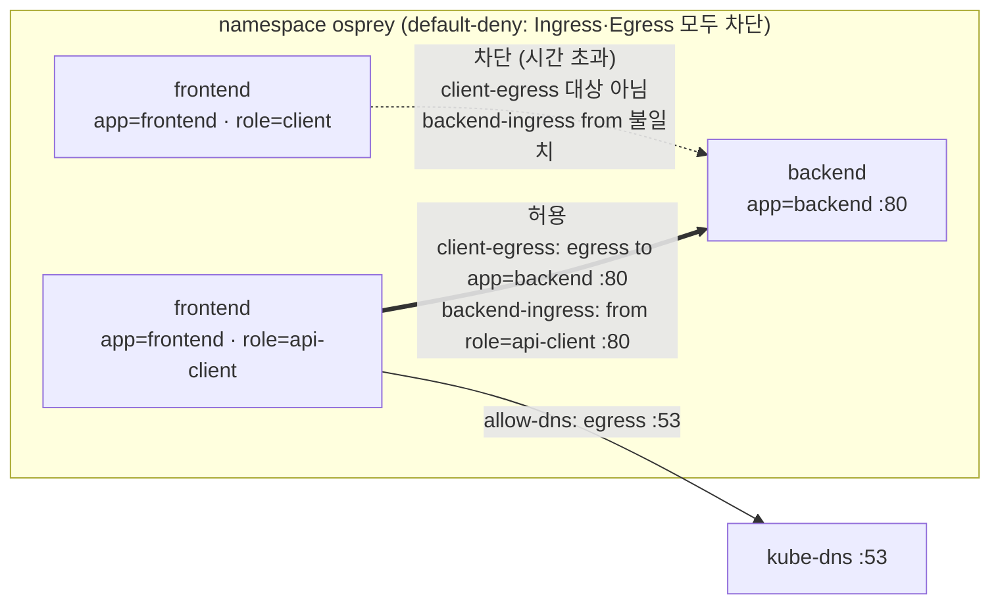

# q17 — Reach a backend through NetworkPolicies by relabeling a Pod · 풀이

← 문제: **[question.md](question.md)**

## 문제 (해석)

**원문**

> In namespace `osprey`, Pod `frontend` cannot reach Service `backend`. The NetworkPolicies in the
> namespace are approved by the security team and must not be changed.
>
> 1. Inspect the NetworkPolicies in namespace `osprey` and find which Pod labels they allow to
>    send traffic to the `backend` Pods.
> 2. Change only the labels of Pod `frontend` (do not recreate it and do not modify, delete or create
>    any NetworkPolicy) so that `frontend` can reach Service `backend` on port `80`.
> 3. Write the label you set, in the form `key=value`, to `/opt/course/d17/label.txt`, and confirm
>    that `wget -qO- -T 3 http://backend` from `frontend` now returns the nginx welcome page.

**해석**

`osprey` 네임스페이스에서 Pod `frontend` 가 Service `backend` 에 닿지 못한다. 네임스페이스의 NetworkPolicy 는
보안팀이 승인한 것이라 바꾸면 안 된다.

1. `osprey` 네임스페이스의 NetworkPolicy 를 살펴, 어떤 파드 라벨이 `backend` 파드로 트래픽을 보내도록 허용되는지
   찾는다.
2. Pod `frontend` 의 라벨만 바꿔서(파드를 다시 만들지 않고, NetworkPolicy 를 고치거나 지우거나 새로 만들지 않고)
   `frontend` 가 Service `backend` 의 포트 `80` 에 닿게 한다.
3. 설정한 라벨을 `key=value` 형태로 `/opt/course/d17/label.txt` 에 적고, `frontend` 에서
   `wget -qO- -T 3 http://backend` 가 이제 nginx 환영 페이지를 돌려주는지 확인한다.

## 모범 풀이

**1) 정책 읽기**

```bash
kubectl -n osprey get netpol
# NAME             POD-SELECTOR    AGE
# allow-dns        <none>          1m
# backend-ingress  app=backend     1m
# client-egress    role=api-client 1m
# default-deny     <none>          1m
kubectl -n osprey describe netpol backend-ingress client-egress
kubectl -n osprey get pod --show-labels
# backend    app=backend
# frontend   app=frontend,role=client          ← role 값이 다르다
```

| 정책 | 대상(podSelector) | 허용 |
|---|---|---|
| `default-deny` | 모든 파드 | 아무것도 허용하지 않음 (Ingress·Egress 모두 차단) |
| `allow-dns` | 모든 파드 | Egress 53/UDP·TCP (DNS) |
| `backend-ingress` | `app=backend` | Ingress: `role=api-client` 파드에서 오는 80/TCP |
| `client-egress` | `role=api-client` | Egress: `app=backend` 파드로 가는 80/TCP |

통신이 되려면 **보내는 쪽 Egress** 와 **받는 쪽 Ingress** 가 둘 다 허용해야 합니다. 두 정책이 같은 라벨
`role=api-client` 를 가리키므로, 이 라벨 하나로 양쪽이 모두 열립니다.

**2) 라벨 바꾸기**

```bash
kubectl -n osprey label pod frontend role=api-client --overwrite
```

`frontend` 에는 이미 `role=client` 가 있어서 `--overwrite` 없이 치면 `'role' already has a value (client)` 에러로
거부됩니다. 라벨은 파드를 다시 만들지 않고 바로 바뀌고, CNI 가 정책 적용 대상을 곧바로 다시 계산합니다.
`app=frontend` 는 그대로 둬도 됩니다.

**3) 기록과 확인**

```bash
echo 'role=api-client' > /opt/course/d17/label.txt
kubectl -n osprey exec frontend -- wget -qO- -T 3 http://backend | head -4
# <!DOCTYPE html>
# <html>
# <head>
# <title>Welcome to nginx!</title>
```

### 그림 — 허용 경로



1. `default-deny` 가 네임스페이스의 모든 파드를 Ingress·Egress 양쪽으로 격리합니다. 그 뒤로는 정책이 명시적으로 허용한 것만 통과합니다.
2. `allow-dns` 가 모든 파드에 DNS 만 열어 주므로 `http://backend` 이름 풀이는 됩니다. 그래서 실패가 "이름을 못 찾음"이 아니라 시간 초과로 보입니다.
3. 라벨이 `role=client` 일 때는 `client-egress` 의 대상이 아니라 나가는 트래픽이 막히고, `backend-ingress` 의 `from` 과도 맞지 않아 들어오는 트래픽도 막힙니다.
4. `role=api-client` 로 바꾸면 frontend 가 `client-egress` 의 대상이 되어 backend:80 으로 나갈 수 있고, `backend-ingress` 의 `from` 과 맞아 backend 가 받아 줍니다. Service ClusterIP 로 보내도 정책은 DNAT 뒤의 파드 IP·포트(80)로 판단합니다.

## 검증

```bash
cat /opt/course/d17/label.txt                                  # role=api-client
kubectl -n osprey get pod frontend --show-labels               # app=frontend,role=api-client
kubectl -n osprey exec frontend -- wget -qO- -T 3 http://backend | grep -o 'Welcome to nginx!' | head -1
# Welcome to nginx!
kubectl -n osprey get netpol                                   # 4개 그대로, 바뀐 것 없음
kubectl -n osprey get pod frontend -o jsonpath='{.status.containerStatuses[0].restartCount}{"\n"}'   # 0 (다시 만들지 않음)
```

## 오답 원인 / 배운 점

- **왜 틀렸나**:
- **기억할 것**: 통신 = 보내는 파드의 Egress 허용 + 받는 파드의 Ingress 허용. 라벨 수정은 `kubectl label pod <p> k=v --overwrite`.
- **헷갈리는 지점**: `backend-ingress` 만 보고 Ingress 쪽만 맞추면 egress 가 막혀 여전히 실패합니다(이 문제는 같은 라벨로 둘 다 풀림). `from` 에서 `podSelector` 와 `namespaceSelector` 가 같은 항목(대시 하나)에 있으면 AND, 따로 있으면 OR 입니다. DNS egress 가 없으면 Service 이름 풀이부터 실패합니다.

## 참고 문서

- 검색어: `network policies`, `declare network policy`
- https://kubernetes.io/docs/concepts/services-networking/network-policies/
- https://kubernetes.io/docs/tasks/administer-cluster/declare-network-policy/

---

[↑ 문항 목록](../README.md) · [← 문제로](question.md)
