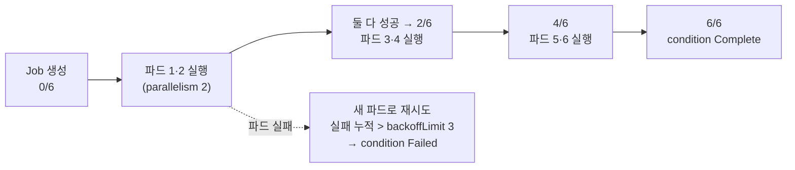

# q01 — Run a parallel Job and collect its logs · 풀이

← 문제: **[question.md](question.md)**

## 문제 (해석)

**원문**

> A batch step must process six work items, two at a time, and the team wants every pod's output
> kept in one file.
>
> 1. In namespace `ruby`, create a Job named `batch-counter` using image `busybox:1.36` that runs
>    `sh -c 'echo "item done by $(hostname)"; sleep 5'`.
> 2. The Job must need `6` successful completions, run at most `2` pods at the same time, and give
>    up after `3` retries (`backoffLimit`).
> 3. Wait until the Job is complete, then write the logs of **all** of the Job's pods to
>    `/opt/course/e01/job.log` (one line per pod, six lines in total).

**해석**

배치 단계 하나가 작업 항목 6개를 한 번에 2개씩 처리해야 하고, 팀은 모든 파드의 출력을 한 파일에
모아 두고 싶어 한다.

1. `ruby` 네임스페이스에 이미지 `busybox:1.36` 으로 Job `batch-counter` 를 만든다. 실행 명령은
   `sh -c 'echo "item done by $(hostname)"; sleep 5'` 이다.
2. 이 Job 은 성공 완료 `6` 회가 필요하고, 동시에 최대 `2` 개의 파드만 돌리며, 재시도 `3` 회 후
   포기한다(`backoffLimit`).
3. Job 이 완료될 때까지 기다린 뒤, Job 의 **모든** 파드 로그를 `/opt/course/e01/job.log` 에 쓴다
   (파드당 한 줄, 모두 여섯 줄).

## 모범 풀이

**1) 뼈대는 명령형으로 만듭니다**

```bash
export do="--dry-run=client -o yaml"
kubectl -n ruby create job batch-counter --image=busybox:1.36 $do \
  -- sh -c 'echo "item done by $(hostname)"; sleep 5' > /tmp/e01.yaml
```

`kubectl create job` 에는 `completions`/`parallelism`/`backoffLimit` 플래그가 없습니다. 그래서
`$do` 로 YAML 을 뽑아 세 필드를 손으로 넣습니다. `--` 뒤는 그대로 `command` 가 됩니다.

**2) 세 필드는 Job 의 `spec` 바로 아래에 넣습니다**

```yaml
apiVersion: batch/v1
kind: Job
metadata:
  name: batch-counter
  namespace: ruby
spec:
  completions: 6        # 성공한 파드가 6개가 되면 Job 완료
  parallelism: 2        # 동시에 최대 2개
  backoffLimit: 3       # 실패한 파드가 3번을 넘으면 Job 실패
  template:
    spec:
      restartPolicy: Never
      containers:
      - name: batch-counter
        image: busybox:1.36
        command: ["sh", "-c", "echo \"item done by $(hostname)\"; sleep 5"]
```

```bash
kubectl apply -f /tmp/e01.yaml
kubectl -n ruby get job batch-counter -w        # COMPLETIONS 0/6 → 2/6 → ... → 6/6
```

세 필드를 `template.spec`(파드 스펙) 아래에 넣으면 `unknown field` 로 거부됩니다. 파드가 아니라 **Job**
의 설정이기 때문입니다. `restartPolicy` 는 파드 스펙에 있어야 하고 Job 에서는 `Never` 또는
`OnFailure` 만 됩니다(`create job` 이 `Never` 를 넣어 줍니다).

**3) 완료를 기다린 뒤 모든 파드의 로그를 모읍니다**

```bash
kubectl -n ruby wait --for=condition=complete job/batch-counter --timeout=180s
kubectl -n ruby logs -l job-name=batch-counter --tail=-1 > /opt/course/e01/job.log
cat /opt/course/e01/job.log
```

`kubectl logs job/batch-counter` 는 Job 의 파드 **하나만** 골라 보여 줍니다. 여섯 개를 다 모으려면
Job 컨트롤러가 붙이는 라벨(`job-name=<job>`, 1.27부터는 `batch.kubernetes.io/job-name` 도 함께)로
`-l` 을 씁니다. `-l` 을 쓰면 `--tail` 기본값이 10 으로 바뀌므로 로그가 긴 경우를 대비해
`--tail=-1` 을 붙이는 습관을 들입니다.

### 그림 — completions 6, parallelism 2 의 진행



1. 컨트롤러는 남은 완료 수와 `parallelism` 중 작은 수만큼 파드를 동시에 띄웁니다.
2. 성공한 파드 수가 `completions` 6 에 닿으면 Job 은 `Complete` 가 되고 더 이상 파드를 만들지 않습니다.
3. 파드가 실패하면 새 파드를 만들어 다시 시도하고, 실패 횟수가 `backoffLimit` 를 넘으면 Job 전체가
   `Failed`(reason `BackoffLimitExceeded`)가 됩니다.

## 검증

```bash
kubectl -n ruby get job batch-counter
# NAME            STATUS     COMPLETIONS   DURATION   AGE
# batch-counter   Complete   6/6           20s        1m
kubectl -n ruby get job batch-counter -o jsonpath='{.spec.completions} {.spec.parallelism} {.spec.backoffLimit}{"\n"}'
# 6 2 3
kubectl -n ruby get pods -l job-name=batch-counter      # Completed 6개
wc -l < /opt/course/e01/job.log                          # 6
head -2 /opt/course/e01/job.log
# item done by batch-counter-xxxxx
# item done by batch-counter-yyyyy
```

## 오답 원인 / 배운 점

- **왜 틀렸나**:
- **기억할 것**: 여러 파드의 로그는 `kubectl logs -l job-name=<job> --tail=-1`. `logs job/<job>` 은 파드 하나뿐이다.
- **헷갈리는 지점**: `completions`/`parallelism`/`backoffLimit` 은 Job `spec` 필드라서 `template` 안에 넣으면 거부됩니다. 인덱스마다 재시도 한도를 따로 두는 `backoffLimitPerIndex`(Indexed Job 전용)와 성공 조건 `successPolicy` 는 v1.33 에서 GA, 종료 코드별로 처리를 정하는 `podFailurePolicy` 는 v1.31 GA 입니다. 이번 문제처럼 단순한 재시도 한도는 `backoffLimit` 하나면 됩니다.

## 참고 문서

- 검색어: `jobs parallel`, `kubectl logs selector`
- https://kubernetes.io/docs/concepts/workloads/controllers/job/
- https://kubernetes.io/docs/reference/kubectl/generated/kubectl_logs/

---

[↑ 문항 목록](../README.md) · [← 문제로](question.md) · [다음 문제 q02 →](../q02_daemonset_log_agent/question.md)
