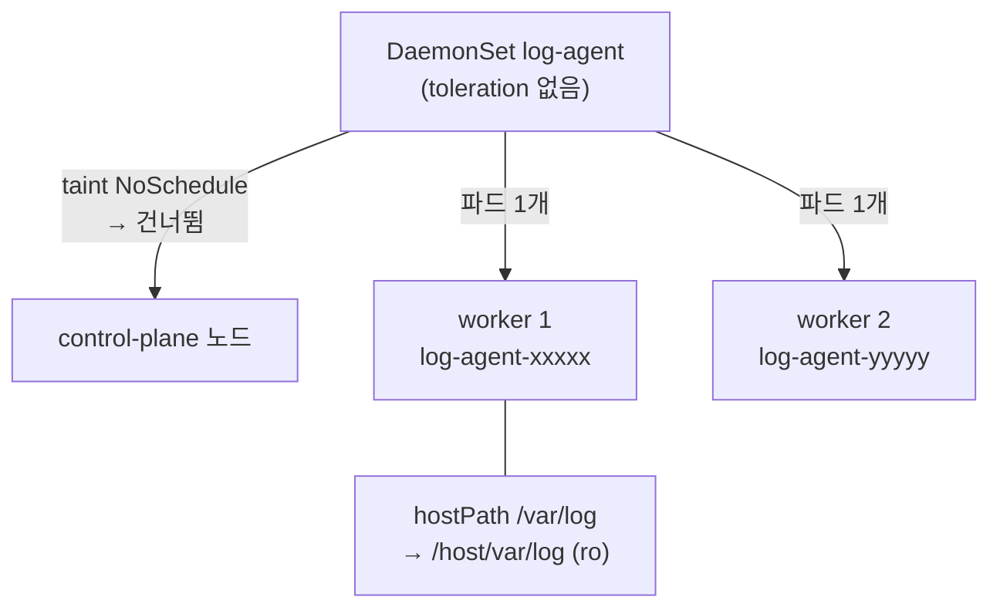

# q02 — Run a log agent on every worker node · 풀이

← 문제: **[question.md](question.md)**

## 문제 (해석)

**원문**

> Every worker node needs a small log agent that can read the node's `/var/log` directory.
>
> 1. In namespace `sapphire`, create a DaemonSet named `log-agent` with pod label `app=log-agent`.
>    Its container `agent` uses image `busybox:1.36` and runs
>    `sh -c 'while true; do ls /host/var/log | wc -l; sleep 30; done'`.
> 2. Mount the node's `/var/log` directory into the container at `/host/var/log`, read-only.
> 3. The agent must run on worker nodes only (do not add any toleration). Confirm that there is
>    exactly one `log-agent` pod per worker node, and write the node names of the `log-agent` pods,
>    one per line, to `/opt/course/e02/nodes.txt`.

**해석**

모든 worker 노드에 노드의 `/var/log` 디렉터리를 읽을 수 있는 작은 로그 에이전트가 필요하다.

1. `sapphire` 네임스페이스에 파드 라벨이 `app=log-agent` 인 DaemonSet `log-agent` 를 만든다.
   컨테이너 `agent` 는 이미지 `busybox:1.36` 을 쓰고
   `sh -c 'while true; do ls /host/var/log | wc -l; sleep 30; done'` 를 실행한다.
2. 노드의 `/var/log` 디렉터리를 컨테이너의 `/host/var/log` 에 읽기 전용으로 마운트한다.
3. 에이전트는 worker 노드에서만 돈다(toleration 을 추가하지 않는다). worker 노드마다 `log-agent`
   파드가 정확히 하나씩 있는지 확인하고, `log-agent` 파드들이 떠 있는 노드 이름을 한 줄에 하나씩
   `/opt/course/e02/nodes.txt` 에 쓴다.

## 모범 풀이

**1) Deployment YAML 을 뽑아 DaemonSet 으로 고칩니다**

`kubectl create daemonset` 은 없습니다. Deployment 를 dry-run 으로 만든 뒤 `kind` 를 바꾸고
DaemonSet 에 없는 필드(`replicas`, `strategy`, `status`)를 지웁니다.

```bash
export do="--dry-run=client -o yaml"
kubectl -n sapphire create deploy log-agent --image=busybox:1.36 $do \
  -- sh -c 'while true; do ls /host/var/log | wc -l; sleep 30; done' > /tmp/e02.yaml
vi /tmp/e02.yaml
```

**2) 고친 결과 — hostPath 를 읽기 전용으로**

```yaml
apiVersion: apps/v1
kind: DaemonSet                  # Deployment → DaemonSet
metadata:
  name: log-agent
  namespace: sapphire
  labels:
    app: log-agent
spec:                            # replicas, strategy 삭제
  selector:
    matchLabels:
      app: log-agent
  template:
    metadata:
      labels:
        app: log-agent
    spec:
      containers:
      - name: agent              # create deploy 가 붙인 이름 busybox 를 agent 로
        image: busybox:1.36
        command: ["sh", "-c", "while true; do ls /host/var/log | wc -l; sleep 30; done"]
        volumeMounts:
        - name: varlog
          mountPath: /host/var/log
          readOnly: true
      volumes:
      - name: varlog
        hostPath:
          path: /var/log
          type: Directory
```

```bash
kubectl apply -f /tmp/e02.yaml
kubectl -n sapphire rollout status ds log-agent
```

컨테이너 이름을 `agent` 로 바꾸는 것을 놓치기 쉽습니다(`create deploy` 는 이미지 이름 `busybox` 를
씁니다). 읽기 전용은 `volumeMounts[].readOnly: true` 로 겁니다. `hostPath` 쪽에는 readOnly 필드가
없습니다.

**3) 노드당 하나인지 확인하고 노드 이름을 기록합니다**

```bash
kubectl get nodes
kubectl -n sapphire get ds log-agent            # DESIRED = CURRENT = READY = worker 노드 수
kubectl -n sapphire get pods -l app=log-agent -o wide
kubectl -n sapphire get pods -l app=log-agent \
  -o jsonpath='{range .items[*]}{.spec.nodeName}{"\n"}{end}' > /opt/course/e02/nodes.txt
```

control-plane 노드에는 `NoSchedule` taint 가 있어 toleration 이 없는 DaemonSet 파드는 그 노드에
뜨지 않습니다. 그래서 DESIRED 는 worker 노드 수와 같아집니다. 모든 노드(control-plane 포함)에
띄우라는 문제라면 `node-role.kubernetes.io/control-plane` 에 대한 `NoSchedule` toleration 을
넣어야 합니다.

### 그림 — DaemonSet 파드가 놓이는 노드



1. DaemonSet 컨트롤러는 조건에 맞는 노드마다 파드를 **하나씩** 만듭니다. `replicas` 는 없습니다.
2. control-plane 노드의 taint 를 견딜 toleration 이 없으므로 그 노드는 건너뜁니다.
3. 노드가 추가되면 그 노드에도 자동으로 파드가 생기고, 노드가 빠지면 그 파드도 사라집니다.

## 검증

```bash
kubectl -n sapphire get ds log-agent
# NAME        DESIRED   CURRENT   READY   UP-TO-DATE   AVAILABLE   NODE SELECTOR   AGE
# log-agent   2         2         2       2            2           <none>          1m
kubectl get nodes --no-headers | grep -vc control-plane                 # worker 수, 위 DESIRED 와 같다
kubectl -n sapphire get pods -l app=log-agent -o wide                   # NODE 열이 서로 다르다
sort /opt/course/e02/nodes.txt | uniq -d                                # 출력 없음 (중복 노드 없음)
kubectl -n sapphire get ds log-agent -o jsonpath='{.spec.template.spec.containers[0].name} {.spec.template.spec.containers[0].volumeMounts[0].readOnly}{"\n"}'
# agent true
kubectl -n sapphire logs ds/log-agent --tail=1                           # 숫자 (예: 23)
```

## 오답 원인 / 배운 점

- **왜 틀렸나**:
- **기억할 것**: DaemonSet 은 `create deploy $do` → `kind: DaemonSet` 으로 바꾸고 `replicas`·`strategy` 를 지운다.
- **헷갈리는 지점**: control-plane 에도 띄울지는 toleration 으로 결정됩니다. 문제의 "every node" 와 "every worker node" 를 구분해서 읽습니다. 업데이트 전략 필드는 Deployment 의 `strategy` 가 아니라 DaemonSet 의 `updateStrategy`(RollingUpdate/OnDelete)입니다.

## 참고 문서

- 검색어: `daemonset`, `hostPath`
- https://kubernetes.io/docs/concepts/workloads/controllers/daemonset/
- https://kubernetes.io/docs/concepts/storage/volumes/#hostpath

---

[↑ 문항 목록](../README.md) · [← 문제로](question.md) · [다음 문제 q03 →](../q03_native_sidecar_log_tail/question.md)
