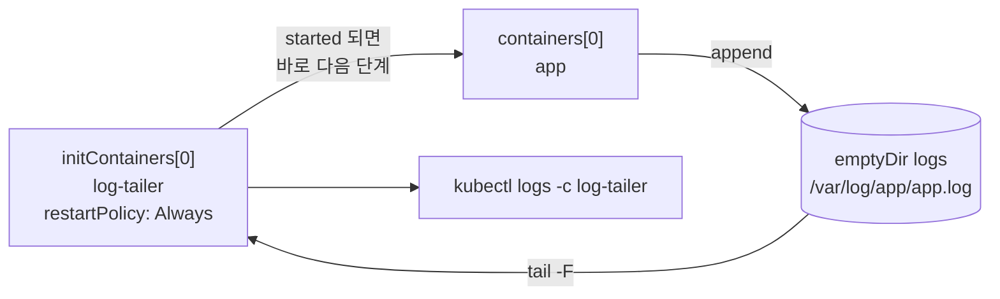

# q03 — Tail an application log with a native sidecar · 풀이

← 문제: **[question.md](question.md)**

## 문제 (해석)

**원문**

> The application in `/opt/course/e03/web-app.yaml` writes its log only to a file, so
> `kubectl logs` shows nothing useful. Add a log-shipping sidecar using the native sidecar feature.
>
> 1. Edit `/opt/course/e03/web-app.yaml`: add a sidecar container named `log-tailer` (image
>    `busybox:1.36`) that runs `tail -F /var/log/app/app.log`. Define it as a native sidecar, i.e. as
>    an init container that keeps running for the whole life of the pod.
> 2. Mount the existing `logs` volume into `log-tailer` at `/var/log/app`.
> 3. Create the pod `web-app` in namespace `emerald` from the file and confirm that both containers
>    are ready, then write the last `5` lines of the `log-tailer` container's logs to
>    `/opt/course/e03/sidecar.log`.

**해석**

`/opt/course/e03/web-app.yaml` 의 애플리케이션은 로그를 파일에만 써서 `kubectl logs` 로는 쓸모 있는
내용이 보이지 않는다. 네이티브 사이드카 기능으로 로그 전달용 사이드카를 추가한다.

1. `/opt/course/e03/web-app.yaml` 을 고쳐 `tail -F /var/log/app/app.log` 를 실행하는 사이드카
   컨테이너 `log-tailer`(이미지 `busybox:1.36`)를 넣는다. 네이티브 사이드카, 즉 파드가 살아 있는
   동안 계속 실행되는 init 컨테이너로 정의한다.
2. 기존 볼륨 `logs` 를 `log-tailer` 의 `/var/log/app` 에 마운트한다.
3. 이 파일로 `emerald` 네임스페이스에 파드 `web-app` 을 만들고 두 컨테이너가 모두 ready 인지
   확인한 뒤, `log-tailer` 컨테이너 로그의 마지막 `5` 줄을 `/opt/course/e03/sidecar.log` 에 쓴다.

## 모범 풀이

**1) 사이드카는 `initContainers` 에 `restartPolicy: Always` 로 넣습니다**

```bash
vi /opt/course/e03/web-app.yaml
```

```yaml
apiVersion: v1
kind: Pod
metadata:
  name: web-app
  namespace: emerald
spec:
  initContainers:                 # 추가한 부분
  - name: log-tailer
    image: busybox:1.36
    restartPolicy: Always         # 이 한 줄이 "네이티브 사이드카" 표시
    command: ["sh", "-c", "tail -F /var/log/app/app.log"]
    volumeMounts:
    - name: logs
      mountPath: /var/log/app
  containers:                     # 기존 그대로
  - name: app
    image: busybox:1.36
    command: ["sh", "-c", "i=0; while true; do echo \"$(date) request $i\" >> /var/log/app/app.log; i=$((i+1)); sleep 2; done"]
    volumeMounts:
    - name: logs
      mountPath: /var/log/app
  volumes:
  - name: logs
    emptyDir: {}
```

`restartPolicy: Always` 가 없는 init 컨테이너는 끝날 때까지 기다리는 보통 init 컨테이너입니다.
`tail -F` 는 끝나지 않으므로 앱 컨테이너가 영원히 시작하지 못하고 파드는 `Init:0/1` 에 멈춥니다.
`restartPolicy: Always` 가 붙으면 kubelet 은 사이드카가 **시작**되면 다음 단계로 넘어가고, 사이드카는
앱과 함께 계속 돕니다.

`tail -f` 대신 `-F` 를 쓰는 이유: 사이드카가 앱보다 먼저 떠서 아직 파일이 없을 수 있습니다. `-F` 는
파일이 생길 때까지 다시 시도합니다.

**2) 같은 `logs` 볼륨을 같은 경로에 마운트합니다** — 위 YAML 의 `volumeMounts`. emptyDir 은 파드
안의 모든 컨테이너가 공유하므로 앱이 쓴 파일을 사이드카가 그대로 읽습니다.

**3) 생성, 확인, 로그 저장**

```bash
kubectl apply -f /opt/course/e03/web-app.yaml
kubectl -n emerald wait --for=condition=Ready pod/web-app --timeout=60s
kubectl -n emerald get pod web-app                    # READY 2/2
sleep 12
kubectl -n emerald logs web-app -c log-tailer --tail=5 > /opt/course/e03/sidecar.log
```

컨테이너가 둘이면 `-c` 를 빼면 기본 컨테이너(`app`)의 로그가 나옵니다. `app` 의 stdout 은 비어
있으므로 반드시 `-c log-tailer` 를 줍니다. 파드는 이미 만든 뒤에는 initContainers 를 추가할 수 없으니,
잘못 만들었으면 `kubectl replace --force -f` 로 다시 만듭니다.

### 그림 — 네이티브 사이드카의 기동 순서



1. 파드가 시작하면 init 컨테이너 단계에서 `log-tailer` 가 먼저 뜹니다. `restartPolicy: Always` 라서
   종료를 기다리지 않고 "시작됨"만 확인한 뒤 앱 컨테이너로 넘어갑니다.
2. `app` 이 emptyDir 의 `app.log` 에 줄을 덧붙이고, `log-tailer` 가 그 파일을 따라 읽어 자기 stdout 에 냅니다.
3. kubelet 은 컨테이너 stdout 을 저장하므로 `kubectl logs -c log-tailer` 로 앱 로그를 볼 수 있습니다.
4. 파드가 끝날 때는 앱 컨테이너가 먼저 멈추고 사이드카는 그 뒤에 멈춥니다. Job 파드에서도 사이드카가 Job 완료를 막지 않습니다.

## 검증

```bash
kubectl -n emerald get pod web-app
# NAME      READY   STATUS    RESTARTS   AGE
# web-app   2/2     Running   0          30s
kubectl -n emerald get pod web-app -o jsonpath='{.spec.initContainers[0].name} {.spec.initContainers[0].restartPolicy}{"\n"}'
# log-tailer Always
kubectl -n emerald get pod web-app -o jsonpath='{.status.initContainerStatuses[0].ready} {.status.initContainerStatuses[0].started}{"\n"}'
# true true
wc -l < /opt/course/e03/sidecar.log                 # 5
cat /opt/course/e03/sidecar.log
# Sat Oct 24 01:02:03 UTC 2026 request 3
# ...
```

## 오답 원인 / 배운 점

- **왜 틀렸나**:
- **기억할 것**: 네이티브 사이드카 = `initContainers` + `restartPolicy: Always`. 로그는 `kubectl logs <pod> -c <sidecar>`.
- **헷갈리는 지점**: 사이드카를 `containers` 에 두 번째 컨테이너로 넣어도 로그는 보이지만 문제는 "native sidecar"를 요구합니다. 네이티브 사이드카는 v1.33 에서 GA 가 되었고, READY 칸에도 사이드카가 포함되어 `2/2` 로 셉니다. `restartPolicy` 는 컨테이너 단위 필드로 init 컨테이너에서만 `Always` 를 쓸 수 있습니다(파드의 `spec.restartPolicy` 와 다릅니다).

## 참고 문서

- 검색어: `sidecar containers`, `init containers`
- https://kubernetes.io/docs/concepts/workloads/pods/sidecar-containers/
- https://kubernetes.io/docs/concepts/cluster-administration/logging/#sidecar-container-with-logging-agent

---

[↑ 문항 목록](../README.md) · [← 문제로](question.md) · [다음 문제 q04 →](../q04_blue_green_service_switch/question.md)
