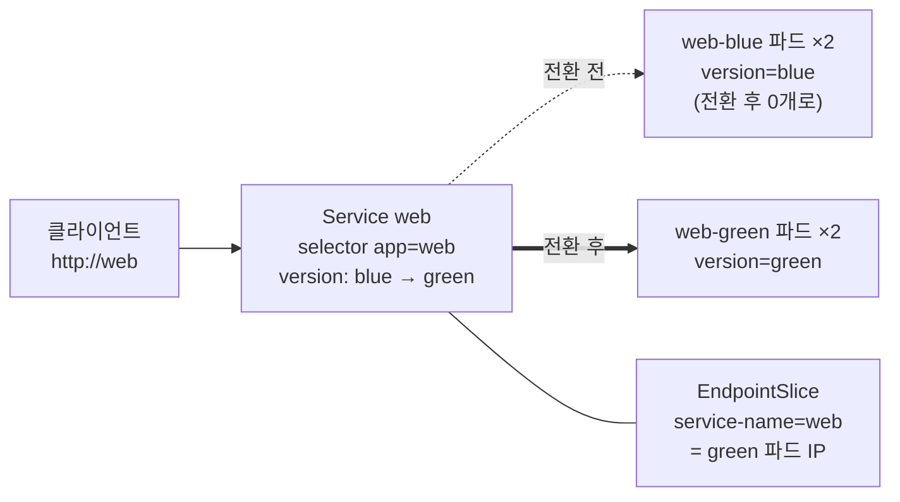

# q04 — Switch a Service from blue to green · 풀이

← 문제: **[question.md](question.md)**

## 문제 (해석)

**원문**

> Namespace `topaz` runs two versions of the same application side by side: Deployment `web-blue`
> (version `blue`) and Deployment `web-green` (version `green`). Service `web` currently sends all
> traffic to blue. Perform a blue/green switch.
>
> 1. Change Service `web` so that it selects only the pods with labels `app=web` and
>    `version=green`. Do not modify either Deployment.
> 2. Confirm with the Service's EndpointSlice that its endpoints are now exactly the IPs of the
>    `web-green` pods, and write those endpoint IPs, one per line, to `/opt/course/e04/endpoints.txt`.
> 3. From a temporary pod using image `curlimages/curl:8.10.1`, request `http://web` and write the
>    response body to `/opt/course/e04/response.txt` (it must contain `green`).
> 4. Scale Deployment `web-blue` to `0` replicas so that only green keeps running.

**해석**

`topaz` 네임스페이스에는 같은 애플리케이션의 두 버전이 나란히 돌고 있다. Deployment `web-blue`
(버전 `blue`)와 Deployment `web-green`(버전 `green`)이다. Service `web` 은 지금 모든 트래픽을 blue 로
보낸다. blue/green 전환을 한다.

1. Service `web` 이 라벨 `app=web`, `version=green` 인 파드만 고르도록 바꾼다. 두 Deployment 는
   수정하지 않는다.
2. Service 의 EndpointSlice 로 엔드포인트가 이제 정확히 `web-green` 파드들의 IP 인지 확인하고, 그
   엔드포인트 IP 를 한 줄에 하나씩 `/opt/course/e04/endpoints.txt` 에 쓴다.
3. 이미지 `curlimages/curl:8.10.1` 을 쓰는 임시 파드에서 `http://web` 을 요청하고 응답 본문을
   `/opt/course/e04/response.txt` 에 쓴다(`green` 이 들어 있어야 한다).
4. green 만 남도록 Deployment `web-blue` 를 `0` 레플리카로 줄인다.

## 모범 풀이

**0) 현재 상태부터 봅니다**

```bash
kubectl -n topaz get deploy,svc -o wide
kubectl -n topaz get pods -L version -o wide
kubectl -n topaz get svc web -o jsonpath='{.spec.selector}{"\n"}'
# {"app":"web","version":"blue"}
```

**1) Service selector 만 바꿉니다**

```bash
kubectl -n topaz patch svc web -p '{"spec":{"selector":{"version":"green"}}}'
# 또는 셀렉터 전체를 새로 지정
kubectl -n topaz set selector svc web 'app=web,version=green'
```

`patch` (strategic merge)는 `selector` 맵의 `version` 키만 바꾸고 `app` 은 남깁니다.
`kubectl set selector` 는 셀렉터를 **통째로 교체**하므로 `version=green` 만 주면 `app=web` 이
사라집니다. 두 키를 다 적어야 합니다. 이 전환은 Service 하나만 바꾸므로 순간적으로 트래픽이 넘어가고,
되돌릴 때도 selector 를 blue 로 돌리면 끝입니다.

**2) EndpointSlice 로 확인하고 IP 를 기록합니다**

```bash
kubectl -n topaz get endpointslice -l kubernetes.io/service-name=web
# NAME        ADDRESSTYPE   PORTS   ENDPOINTS                 AGE
# web-x7k2p   IPv4          5678    10.0.1.23,10.0.2.31       5m
kubectl -n topaz get pods -l app=web,version=green -o wide        # IP 가 위와 같다

kubectl -n topaz get endpointslice -l kubernetes.io/service-name=web \
  -o jsonpath='{range .items[*].endpoints[*]}{.addresses[0]}{"\n"}{end}' > /opt/course/e04/endpoints.txt
```

`kubectl get endpoints` 는 v1.33 부터 deprecated 경고가 납니다. Service 와 EndpointSlice 는
`kubernetes.io/service-name` 라벨로 연결됩니다.

**3) 클러스터 안에서 요청합니다**

```bash
kubectl -n topaz run tmp --rm -i --restart=Never --image=curlimages/curl:8.10.1 \
  -- curl -s http://web > /opt/course/e04/response.txt
cat /opt/course/e04/response.txt
# green
# pod "tmp" deleted        ← kubectl 버전에 따라 이 줄이 함께 들어갈 수 있다(무해)
```

Service 이름 `web` 은 같은 네임스페이스의 파드에서만 짧은 이름으로 풀립니다. 그래서 임시 파드를
반드시 `-n topaz` 로 띄웁니다.

**4) blue 를 내립니다**

```bash
kubectl -n topaz scale deploy web-blue --replicas=0
```

전환이 확인된 뒤에 줄입니다. 먼저 줄이면 selector 를 바꾸기 전까지 Service 에 엔드포인트가 없어
요청이 실패합니다.

### 그림 — selector 하나로 넘어가는 blue/green



1. 두 Deployment 는 항상 함께 떠 있고, 어느 쪽이 트래픽을 받는지는 Service selector 만 결정합니다.
2. selector 의 `version` 을 `green` 으로 바꾸면 EndpointSlice 컨트롤러가 엔드포인트를 green 파드 IP 로 다시 채웁니다.
3. 새 연결은 곧바로 green 으로 갑니다. 문제가 생기면 selector 를 `blue` 로 되돌리는 것이 롤백입니다.
4. 전환이 확정되면 blue 를 0 으로 줄여 자원을 돌려줍니다.

## 검증

```bash
kubectl -n topaz get svc web -o jsonpath='{.spec.selector}{"\n"}'
# {"app":"web","version":"green"}
kubectl -n topaz get endpointslice -l kubernetes.io/service-name=web
kubectl -n topaz get pods -l version=green -o jsonpath='{range .items[*]}{.status.podIP}{"\n"}{end}' | sort > /tmp/green.txt
sort /opt/course/e04/endpoints.txt | diff - /tmp/green.txt && echo same     # same
grep -c green /opt/course/e04/response.txt                                    # 1
kubectl -n topaz get deploy
# NAME        READY   UP-TO-DATE   AVAILABLE   AGE
# web-blue    0/0     0            0           6m
# web-green   2/2     2            2           6m
```

## 오답 원인 / 배운 점

- **왜 틀렸나**:
- **기억할 것**: blue/green 은 Deployment 를 건드리지 않고 Service selector 만 바꾼다. `set selector` 는 셀렉터 전체 교체.
- **헷갈리는 지점**: `kubectl set selector svc web version=green` 처럼 키 하나만 주면 `app=web` 이 지워져 version=green 라벨을 가진 다른 앱 파드까지 잡을 수 있습니다. 엔드포인트 확인은 `get ep` 대신 `get endpointslice -l kubernetes.io/service-name=web`(Endpoints API 는 v1.33 deprecated).

## 참고 문서

- 검색어: `service selector`, `endpointslices`, `kubectl set selector`
- https://kubernetes.io/docs/concepts/services-networking/service/
- https://kubernetes.io/docs/concepts/services-networking/endpoint-slices/
- https://kubernetes.io/docs/reference/kubectl/generated/kubectl_set/kubectl_set_selector/

---

[↑ 문항 목록](../README.md) · [← 문제로](question.md) · [다음 문제 q05 →](../q05_helm_values_upgrade_rollback/question.md)
