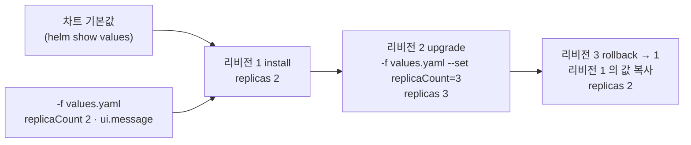

# q05 — Install, upgrade and roll back a Helm release · 풀이

← 문제: **[question.md](question.md)**

## 문제 (해석)

**원문**

> The team deploys the `podinfo` demo with Helm and wants to practise a release's full life cycle.
> A values file is ready at `/opt/course/e05/values.yaml`.
>
> 1. Add the chart repository `podinfo` at `https://stefanprodan.github.io/podinfo` and write the
>    default values of chart `podinfo/podinfo` to `/opt/course/e05/default-values.yaml`.
> 2. Install release `podinfo` from chart `podinfo/podinfo` into namespace `opal` using the values
>    file `/opt/course/e05/values.yaml`.
> 3. Upgrade the release so that it runs `3` replicas while keeping every other value from the
>    values file.
> 4. Roll the release back to revision `1`, then write the output of `helm history` for the release
>    to `/opt/course/e05/history.txt`. The Deployment must run `2` replicas again.

**해석**

팀은 `podinfo` 데모를 Helm 으로 배포하며 릴리스의 전체 생명주기를 연습하려 한다. values 파일이
`/opt/course/e05/values.yaml` 에 준비되어 있다.

1. `https://stefanprodan.github.io/podinfo` 를 차트 저장소 `podinfo` 로 추가하고, 차트
   `podinfo/podinfo` 의 기본값을 `/opt/course/e05/default-values.yaml` 에 쓴다.
2. values 파일 `/opt/course/e05/values.yaml` 을 써서 차트 `podinfo/podinfo` 로 릴리스 `podinfo` 를
   `opal` 네임스페이스에 설치한다.
3. values 파일의 다른 값은 모두 유지한 채, `3` 레플리카로 돌도록 릴리스를 업그레이드한다.
4. 릴리스를 리비전 `1` 로 롤백한 뒤, 이 릴리스의 `helm history` 출력을
   `/opt/course/e05/history.txt` 에 쓴다. Deployment 는 다시 `2` 레플리카로 돌아야 한다.

## 모범 풀이

**1) 저장소 추가와 기본값 저장**

```bash
helm repo add podinfo https://stefanprodan.github.io/podinfo
helm repo update
helm show values podinfo/podinfo > /opt/course/e05/default-values.yaml
grep -nE '^replicaCount|^ui:' -A2 /opt/course/e05/default-values.yaml
cat /opt/course/e05/values.yaml
```

`helm show values` 는 **차트에 들어 있는 기본값**(chart 의 values.yaml)입니다. 설치된 릴리스에 준 값은
`helm get values` 로 봅니다. 둘을 헷갈리지 않습니다.

**2) values 파일로 설치**

```bash
helm install podinfo podinfo/podinfo -n opal -f /opt/course/e05/values.yaml
kubectl -n opal rollout status deploy podinfo
```

namespace `opal` 은 이미 있으므로 `--create-namespace` 는 필요 없습니다(붙여도 해롭지는 않습니다).

**3) 레플리카만 바꾸는 업그레이드**

```bash
helm upgrade podinfo podinfo/podinfo -n opal -f /opt/course/e05/values.yaml --set replicaCount=3
# 또는: helm upgrade podinfo podinfo/podinfo -n opal --reuse-values --set replicaCount=3
kubectl -n opal get deploy podinfo        # 3/3
```

`helm upgrade` 에 `--set` 만 주고 `-f` 나 `--reuse-values` 를 빼면 Helm 은 이전 사용자 값을 버리고 차트
기본값 위에 `replicaCount=3` 만 얹습니다. 그러면 `ui.message` 가 기본값으로 돌아가 "다른 값 유지"
조건이 깨집니다. 같은 키가 `-f` 와 `--set` 에 모두 있으면 `--set` 이 이깁니다.

**4) 롤백과 히스토리 기록**

```bash
helm rollback podinfo 1 -n opal
helm history podinfo -n opal > /opt/course/e05/history.txt
kubectl -n opal rollout status deploy podinfo
```

롤백은 히스토리를 되감는 것이 아니라 **리비전 1 의 설정으로 새 리비전 3 을 만드는** 동작입니다.

### 그림 — 리비전 흐름과 값의 우선순위



1. 렌더링에 쓰는 값은 "차트 기본값 < `-f` 파일 < `--set`" 순서로 덮어씁니다.
2. 리비전 2 는 같은 values 파일에 `--set replicaCount=3` 을 더해 레플리카만 3 이 되고 `ui.message` 는 그대로입니다.
3. `helm rollback podinfo 1` 은 리비전 1 의 차트와 값을 그대로 복사해 **리비전 3** 을 만듭니다. 그래서 히스토리는 3줄이고 마지막 DESCRIPTION 은 `Rollback to 1` 입니다.

## 검증

```bash
helm history podinfo -n opal          # (일부 열 생략)
# REVISION  STATUS      CHART           DESCRIPTION
# 1         superseded  podinfo-6.x.y   Install complete
# 2         superseded  podinfo-6.x.y   Upgrade complete
# 3         deployed    podinfo-6.x.y   Rollback to 1
grep -c 'Rollback to 1' /opt/course/e05/history.txt     # 1
grep -q '^replicaCount' /opt/course/e05/default-values.yaml && echo ok   # ok
helm get values podinfo -n opal       # values.yaml 의 값 (replicaCount: 2, ui.message)
kubectl -n opal get deploy podinfo
# NAME      READY   UP-TO-DATE   AVAILABLE   AGE
# podinfo   2/2     2            2           3m
```

## 오답 원인 / 배운 점

- **왜 틀렸나**:
- **기억할 것**: `helm show values` = 차트 기본값, `helm get values` = 릴리스 값. rollback 은 새 리비전을 만든다.
- **헷갈리는 지점**: upgrade 에 `--set` 만 주면 이전 값이 사라집니다. `-f` 를 다시 주거나 `--reuse-values` 를 씁니다. Helm 4(2025.11)에서도 `install`/`upgrade`/`rollback`/`history` 는 그대로이고, `--atomic` 만 `--rollback-on-failure` 로 이름이 바뀌었습니다. Bitnami 무료 차트가 줄어든 뒤라 연습용 차트는 podinfo 처럼 직접 관리되는 저장소를 씁니다.

## 참고 문서

- 검색어: `helm rollback`, `helm show values`, `helm upgrade`
- https://helm.sh/docs/helm/helm_rollback/
- https://helm.sh/docs/helm/helm_show_values/
- https://helm.sh/docs/helm/helm_upgrade/

---

[↑ 문항 목록](../README.md) · [← 문제로](question.md) · [다음 문제 q06 →](../q06_kustomize_configmap_patch/question.md)
