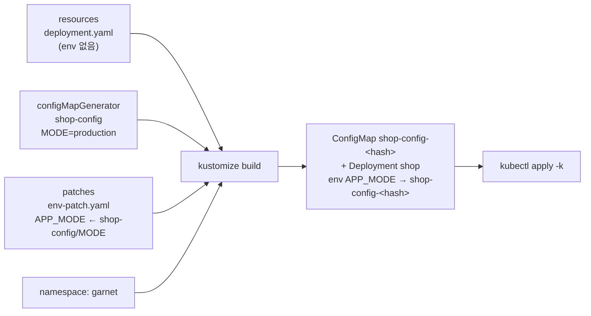

# q06 — Kustomize a ConfigMap generator and an env patch · 풀이

← 문제: **[question.md](question.md)**

## 문제 (해석)

**원문**

> The Kustomize directory `/opt/course/e06/` deploys Deployment `shop` into namespace `garnet`.
> Extend it without editing `deployment.yaml`.
>
> 1. In `/opt/course/e06/kustomization.yaml`, add a `configMapGenerator` that creates a ConfigMap
>    named `shop-config` with the literal `MODE=production`.
> 2. Create the strategic-merge patch file `/opt/course/e06/env-patch.yaml` that adds the
>    environment variable `APP_MODE` to container `shop`, taking its value from key `MODE` of
>    ConfigMap `shop-config`. Reference the patch with the `patches:` field.
> 3. Write the rendered output of the directory to `/opt/course/e06/rendered.yaml`, then apply the
>    directory with `kubectl apply -k` and confirm that `APP_MODE=production` is set inside the
>    running `shop` pod.

**해석**

Kustomize 디렉터리 `/opt/course/e06/` 은 Deployment `shop` 을 `garnet` 네임스페이스에 배포한다.
`deployment.yaml` 은 고치지 않고 이 디렉터리를 확장한다.

1. `/opt/course/e06/kustomization.yaml` 에 리터럴 `MODE=production` 으로 ConfigMap `shop-config` 를
   만드는 `configMapGenerator` 를 추가한다.
2. 컨테이너 `shop` 에 환경 변수 `APP_MODE` 를 추가하는 strategic-merge 패치 파일
   `/opt/course/e06/env-patch.yaml` 을 만든다. 값은 ConfigMap `shop-config` 의 키 `MODE` 에서 가져온다.
   패치는 `patches:` 필드로 참조한다.
3. 디렉터리를 렌더링한 결과를 `/opt/course/e06/rendered.yaml` 에 쓰고, `kubectl apply -k` 로
   디렉터리를 적용한 뒤 실행 중인 `shop` 파드 안에 `APP_MODE=production` 이 설정되었는지 확인한다.

## 모범 풀이

**0) 디렉터리 구성 확인**

```bash
cd /opt/course/e06 && ls && cat kustomization.yaml deployment.yaml
```

**1) configMapGenerator 추가**

```yaml
# /opt/course/e06/kustomization.yaml
apiVersion: kustomize.config.k8s.io/v1beta1
kind: Kustomization
namespace: garnet
resources:
- deployment.yaml
configMapGenerator:
- name: shop-config
  literals:
  - MODE=production
patches:
- path: env-patch.yaml
```

generator 가 만드는 ConfigMap 의 실제 이름은 `shop-config-<해시>` 입니다. 내용이 바뀌면 해시가 바뀌어
Deployment 의 파드 템플릿도 바뀌고, 그래서 설정 변경이 자동으로 롤아웃됩니다.

**2) strategic-merge 패치**

```yaml
# /opt/course/e06/env-patch.yaml
apiVersion: apps/v1
kind: Deployment
metadata:
  name: shop
spec:
  template:
    spec:
      containers:
      - name: shop              # 이름으로 기존 컨테이너에 합쳐진다
        env:
        - name: APP_MODE
          valueFrom:
            configMapKeyRef:
              name: shop-config # 해시 없는 이름으로 쓴다
              key: MODE
```

strategic merge 는 `containers` 리스트를 `name` 키로 합칩니다. 그래서 패치에는 바꿀 컨테이너의 `name`
과 추가할 필드만 적으면 됩니다. `configMapKeyRef.name` 에는 해시 없는 `shop-config` 를 쓰면
kustomize 가 생성된 이름(`shop-config-<해시>`)으로 바꿔 줍니다.

Kustomize v5 에서 `patchesStrategicMerge:` 는 deprecated 입니다. `patches:` 에 `path:` 로 넣으면
파일 내용을 보고 strategic merge 패치인지 JSON 6902 패치인지 알아서 판단합니다.

**3) 렌더링, 적용, 확인**

```bash
kubectl kustomize /opt/course/e06 > /opt/course/e06/rendered.yaml
grep -n 'shop-config' /opt/course/e06/rendered.yaml     # ConfigMap 과 configMapKeyRef 가 같은 해시 이름
kubectl apply -k /opt/course/e06
kubectl -n garnet rollout status deploy shop
kubectl -n garnet exec deploy/shop -- printenv APP_MODE   # production
```

### 그림 — kustomize 가 하나로 합치는 과정



1. `resources` 의 원본 Deployment 를 읽습니다. 원본 파일은 바뀌지 않습니다.
2. generator 가 ConfigMap 을 만들고 내용 해시를 이름 끝에 붙입니다.
3. 패치가 `name: shop` 컨테이너에 env 를 합치고, kustomize 의 이름 참조 기능이 `configMapKeyRef` 의 이름을 해시가 붙은 이름으로 바꿉니다.
4. `namespace: garnet` 이 모든 리소스에 붙은 뒤 하나의 YAML 스트림이 되어 `apply -k` 로 적용됩니다.

## 검증

```bash
cat /opt/course/e06/kustomization.yaml          # configMapGenerator, patches: - path: env-patch.yaml
grep -c 'kind: ConfigMap' /opt/course/e06/rendered.yaml    # 1
kubectl -n garnet get cm
# NAME                     DATA   AGE
# kube-root-ca.crt         1      2m
# shop-config-5k2m8t9c7h   1      1m
kubectl -n garnet get deploy shop -o jsonpath='{.spec.template.spec.containers[0].env[0].valueFrom.configMapKeyRef.name}{"\n"}'
# shop-config-5k2m8t9c7h     (해시는 다를 수 있다)
kubectl -n garnet exec deploy/shop -- printenv APP_MODE
# production
```

## 오답 원인 / 배운 점

- **왜 틀렸나**:
- **기억할 것**: Kustomize v5 는 `patches: - path: <file>` 하나로 SMP·JSON 패치를 모두 받는다. generator 이름에는 해시가 붙는다.
- **헷갈리는 지점**: `patchesStrategicMerge`, `commonLabels` 는 v5 에서 deprecated(`patches`, `labels` 로 대체). `kubectl apply -f` 로 디렉터리를 적용하면 kustomization.yaml 이 무시되고 원본 yaml 만 적용되므로 반드시 `-k` 입니다. 패치의 `metadata.name` 이 원본과 다르면 "no matches for Id" 에러가 납니다.

## 참고 문서

- 검색어: `kustomize`, `configMapGenerator`, `kustomization patches`
- https://kubernetes.io/docs/tasks/manage-kubernetes-objects/kustomization/
- https://kubernetes.io/docs/tasks/configure-pod-container/configure-pod-configmap/

---

[↑ 문항 목록](../README.md) · [← 문제로](question.md) · [다음 문제 q07 →](../q07_startup_liveness_probe/question.md)
